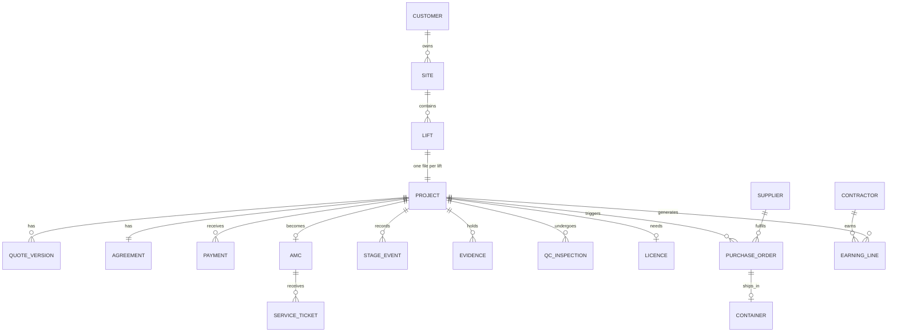
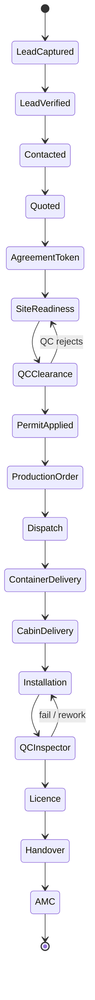
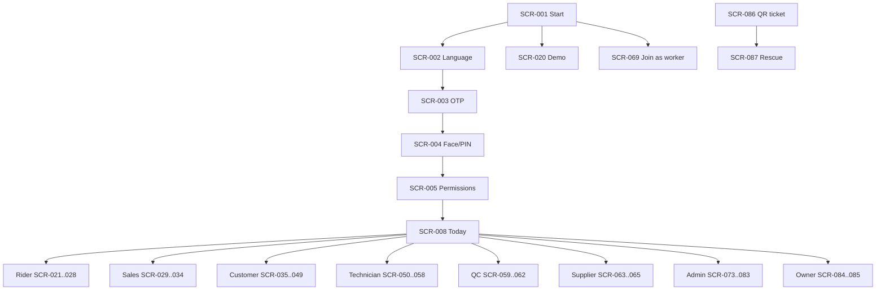
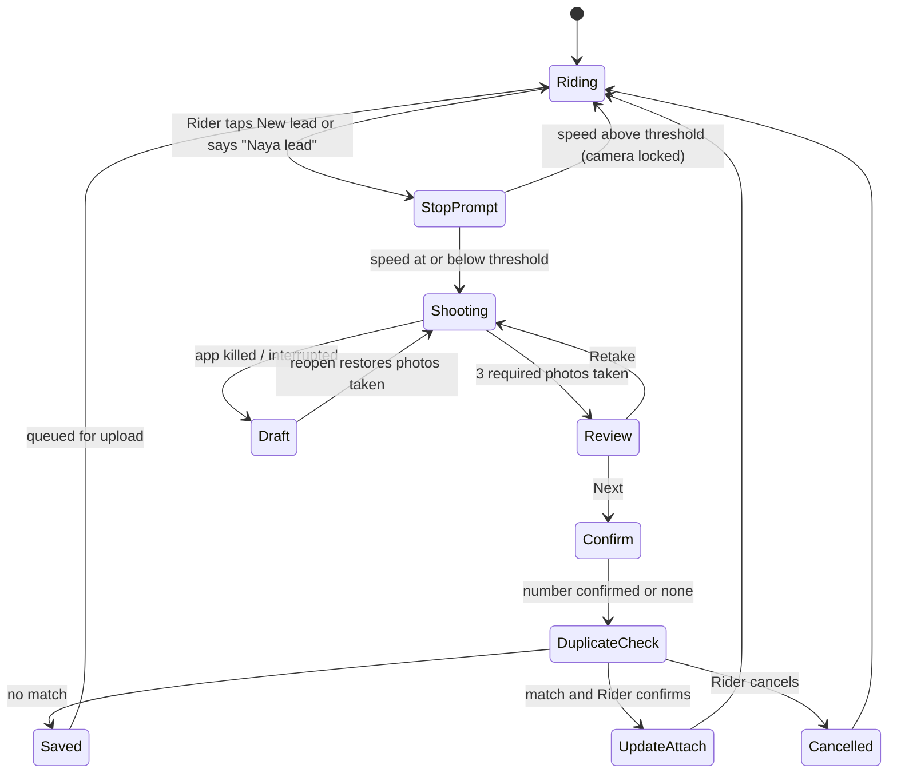
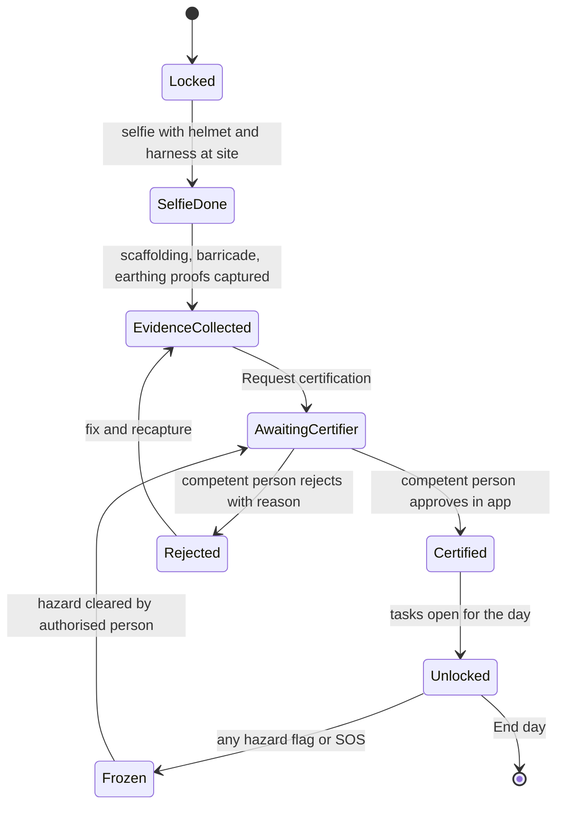
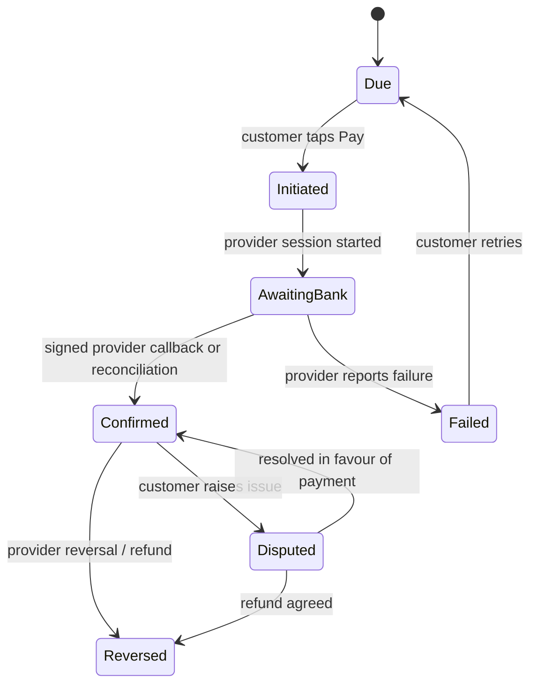

# AIEC ELEVATOR OS — MASTER SPECIFICATION (FINAL DRAFT FOR OWNER REVIEW)

**ALL INDIA ELEVATORS COMPANY (AIEC)** · Mobile-first, role-based, workflow-driven elevator business operating system

> **Status of this document:** a specification, not an application. Nothing here claims that any feature is built, any test has passed, any provider is connected, or any legal/safety approval is obtained. Items marked ⚖️ need a qualified professional; items marked ⚠️ need an owner decision.

**How to read the tags used throughout**

| Tag | Meaning |
|---|---|
| SOURCE REQUIREMENT | Present in the supplied files (traceability matrix shows exact source section) |
| VERIFIED EXTERNAL REQUIREMENT | Supported by an authoritative source opened during research (register in section 5) |
| PROPOSED IMPROVEMENT | Recommended enhancement, not in the sources |
| INFERENCE | Reasonable reading not explicitly stated |
| OWNER DECISION REQUIRED | Business choice only the owner can make (section 40) |
| LEGAL/SAFETY REVIEW REQUIRED | Needs lawyer, CA, licensed lift engineer or regulator |
| EXTERNAL INTEGRATION REQUIRED | Depends on a provider not yet selected or connected |
| UNVERIFIED | Research inconclusive or not performed |

---

## 1. Document control and version

| Item | Value |
|---|---|
| Document | AIEC_ELEVATOR_OS_MASTER_SPECIFICATION_FINAL.md |
| Version | 1.0 (draft for owner review) |
| Prepared | 25 October 2026 |
| Inputs | `AIEC_Elevator_OS_Research_Enhanced_Blueprint.md` (abbrev. **BP**), `OCT_FILE.TXT` (the file named "OCT FILE(3).TXT" in the brief; abbrev. **OCT**), `ALL_INDIA_ELEVATORS_COMPANY___App_Build_Spec_v3.md` (abbrev. **V3**) |
| Source files | Read completely: 3 of 3. Originals not modified |
| Not an input | The master brief itself (abbrev. **MP**) is the instruction set, not a requirements source |
| Repository | No application repository was supplied or inspected; "existing code" constraints could not be assessed (**limitation**) |

**Conflict priority (carried from BP §2):** 1 statutory and physical-safety requirements confirmed by qualified professionals → 2 signed agreements and payment-provider rules → 3 approved AIEC master configuration → 4 state machine and permission matrix → 5 UI copy or AI suggestions. The software never silently resolves a conflict; it raises a visible exception for the responsible human.

## 2. Executive summary

AIEC is an asset-light platform that finds lift-ready construction sites (Riders), sells (Sales bot and Negotiator), contracts and collects money through milestones, procures from suppliers in a GPS container, installs with independent contractors (Technicians) working to a strict proof-based SOP, inspects (QC and the statutory Electrical Inspector), hands over, and then runs AMC.

The three sources agree on the spine and disagree on several money and safety details. This specification therefore:

1. Keeps **one Project record per Lift** under a Site, with one server-enforced state machine of **16 stages** plus side states.
2. Treats **evidence, money, and safety** as three locks: proof captured only by the in-app camera; payment status only from a verified provider callback; safety-critical sign-off only by a qualified human.
3. Lists **32 owner/professional decisions** (section 40) — none are silently chosen. Where a recommended default exists it is labelled and configurable.
4. Gives every screen and module a visual and interaction specification suitable for an inexpensive Android phone, Marathi-first.
5. Provides a traceability matrix (section 42) and a computed coverage audit (section 43).

**What the owner must do first:** answer the tier 1 and tier 2 decisions in section 40.0 (16 decisions) and obtain written opinions from a lawyer, CA, licensed lift engineer and the payment provider. Until then, payout and payment-release features stay disabled by configuration.

## 3. Product vision and measurable objectives

**Vision (SOURCE):** the app is the **manager** (assigns, tracks, nudges, escalates) and the **assistant** (speaks, fills known fields, drafts, flags gaps), never a replacement for competent human judgement where life or money is at risk.

| # | Objective | Measure | Source |
|---|---|---|---|
| O1 | No gate opens without proof | 0 stage transitions without required evidence in audit sample | V3§8 |
| O2 | No payout without verified proof and approval | 0 payouts lacking QC pass + Admin approval + provider confirmation | V3§7.5 |
| O3 | Field tasks usable without reading | ≥4 of 5 low-literacy test users finish each field task unaided | V3§11, BP§9 |
| O4 | One truth | Any dispute resolvable from the single timeline | V3§1 |
| O5 | No lift handed over for public use without licence | 0 handovers without licence record | V3§5 |
| O6 | No duplicate money events | Replayed webhooks/payout calls create 0 duplicates | BP§4.9 |
| O7 | No evidence lost | 0 captured files discarded on kill/offline | MP§12 |

Numeric business targets (leads/day, win rate, margin) are **not defined in the sources** and are not invented here (OWNER DECISION REQUIRED).

## 4. Source files and source audit

| File | Lines | Bytes | Nature | Unique contribution |
|---|---:|---:|---|---|
| OCT_FILE.TXT | 371 | 22,723 | Owner's brain dump (English, Marathi) incl. contractor module and 3 pasted prompts | Original intent, numbers (160/130/120, 10k, 70/20/10, 14 days), wording ("wallet", "kill switch") |
| ALL_INDIA_ELEVATORS_COMPANY___App_Build_Spec_v3.md | 715 | 77,217 | Builder-ready spec with 16 stages, permission matrix, money rules, trust score | Stage order, matrix, cancellation table, ladder numbers, legal checklist |
| AIEC_Elevator_OS_Research_Enhanced_Blueprint.md | 765 | 40,132 | Review and improvement blueprint | Safety/legal/financial corrections, 66-point coverage list, phases |

**Method.** Every heading, table and list in the three files was read. Requirements were extracted into a register (section 42); each row records its source file and section/topic (no invented line numbers). Overlaps were merged while keeping each distinct number, exception and condition; contradictions became decisions (section 40). Coverage maps in section 43 trace the BP 66-point list, the V3 audit fixes, and OCT items to requirement IDs.

**Observed file-level conflicts:** OCT asks for "100% instant digital wallet" and "no liability" via contractor labelling; V3 and BP say wallet needs RBI authorisation and labels do not remove duties. OCT omits any licence step; V3 inserts one before handover. These are preserved as conflicting requirements, not resolved.

## 5. Research methodology and research register

Research was run on 25 October 2026 using web search against official or primary documents wherever possible. Fetching of the India Code URL specified in the brief was **refused by the site's robots policy**; the 2017 Act text was taken from the PRS India copy instead, and a human must confirm the India Code current text (R-02).

| ID | Source | Publisher | URL | Version/date | Accessed | Finding | Effect on spec | Confidence | Tag |
|---|---|---|---|---|---|---|---|---|---|
| R-01 | Maharashtra Lifts, Escalators and Moving Walks Act, 2017 (Act 15 of 2018) | Maharashtra legislature via PRS India | https://prsindia.org/files/bills_acts/acts_states/maharashtra/2018/2018MH15.pdf | Gazette 17 Jan 2018 | 25 Oct 2026 | Act regulates construction, erection, maintenance and safe working of lifts, escalators, moving walks; defines contractor as licensed by the Chief Electrical Inspector; licence for a lift is granted under the Act | Lifecycle gates for permission, inspection and licence; licence holder stored per project | Medium (search extract only; full text not read line by line) | VERIFIED EXTERNAL REQUIREMENT |
| R-02 | India Code entry handle 123456789/15840 (user-specified) | India Code, Govt of India | https://www.indiacode.nic.in/handle/123456789/15840 | n/a | 25 Oct 2026 | Fetch was refused (site disallows automated access). Search surfaced only the repealed 1939 Act entry (handle 21983), not the 2017 Act entry | 2017 Act text taken from PRS copy; India Code must be opened manually by a human to confirm current text | Low | UNVERIFIED |
| R-03 | Maharashtra Lifts, Escalators and Moving Walks (Amendment) Bill/Act, 2026 | Maharashtra Legislature (Bill 7 of 2026) via PRS and mls.org.in; TeamLease RegTech summary 10 Mar 2026 | https://prsindia.org/files/bills_acts/bills_states/maharashtra/2026/Bill7of2026MH.pdf | Bill issued 4 Mar 2026 | 25 Oct 2026 (re-checked) | The bill adds the Superintending Engineer as an authority who exercises the powers of an Electrical Inspector in their area, substitutes designations for Electrical Inspector (Lifts) (the exact replacement wording was only partly visible in the extract), replaces the Factories Act reference with the OSH Code 2020, and sets appeals to the Chief Electrical Inspector decided within thirty days. The legislature's own page title groups it among the 2026 bills passed by the Legislative Council (title read in Marathi), which suggests passage but does not prove enactment or commencement; no commencement date found | Authority names, forms and the appeal route are configuration; enactment and commencement are confirmed by a lawyer at go-live (DEC-031) | Medium for content, Low for enactment and commencement | LEGAL/SAFETY REVIEW REQUIRED |
| R-04 | CEI Maharashtra online services | Chief Electrical Inspector, Govt of Maharashtra | https://www.ceimah.in/online-services | n/a | 25 Oct 2026 | Official portal lists services: permission for erection of lift, licence for working of lift, duplicate licence, change of ownership of licence; Bombay Lift Rules 1958 still listed | Statutory tracker uses these categories; rules to be confirmed | Medium-High | VERIFIED EXTERNAL REQUIREMENT |
| R-05 | Summary of 2017 Act key provisions | Lexplosion and Kaanoon (secondary, not authoritative) | https://lexplosion.in/?p=9228 | n/a | 25 Oct 2026 (re-checked) | Lexplosion: the owner needs Electrical Inspector (Lifts) permission to erect and contractor licence applicants need a valid electrical contractor licence under the CEA safety regulations 2010. Kaanoon (practitioner Q&A) reports that the owner must intimate the inspector within 1 month of completion and get a working licence, and gives renewal periods inconsistently (3 years in one reply, up to 5 years at a time in another) | Licence-holder decision DEC-005; licence validity, renewal lead time and the 1-month intimation are configurable values not hardcoded until read from the Act/Rules by a lawyer | Low (secondary; conflicting on renewal period) | LEGAL/SAFETY REVIEW REQUIRED |
| R-06 | Lift standards overview (IS 14665, IS 4591, IS 14671, IS 15330; NBC 2016 Part 8 Sec 5) | Elevator World India (secondary) | https://elevatorworld.com/?p=48373 | 2020 | 25 Oct 2026 | Lists BIS and NBC documents relevant to lifts; current editions not verified | SOP author must confirm applicable editions; no tolerances hardcoded | Low (secondary, edition unknown) | LEGAL/SAFETY REVIEW REQUIRED |
| R-07 | DPDP Rules 2025 phased commencement | MeitY Gazette Notification 846(E) dated 13 Nov 2025 as summarised by JSA, Conventus Law, S.S. Rana, Bar and Bench, Mondaq; PIB document | https://static.pib.gov.in/WriteReadData/specificdocs/documents/2025/nov/doc20251117695301.pdf | Notified 13 Nov 2025 (gazetted 14 Nov) | 25 Oct 2026 (re-checked) | Board provisions immediate; Consent Manager rule (Rule 4) after 12 months, 13 Nov 2026; Rules 3, 5-16, 22, 23 (notice, consent, security, breach, data-principal rights) after 18 months, 13 May 2027. JSA also reports a 7-year retention requirement for consent records. Secondary sources disagree on whether the SPDI Rules 2011 continue until May 2027 (Mondaq: yes; Bar and Bench: they should stand repealed) | Consent notices, retention and breach workflows built now; consent-record retention of 7 years to be confirmed; SPDI position left to counsel | High for dates (several sources agree), Low-Medium on SPDI and retention detail | LEGAL/SAFETY REVIEW REQUIRED |
| R-08 | Code on Social Security 2020 and Social Security (Central) Rules 2026: gig/platform workers and aggregators | PIB backgrounder (9 Dec 2025); Taxmann; IMPRI; KSMG, Indian HRM, Key4Comply (secondary summaries) | https://www.pib.gov.in/PressReleasePage.aspx?PRID=2200767&reg=3&lang=1 | Code in force 21 Nov 2025; Rules notified 8 May 2026 | 25 Oct 2026 (re-checked) | Aggregator contribution is 1-2% of annual turnover (excluding taxes/cess), capped at 5% of amounts paid or payable to gig workers (s.114(4)); the rate and the start date (s.114(5)) were still not notified per sources dated up to three days before this check. Registration and reporting duties are already in force: aggregators register on the government portal and register each worker in real time or daily (Rule 48(2)(c), per Taxmann); late contributions carry 12% annual interest; filing form dates are reported inconsistently. Whether AIEC is a covered aggregator category is unverified | Placeholder cost line for the contribution; if AIEC is a covered aggregator, onboarding must capture portal registration data and report worker joins/exits daily (REQ GIG_REGISTRATION); counsel decides applicability | Medium-High for contribution status, Medium for registration duties (secondary summaries of the Rules) | LEGAL/SAFETY REVIEW REQUIRED |
| R-09 | OWASP Application Security Verification Standard 5.0.0 | OWASP | https://github.com/OWASP/ASVS | 5.0.0 (May 2025) | 25 Oct 2026 | Latest stable ASVS is 5.0.0; identifiers should cite version e.g. v5.0.0-x.y.z | ASVS 5.0.0 is the web/API verification baseline; MASVS/MASTG for mobile taken from source BP, not re-fetched | High | VERIFIED EXTERNAL REQUIREMENT |
| R-10 | Razorpay Route transfers and settlement hold | Razorpay docs | https://razorpay.com/docs/payments/route/schedule-settlement.md | n/a | 25 Oct 2026 (re-checked) | Route transfers are INR only and only on captured payments. A transfer can be created with on_hold true, which puts the settlement to the linked account on hold indefinitely or until an on_hold_until timestamp; it can be modified before settlement, and a held transfer does not settle even when the normal schedule (for example T+10) passes. The documentation describes this as settlement hold, not as escrow | Hold/release is available as a mechanism, but it is not stated to be a regulated escrow; legal escrow, milestone limits and refund after split must be confirmed in writing | Medium | EXTERNAL INTEGRATION REQUIRED |
| R-11 | WhatsApp Business Platform: pricing updates, customer service window, templates, opt-in | Meta for Developers (pricing updates page, official) plus 360dialog, Vonage, Rasayel and Gallabox (secondary) for policy detail | https://developers.secure.facebook.com/docs/whatsapp/pricing/updates-to-pricing | Per-message pricing rolled out in phases from 1 Apr 2025, pricing object from 1 Jul 2025 | 25 Oct 2026 (re-checked) | Official page: businesses are charged per delivered marketing template message and per delivered authentication template message, and per delivered utility template message when sent outside a customer service window; utility templates inside the 24-hour window are free; user-initiated messages open a 24-hour window in which any message type may be sent; free-entry-point (ad or page button) conversations open a 72-hour free window. Secondary sources: free-form messages only inside the window, approved templates otherwise, opt-in required, automation must offer a human route. The Meta messaging-policy page itself was not opened | Outreach is template-first with per-contact cost recorded (cost field in the outreach record); opt-in, opt-out and human hand-off rules stay as written; prices per message are provider-quoted and not assumed | Medium-High for pricing and window rules (official page), Medium for opt-in and policy detail (secondary) | EXTERNAL INTEGRATION REQUIRED |
| R-12 | Android foreground service background-start and type restrictions | Android Developers | https://developer.android.com/develop/background-work/services/fgs/restrictions-bg-start | Android 12-15 notes | 25 Oct 2026 | Apps targeting Android 12+ cannot start foreground services from background except listed exemptions; Android 14 requires declared types and matching permissions; location service type needs location permissions | Tracking starts when the user taps Start day with app visible; no unkillable promise | High | VERIFIED EXTERNAL REQUIREMENT |
| R-13 | WCAG 2.2 What's new | W3C WAI | https://www.w3.org/WAI/standards-guidelines/wcag/new-in-22/ | W3C Recommendation 5 Oct 2023 | 25 Oct 2026 | SC 2.5.8 requires targets at least 24x24 CSS px (AA) with exceptions; 2.5.7 requires non-drag alternative; 2.4.11 focus not obscured; 3.3.8 accessible authentication | AIEC sets 48 dp field targets above the AA minimum; OTP login avoids cognitive tests | High | VERIFIED EXTERNAL REQUIREMENT |
| R-14 | Supabase Row Level Security | Supabase docs | https://supabase.com/docs/guides/database/postgres/row-level-security | n/a | 25 Oct 2026 | Enable RLS on every table in exposed schemas; service-role key bypasses RLS and must stay server-side; views bypass RLS by default | Every table has RLS; service key never in clients; views use security-invoker or are avoided | High | VERIFIED EXTERNAL REQUIREMENT |
| R-15 | V3 external links carried over (Razorpay Route page, Setu eSign/eStamp, Vinod Kothari stamp-duty note, TeamLease) | Various | https://docs.setu.co/data/esign/estamp | n/a | Not re-opened | Cited in source; not independently verified in this task | E-stamp/eSign provider is an implementation dependency | Low | UNVERIFIED |
| R-17 | Reserve Bank of India (Regulation of Payment Aggregators) Directions, 2025 | Reserve Bank of India | https://www.rbi.org.in/scripts/NotificationUser.aspx?Id=12896 | 15 Sep 2025 (effective immediately unless stated) | 25 Oct 2026 | Consolidated Master Direction covers payment aggregators, merchant due diligence, and escrow accounts used to settle collected funds to merchants; non-bank PAs needed RBI authorisation by 31 Dec 2025 (secondary summary, Outlook Business); the text describes escrow for PA settlement, not buyer-seller milestone escrow | Payment provider must be an RBI-authorised PA (or bank) and must confirm in writing that holding milestone funds until gates are met is within its authorisation; AIEC does not hold customer funds itself | Medium (official page opened via search extract; chapter text not read in full) | LEGAL/SAFETY REVIEW REQUIRED |
| R-18 | Android accessibility: use large, simple controls (48dp touch target) | Android Developers | https://developer.android.com/training/accessibility/accessible-app.html | n/a | 25 Oct 2026 | Android recommends a touch target of at least 48dp x 48dp for each interactive element; padding may enlarge small visuals to that size | AIEC field controls set to 48 dp minimum and 56 dp primary; confirms the 48 dp figure used in the design tokens | High | VERIFIED EXTERNAL REQUIREMENT |
| R-19 | OWASP API Security Top 10 (2023 edition) | OWASP (read via secondary summaries; OWASP page itself not opened) | https://www.apisec.ai/blog/2023-owasp-api-top-ten | 2023 | 25 Oct 2026 | 2023 list begins with Broken Object Level, Broken Authentication, Broken Object Property Level and Broken Function Level Authorization; Unrestricted Access to Sensitive Business Flows is API6 | Tests for object-, property- and function-level authorisation (T-001, T-023, T-170, T-171) and business-flow abuse limits on quote, unlock and payout flows | Medium (secondary sources) | VERIFIED EXTERNAL REQUIREMENT |
| R-20 | TRAI Telecom Commercial Communications Customer Preference Regulations 2018 (TCCCPR) | TRAI (official PIB-style notes and Standing Direction) with Exotel developer notes (secondary) | https://www.trai.gov.in/sites/default/files/Standing_Direction_02062023.pdf | Notified 19 Jul 2018; in force 28 Feb 2019 | 25 Oct 2026 | Commercial senders must register on the DLT platform, register templates and consent, and honour customer preferences (DND); secondary source states commercial calls only 9 AM-9 PM and promotional calls blocked for DND numbers | Automatic marketing calls and SMS are allowed only after DLT registration, recorded consent and DND scrub; calling-hours rule enforced in software; lawyer confirms scope | Medium (calling-hours detail from a secondary source) | LEGAL/SAFETY REVIEW REQUIRED |
| R-16 | Areas still not researched after the second research pass | n/a | n/a | n/a | 25 Oct 2026 | Material Design 3 site, OWASP Top 10 (web) and MASVS/MASTG text, PostGIS, Flutter vs React Native/Expo specifics, PWA background-sync limits, push/FCM, maps/geocoding, e-sign/e-stamp, NBFC, container lock vendors, hosting, BIS current editions, Reddit/practitioner threads | Related requirements remain PROPOSED or UNVERIFIED | n/a | UNVERIFIED |

**Research not performed in this task** (listed so nobody assumes it was): see R-16. Reddit/practitioner threads were not used. Visual references below are *patterns*, not retrieved sources.

## 6. Verified legal, safety, security and platform constraints

| Area | Verified finding (source) | Consequence in the app | Status |
|---|---|---|---|
| Lift law | Maharashtra Lifts, Escalators and Moving Walks Act 2017 governs lifts; contractor licences are granted by the Chief Electrical Inspector (R-01). CEI portal lists permission for erection, licence for working, duplicate licence, change of ownership, and still lists the Bombay Lift Rules 1958 (R-04) | Statutory tracker per Lift; licence is a gate before handover | Verified (search extracts); ⚖️ professional confirmation of sequence |
| 2026 Amendment | Bill 7 of 2026 (issued 4 Mar 2026) adds a Superintending Engineer with an Electrical Inspector's powers, changes inspector designations, replaces the Factories Act reference with the OSH Code 2020; the legislature's page lists it among 2026 bills passed by the Council, but enactment and commencement are unconfirmed (R-03) | Authority names configurable; no hardcoded titles | ⚖️ Unresolved |
| Lift standards | Secondary source lists IS 14665, IS 4591, IS 14671, IS 15330, NBC 2016 Part 8 Sec 5 (R-06) | SOP author confirms editions; no tolerances hardcoded | UNVERIFIED editions |
| Data protection | DPDP Rules 2025 (Gazette 846(E), 13 Nov 2025): core duties from 13 May 2027; consent managers from 13 Nov 2026; SPDI Rules status until then is disputed in secondary sources; 7-year consent-record retention reported by one firm (R-07) | Notices, consent records, breach and retention workflows designed in now | Verified dates; ⚖️ legal reading |
| Gig workers | Code on Social Security in force 21 Nov 2025; aggregator contribution 1–2% of turnover capped at 5% of payouts; rate/date not notified at 18 Oct 2026 (R-08) | Placeholder cost line, no contribution engine live | Verified; applicability ⚖️ |
| Payments | Razorpay Route supports INR transfers on captured payments and settlement hold/release (R-10) | Hold/release is a mechanism, **not** assumed to be regulated escrow | ⚠️ Written provider confirmation needed |
| WhatsApp | Free-form only inside 24-hour window; templates otherwise; opt-in required (R-11) | Template-first outreach, opt-out, human handoff | Verified (secondary) |
| Payment aggregators | RBI Payment Aggregator Directions 2025 regulate PA escrow and merchant settlement; non-bank PAs needed authorisation by 31 Dec 2025 (R-17) | Only an RBI-authorised provider; written confirmation that milestone holds are within its authorisation; no AIEC-held customer funds | ⚖️ Provider confirmation needed |
| Commercial calls and SMS | TRAI TCCCPR 2018: DLT registration, registered templates, recorded consent, DND scrub (R-20) | Automated calls/SMS gated by consent, DLT IDs and calling hours | ⚖️ Scope confirmation |
| Android | Foreground services cannot be started from background except exemptions; types and permissions required (R-12) | Tracking starts from visible app on "Start day"; no unkillable promise | Verified |
| Accessibility | WCAG 2.2 AA: 24×24 px minimum targets, drag alternatives (R-13) | AIEC field targets ≥48 dp (Android recommends 48 dp, R-18) | Verified |
| Security | ASVS 5.0.0 latest stable (R-09); OWASP API Top 10 2023 puts object-, property- and function-level authorisation first (R-19); Supabase RLS rules and service-key bypass (R-14) | RLS on every table; service key server-only | Verified |

## 7. Business model and operating principles

**Asset-light platform.** AIEC holds no stock and no payroll. Workers are independent contractors under reviewed agreements (⚖️ classification risk, DEC-016). Money moves through authorised providers only.

**Four locks (V3§1):** no material leaves without payment · no worker is paid without proof · nobody bypasses the platform · no lift runs without a licence.

**Entity relationships**



**Canonical lifecycle** (preserved from V3§5; OCT has no licence stage → DEC-013):



## 8. User roles and permission matrix

**Roles inventory** (12 source roles + 4 added by inference; none removed or merged):

| Role | Source | Main job |
|---|---|---|
| Rider / Scout | OCT, V3 | Find lift-ready sites, capture leads |
| Sales bot | OCT, V3 | WhatsApp, calls, quote, first negotiation (system actor) |
| Negotiator (human) | V3 | Close deals down to floor |
| Customer / Builder | OCT, V3 | Pay, approve, sign, track, complain; may name a representative |
| Trainee / Technician | OCT, V3 | Install and service by SOP |
| QC Inspector | OCT, V3 | Clearance, surprise QC, handover witness |
| Supplier | OCT, V3 | Produce, pack, ship |
| NBFC partner | OCT, V3 | Approve and track EMI |
| Coordinator | V3 | Assist workers, onboarding, field issues; never approves work |
| Admin | OCT, V3 | Run and approve everything |
| Owner | OCT, V3 | Growth view and decision queue |
| Applicant | V3 | Onboarding and training only |
| Senior Technician *(inferred from ladder, V3§9)* | V3 | Leads whole installation, mentors |
| Rescue / AMC responder *(inferred, V3§5)* | V3 | 24×7 human response to trapped-person alert |
| Resident (QR user, no login) *(inferred, BP§4.16)* | BP | Report fault or trapped person |
| Backup approver / delegate *(V3§4)* | V3 | Second approver when Admin/Owner unavailable |

**Permission matrix** (S see · D do · — never; reproduced from V3§4 and enforced by database policies; the 4 inferred roles inherit the narrowest applicable row and need owner confirmation):

| Data / action | Rider | Sales bot | Negotiator | Customer | Technician | QC | Supplier | NBFC | Coordinator | Admin | Owner | Applicant |
|---|---|---|---|---|---|---|---|---|---|---|---|---|
| Base cost and margin | — | rules only | floor only | — | — | — | own supply price | — | — | S/D | S | — |
| Quoted price | — | S/D to bot limit | S/D to floor | S | — | — | — | S | — | S/D | S/D incl. below floor with reason | — |
| Customer phone | masked | S | S | own | masked calls | masked | — | S with consent | — | S | — | — |
| Worker phone | — | — | — | masked | own | own | — | — | assigned, audited | S | — | own |
| Site location/photos | own leads | S | S | own | assigned | assigned | delivery point | S | assigned sites | S | summary | — |
| Drawings | — | — | — | S | assigned | assigned | S (production) | — | — | S/D | — | — |
| Payment status | — | S | S | own | paid/not paid | same | own orders | own loans | — | S/D | S | — |
| Open container lock | — | — | — | D (named rep, key 1/3) | D (key 1/3) | — | — | — | — | D (key 3/3) | — | — |
| Capture evidence | own leads | — | — | readiness photos | assigned | assigned | dispatch photos | — | assisted only | — | — | training only |
| Approve stage gate | — | — | — | readiness, handover | site start; peer check of other team | QC gates | dispatch | loan | recommend only | all + override | — | — |
| Approve pause/replacement | — | — | — | — | request | — | — | — | recommend | D | — | — |
| Release payout | — | — | — | — | — | — | — | — | — | D (2nd approver above limit) | D as 2nd approver | — |
| Earnings | own | — | own | — | own | own | own invoices | — | — | all | totals | — |
| Other workers on map | — | — | — | — | same-project team | — | — | — | assigned | all | heat map | — |
| Change rules | — | — | — | — | — | — | — | — | — | propose | approve | — |

**Hard rules (SOURCE, V3§4):** no self-approval; ≥2 approvers always available; masked contact; technician access ends 90 days after handover (defect/AMC tickets only); every override loud and reviewed by Owner weekly; sensitive reads logged; offline unlock codes issued by someone other than the third-key Admin.

**For each role** the following are specified in section 15 (module tables) and section 11 (screen inventory): responsibilities, allowed screens, allowed actions, data visibility, approval authority, financial/evidence permissions, restrictions, escalation path, audit. Escalation path default: worker → Coordinator → Admin → Owner; backup approver when absent.

## 9. User journeys and end-to-end lifecycle

| Journey | Steps (stage numbers = V3§5) | Humans in loop |
|---|---|---|
| Rider day | Start day → ride → stop-to-capture → confirm number/consent → duplicate check → End day (1) | Coordinator on GPS drift |
| Sale | Verify (2) → contact (3) → quote and negotiate (4) → agreement + token (5) | Negotiator, Owner below floor, lawyer-approved text |
| Readiness to permit | Readiness (6) → QC clearance + variation check (7) → permit (8) | QC, lift engineer, Admin |
| Supply | PO (9) → dispatch with funds confirmed (10) → container delivery with 3 keys (11) → cabin (12) | Customer rep, Technician, Admin, Supplier |
| Install | Safety gate daily → SOP sub-stages with peer/QC check (13) | Competent person, QC |
| Close-out | QC + Inspector (14) → licence (15) → handover, final 10%, NOC, AMC (16) | QC, Electrical Inspector, Admin |
| Worker career | Apply → verify → learn → safety test → trial → promotion → monthly review | Coordinator, QC, Admin |
| Fault / rescue | Resident QR → human rescue (trapped) or ticket → dispatch → resolution | Rescue staff, Admin |

## 10. Design principles and visual direction

1. **Field first, premium where it counts.** Field roles (Rider, Technician, QC, Supplier) get a practical, high-contrast, large-control interface. Customer, Admin and Owner screens may carry more text and tables, with an optional dark Owner Command Center — not dark graphite-and-gold everywhere (MP§7.2).
2. **One screen, one job; one obvious next action** (SCREEN_GRAMMAR, NEXT_CARD).
3. **Picture, voice, tap.** Photo of the real object plus a word; the screen speaks in the chosen language.
4. **Honest status.** Colour + icon + label + spoken line; locked steps explain why; offline state always visible; never show invented live data.
5. **Trust cues.** Show who is waiting, what you earn, who approved, with a timeline link; money as digits plus a coin-stack picture.
6. **Low cognitive load.** ≤3 choices on field screens; progressive disclosure for advanced options; smart defaults; draft saving; duplicate prevention.

**Visual patterns adopted** (patterns only; no proprietary layout copied; designer to validate):

| Pattern | Where | Benefit |
|---|---|---|
| Single-action task queue | Today (all roles), Admin exceptions | Removes choice overload; supports "one next action" |
| Bottom navigation with 5 fixed tabs | All roles | Same grammar across roles; one-handed reach |
| Bottom sheets for details | Map pin, site card, approval | Keeps map visible; tap target close to thumb |
| Evidence timeline | Project file, chat, safety log | One truth with who/what/when/where/proof |
| Stepper / pizza tracker | Customer progress, installation | Progress without reading |
| Approval inbox with diff and reason | Admin, Owner | Fast, auditable decisions |
| Ledger table with bucket chips | Technician money, Admin ledger | Readable financial state; earned/paid/outstanding/disputed separated |
| Camera with ghost outline and counter | Evidence camera | Correct angles, fewer retakes |
| Skeleton loaders and offline banners | All | Honest loading on weak networks |

*Reference sources:* Android accessibility guidance (48 dp targets) was retrieved (R-18); the Material Design 3 site (m3.material.io) was **not** retrieved (R-16); the patterns above are common practice and must be checked against those documents by the designer.

## 11. Design tokens and component system

**Brand identity:** no logo, brand colours or typefaces were supplied in the sources. The palette below is a **PROPOSED** starting point; logo placement is top-left of the splash screen and the top bar (24 dp height, never overlapping the voice/language controls). OWNER DECISION REQUIRED to supply brand assets.

### 11.1 Colour tokens (PROPOSED; contrast computed by script, WCAG relative-luminance formula)

```
color.light.bg=#F4F7FB  color.light.surface=#FFFFFF  color.light.text=#10202F  color.light.text2=#44546A
color.light.primary=#0B5CAD  color.light.onPrimary=#FFFFFF  color.light.success=#1B7A3A  color.light.warnBg=#FFE9A8  color.light.warnText=#4A3200
color.light.danger=#B3261E  color.light.info=#0B5CAD  color.light.border=#6B7A8D
color.colour.secondary=#5B3E9B  color.colour.accent=#B93A0A
color.outdoor.bg=#FFFFFF  color.outdoor.text=#000000  color.outdoor.primary=#003F7F  color.outdoor.success=#006B2D
color.outdoor.warnBg=#FFD23F  color.outdoor.danger=#A00000  color.outdoor.border=#000000 (2 px)
color.dark.bg=#0F1720  color.dark.surface=#18232F  color.dark.text=#E8EDF3  color.dark.text2=#AEBBCB  color.dark.accent=#E3B94F
color.dark.success=#4CC27A  color.dark.danger=#FF8A80
```

Semantic meaning is fixed across themes (SOURCE rule): **green = do/done, yellow = waiting, red = stopped/needs help, blue = information.** Light and Colour glass use translucency only on non-critical cards; critical status chips are opaque. **Outdoor high-contrast** is the default for Rider, Technician, QC. The **dark** variant is optional and Owner-only.

| Theme | Pair | Foreground | Background | Ratio | Required | Result |
|---|---|---|---|---:|---:|---|
| Light glass | Body text on background | `#10202F` | `#F4F7FB` | 15.39:1 | 4.5:1 | PASS |
| Light glass | Body text on surface | `#10202F` | `#FFFFFF` | 16.54:1 | 4.5:1 | PASS |
| Light glass | Secondary text on surface | `#44546A` | `#FFFFFF` | 7.71:1 | 4.5:1 | PASS |
| Light glass | Primary button label | `#FFFFFF` | `#0B5CAD` | 6.67:1 | 4.5:1 | PASS |
| Light glass | Success (done) label on white | `#1B7A3A` | `#FFFFFF` | 5.40:1 | 4.5:1 | PASS |
| Light glass | Waiting chip text on yellow | `#4A3200` | `#FFE9A8` | 10.00:1 | 4.5:1 | PASS |
| Light glass | Danger text on white | `#B3261E` | `#FFFFFF` | 6.54:1 | 4.5:1 | PASS |
| Light glass | Input border on surface (UI 3:1) | `#6B7A8D` | `#FFFFFF` | 4.38:1 | 3.0:1 | PASS |
| Light glass | Focus ring on surface (UI 3:1) | `#0B5CAD` | `#FFFFFF` | 6.67:1 | 3.0:1 | PASS |
| Colour glass | Label on secondary | `#FFFFFF` | `#5B3E9B` | 8.05:1 | 4.5:1 | PASS |
| Colour glass | Label on accent | `#FFFFFF` | `#B93A0A` | 5.72:1 | 4.5:1 | PASS |
| Outdoor high-contrast | Body text | `#000000` | `#FFFFFF` | 21.00:1 | 4.5:1 | PASS |
| Outdoor high-contrast | Primary button label | `#FFFFFF` | `#003F7F` | 10.41:1 | 4.5:1 | PASS |
| Outdoor high-contrast | Success label | `#FFFFFF` | `#006B2D` | 6.69:1 | 4.5:1 | PASS |
| Outdoor high-contrast | Danger label | `#FFFFFF` | `#A00000` | 8.42:1 | 4.5:1 | PASS |
| Outdoor high-contrast | Waiting chip text on yellow | `#000000` | `#FFD23F` | 14.54:1 | 4.5:1 | PASS |
| Owner dark | Body text | `#E8EDF3` | `#0F1720` | 15.33:1 | 4.5:1 | PASS |
| Owner dark | Secondary text | `#AEBBCB` | `#18232F` | 8.16:1 | 4.5:1 | PASS |
| Owner dark | Accent gold on surface | `#E3B94F` | `#18232F` | 8.57:1 | 4.5:1 | PASS |
| Owner dark | Success on surface | `#4CC27A` | `#18232F` | 7.05:1 | 4.5:1 | PASS |
| Owner dark | Danger on surface | `#FF8A80` | `#18232F` | 6.97:1 | 4.5:1 | PASS |

All 21 listed pairs: 21 pass. Glass blur/transparency must be tested over real backgrounds in sunlight; if a background reduces contrast, the opaque fallback is used.

### 11.2 Typography, spacing, shape, motion

| Token | Value |
|---|---|
| Font (PROPOSED, licence to confirm) | Noto Sans (English), Noto Sans Devanagari (Marathi/Hindi), bundled offline; system fallback stack |
| Scale (sp) | Display 28/36 · H1 24/32 · H2 20/28 · Body 16/24 · Label 14/20 · Caption 12/16 (never for critical info) · Money figure 32/40 |
| Devanagari | line-height ×1.5 minimum; no letter-spacing; test conjuncts, matras, numerals |
| Spacing (dp) | 4 · 8 · 12 · 16 · 24 · 32 · 48 |
| Grid | 4-column at 360 dp, 8-column at 600 dp, 12-column at 840 dp; 16 dp gutters |
| Radius | 8 (inputs) · 12 (chips) · 16 (cards) · 24 (sheets) · pill (buttons optional) |
| Elevation | 0 · 1 · 2 · 4 dp; outdoor theme uses borders instead of shadows |
| Touch targets | Field ≥48×48 dp, primary 56 dp; office ≥44 dp; never below WCAG 2.5.8 24 px |
| Icons | 24 dp outlined, 2 px stroke, filled variant for active tab; every icon has a text label |
| Illustration | Flat real-object photos for SOPs; line illustrations for empty states; no stock-photo faces |
| Data visualisation | ≤5 series, direct labels, patterns plus colour, table alternative |
| Motion | 120 ms (feedback), 200 ms (transition), 300 ms (sheet); ease-out; reduced motion → fade/no movement; no auto-playing animation on field screens |

### 11.3 Token naming convention
`{category}.{theme|role}.{name}` e.g. `space.4`, `radius.card`, `type.body`, `motion.fast`; theme tokens resolve at runtime; the scale slider multiplies `type.*` and non-critical `space.*` only, and clamps `target.min` and `button.primary.height`.

### 11.4 Component rules (summary)

| Component | Rule |
|---|---|
| Primary button | Full width, min height 56 dp (field) / 48 dp (office), 30% screen height on single-action field screens, icon + label, filled primary colour |
| Secondary / tertiary | Outline / text; never beside two other primaries |
| Form field | Visible label above, helper text, inline error with fix instruction; number pad for numbers; no hidden placeholder-only labels |
| Card | 16 dp radius, 16 dp padding, one primary action, status chip (icon + text) |
| List row | Min 56 dp; leading icon, title, status, trailing chevron; whole row tappable |
| Table | Scroll inside own container; sticky first column; card-list alternative below 480 px |
| Bottom sheet | Drag handle **plus** a visible Close button (WCAG 2.5.7 alternative to dragging) |
| Toast / banner | Toast ≤4 s non-critical; banners persist for offline, blocked, permission denied |
| Dialog | Only for irreversible or safety actions; max two buttons |
| Empty state | Illustration, one sentence, one action |
| Skeleton | Matches final layout; ≥2 s of waiting shows progress text |
| Offline indicator | Top banner (amber) with queue count and Retry |
| States | Success (green + check), waiting (yellow + clock), blocked (red + padlock + reason), info (blue + i) |
| Focus | 3 px outline, 3:1 contrast, never hidden under sticky bars |

### 11.5 ASCII wireframes (illustrative)

**Next-step card (all roles)**
```
┌─────────────────────────────┐
│ ≡ AIEC        [मराठी] [🔊]  │
├─────────────────────────────┤
│ NEXT STEP                   │
│ ▶ Capture shaft photo       │
│ Waiting: Sales  Earn: ₹xx   │
│ ┌─────────────────────────┐ │
│ │      📷  START          │ │  ← ≥30% height
│ └─────────────────────────┘ │
│ [Help]            [SOS]     │
├─────────────────────────────┤
│ Today Map Chat Money Me     │
└─────────────────────────────┘
```

**Safety gate (Technician)**
```
┌─────────────────────────────┐
│ Safety check  1 / 3         │
│ [photo of scaffolding]      │
│ ┌───────────┐ ┌───────────┐ │
│ │ 🎥 RECORD │ │ 📷 PHOTO  │ │
│ └───────────┘ └───────────┘ │
│ 🔒 Work locked until the    │
│ competent person certifies  │
│ [Help]            [SOS]     │
└─────────────────────────────┘
```

**Admin exceptions queue**
```
┌─────────────────────────────┐
│ Exceptions (7)  ● Red 2     │
│ ▌RED  Safety incident Site 4│
│ ▌RED  Payment mismatch P-19 │
│ ▌YEL  Approval: unlock #3   │
│ [Open]  owner: A.K. due 14:00│
└─────────────────────────────┘
```

## 12. Accessibility and localisation

| Requirement | Specification | Test |
|---|---|---|
| WCAG 2.2 AA design target (R-13) | Contrast ≥4.5:1 text, ≥3:1 large text/icons/focus; targets ≥24×24 CSS px minimum, 48 dp for field controls | T-090, T-091 |
| Touch targets under scale | Slider 20–130% retained for non-critical content; critical controls and primary buttons clamp to ≥48 dp and 30% height rule (DEC-024) | T-091 |
| Text resize | Respect OS font scale up to 200% on office screens; field screens reflow, never clip | T-092 |
| Screen readers | Every control has a label in the active language; status chips announced as "state, reason" | T-090 |
| Keyboard/focus (web) | Logical order, visible focus, no keyboard trap, focus not obscured by sticky headers (2.4.11) | T-093 |
| Not colour alone | Icon + text + voice on every state | T-090 |
| Errors | Say what happened and the next action, in the active language; link error to field | T-097 |
| Motion | Honour reduced-motion; no motion needed to understand state | T-090 |
| Authentication | OTP + face/PIN; no puzzle or memory test (3.3.8); alternative human recovery | T-008 |
| Marathi/Hindi | Bundle Noto Sans Devanagari (PROPOSED; licence to be confirmed) so offline text renders; line-height ≥1.5; test conjuncts and numerals; voice lines human-reviewed | T-092 |
| Charts | Every chart has a data table alternative and text summary | T-083 |
| Known exceptions | Camera viewfinder and map canvas cannot be fully screen-reader-accessible; alternative: captions, list view of pins, voice guidance | recorded |

## 13. Complete screen inventory

### 13.1 Template inherited by every screen

Every screen below inherits these defaults; the table lists only what is **specific** to the screen. A designer producing wireframes must apply all of them (MP§7.3 items 1–20):

| Item | Default for all screens |
|---|---|
| Header | Title, language chip, speaker (repeat voice), role chip; back arrow |
| Navigation | Five tabs (Today, Map, Chat, Money, Me); Admin/Owner add Analytics |
| Next action | Exactly one primary action; ≤2 secondary; field screens ≤3 choices |
| Loading | Skeleton matching layout; progress text after 2 s; never blank |
| Empty | Illustration + one sentence + one action ("Nothing to do — next step is …") |
| Success | Green check, spoken confirmation, Undo bar 10 s (except unlock, payment confirmation, SOS) |
| Failure | Reason in plain language + retry + Help; never lose entered work (draft saved) |
| Offline | Amber banner, "saved on phone, will send", queue count; actions that need server show *why* disabled |
| Permission denied | Explains what is missing, shows how to enable, offers human help; blocked actions show padlock |
| Audit/evidence | Every state-changing action writes the six facts (who, role, what, when, where, proof) |
| Responsive | 360 px min; single column; tables become cards under 480 px |
| Accessibility | Section 12 |
| Required vs optional | Required fields marked with text "Required" (not colour); optional marked "Optional" |
| Test | Linked tests in the traceability matrix |

### 13.2 Screens (87)

| Screen ID | Name | Role | Route | Primary action | Related requirement keys | Screen-specific states/notes |
|---|---|---|---|---|---|---|
| SCR-001 | Splash and install gate | ALL | `/start` | Install app (field roles) or Try demo | FORCE_INSTALL, DEMO, PWA_NATIVE | Android install prompt; iPhone picture guide; demo link always visible |
| SCR-002 | Language choice | ALL | `/language` | Tap Marathi / Hindi / English | LANG3 | Voice line plays in each language on tap |
| SCR-003 | Mobile OTP login | ALL | `/login` | Send OTP then enter code on number pad | ROLE_LOGIN, SEC_BASELINE | Rate-limited; invitation required for roles |
| SCR-004 | Face or PIN unlock | ALL | `/unlock` | Look at camera or enter 4-digit PIN | ROLE_LOGIN, ACCOUNT_RECOVERY | Fallback to human-reviewed recovery |
| SCR-005 | Permission wizard | ALL | `/permissions` | Allow one permission at a time with picture | PERM_WIZARD | Shows consequence of denying camera/location |
| SCR-006 | Consent notice and records | ALL | `/consent` | Listen then accept or decline per purpose | CONSENT_REC, PRIVACY | Notice read aloud; withdrawal control |
| SCR-007 | Role switcher | ALL | `/role` | Pick active role | ROLE_MULTI | Only roles assigned to the account |
| SCR-008 | Today (Next-step card) | ALL | `/today` | Do the one next action | NEXT_CARD, FIVE_TABS, MANAGER_ASSISTANT | Content differs by role |
| SCR-009 | Chat list | ALL | `/chat` | Open a project thread | CHAT | Only assigned projects |
| SCR-010 | Project chat thread | ALL | `/chat/:projectId` | Send message / voice note / approval reply | CHAT, APPROVALS_INBOX | System events visually distinct |
| SCR-011 | Money tab | ALL | `/money` | See role-specific money status | PAID_ON_PROOF, LEDGER_BUCKETS, CUSTOMER_VIEWS | Role-specific; no wallet wording |
| SCR-012 | Me and Settings | ALL | `/me` | Change language, theme, scale, help | LANG3, THEMES, SCALE, SOUNDS | Scale clamp applied |
| SCR-013 | Notification centre | ALL | `/notifications` | Open notification target | NOTIFY_OUTBOX | Delivery state shown |
| SCR-014 | Offline and sync status | ALL | `/sync` | Retry sync now | OFFLINE_SYNC, OFFLINE_QUEUE | Shows queue, retries, last sync |
| SCR-015 | Evidence camera | ALL | `/camera` | Capture 2-5 photos or 10 s video | CAMERA_ONLY, EVID_STAMP, VIDEO10 | Ghost outline; no gallery |
| SCR-016 | Evidence review and submit | ALL | `/camera/review` | Submit or retake | EVID_CHECKS, AI_FAIRNESS, OFFLINE_SYNC | Shows AI reason picture and Ask human review |
| SCR-017 | SOS | TEC,RID,QC | `/sos` | Call 112 / send alert | SOS | Always reachable; offline SMS route |
| SCR-018 | Help and call-back | ALL | `/help` | Request chat or call-back | SCREEN_GRAMMAR | Red Help on every screen |
| SCR-019 | Account recovery | ALL | `/recovery` | Start human-reviewed recovery | ACCOUNT_RECOVERY | Lost phone revokes sessions |
| SCR-020 | Demo home | ALL | `/demo` | Explore sample role | DEMO | Isolated data |
| SCR-021 | Rider start day | RID | `/rider/start` | Start day with selfie | RIDER_ROUTINE, RIDER_COVER | Tracking indicator on |
| SCR-022 | Rider map | RID | `/rider/map` | Tap a pin or New lead | RIDER_MAP, SUGGEST_AREAS | Layers toggles |
| SCR-023 | Stop-to-capture lead | RID | `/rider/capture` | Capture site, shaft, board | LEAD_CAPTURE, STOP_CAPTURE, AUTO_ADDRESS | Blocked while moving |
| SCR-024 | Lead confirm and consent | RID | `/rider/lead/confirm` | Confirm number and record consent yes | OCR_NUMBER, LEAD_CONSENT | OCR proposes, rider confirms |
| SCR-025 | Duplicate warning | RID | `/rider/lead/duplicate` | Attach as update or cancel | DUP_LEAD, GPS_DRIFT | Shows attribution rule in advance |
| SCR-026 | Lead detail | RID,SAL | `/lead/:id` | View status and photos | LEAD_STATUS_VIEW, TAP_DETAIL | Contact masked |
| SCR-027 | Rider earnings and leaderboard | RID | `/rider/money` | View commission and rank | COMMISSION, GAMIFY | Won-deal based board |
| SCR-028 | Rider end day | RID | `/rider/end` | End day and see summary | RIDER_ROUTINE | Tracking stops |
| SCR-029 | Sales lead map and queue | SAL | `/sales` | Open next lead | LEADS_TO_SALES, WA_OUTREACH | Sorted by distance and score |
| SCR-030 | Outreach log | SAL | `/sales/:id/outreach` | Review WhatsApp/call result | WA_OUTREACH, AUTO_CALL, COLD_FOLLOWUP | Opt-out state shown |
| SCR-031 | Requirement and quote builder | SAL | `/sales/:id/quote` | Confirm requirement and send quote | REQ_CAPTURE, AUTO_QUOTE, QUOTE_DISCLOSURE, RATE_CARD | Server floor check |
| SCR-032 | Bot negotiation monitor | SAL,ADM | `/sales/:id/bot` | Take over chat | PRICE_LADDER, BOT_LIMITS, HANDOFF_TRIGGERS | Never shows floor to customer |
| SCR-033 | Negotiator workspace | NEG | `/negotiator/:id` | Offer price down to floor | NEGOTIATOR, PRICE_LADDER | Full chat and history |
| SCR-034 | Below-floor request | NEG,OWN | `/owner/floor/:id` | Approve or decline with reason | BELOW_FLOOR, OVERRIDE_LOUD | Second approval required |
| SCR-035 | Quote and negotiation chat | CUS | `/c/quote` | Accept price or counter | CUSTOMER_VIEWS, QUOTE_DISCLOSURE | Price history only |
| SCR-036 | Agreement read-aloud and sign | CUS | `/c/agreement` | Listen then e-sign | AGREEMENT, CUST_PARTIES | Authority proof upload |
| SCR-037 | Payments and schedule | CUS | `/c/payments` | Pay milestone | PAY_SCHEDULE, ESCROW_GATE, PAY_METHODS, TOKEN | Status from provider only |
| SCR-038 | EMI view | CUS,NBFC | `/c/emi` | View or apply EMI | EMI_NBFC | Status from NBFC only |
| SCR-039 | Readiness checklist | CUS | `/c/readiness` | Upload readiness photos | READINESS_SOP | Reminders every 3 days |
| SCR-040 | Drawings and technical details | CUS | `/c/drawings` | Open drawing | DRAWINGS_RELEASE | Locked until gate |
| SCR-041 | Progress tracker | CUS | `/c/progress` | View stage photos | CUSTOMER_VIEWS | Pizza tracker 0-100% |
| SCR-042 | Authorised representative | CUS | `/c/representative` | Name representative with proof | CUST_PARTIES, CUSTODY | Delegation proof stored |
| SCR-043 | Container unlock approval | CUS,TEC,ADM | `/unlock/:containerId` | Approve unlock with face check | CONTAINER_LOCK, OFFLINE_CODE | Exempt from Undo |
| SCR-044 | Material handover sign | CUS,TEC | `/handover/material` | Sign custody clause | CUSTODY, BOM, MATERIAL_CLAIM | Both parties present |
| SCR-045 | Variation quote sign | CUS | `/c/variation` | Sign variation quote | VARIATION | Production blocked until signed |
| SCR-046 | Final handover sign | CUS,TEC,QC | `/handover/final` | Three-party eSign and pay final 10% | HANDOVER_SIGN, NOC_DEF, LICENCE_GATE | Blocked without licence |
| SCR-047 | Daily safety PDFs | CUS | `/c/safety` | Open daily log | SAFETY_PDF | Faces blurred copy |
| SCR-048 | Complaint bot and tickets | CUS | `/c/service` | Report problem | SERVICE_TICKET, AMC_FLIP | Trapped goes to human |
| SCR-049 | AMC progress | CUS | `/c/amc` | View AMC and renewals | AMC_FLIP, INSURANCE | Renewal reminders |
| SCR-050 | Job offers | TEC | `/tech/offers` | Accept or decline offer | CONTRACTOR_CLASS, GAMIFY | Skill-matched |
| SCR-051 | Site arrival and geofence | TEC | `/tech/arrive` | Check in at site | SAFETY_GATE, BG_TRACK | Basement tolerance |
| SCR-052 | Daily safety gate | TEC | `/tech/safety` | Record scaffolding, barricade, earthing proof | SAFETY_GATE, SAFETY_CRITICAL | Tasks locked until certified |
| SCR-053 | SOP step | TEC | `/tech/sop/:step` | Watch video then capture proof | SOP_VERSIONED, SUBSTAGES5, PAID_ON_PROOF | Picture-based |
| SCR-054 | Peer check | TEC,QC | `/tech/peer` | 3-point check of previous stage | PEER_RELAY | Never same team |
| SCR-055 | Extra material or defect | TEC | `/tech/extra` | Photo damaged part with serial | BOM, MATERIAL_CLAIM | Emergency human path |
| SCR-056 | Pause request | TEC | `/tech/pause` | Request pause with proof | SITE_START_14D | Admin approves |
| SCR-057 | Technician end day | TEC | `/tech/end` | End day and send safety PDF | SAFETY_PDF, OFFLINE_SYNC | Provisional earnings shown |
| SCR-058 | Technician money | TEC | `/tech/money` | View ledger buckets | LEDGER_BUCKETS, PAYOUT_MODEL | Earned, paid, outstanding, disputed |
| SCR-059 | QC visit list | QC | `/qc` | Open visit | SURPRISE_QC | Surprise visits revealed on day |
| SCR-060 | Site clearance and measurements | QC | `/qc/clearance/:id` | Enter measurements and sign | QC_CLEARANCE, QC_REJECT_SITE | Numeric fields with units |
| SCR-061 | Variation check | QC | `/qc/variation/:id` | Compare measured and quoted | VARIATION | 5% threshold |
| SCR-062 | Final QC and surprise QC | QC | `/qc/final/:id` | Pass or fail with evidence | SURPRISE_QC, INSPECTOR_GATE, SAFETY_CRITICAL | Qualified signer check |
| SCR-063 | Supplier orders | SUP | `/supplier` | Accept production order | SUPPLIER_PO, SUPPLIER_VIEW | Exact spec version |
| SCR-064 | Packing and dispatch | SUP | `/supplier/dispatch/:id` | Upload packing photos and challan | DISPATCH_RULES, BOM | Blocked until payment gate |
| SCR-065 | Supplier invoices | SUP | `/supplier/money` | View own invoice status | SUPPLIER_PAY, SUPPLIER_VIEW | Own invoices only |
| SCR-066 | NBFC loan queue | NBFC | `/nbfc` | Approve or update loan status | EMI_NBFC | Consent-based data only |
| SCR-067 | Coordinator assist | COO | `/coord/assist` | Assist worker step | ASSISTED, TECH_ABSENT | Records assisted-by |
| SCR-068 | Review queue | COO | `/coord/review` | Resolve face/GPS/AI flag | GPS_DRIFT, AI_FAIRNESS, EVID_CHECKS | Response time limit |
| SCR-069 | New worker page | APP | `/join` | Join and filter jobs | AGGREGATOR_PAGE | No login to view |
| SCR-070 | Onboarding and KYC | APP | `/join/kyc` | Verify ID, bank, face | ONBOARD_ENGINE | Liveness |
| SCR-071 | Training and quiz | APP | `/join/train` | Watch video and take picture quiz | TRAINING, ONBOARD_ENGINE | Three languages |
| SCR-072 | Safety test and trial job | APP,TRAINEE | `/join/trial` | Complete safety test | ONBOARD_ENGINE, TRAINEE_RULES | Low-risk tasks only |
| SCR-073 | Admin exceptions queue | ADM | `/admin` | Resolve top exception | ADMIN_QUEUE, DAY_CLOSE | Severity ordered |
| SCR-074 | Admin live map | ADM | `/admin/map` | Filter and open Project file | ADMIN_MAP | Real data only |
| SCR-075 | Project file detail | ADM | `/project/:id` | Review timeline | SINGLE_RECORD, SIDE_STATES, TAP_DETAIL | Overrides in red |
| SCR-076 | Approvals inbox | ADM,OWN | `/admin/approvals` | Approve or reject | APPROVALS_INBOX, NO_SELF_APPROVE | Self-approval blocked |
| SCR-077 | Payout batch | ADM,OWN | `/admin/payouts` | Approve batch | PAYOUT_CONTROLS, CONFIRMED_RULE | Second approver above limit |
| SCR-078 | Ledger and reconciliation | ADM | `/admin/ledger` | Review mismatches | LEDGER, PAY_TRUTH | Provider confirmation shown |
| SCR-079 | Rules and rate card | ADM,OWN | `/admin/rules` | Propose rule change | RATE_CARD, FULL_COST_BASE, VARIATION | Owner approves |
| SCR-080 | Statutory tracker | ADM | `/admin/statutory` | Update permit or licence | PERMIT_TRACK, LICENCE_GATE, LICENCE_HOLDER | Expiry alerts |
| SCR-081 | Worker management and appeals | ADM | `/admin/workers` | Decide appeal | APPEALS, DEMOTION, LADDER | Evidence and reason codes |
| SCR-082 | Incident management | ADM,OWN | `/admin/incidents` | Close incident step | INCIDENT, SOS | Regulator/insurer tasks |
| SCR-083 | Analytics | ADM,OWN | `/admin/analytics` | Drill into KPI | ANALYTICS, LEAD_METRICS, LEARNING_LOOP | Table alternative for charts |
| SCR-084 | Owner summary | OWN | `/owner` | View business summary | OWNER_PAGE | Weekly summary |
| SCR-085 | Owner decision queue | OWN | `/owner/decisions` | Decide item | OWNER_PAGE, BELOW_FLOOR | Delegate when away |
| SCR-086 | Resident QR ticket | RES | `/q/:liftCode` | Report fault or Person trapped | QR_NO_PII, ENTRAPMENT, SERVICE_TICKET | No login; human rescue first |
| SCR-087 | Rescue console | RES,ADM | `/rescue` | Acknowledge and dispatch | ENTRAPMENT, INCIDENT | 24x7 owner decision |

### 13.3 Role-to-screen matrix

| Role | Count | Screens (ALL-role screens included) |
|---|---:|---|
| Rider | 28 | SCR-001, SCR-002, SCR-003, SCR-004, SCR-005, SCR-006, SCR-007, SCR-008, SCR-009, SCR-010, SCR-011, SCR-012, SCR-013, SCR-014, SCR-015, SCR-016, SCR-017, SCR-018, SCR-019, SCR-020, SCR-021, SCR-022, SCR-023, SCR-024, SCR-025, SCR-026, SCR-027, SCR-028 |
| Sales / Sales bot | 24 | SCR-001, SCR-002, SCR-003, SCR-004, SCR-005, SCR-006, SCR-007, SCR-008, SCR-009, SCR-010, SCR-011, SCR-012, SCR-013, SCR-014, SCR-015, SCR-016, SCR-018, SCR-019, SCR-020, SCR-026, SCR-029, SCR-030, SCR-031, SCR-032 |
| Negotiator | 21 | SCR-001, SCR-002, SCR-003, SCR-004, SCR-005, SCR-006, SCR-007, SCR-008, SCR-009, SCR-010, SCR-011, SCR-012, SCR-013, SCR-014, SCR-015, SCR-016, SCR-018, SCR-019, SCR-020, SCR-033, SCR-034 |
| Customer / Builder | 34 | SCR-001, SCR-002, SCR-003, SCR-004, SCR-005, SCR-006, SCR-007, SCR-008, SCR-009, SCR-010, SCR-011, SCR-012, SCR-013, SCR-014, SCR-015, SCR-016, SCR-018, SCR-019, SCR-020, SCR-035, SCR-036, SCR-037, SCR-038, SCR-039, SCR-040, SCR-041, SCR-042, SCR-043, SCR-044, SCR-045, SCR-046, SCR-047, SCR-048, SCR-049 |
| Technician / Trainee | 32 | SCR-001, SCR-002, SCR-003, SCR-004, SCR-005, SCR-006, SCR-007, SCR-008, SCR-009, SCR-010, SCR-011, SCR-012, SCR-013, SCR-014, SCR-015, SCR-016, SCR-017, SCR-018, SCR-019, SCR-020, SCR-043, SCR-044, SCR-046, SCR-050, SCR-051, SCR-052, SCR-053, SCR-054, SCR-055, SCR-056, SCR-057, SCR-058 |
| QC Inspector | 26 | SCR-001, SCR-002, SCR-003, SCR-004, SCR-005, SCR-006, SCR-007, SCR-008, SCR-009, SCR-010, SCR-011, SCR-012, SCR-013, SCR-014, SCR-015, SCR-016, SCR-017, SCR-018, SCR-019, SCR-020, SCR-046, SCR-054, SCR-059, SCR-060, SCR-061, SCR-062 |
| Supplier | 22 | SCR-001, SCR-002, SCR-003, SCR-004, SCR-005, SCR-006, SCR-007, SCR-008, SCR-009, SCR-010, SCR-011, SCR-012, SCR-013, SCR-014, SCR-015, SCR-016, SCR-018, SCR-019, SCR-020, SCR-063, SCR-064, SCR-065 |
| NBFC partner | 21 | SCR-001, SCR-002, SCR-003, SCR-004, SCR-005, SCR-006, SCR-007, SCR-008, SCR-009, SCR-010, SCR-011, SCR-012, SCR-013, SCR-014, SCR-015, SCR-016, SCR-018, SCR-019, SCR-020, SCR-038, SCR-066 |
| Coordinator | 21 | SCR-001, SCR-002, SCR-003, SCR-004, SCR-005, SCR-006, SCR-007, SCR-008, SCR-009, SCR-010, SCR-011, SCR-012, SCR-013, SCR-014, SCR-015, SCR-016, SCR-018, SCR-019, SCR-020, SCR-067, SCR-068 |
| Admin | 33 | SCR-001, SCR-002, SCR-003, SCR-004, SCR-005, SCR-006, SCR-007, SCR-008, SCR-009, SCR-010, SCR-011, SCR-012, SCR-013, SCR-014, SCR-015, SCR-016, SCR-018, SCR-019, SCR-020, SCR-032, SCR-043, SCR-073, SCR-074, SCR-075, SCR-076, SCR-077, SCR-078, SCR-079, SCR-080, SCR-081, SCR-082, SCR-083, SCR-087 |
| Owner | 27 | SCR-001, SCR-002, SCR-003, SCR-004, SCR-005, SCR-006, SCR-007, SCR-008, SCR-009, SCR-010, SCR-011, SCR-012, SCR-013, SCR-014, SCR-015, SCR-016, SCR-018, SCR-019, SCR-020, SCR-034, SCR-076, SCR-077, SCR-079, SCR-082, SCR-083, SCR-084, SCR-085 |
| Applicant | 23 | SCR-001, SCR-002, SCR-003, SCR-004, SCR-005, SCR-006, SCR-007, SCR-008, SCR-009, SCR-010, SCR-011, SCR-012, SCR-013, SCR-014, SCR-015, SCR-016, SCR-018, SCR-019, SCR-020, SCR-069, SCR-070, SCR-071, SCR-072 |
| Resident / Rescue | 21 | SCR-001, SCR-002, SCR-003, SCR-004, SCR-005, SCR-006, SCR-007, SCR-008, SCR-009, SCR-010, SCR-011, SCR-012, SCR-013, SCR-014, SCR-015, SCR-016, SCR-018, SCR-019, SCR-020, SCR-086, SCR-087 |

## 14. Navigation architecture



**Navigation checks performed during drafting (and to be repeated by the build agent):**

| Check | Result of this draft |
|---|---|
| Dead ends | Every screen has an exit: back, Today, or next step; failure states offer Retry/Help |
| Orphans | SCR-019 (recovery) is reached from SCR-003/004 "Can't log in"; SCR-006 from SCR-005; SCR-013 from top-bar bell; SCR-014 from offline banner |
| Duplicates | None with different names; SCR-044 (material handover) and SCR-046 (final handover) are deliberately separate events |
| Buttons without result | Each primary action in 13.2 defines its result in the module tables (section 15) and workflow rows (section 16) |
| Missing data | Representative must be named (SCR-042) before unlock (SCR-043); contract must exist before payment (SCR-036→037) |
| Unreachable states | Cancelled/Lost/Disputed/On hold exit paths in section 16.3 |
| Recovery paths | Failure matrix in section 34 |
| Known gap | Rescue console staffing and NBFC/Supplier onboarding screens depend on owner decisions DEC-011, DEC-006; wireframe pass must confirm |

## 15. Detailed module specifications

Each module lists layout, primary component, interaction and visual treatment. Field modules use **Outdoor high-contrast** or **Light glass**; Admin/Owner may use **Colour glass** or the **dark Command Center** option.

| Module | Roles | Layout and visual treatment | Primary interaction | Key requirements |
|---|---|---|---|---|
| M1 Access and onboarding | ALL | Full-screen splash, large language buttons with flag-free text (मराठी/हिंदी/English), number pad | OTP → face/PIN → permission wizard with picture per permission | ROLE_LOGIN, PERM_WIZARD, ACCOUNT_RECOVERY, CONSENT_REC |
| M2 Rider | Rider | Map-dominant; bottom sheet for pin detail; capture button 30% height; large km/area/earnings counters | Stop-to-capture → confirm number → consent yes → duplicate check | LEAD_CAPTURE, STOP_CAPTURE, RIDER_MAP, DUP_LEAD |
| M3 Sales and negotiation | Sales, Negotiator, Owner | Map + queue; chat with price-history chip; floor never shown to customer view | Take over chat; offer price within limit | AUTO_QUOTE, PRICE_LADDER, BELOW_FLOOR |
| M4 Customer | Customer | Pizza-tracker top card; tabs for Quote, Pay, Track, Drawings, Safety, Service, AMC; read-aloud agreement | Sign, pay, approve unlock, upload readiness photos | CUSTOMER_VIEWS, AGREEMENT, PAY_SCHEDULE |
| M5 Technician | Technician | Today card = current SOP step; padlock for locked steps; 10-second video recorder; money coin-stack | Safety gate → SOP video → proof capture → peer check | SAFETY_GATE, SOP_VERSIONED, PEER_RELAY |
| M6 QC | QC | Visit list on map; numeric measurement form with units and tolerance chip; instrument-in-photo prompt | Measure → pass/fail → sign | QC_CLEARANCE, SURPRISE_QC |
| M7 Supplier and NBFC | Supplier, NBFC | Compact office layout; order stepper; packing photo checklist | Accept order → pack → dispatch (blocked until funds confirmed) | SUPPLIER_PO, DISPATCH_RULES, EMI_NBFC |
| M8 Coordinator | Coordinator | Review queue with side-by-side evidence; assisted-mode banner "assisting <name>" | Resolve flag within response limit | ASSISTED, GPS_DRIFT |
| M9 Worker aggregator and onboarding | Applicant | Hero with earning calculator (only real data), skill/city filters, picture quiz | Join → KYC → training → safety test → trial | AGGREGATOR_PAGE, ONBOARD_ENGINE |
| M10 Admin | Admin | Exceptions-first list; live map with colour filters; approvals inbox | Resolve top exception; approve with reason | ADMIN_QUEUE, ADMIN_MAP, APPROVALS_INBOX |
| M11 Owner | Owner | One-page cards (cash, pipeline, margin, risks) + decision queue; optional dark theme | Decide queued item | OWNER_PAGE |
| M12 Chat and approvals | ALL | Chronological timeline, human vs system bubbles distinguished by icon and alignment; approval cards with Approve/Reject | Structured approval reply | CHAT |
| M13 Money and ledger | ALL | Bucket chips (Provisional, Confirmed, Payable, Bond/Reserve, Disputed), table-to-card; provider reference visible | Open line → evidence | LEDGER_BUCKETS, LEDGER |
| M14 AMC, service and rescue | Customer, Resident, Technician, Rescue | QR page with one huge red "Person trapped" and one blue "Report problem" | Trapped → human line; fault → ticket | AMC_FLIP, ENTRAPMENT, SERVICE_TICKET |
| M15 Safety and incident | Technician, Admin | Persistent red SOS, incident form with photo; freeze banner on all phones of that site | SOS → 112 → incident | SOS, INCIDENT |

### 15.1 Field-level specification: Rider role (SCR-021 to SCR-028)

This is the first role specified to the full 20-item depth required by the brief (MP§7.3). It is the **model** for the remaining roles. Values marked **PROPOSED** are not in the sources and must be confirmed in the pilot; Marathi/Hindi strings are **drafts needing native-speaker review**. Theme: Outdoor high-contrast by default. All screens inherit section 13.1.

**Capture record (data collected, with source of each value)**

| Field | Type | Source of value | Required | Validation |
|---|---|---|---|---|
| capture_id | UUID | App, created before the first photo | Yes | Unique; idempotency key for upload |
| rider_id, role | ref | Session | Yes | Role must be Rider and on duty |
| photo_site, photo_shaft, photo_board | 3 images | In-app camera only | Yes (≥3 photos; extra allowed) | Stamped, hashed; no gallery import |
| gps_lat, gps_lng, gps_accuracy_m, gps_fix_time | numbers | Device | Yes | Accuracy stored; poor accuracy routes to review (GPS_DRIFT) |
| address_text | text | Reverse geocoding (provider TBD) | Auto | Rider may only confirm or tap "Wrong address" (then Coordinator fixes) |
| ward_area | text | Geofence/area lookup | Auto | — |
| contact_phone | digits | OCR proposal confirmed by Rider (number pad fallback) | Yes unless "no contact available" | 10-digit Indian mobile pattern; duplicate check; stored then masked |
| contact_role | choice | Rider taps: Owner · Builder · Site engineer · Watchman · Other | Optional | One tap |
| consent_whatsapp | recorded yes/no | Rider records the contact's spoken answer after reading the script | Required to enable outreach | Script version, language, audio clip, timestamp, authority tap |
| consent_calls | recorded yes/no | Same, separate question | Optional | Stored per channel (TRAI/DND rules, R-20) |
| tower_label | choice | Rider taps Tower A/B/… or "Single building" | Optional | Needed for duplicate matching |
| floors_estimate | number | Rider number pad or "Not sure" | Optional | 1–99 |
| capture_speed_kmh | number | Device | Auto | Must be at or below stop threshold at shutter |
| device_signals | flags | App | Auto | mock-location/root signals stored as evidence for review, not proof of fraud |

**Stop-to-capture state machine**



Stop threshold: **PROPOSED** 5 km/h with GPS-error tolerance, configurable by Admin; not a legal-grade value and must be tested on real bikes.

#### SCR-021 Rider start day

| Item | Specification |
|---|---|
| Purpose / role | Open the working day, verify the person, start tracking. Rider only |
| Entry / exit | From Today "START DAY" card → SCR-022 Rider map. Back = Today |
| Header | "Start day · दिवस सुरू" , language chip, speaker, Help |
| Layout | Top: sports-bike icon + today's date. Middle: tracking permission status row (green/red) and insurance status row. Bottom: one large button "START DAY" |
| Primary action | START DAY: front camera selfie → on-device face check against enrolment → foreground tracking service starts with visible on-duty notification |
| Secondary | "Why is location needed?" (voice + picture, opens consent notice SCR-006); "Help" |
| Inputs / defaults | Selfie (camera only). No typing |
| Validation / errors | Face mismatch ×2 → "We could not match your face. Ask your Coordinator" → review task (never a ban). Location off → "Turn on location to start your day" + button to settings. Insurance record missing → blocked: "Cover not active — call Coordinator" (RIDER_COVER) |
| States | Loading: skeleton rows. Empty: n/a. Success: green check, spoken "Day started", tracking banner shown. Failure: reason + retry + Help. Offline: allowed — start is queued, tracking records locally, banner "Saved on phone". Permission denied: location or camera explained with deep link |
| Visibility | Rider only; Coordinator sees status |
| Data shown / source | Duty state, permission status (device), insurance status (server cache) |
| Automation | AUT-021 sync; duty start event written; silent-30-minute alert armed (BG_TRACK) |
| Audit / evidence | Selfie hash, face-match result, time, GPS, device; stored as identity evidence |
| Responsive | Single column; button ≥30% height; works 360 px |
| Accessibility | Voice line on open; labels on status rows with text+icon; 48 dp targets |
| Tests | T-007, T-126, AIEC-TEST-0174 |

#### SCR-022 Rider map

| Item | Specification |
|---|---|
| Purpose / role | Show where the Rider has been, which leads exist, which areas are covered or suggested. Rider |
| Entry / exit | From SCR-021 or Today "Map" tab. Tapping a pin opens a bottom sheet → SCR-026. "NEW LEAD" → SCR-023 |
| Header | Day counters: km today, leads today, area covered |
| Layout | Map fills screen. Floating layer button (4 toggles: My path, Lead pins, Covered area, Suggested areas). Bottom bar: big "NEW LEAD" button (≥56 dp). Counters card collapsed to one line |
| Primary action | NEW LEAD (opens stop prompt) |
| Secondary | Layer toggles; "List view" (accessible alternative to map); recentre; End day link in Me menu |
| Inputs / defaults | Layers default: path ON, pins ON, covered ON, suggested ON. Other riders' covered zones shown shaded **without their pins** |
| Validation / errors | Map tiles unavailable → "Map not loaded. Your path is still saved" + list view. GPS lost → amber banner "Weak GPS. Last position shown" |
| States | Loading: grey tiles + skeleton counters. Empty: "No leads yet today — ride to a new area" with arrow to nearest suggested area. Offline: cached tiles of the working area if downloaded; otherwise list view; pins from cache |
| Visibility | Own leads and status; others' coverage only as shaded area; no other riders' pins or customer data |
| Data shown / source | Path (device), pins and status (server), coverage polygon (server from tracks), suggestions (server from lawful public data + conversion history; never claims complete registry coverage) |
| Automation | Suggested areas refreshed daily; coverage recalculated on sync |
| Audit | Tracking points stored duty-only; map reads of other-rider coverage are aggregated |
| Responsive | Bottom sheet for pin detail; no horizontal scroll; layer panel as bottom sheet below 360 px height |
| Accessibility | List view lists every pin with address, status, distance; map not required for any action; pins have text labels |
| Tests | T-123, T-124, AIEC-TEST-0175 |

#### SCR-023 Stop-to-capture lead

| Item | Specification |
|---|---|
| Purpose / role | Capture proof of a lift-ready site. Rider |
| Entry / exit | From SCR-022 NEW LEAD or voice "Naya lead". Next → SCR-024 |
| Header | "Step 1 of 3: Site · पायरी १ : साइट" with 3-dot progress |
| Layout | Full-screen camera. Ghost outline showing what to frame (building, shaft, board). Counter "1/3". Large round shutter. Strip of thumbnails. "Retake" per thumbnail |
| Primary action | Shutter ×3 (site, shaft, site board), each stamped (GPS, time, name, role, address, project ID if known) |
| Secondary | Torch toggle; "Skip board photo — no board" (allowed only with reason tap: No board / Not allowed); Help |
| Inputs / defaults | 2–5 photos; first three are mandatory types in order. No typing |
| Validation / errors | Speed above threshold → locked screen "Stop safely to capture · सुरक्षितपणे थांबा". Blurry/dark (on-device check) → "Photo too dark — use torch". Screen-photo or reused photo detected → amber, goes to review, Rider may continue. Fewer than 3 → Next disabled with "Take 2 more photos" |
| States | Loading: camera opening spinner ≤2 s then text. Success: thumbnail strip with ticks. Failure: camera error → "Camera not working" + Help. Offline: unaffected; photos saved encrypted. Permission denied: camera → full-screen explanation, no gallery fallback, offer "Ask Coordinator to assist" (ASSISTED); location denied → capture blocked ("proof needs location") |
| Visibility | Rider only |
| Data shown / source | Camera, GPS, speed (device) |
| Automation | AUT-020 completeness check queued; draft auto-saved after every shutter |
| Audit / evidence | capture_id, per-file hash, original + rendered stamped copy, device signals |
| Responsive | Portrait lock; shutter within thumb reach; works on 360×640 |
| Accessibility | Spoken prompts "Take site photo"; shutter has label and haptic; ghost outline not required for completion |
| Tests | T-010, T-011, T-062, T-063, AIEC-TEST-0176 |

#### SCR-024 Lead confirm and consent

| Item | Specification |
|---|---|
| Purpose / role | Confirm the contact and record the contact's spoken consent. Rider |
| Entry / exit | From SCR-023 Next → duplicate check → SCR-025 or save → Map |
| Header | "Step 2 of 3: Contact · पायरी २ : संपर्क" |
| Layout | Board photo with OCR number highlighted; number shown in large digits with two buttons: ✔ "Correct" / ✎ "Change" (number pad); contact-role chips; tower chips; then Consent card with script text, "Play script" and a large red-dot "Record yes" button |
| Primary action | Confirm number → read script aloud to the contact → record the answer → SAVE LEAD |
| Secondary | "No contact available" (saves lead with no outreach and no consent); "Contact said no" (saves lead, outreach disabled); Help |
| Inputs / defaults | Number defaults to OCR proposal; consent channels default **off** until recorded; script language defaults to contact's language chosen by Rider tap (Marathi/Hindi/English) |
| Validation / errors | Number not 10 digits → "Check the number · क्रमांक तपासा" and number pad stays open. Number already known → goes to SCR-025. Consent clip under 2 s or silent → "Recording too short — record again". "Is this person authorised?" tap (Yes/No/Not sure): "No/Not sure" blocks consent recording and saves lead without outreach |
| States | Loading: OCR spinner with manual fallback after 3 s. Success: saved toast with Undo 10 s. Failure: save error keeps all entries as draft. Offline: saves to queue; duplicate check uses cached nearby leads and is finalised on sync. Permission denied: microphone denied → consent cannot be recorded → lead saved without consent, message explains outreach will not happen |
| Visibility | Rider sees number **until save**, then masked |
| Data shown / source | OCR (provider TBD), Rider taps, script text from approved consent template (⚖️ lawyer-approved wording, name "ALL INDIA ELEVATORS COMPANY" read aloud, purpose and channel stated, version stored) |
| Automation | AUT-003 duplicate warning; AUT-005 outreach only if consent_whatsapp recorded and not opted out |
| Audit / evidence | Consent audio, script version, language, authority answer, timestamp, rider ID; phone stored encrypted; reads logged |
| Responsive | Number pad inside screen, not OS keyboard; consent card scrolls inside own area |
| Accessibility | Script has captions; record button states announced; audio feedback on start/stop |
| Tests | T-009, T-012, T-017, T-019, AIEC-TEST-0177, AIEC-TEST-0178 |

#### SCR-025 Duplicate warning

| Item | Specification |
|---|---|
| Purpose / role | Prevent a second lead for the same site. Rider |
| Entry / exit | Auto from duplicate check. "Add update" → saves as update → Map. "Cancel" → Map |
| Header | "This site already exists · ही साइट आधीच आहे" |
| Layout | Original lead card (photo, area, status, date, "found by another rider" with no name). Rule box in plain words: attribution window, share if update adds something new. Two buttons |
| Primary action | ADD UPDATE (attaches new photos/number as update) |
| Secondary | CANCEL; Help |
| Inputs / defaults | Default selection: Add update. Rider tick "I have something new" (new contact / new tower / new photo) required to claim any share |
| Validation / errors | Update adds nothing new → message "No new information — no commission share" but allowed. Different tower detected → prompt "New tower? Create new lead" |
| States | Loading: skeleton. Offline: provisional match from cache; text "Will be confirmed when online". Conflict after sync → both entries kept for Admin review |
| Visibility | No other rider's identity, phone or earnings shown |
| Data shown / source | Matching by geofence (≈50 m), tower, contact, time window; rule values from configuration (60-day window and 10% share are PROPOSED, DEC-007) |
| Automation | AUT-003, AUT-025 (one claim per lead+rider) |
| Audit | Match inputs, rider choice, new-information flag |
| Responsive / a11y | Two big buttons stacked; spoken explanation; no colour-only cue |
| Tests | T-013, T-014, T-015, AIEC-TEST-0179 |

#### SCR-026 Lead detail (Rider view)

| Item | Specification |
|---|---|
| Purpose / role | Show status of the Rider's lead. Rider (own leads) and Sales |
| Entry / exit | From map pin or lead list. Back = Map |
| Layout | Photos carousel, address, area, status line (captured → verified → contacted → quoted → won → installed) with the current step highlighted, masked contact "98••••••21", commission status chip |
| Primary action | None required; optional "Add update" if on site again (opens SCR-023 with lead pre-selected) |
| Validation / states | Verification pending: yellow chip "Checking · तपासणी". Rejected (e.g. photo of screen, outside geofence): red chip with picture reason and "Ask human review" button. Offline: cached view |
| Visibility | Own leads only; no customer name, quote, price, margin or payment details |
| Automation | Status updates push to Rider |
| Tests | T-012, T-065, AIEC-TEST-0180 |

#### SCR-027 Rider earnings and leaderboard

| Item | Specification |
|---|---|
| Purpose / role | Show what is pending, payable, paid; rank. Rider |
| Layout | Coin-stack total; three chips: Pending (token paid, awaiting QC clearance), Payable, Paid; list of leads with amounts; leaderboard card ranked by **won deals and verified leads**, weekly/monthly toggle, shows counts |
| Primary action | Open a lead's earning line → evidence and reason |
| Validation / errors | Amount undefined by owner → shows "Amount not set yet" (never a guessed figure) (DEC-028). Dispute → "Ask about this amount" opens chat with Coordinator |
| States | Offline: last synced values with timestamp. Empty: "Your first verified lead will appear here" |
| Visibility | Own earnings; leaderboard shows rank and counts, not other riders' amounts |
| Data shown / source | Ledger lines (never calculated on the phone) |
| Automation | AUT-025 commission eligibility; payout per decided model |
| Audit | Reads of ledger logged |
| Tests | T-014, T-081, AIEC-TEST-0181 |

#### SCR-028 Rider end day

| Item | Specification |
|---|---|
| Purpose / role | Close the day and sync. Rider |
| Layout | Summary: leads, km, area, pending sync items, earnings change, rank, suggested area for tomorrow |
| Primary action | END DAY: forces sync of queue, then stops tracking and removes the on-duty notification |
| Validation / errors | Sync incomplete (offline) → "3 items still on phone. They will send when network returns" — allowed to end day; queue continues in background. Unsaved draft lead → prompt to finish or discard (discard needs confirm) |
| States | Success: spoken "Day ended" and summary stored. Failure: stays on duty with retry |
| Automation | AUT-021 sync; tracking service stops; day record closed |
| Audit | Duty end time, GPS, queue state |
| Tests | T-066, T-123, AIEC-TEST-0182 |

#### Rider message catalogue (English keys; mr/hi drafts need review)

| Key | English | मराठी (draft) |
|---|---|---|
| rider.stop_to_capture | Stop safely to capture | सुरक्षितपणे थांबा, मग फोटो घ्या |
| rider.photo_dark | Photo too dark. Use the torch | फोटो अंधारा आहे. टॉर्च वापरा |
| rider.number_check | Check the number | क्रमांक तपासा |
| rider.consent_short | Recording too short. Record again | रेकॉर्डिंग खूप लहान आहे. पुन्हा करा |
| rider.dup_found | This site already exists | ही साइट आधीच आहे |
| rider.no_new_info | No new information, so no commission share | नवीन माहिती नाही, म्हणून कमिशन वाटा नाही |
| rider.saved_phone | Saved on phone. Will send when network returns | फोनमध्ये सेव्ह झाले. नेटवर्क आल्यावर पाठवले जाईल |
| rider.face_fail | We could not match your face. Ask your Coordinator | चेहरा जुळला नाही. समन्वयकाला विचारा |

**Rider-role wireframes**

```
SCR-022 Rider map                    SCR-023 Capture
┌─────────────────────────────┐      ┌─────────────────────────────┐
│ 🏍  42 km · 5 leads · 3.1 km²│      │ Step 1 of 3: Site  ●○○      │
│ ┌─────────────────────────┐ │      │ ┌─────────────────────────┐ │
│ │      MAP (path, pins,   │ │      │ │   ghost outline of      │ │
│ │  shaded covered area,   │ │      │ │   building + shaft      │ │
│ │  suggested ▒▒ area)     │ │      │ │                         │ │
│ │  [layers]        [list] │ │      │ └─────────────────────────┘ │
│ └─────────────────────────┘ │      │  [thumb][thumb][ + ]        │
│ ┌─────────────────────────┐ │      │        ( ◉ SHUTTER )        │
│ │      ＋  NEW LEAD       │ │      │ [torch]  [Help]    [SOS]    │
│ └─────────────────────────┘ │      └─────────────────────────────┘
│ Today  Map  Chat  Money  Me │       ("SOS" only where role has it;
└─────────────────────────────┘        Rider SOS per SOS requirement)

SCR-024 Confirm and consent
┌─────────────────────────────┐
│ Step 2 of 3: Contact        │
│ [board photo, number boxed] │
│  98 ▮▮▮▮ ▮▮ 21              │
│ [✔ Correct]   [✎ Change]    │
│ Is this person authorised?  │
│ [Yes] [No] [Not sure]       │
│ Script ▶ (Marathi ▼)        │
│ ┌─────────────────────────┐ │
│ │   ● RECORD "YES"        │ │
│ └─────────────────────────┘ │
│ [No contact available]      │
└─────────────────────────────┘
```

**Rider acceptance tests added for field-level behaviour:** AIEC-TEST-0174 to AIEC-TEST-0182 (section 36). **Open items for the Rider role:** stop-speed threshold, consent script wording (⚖️), commission amounts (DEC-028), insurance product (DEC-016/RIDER_COVER), OCR and geocoding providers (EXTERNAL INTEGRATION REQUIRED). The SOS button is carried on Rider capture screens because the sources require SOS on all field screens (SCREEN_GRAMMAR rule 8).


### 15.2 Field-level specification: Technician role (SCR-017, SCR-050 to SCR-058)

Same depth and conventions as 15.1. **Safety principle for every screen below:** a checkbox never completes a safety-critical task; where life is at risk a qualified human decides; the app freezes work when in doubt. Numeric tolerances, test values and the list of safety-critical items are **not in the sources** and are authored by the licensed lift engineer (⚖️); this document only defines where those values plug in. Theme: Outdoor high-contrast. All screens inherit section 13.1.

**Records the Technician screens create**

| Record | Key fields | Created by | Rule |
|---|---|---|---|
| Job offer response | offer_id, contractor_id, accept/decline, time | SCR-050 | Needs signed contractor agreement and matching skill/level; decline carries no penalty |
| Arrival event | project_id, GPS, accuracy, geofence result | SCR-051 | Inside site geofence (≈50 m; basement tolerance up to 100 m with last good fix) else review task |
| Daily safety gate | gate_id, date, selfie, scaffolding evidence, barricade evidence, earthing evidence, certifier_id, certified_at | SCR-052 | Each evidence item must exist before certification request; certifier must hold the competent-person qualification set by the lift engineer |
| SOP step proof | step_id, SOP version, evidence ids, AI result, human result, peer result | SCR-053/054 | Version pinned at job start; no step completes without evidence and the applicable approver |
| Material request | bom_line, serial, damage photo, emergency flag | SCR-055 | Photo with serial mark required; emergency path allows a human decision |
| Pause request | reason, proof, requested_by, decided_by, days excluded | SCR-056 | Admin approves; paused days leave the clock |
| End-day record | progress, provisional earnings, PDF id, queue state | SCR-057 | Triggers daily safety PDF |

**Daily safety gate state machine**



If no certifier answers within the response limit (**OWNER DECISION**, not in sources), the Coordinator then Admin are alerted and tasks **stay locked**; there is no override that unlocks safety-critical work without certification. Offline: evidence is saved on the phone; certification needs the certifier's server-confirmed approval, so tasks remain locked and the screen offers "Call Coordinator".

#### SCR-050 Job offers

| Item | Specification |
|---|---|
| Purpose / role | Show eligible jobs; accept or decline. Technician (Trainee sees only approved low-risk jobs, TRAINEE_RULES) |
| Entry / exit | Today card or notification → offer card → accepted job opens SCR-051 on the job day |
| Layout | Card per offer: area, lift type, floors, rate shown by agreed basis (per lift or per sub-stage — DEC-029), start date, expected 14-day window (DEC-022), crew members. Two large buttons ACCEPT / DECLINE |
| Primary / secondary | ACCEPT; DECLINE (no reason required, no penalty); Help |
| Inputs / defaults | None; no typing |
| Validation / errors | Contractor agreement unsigned → "Sign your agreement first" link. Skill/level mismatch → offer not shown. Offer already taken → "Job taken by another team" |
| States | Empty: "No jobs now. We will tell you." Offline: cached offers marked "Not confirmed"; accept queued but job not assigned until server confirms |
| Visibility | Own offers; rate only for own level; no customer personal data until accepted |
| Automation | Offers skill-matched; acceptance idempotent per offer_id; unaccepted offer expires and goes to next eligible technician |
| Audit | Offer, response, timing |
| Responsive / a11y | One card per screen width; spoken summary including amount; both buttons ≥56 dp |
| Tests | T-143, AIEC-TEST-0183 |

#### SCR-051 Site arrival and geofence

| Item | Specification |
|---|---|
| Purpose | Prove presence at the right site before work. Technician |
| Layout | Map card with geofence circle, distance remaining, big button CHECK IN. Status row: location OK / weak |
| Primary action | CHECK IN → location fix and accuracy stored → opens SCR-052 |
| Validation / errors | Outside geofence → "You are 240 m from the site" with directions. Poor accuracy/basement → uses last good fix within tolerance, otherwise review task to Coordinator; Technician may still proceed to the safety gate **only** after Coordinator accepts. Mock-location signals → amber evidence flag (human review, not accusation) |
| States | Offline: check-in queued; safety gate can be prepared but certification needs network. Permission denied: location → blocked with explanation and Coordinator assist |
| Audit / evidence | GPS, accuracy, device signals, time |
| Tests | T-007, AIEC-TEST-0184 |

#### SCR-052 Daily safety gate

| Item | Specification |
|---|---|
| Purpose | Daily go/no-go for work at height. Technician; certifier role sees the approval view |
| Entry / exit | After SCR-051. On Certified → SCR-053 first open step. On Frozen → SOS/incident |
| Layout | Progress "1 of 4" with four rows: Helmet + harness selfie · Scaffolding · Shaft barricade · Power earthing. Each row opens the camera (selfie or 10 s video + photo). Padlock banner "Work locked until certified". Button REQUEST CERTIFICATION enabled when all rows have evidence |
| Primary action | Capture evidence per row, then REQUEST CERTIFICATION |
| Secondary | "Report hazard" (red) → freezes work; SOS; Help |
| Inputs / defaults | Camera only; no tick-box path; selfie is identity evidence only, not proof of safe conditions |
| Validation / errors | Missing row → button disabled with row highlighted. AI reports no helmet/harness visible → amber, "Show helmet and harness clearly", human review available; hazards never auto-cleared by AI. Certifier rejects → reason shown in plain language and recapture rows only for the rejected items |
| States | Awaiting certifier: yellow "Waiting for <role>" with call button. Certified: green check, spoken "Safety approved. Work open." Frozen: red banner, only SOS/incident/Help active. Offline: evidence saved; request queued; tasks locked |
| Visibility | Technician sees own team's gate; certifier sees evidence and certifies; Admin sees all |
| Data shown / source | Evidence (camera), certifier identity and qualification (server), gate rules (configuration, engineer-defined) |
| Automation | AUT-027 safety stop; AUT-020 completeness; certification request routes to certifier by site/availability |
| Audit / evidence | Every evidence hash, certifier ID, qualification at time, decision, reason; faces blurred in builder PDF copy, originals access-controlled |
| Responsive / a11y | Four rows stacked; large icons with text; spoken instructions per row; red hazard button reachable but separated from capture buttons |
| Tests | T-052, T-053, AIEC-TEST-0185, AIEC-TEST-0186 |

#### SCR-053 SOP step

| Item | Specification |
|---|---|
| Purpose | Perform and prove one SOP step. Technician |
| Entry / exit | Only when the safety gate is Unlocked, the previous step is approved, required materials match the BOM. Exit → next step or SCR-054 peer check |
| Layout | Top: step name with sub-stage chip (1 site check, 2 rails, 3 cabin/machine/roping, 4 electrical, 5 test/commissioning). Video player 20–40 s with captions and voice; "Tools and materials" row with pictures; evidence list with ghost outlines; button START PROOF CAMERA |
| Primary action | Watch video → capture 2–5 photos or the 10-second video required by the step → submit |
| Secondary | Replay video; Report problem (opens SCR-055); Request pause (SCR-056); SOS |
| Inputs / defaults | Evidence list comes from the pinned SOP version; no free text |
| Validation / errors | Missing item → "Take the 10-second video" (named item). AI amber/red → picture reason and "Ask human review" (no penalty). Safety-critical step (earthing, brakes, overspeed governor, safety gear, door interlocks, final test) → after upload shows "Waiting for QC approval" and **cannot** be completed by the Technician or AI alone. Earthing test reading photo requires the instrument display legible |
| States | Loading: video skeleton. Offline: video cached when job accepted; evidence queued; step shown as "Saved on phone — waiting to send" and provisional earnings **not** shown until server accepts. Blocked: padlock with reason (customer/supplier/permit/defect/gate) |
| Visibility | Assigned team; QC and Admin read evidence; Customer sees only stage photos chosen for the tracker |
| Data shown / source | SOP version, videos (engineer-authored, ⚖️), BOM lines, step approval states |
| Automation | AUT-020 evidence completeness; AUT-001 task creation; AUT-023 QC failure handling; earnings enter ledger as Provisional only after accepted proof (PAID_ON_PROOF) |
| Audit / evidence | Full evidence record (capture id, hash, stamp, checks, reviewer), SOP version pinned |
| Responsive / a11y | Video captions; touch targets ≥48 dp; evidence rows as large tiles; voice reads step title and what to capture |
| Tests | T-056, T-064, T-065, T-108, AIEC-TEST-0187 |

#### SCR-054 Peer check

| Item | Specification |
|---|---|
| Purpose | Independent 3-point check of the previous sub-stage before the next starts. Technician of **another team**, or QC |
| Entry / exit | Assigned automatically; never offered to the team that did the work. Approve → previous team's earnings move toward Confirmed; Reject → defect |
| Layout | Previous team's evidence thumbnails on top; three checklist points (taken from the SOP, one photo each); buttons APPROVE / FOUND A PROBLEM |
| Primary action | Capture 3 photos at the actual work, answer approve/problem |
| Validation / errors | Same team or same person → blocked "Not allowed: your own work". Problem → photo of defect + defect type chips → creates defect, rework task and points reduction pending review |
| States | Offline: result queued; next sub-stage stays locked until server records it |
| Visibility | Evidence of the checked sub-stage only; no earnings or personal data of the other team |
| Automation | Peer approval moves earnings Provisional → eligible for QC/Admin confirmation; defect triggers AUT-023 |
| Audit | Checker identity, evidence, decision |
| Tests | T-055, AIEC-TEST-0188 |

#### SCR-055 Extra material or defect report

| Item | Specification |
|---|---|
| Purpose | Report a damaged or missing part, or request extra material. Technician |
| Layout | Pick BOM line from pictured list; camera for damaged part with serial mark; big REQUEST button; red "Safety emergency" toggle |
| Validation / errors | No photo → blocked. Emergency toggle on → human decision path opens (not blocked) with Admin alert; installation continues on other safe sub-stages |
| Automation | Supplier claim opened (MATERIAL_CLAIM); Admin approves any extra material; BOM guard prevents unlisted items |
| States | Offline: queued; "Will send when network returns" |
| Audit | Serial, photo, BOM line, approver |
| Tests | T-045, T-138, AIEC-TEST-0189 |

#### SCR-056 Pause request

| Item | Specification |
|---|---|
| Purpose | Stop the 14-day clock fairly. Technician |
| Layout | Five reason tiles with pictures: Customer, Supplier, Weather, Permit, Defect; camera for proof; REQUEST PAUSE |
| Validation / errors | No proof → blocked; reason chosen but Admin rejects → returned with reason and clock continues |
| Rules | Approved pause excludes days from the clock and suspends worker penalties; reasons not caused by the worker never reduce trust (HONESTY/SITE_START_14D) |
| Automation | Admin approval task, response limit **OWNER DECISION** |
| Tests | T-051, AIEC-TEST-0190 |

#### SCR-057 Technician end day

| Item | Specification |
|---|---|
| Purpose | Close the day, send the safety log. Technician |
| Layout | Today's steps with ticks (accepted / waiting / blocked), provisional earnings, sync status, button END DAY |
| Primary action | END DAY: sync queue, close gate, generate daily safety PDF for builder |
| Validation / errors | Unsynced evidence → allowed to end; queue continues; PDF marks "evidence pending" until arrival. Open hazard flag → cannot end day silently: must be reported |
| Automation | Safety PDF (SAFETY_PDF), builder email/app copy with faces blurred, originals access-controlled |
| Audit | Day record, PDF hash |
| Tests | T-054, T-066, AIEC-TEST-0191 |

#### SCR-058 Technician money

| Item | Specification |
|---|---|
| Purpose | Show where money is. Technician |
| Layout | Coin-stack total; bucket chips: Provisional · Confirmed · Payable this weekend · Bond/Reserve (only if model uses it) · Disputed; list of lines with project, step, reason; "Ask about this amount" |
| Validation / errors | **Payout model not yet decided (DEC-001):** the screen shows buckets and statuses only and displays "Payout rules to be announced" instead of any date or percentage until the owner approves a model. Amounts come only from the ledger; phone never calculates money |
| States | Offline: last synced with timestamp; Empty: "Your earnings appear after your first approved step" |
| Rules | Confirmed = QC pass + Admin approval; rating never changes base pay; paid only when provider confirms; disputed amounts isolated |
| Audit | Reads of ledger logged |
| Tests | T-070, T-072, T-073, AIEC-TEST-0192 |

#### SCR-017 SOS (shared by Rider, Technician, QC)

| Item | Specification |
|---|---|
| Purpose | One-tap emergency. Always reachable (red button, bottom corner, every field screen) |
| Primary action | Tap → confirm slider-free single press-and-hold (1 s, not drag; WCAG 2.5.7) → 112 dialler opens **immediately** without waiting for the server → in parallel alert Admin and site contact, send GPS, freeze site work, open incident form |
| Validation / errors | No data → SMS attempted where the phone allows and the screen shows delivery state: Sent / Not sent. No SIM → message "Call from another phone" with site address displayed large |
| Exempt | No Undo bar; unaffected by quiet hours or sound settings |
| Audit | Press time, GPS, delivery results, recipients |
| Tests | T-058, T-059, AIEC-TEST-0193 |

**Technician message catalogue** (mr drafts need native-speaker review)

| Key | English | मराठी (draft) |
|---|---|---|
| tech.work_locked | Work locked until safety is approved | सुरक्षा मंजूर होईपर्यंत काम बंद आहे |
| tech.show_ppe | Show helmet and harness clearly | हेल्मेट आणि हार्नेस स्पष्ट दाखवा |
| tech.wait_qc | Waiting for QC approval | QC मंजुरीची वाट पाहत आहे |
| tech.not_own_work | Not allowed: this is your own work | परवानगी नाही: हे तुमचे स्वतःचे काम आहे |
| tech.ai_ask_human | Ask a person to check this | हे तपासण्यासाठी माणसाला सांगा |
| tech.rules_later | Payout rules to be announced | पेमेंटचे नियम लवकरच जाहीर होतील |
| tech.hazard_frozen | Hazard reported. All work stopped | धोका नोंदवला. सर्व काम थांबले |

**Technician wireframes**

```
SCR-052 Safety gate                  SCR-053 SOP step
┌─────────────────────────────┐      ┌─────────────────────────────┐
│ Safety check  2 / 4         │      │ Rails · step 3  [chip: 2]   │
│ ✔ Helmet + harness selfie   │      │ ┌─────────────────────────┐ │
│ ▶ Scaffolding   [🎥][📷]    │      │ │  ▶ video 0:28  (captions)│ │
│ ○ Shaft barricade           │      │ └─────────────────────────┘ │
│ ○ Power earthing            │      │ Tools: [img][img][img]      │
│ 🔒 Work locked until        │      │ Capture: 10 s plumb video   │
│  the competent person       │      │ ┌─────────────────────────┐ │
│  certifies                  │      │ │  🎥  START PROOF CAMERA │ │
│ [REQUEST CERTIFICATION] off │      │ └─────────────────────────┘ │
│ [Report hazard]   [SOS]     │      │ [Problem] [Pause]   [SOS]   │
└─────────────────────────────┘      └─────────────────────────────┘
```

**Open items for the Technician role:** competent-person definition and qualification (⚖️ lift engineer), safety-critical item list, per-step evidence lists and tolerances (engineer-authored SOP), certifier response limit and pause-approval limit (OWNER DECISION), payout model (DEC-001), rate basis (DEC-029), AI vendor and false-reject rate (first 30 jobs fully human-reviewed), and whether the press-and-hold duration for SOS suits gloved hands (field test).


### 15.3 Field-level specification: Customer role (SCR-035 to SCR-049)

Same conventions as 15.1 and 15.2. The Customer is an office-grade user (builder, society, owner): **Light glass** theme by default, works as installed web app/PWA or native app, but every money, signature and unlock action is confirmed on the server. Legal wording, amounts and trigger points shown here come from **configuration approved by the lawyer, CA and payment partner** — screens never invent them. All screens inherit section 13.1.

**Records the Customer screens create or change**

| Record | Key fields | Rule |
|---|---|---|
| Agreement signature | agreement_version, signatory_id, authority_proof_id, language_version, audio_played, esign_certificate_id, time | Signatory must hold verified authority; the text and audio the customer saw are stored |
| Payment attempt | milestone, amount (paise), method, provider_reference, status | Status only from verified provider callback/reconciliation (PAY_TRUTH); screen never marks Paid |
| EMI consent and application | borrower_id, consent_record, nbfc_status | Borrower may differ from signatory (CUST_PARTIES); status only from NBFC |
| Readiness submission | checklist_item, photos, source (camera / customer-supplied), time | Gallery uploads are tagged "customer-supplied, not geostamped" (PROPOSED) and verified by QC on site |
| Representative delegation | person, phone, ID photo, delegation proof, valid_for_delivery_id | One named person per delivery; face enrolled at delivery |
| Unlock approval (key 1 of 3) | container_id, representative_id, face_result, time | Valid only with the other two keys and confirmed delivery payment (CONTAINER_LOCK) |
| Variation decision | variation_id, accept/decline, eSign | Production blocked until accepted |
| Handover signature | handover_id, signatory, time | Three parties; blocked until licence recorded |
| Rating (optional) | stars, comment | Bonus/promotion only; auto-accepted after 7 days |

**Payment state model (customer-visible)**



A success page in the browser or app **does not** move a payment to Confirmed. Duplicate callbacks are ignored by idempotency key.

#### SCR-035 Quote and negotiation chat

| Item | Specification |
|---|---|
| Purpose / entry | See quote, negotiate, accept. From WhatsApp link, notification or Today. Customer |
| Layout | Quote card (lift type, floors, finish, price, validity countdown "valid 7 days", assumptions line "final price subject to measured specification"). Price-history chips (earlier offers). Chat with bot, voice-note button, "Talk to a person" button. ACCEPT PRICE and COUNTER OFFER buttons |
| Primary / secondary | ACCEPT PRICE → SCR-036. COUNTER OFFER: enter amount on number pad (bot answers only within server-approved steps) |
| Validation / errors | Expired quote → "This quote has ended. Ask for a new quote" (button). Counter below what the server allows → bot replies politely and may hand off to a Negotiator; **never reveals the floor**. Bot asked about timeline/spec/terms outside approved values → "A person will confirm" and hand-off (BOT_LIMITS) |
| States | Offline: chat history cached; send queued with "not sent" marker. Loading: skeleton. Empty: first quote loading text |
| Visibility | Own quote, price history, final confirmed amount; never base cost, margin or floor |
| Automation | AUT-008 quote, AUT-009 floor check, AUT-010 hand-off, AUT-007 reminders |
| Audit | Each offer and counter with who/when/version |
| Accessibility | Price spoken aloud with digits; chat bubbles labelled "Bot"/"Person"; buttons ≥48 dp |
| Tests | T-020, T-023, T-171, AIEC-TEST-0194 |

#### SCR-036 Agreement read-aloud and sign

| Item | Specification |
|---|---|
| Purpose | Sign the agreement lawfully. Customer signatory |
| Entry / exit | After ACCEPT PRICE. Success → token payment (SCR-037) |
| Layout | Language tabs (Marathi/Hindi/English) with the **binding language** marked; document viewer with section headings; audio player with Play/Pause/Back 10 s; summary box (price, milestones, cancellation table, custody clause, NOC meaning); authority card (upload ID and authority proof if signing for a company/society); two buttons: "I listened" / "I read it myself" (recorded) then SIGN WITH AADHAAR OTP |
| Primary action | SIGN: e-stamp applied, Aadhaar-OTP eSign by signatory, then AIEC countersign |
| Validation / errors | Signing disabled until audio played to the end **or** "I read it myself" confirmed (answer recorded). Authority missing/invalid → "We need proof that you can sign for this company" and a review task. Signer not the verified signatory → blocked. Provider failure → "Signing service is busy. We saved your place" + retry + "Ask us to help" (human fallback, never an unsigned binding state). Voice "yes" or selfie is **not** presented as the legal signature |
| States | Loading: document skeleton. Offline: reading allowed from cache; signing requires network (disabled with reason). Success: signed PDF with certificate, spoken confirmation, token step opens |
| Visibility | Signatory and authorised users of that customer |
| Data source | Agreement text from lawyer-approved template version; clause values filled from the quote and configuration |
| Automation | AUT-011 issue agreement and token; version frozen at signing |
| Audit / evidence | Agreement version, language shown, audio-played flag, authority proof, certificate, IP/device |
| Accessibility | Audio captions, adjustable speed, text resize; focus order logical |
| Tests | T-026, AIEC-TEST-0195, AIEC-TEST-0196 |

#### SCR-037 Payments and schedule

| Item | Specification |
|---|---|
| Purpose | See what is due and pay safely. Customer (payer) |
| Layout | Progress bar over the milestone list: Token · Standard material · Custom cabin · Handover. Each row: amount (digits plus spoken), due trigger in plain words, status chip (Due / Awaiting bank / Confirmed / Failed), "Receipt" link when confirmed. PAY button on the next due row only. "Raise a payment issue" link |
| Primary action | PAY → method list (UPI, net banking, virtual account/RTGS/NEFT details — as supported and limit-checked by the provider, EXTERNAL INTEGRATION REQUIRED) → provider page/session → return to this screen |
| Validation / errors | Amount over a method's limit → "This method cannot take ₹X. Use bank transfer" with account details (provider virtual account). Pending > threshold → "Still waiting for the bank. We will tell you" (no second charge prompt). Failed → reason from provider + retry |
| Rules | Amounts and triggers are read from the signed agreement; token treatment (credited or additional) follows DEC-003 and is shown explicitly as a line; dispatch and cabin production gates show "Waiting for your payment" **only when the configured trigger applies** (DEC-004, DEC-019) |
| States | Offline: schedule readable; PAY disabled with reason. Empty: schedule appears after agreement signing |
| Visibility | Payer sees own schedule and receipts; signatory may see; supplier/worker data never shown |
| Automation | AUT-012 confirmation, AUT-013 milestone locks, AUT-032 reconciliation |
| Audit | Attempts, provider references, status transitions |
| Accessibility | Money in digits and words; status chips icon + text; no auto-redirect traps |
| Tests | T-027, T-028, T-029, T-033, AIEC-TEST-0197 |

#### SCR-038 EMI view

| Item | Specification |
|---|---|
| Purpose | Optional finance by an NBFC against material in the GPS container. Customer/borrower; NBFC sees its queue (SCR-066) |
| Layout | Offer summary from NBFC (EMI amount, tenure — values supplied by NBFC, never calculated by AIEC), consent card for data sharing, APPLY button, status timeline (Applied → In review → Approved → Disbursed) |
| Validation / errors | Consent not given → cannot apply. Borrower different from signatory → borrower KYC step. NBFC unreachable → "Finance partner not reachable. Try later or pay another way" |
| Rules | Status shown **only** from NBFC; uploading a loan letter changes nothing; disbursal timing follows DEC-004; if not disbursed by the configured gate the dispatch gate stays closed |
| Tests | T-032, AIEC-TEST-0198 |

#### SCR-039 Readiness checklist

| Item | Specification |
|---|---|
| Purpose | Prepare shaft and power supply per SOP. Customer or named site representative |
| Layout | Picture-based checklist (what a ready shaft and power point look like, from the SOP); each item has a camera button; progress "4 of 9"; reminder schedule shown |
| Validation / errors | Item without photo stays open. Gallery photo accepted but tagged customer-supplied (PROPOSED); QC verifies on site. 30-day limit shown as countdown; at expiry → "Time is over. Choose: new quote or cancel" (AUT-014) |
| States | Offline: photos queued. Empty: first item highlighted |
| Tests | T-038, AIEC-TEST-0199 |

#### SCR-040 Drawings and technical details

| Item | Specification |
|---|---|
| Purpose | View released drawings. Customer |
| Rules | **Locked** (padlock + reason "Opens after QC clearance and required payment/approval") until the gate; view-only with watermark and download disabled (PROPOSED); each open logged |
| States | Locked / Available / Superseded (older versions marked) |
| Tests | T-040, AIEC-TEST-0200 |

#### SCR-041 Progress tracker

| Item | Specification |
|---|---|
| Purpose | See progress without reading. Customer |
| Layout | Pizza-tracker 0–100% mapped from the 16 stages to customer-friendly steps; each completed step shows verified photos chosen by QC; map card (project and, when a container is in transit, its position) |
| Rules | Only stage-approved photos shown; the map shows "Live tracking not connected" if no GPS provider is connected (no invented data); percentage derives from stage gates, not from time |
| Tests | T-084, AIEC-TEST-0201 |

#### SCR-042 Authorised representative

| Item | Specification |
|---|---|
| Purpose | Name the one person who will receive a delivery. Customer signatory |
| Layout | Name, phone (number pad), photo of ID, delegation proof upload, delivery selected |
| Validation / errors | Missing proof → cannot save. One representative per delivery; changing within 24 h of delivery needs Admin approval |
| Audit | Delegation proof, who delegated, time |
| Tests | T-104, AIEC-TEST-0202 |

#### SCR-043 Container unlock approval (key 1 of 3)

| Item | Specification |
|---|---|
| Purpose | Representative approves unlocking with Technician (key 2) and Admin (key 3), CCTV recording |
| Entry | Only when container is at site, delivery payment is Confirmed per DEC-004 rule, representative is named |
| Layout | Large status panel: ① You ② Technician ③ Admin with ticks as each arrives; CCTV "recording" indicator; button APPROVE UNLOCK (press-and-confirm with face check) |
| Primary action | Face check then approve |
| Validation / errors | Face mismatch → retry once then Admin review (no unlock). Not the named representative → blocked. Delivery payment not confirmed → shows "Payment not confirmed. Container will not open" and the return-to-supplier note. Lock offline → "Lock not responding" and Admin offline-code procedure (independent issuer, single-use, 15 minutes, still needs this approval) |
| Exempt | No Undo bar (action is physical) |
| Audit | Face result, time, clip IDs, lock events |
| Tests | T-046, T-047, T-048, AIEC-TEST-0203 |

#### SCR-044 Material handover sign

| Item | Specification |
|---|---|
| Layout | BOM list with ticks and photos, damage notes, custody clause summary, storage checklist photos; SIGN (representative) beside Technician sign |
| Rules | Both parties must be present and sign; mismatch lines become claims; installation cannot start until custody clause signed |
| Tests | T-049, AIEC-TEST-0204 |

#### SCR-045 Variation quote sign

| Item | Specification |
|---|---|
| Layout | Side-by-side "Quoted" vs "Measured" with differences highlighted, price delta (same multipliers), reason, validity; ACCEPT (eSign) / DECLINE |
| Rules | Production blocked until accepted. DECLINE → options: continue original spec if QC confirms feasible, or cancel under the refund table (stage rule) |
| Tests | T-036, T-037, AIEC-TEST-0205 |

#### SCR-046 Final handover sign

| Item | Specification |
|---|---|
| Layout | Checklist of conditions: QC passed, Inspector passed, **licence recorded**, three signatures, final payment; each shows status; SIGN buttons; PAY FINAL; NOC and AMC offer shown only when the NOC definition exists (DEC-015) |
| Validation / errors | Licence missing → whole screen read-only "Waiting for licence". Customer refuses final payment → dispute thread opens, NOC withheld per approved definition |
| Optional | Rating (1–5 stars); none in 7 days = accepted |
| Tests | T-041, T-042, T-043, T-044, AIEC-TEST-0206 |

#### SCR-047 Daily safety PDFs

| Item | Specification |
|---|---|
| Layout | List by date; each opens the builder-copy PDF (faces blurred); "Evidence pending" marker where files are late |
| Note | Evidence of safety practice, not a legal shield; originals stay access-controlled |
| Tests | T-054, AIEC-TEST-0207 |

#### SCR-048 Complaint bot and tickets

| Item | Specification |
|---|---|
| Layout | Two big buttons: red **PERSON TRAPPED** and blue REPORT A PROBLEM. Report opens bot chat (voice note or buttons), ticket list with severity and status |
| Rules | PERSON TRAPPED skips the bot and rings the human rescue line (WF-14, DEC-011); no response-time promise is displayed until a staffed line exists |
| Tests | T-060, T-089, AIEC-TEST-0208 |

#### SCR-049 AMC progress

| Item | Specification |
|---|---|
| Layout | AMC dates, next service, visit evidence, renewal reminder with PAY RENEWAL, licence renewal owner (as per AMC contract) |
| Tests | T-088, AIEC-TEST-0209 |

**Customer message catalogue** (mr drafts need review)

| Key | English | मराठी (draft) |
|---|---|---|
| cust.quote_expired | This quote has ended. Ask for a new quote | ही किंमत संपली आहे. नवीन किंमत मागवा |
| cust.sign_listen | Listen to the agreement or confirm you read it | करार ऐका किंवा वाचला असे सांगा |
| cust.need_authority | We need proof that you can sign for this company | तुम्ही या कंपनीसाठी सही करू शकता याचा पुरावा हवा |
| cust.wait_bank | Still waiting for the bank. We will tell you | बँकेची वाट पाहत आहोत. आम्ही कळवू |
| cust.not_paid_locked | Payment not confirmed. Container will not open | पेमेंट पक्के झाले नाही. कंटेनर उघडणार नाही |
| cust.wait_licence | Waiting for licence | परवान्याची वाट पाहत आहे |

**Customer wireframes**

```
SCR-037 Payments                      SCR-043 Unlock approval
┌─────────────────────────────┐       ┌─────────────────────────────┐
│ Payments       ████░░ 2 of 4│       │ Open container              │
│ ✔ Token        ₹10,000  Paid│       │ ① You         ○ waiting     │
│ ▶ Material     ₹6,90,000    │       │ ② Technician  ✔ approved    │
│   Due: before dispatch*     │       │ ③ Admin       ○ waiting     │
│   [  PAY  ]                 │       │ 🎥 CCTV recording           │
│ ○ Cabin        ₹2,00,000    │       │ ┌─────────────────────────┐ │
│ ○ Handover     ₹1,00,000    │       │ │  😀 FACE CHECK + APPROVE│ │
│ [Raise a payment issue]     │       │ └─────────────────────────┘ │
│ *trigger from agreement     │       │ Not paid = container returns│
└─────────────────────────────┘       └─────────────────────────────┘
```

**Open items for the Customer role:** agreement wording and binding language (⚖️), token treatment (DEC-003), 70%/20% triggers (DEC-004, DEC-019), payment partner methods and limits, NOC definition (DEC-015), NBFC offer data and consent, gallery-upload policy for readiness photos (PROPOSED), drawing download policy (PROPOSED), rescue line staffing and response promise (DEC-011), and whether drawing view-only watermarking meets the lift engineer's and lawyer's expectations.


### 15.4 Field-level specification: QC Inspector role (SCR-059 to SCR-062)

Same conventions as 15.1–15.3. Theme: Outdoor high-contrast. QC is the **independent** check: it never sees base cost or margin (permission matrix), never inspects work it performed or supervised, and its safety sign-offs are limited to people holding the qualification a licensed lift engineer defines (⚖️). All screens inherit section 13.1.

**QC records**

| Record | Key fields | Rule |
|---|---|---|
| Measurement | item, value, unit, tolerance_ref, instrument_photo_id, measured_by | Numeric with units; tolerance comes from the engineer-approved checklist/OEM drawing version, never typed by QC; instrument display must be legible in the photo |
| QC decision | inspection_id, type (clearance / peer / surprise / final), pass/fail, reasons, signer_id, qualification_id | Safety-critical items need a signer holding the defined qualification |
| Defect | defect_id, item, photo, owner, due date, reinspection gate | Created automatically on fail |
| Conflict-of-interest check | inspector_id, project_id, prior role | Block if inspector was assigned to, or approved, the installation work being inspected |

#### SCR-059 QC visit list

| Item | Specification |
|---|---|
| Purpose | Today's inspections. QC |
| Layout | Cards sorted by due time: Clearance (due 48 h after readiness), Final QC (within 72 h of finish, V3 stage 14), Peer check, Handover witness. Map toggle. **Surprise QC cards stay hidden until their day**, then appear with "Today" tag |
| Primary action | Open visit → navigate → SCR-060/062 |
| Validation / states | Offline: cached visits; results queued. Empty: "No visits today". Overdue → red chip with minutes late (escalates to Admin per AUT-026) |
| Visibility | Assigned visits only; no customer phone beyond masked; no price data |
| Tests | T-105, AIEC-TEST-0211 |

#### SCR-060 Site clearance and measurements

| Item | Specification |
|---|---|
| Purpose | Decide whether the shaft and site are ready and record the measured specification. QC |
| Layout | Checklist from the pinned engineer-approved version. Each measurement row: label with picture, number pad field with unit, tolerance chip (green inside / red outside, plus text), camera button that must include the instrument display. Final row: competent-person sign-off area |
| Primary action | SAVE MEASUREMENTS → PASS or FAIL SITE |
| Validation / errors | Missing instrument photo → row incomplete. Value outside tolerance → red "Out of tolerance" and a defect is created on submit. Qualification missing for a safety-critical row → sign-off disabled with reason; another qualified person is requested. No tolerance values are hardcoded anywhere in the app |
| Outcomes | PASS → SCR-061 variation comparison. FAIL → customer receives a picture fix list, project returns to Site readiness (QC_REJECT_SITE) |
| States | Offline: all entries saved; PASS only becomes effective after server accepts. Permission denied (camera): cannot complete; "Ask Coordinator" |
| Audit | Measurement values, instrument photos, signer, qualification at time |
| Tests | T-039, AIEC-TEST-0212 |

#### SCR-061 Variation check

| Item | Specification |
|---|---|
| Purpose | Compare measured and quoted specification. QC (result only) |
| Layout | Two columns Quoted vs Measured with differences highlighted (floors, travel, shaft dimensions, pit/overhead as applicable). QC sees **"Variation required: Yes/No"** but not any price or percentage |
| Rules | The server computes the cost difference from the stored baseline and formula (VARIATION); above the threshold (5% proposed, DEC-009) it creates the variation quote for the customer (SCR-045) and blocks production |
| Tests | T-036, T-037, AIEC-TEST-0213 |

#### SCR-062 Final QC and surprise QC

| Item | Specification |
|---|---|
| Purpose | Independent inspection of the completed installation and surprise checks. QC |
| Layout | Per-sub-stage checklist (1–5) with evidence from the installation team side by side; safety-critical group at top (earthing, brakes, overspeed governor, safety gear, door interlocks, final test) each needing own photos/readings; statutory block (read-only): Inspector status, licence status |
| Primary action | PASS or FAIL per item then FINAL DECISION |
| Validation / errors | Conflict-of-interest → "You cannot inspect this job" (reason: you worked on it). Any safety-critical item failed → final decision fixed to FAIL. Cannot set statutory Inspector or licence status (separate events by Admin) |
| Outcomes | PASS → statutory Inspector gate opens (INSPECTOR_GATE). FAIL → defects, rework task without pay for rework, penalty points under review, reinspection gate; repeated failure → ladder review (AUT-023) |
| Audit | Full decision record; surprise visits log schedule time vs revealed time |
| Tests | T-105, T-106, AIEC-TEST-0214, AIEC-TEST-0215 |

---

### 15.5 Field-level specification: Admin and Owner (SCR-073 to SCR-085)

Admin and Owner screens are information-dense but follow "exceptions first". Theme: Colour glass (Admin), optional dark Command Center (Owner). Responsive: card lists below 480 px, tables above; every chart has a table alternative. All screens inherit section 13.1. Admin has broad powers **but cannot edit or delete evidence, ledger or audit records** (append-only) and cannot approve own actions.

**Exception types (SCR-073)**

| Exception type | Trigger | Severity (default) | Default owner | Actions available |
|---|---|---|---|---|
| Safety incident / SOS | AUT-027 | Critical | Admin on duty | Call, freeze/unfreeze site, open incident (SCR-082) |
| Hazard certification overdue | Safety gate not certified in limit | High | Coordinator → Admin | Call certifier, reassign certifier |
| Payment mismatch | AUT-032 | High | Admin (finance) | Open ledger line, request provider report |
| Statutory deadline / expiry | AUT-030 | High | Admin | Open tracker (SCR-080) |
| Unlock key 3 request | CONTAINER_LOCK | High (time-bound) | Admin (not issuer of offline code) | Approve with face check, refuse |
| Evidence red / review needed | AUT-020 | Medium | Coordinator | Open evidence, human review decision |
| QC failure | AUT-023 | Medium | Admin | Assign rework, schedule reinspection |
| Supplier delay | PO committed date | Medium | Admin | Message supplier, escalate, replace |
| Approval waiting | Approvals inbox | Medium | Approver | Open SCR-076 |
| Worker appeal | APPEALS | Medium | Admin | Open SCR-081 |
| Clock-gap flag | AUT-022 | Low | Admin | Accept/reject with reason |
| Stalled lead / onboarding | Rules | Low | Coordinator | Nudge, reassign |

SLA numbers per type are **OWNER DECISION** (not in sources). Ordering: severity, then due time, then age; safety and statutory always above ordinary reminders.

#### SCR-073 Admin exceptions queue

| Item | Specification |
|---|---|
| Layout | Summary strip (Critical n, High n, Medium n). Card list: icon, type, project/site, severity chip (icon + text), owner, due countdown, "Next action" button. Filter chips by type and owner; search by project ID |
| Primary action | OPEN top card → resolve with action buttons per type |
| Resolution rule | Each exception closes only with a closure note or linked evidence (no silent dismiss); reopened items keep history; day-close rolls open items to tomorrow with an owner |
| Validation / states | Empty: "All clear — nothing needs you". Offline: read-only cache; actions disabled with reason (money and approvals need server). Backup approver sees the same queue when the Admin is absent |
| Audit | Assignment, status changes, closure note, time to close |
| Tests | T-082, T-149, AIEC-TEST-0216 |

#### SCR-074 Admin live map

| Item | Specification |
|---|---|
| Layout | Map with markers for riders, technicians, QC, containers, sites; filter sheet (role, stage, area, delay, level, payment status); colour + shape + text: green on track, yellow at risk, red delayed over 48 h |
| Primary action | Tap marker → bottom sheet → "Open project file" (SCR-075) |
| Rules | Shows **only data from connected providers**; a missing provider shows a banner "Container GPS not connected" and no markers; list view alternative; tracked people shown only while on duty |
| Tests | T-084, AIEC-TEST-0217 |

#### SCR-075 Project file detail

| Item | Specification |
|---|---|
| Layout | Header: lift ID, stage, side state, owner, next action. Tabs: Timeline (evidence timeline with who/what/when/where/proof), Money, Documents, Evidence, People, Issues. Overrides appear red with reason |
| Actions | Put on hold (reason + proof), mark disputed, request move back (reason → Issue), assign people, open chat. **Cannot** edit/delete evidence or ledger lines; corrections are new linked entries |
| Override | Admin override requires typed or spoken reason, shows red on timeline, is included in the Owner weekly summary; below-floor price needs Owner plus second approval (OVERRIDE_LOUD) |
| Tests | T-004, T-098, T-160, AIEC-TEST-0218 |

#### SCR-076 Approvals inbox

| Item | Specification |
|---|---|
| Layout | List by type: unlock key 3, critical evidence, price override, pause/replacement, payouts, promotions. Detail shows what changes (diff), evidence, requester, rule that required approval, APPROVE / REJECT with reason |
| Rules | Own requests are not approvable (self-approval blocked); if the Admin is unavailable the named backup approver gets the item; approvals are structured records with version and role |
| Tests | T-004, T-085, AIEC-TEST-0219 |

#### SCR-077 Payout batch

| Item | Specification |
|---|---|
| Layout | Cycle header (cutoff, status), table: contractor, confirmed amount, bucket, disputed amount (excluded), reason codes, evidence link; totals; APPROVE BATCH |
| Rules | Disabled with explanation until a payout model is approved (DEC-001). Only lines that are Confirmed (QC pass + Admin approval) and undisputed are included. Total above the approval limit (OWNER DECISION) needs a second approver. Submission uses an idempotency key (contractor+cycle); a line becomes Paid only after provider confirmation; failed transfers return to Outstanding and raise an exception |
| Tests | T-070–T-077, AIEC-TEST-0220, AIEC-TEST-0221 |

#### SCR-078 Ledger and reconciliation

| Item | Specification |
|---|---|
| Layout | Daily reconciliation table: provider transaction, ledger entry, difference, status; filters; drill into events |
| Rules | Mismatches go to exceptions; **no automatic correction of money**; a fix is a reversal/adjusting entry with reason and second approver |
| Tests | T-028, AIEC-TEST-0222 |

#### SCR-079 Rules and rate card

| Item | Specification |
|---|---|
| Layout | Sections: Rate card versions, Price ladder limits, Variation threshold, Duplicate window/share, SLA clocks, Stop-speed threshold, Reminder cadence, Authority names (for the 2026 Amendment). Each setting shows current value, source, effective date, who approved |
| Flow | Admin proposes → Owner approves → effective from stated date; every change versioned and audited |
| Rule | **Locked controls (not configurable):** server-side floor enforcement, safety gate certification, licence-before-handover, camera-only evidence, append-only records, no self-approval, payment status from provider only, SOS behaviour, no remote lift disable. Attempting to change them is refused and logged |
| Tests | T-025, AIEC-TEST-0223 |

#### SCR-080 Statutory tracker

| Item | Specification |
|---|---|
| Layout | Per Lift: erection permission (reference, filed date), inspection, working licence (number, holder, renewal date), ownership-change tasks; expiry timeline with 60/30/7-day alerts (PROPOSED) |
| Rules | Authority names and forms are configuration (DEC-031); the sequence is confirmed by a qualified Maharashtra lift professional; licence number and holder are required before handover and AMC creation |
| Tests | T-041, T-148, AIEC-TEST-0224 |

#### SCR-081 Worker management and appeals

| Item | Specification |
|---|---|
| Layout | Worker list (level, trust score with reason codes, rating with count, status), profile with evidence history, appeal queue with SLA clock |
| Rules | No automatic demotion/suspension on unreviewed allegations; safety pause is temporary with prompt review; each decision shows reason codes and is explained to the worker by voice (DEMOTION, APPEALS) |
| Tests | T-079, T-080, AIEC-TEST-0225 |

#### SCR-082 Incident management

| Item | Specification |
|---|---|
| Layout | Incident header, timeline, checklist (injury/entrapment recorded, immediate actions, witnesses, regulator/insurer notified where required, evidence preserved, root cause, corrective action), freeze/unfreeze control |
| Rules | Site stays frozen until the incident lead closes safety conditions; regulator/insurer notification duties are ⚖️ confirmed with a lawyer and lift professional |
| Tests | T-059, AIEC-TEST-0226 |

#### SCR-083 Analytics

| Item | Specification |
|---|---|
| Purpose / role | Drill into the KPI catalogue (section 25). Admin, Owner |
| Layout | KPI cards (value, trend arrow with text, "as of" time and source label), date-range and filter chips, drill-down list below each card, "Table view" toggle that shows the same data as a table |
| Rules | A KPI shows a value only when its source is connected; otherwise "Not connected — no data". Every card links to its definition (formula, data source, refresh). Export (Admin) writes an audit event and masks personal data; the Owner sees margin and cash, Admin sees operational metrics per the permission matrix |
| Validation / states | Loading: skeleton cards. Empty: "No data for this period". Offline: cached values with timestamp, export disabled |
| Accessibility | Every chart has a data table and a one-sentence text summary; colour never the only series cue |
| Tests | T-083, AIEC-TEST-0271 |

#### SCR-084 Owner summary and SCR-085 Owner decision queue

| Item | Specification |
|---|---|
| Layout | Summary cards: revenue and cash, pipeline value, average margin, lifts installed / in progress, worker supply and quality, top 5 risks; each card opens its KPI definition (section 25). Decision queue: rule changes, below-floor prices, override reviews, incidents, payouts above limit |
| Rules | Only connected-source numbers; response limit and delegate per item; weekly summary by WhatsApp or email; Owner cannot approve something they requested |
| Tests | T-150, AIEC-TEST-0227, AIEC-TEST-0228 |

**Admin/Owner open items:** SLA values per exception, payout approval limit, backup approver arrangement (DEC-027), authority names after the 2026 Amendment (DEC-031), which settings the owner wants configurable beyond the list above, and the incident notification duties (⚖️).


### 15.6 Field-level specification: Sales and Negotiator (SCR-029 to SCR-034)

Same conventions as 15.1–15.5. Theme: Colour glass, office layout. **Price visibility rule (permission matrix):** Sales sees quoted price and the lowest price its role may offer; the Negotiator sees the quoted price and the **floor only**; neither sees base cost or margin; only Admin and Owner do. The sales human operator inherits the bot limit (INFERENCE; owner confirms). The server checks every price on every path (AUT-009); screens are conveniences, not controls. All screens inherit section 13.1.

**Records created**

| Record | Key fields | Rule |
|---|---|---|
| Outreach attempt | lead_id, channel, template_id+version, language, consent_id, delivery status, cost | Sent only if channel consent exists, not opted out, template approved for that language; calling-hours and DND rules (R-20) enforced by the server |
| Requirement | floors, stops, lift type (automatic/manual), finish (SS / powder-coated MS), capacity, speed, travel, machine config, power, exclusions, site factors | Binding quote needs the mandatory set complete (REQ_CAPTURE) |
| Quote version | quote_id, version, price, validity (7 days), assumptions, rate_card_version, created_by | Immutable once sent; edit creates new version with reason |
| Negotiation step | offered_by (bot/sales/negotiator/owner), price, counter, ask-back item | Server rejects any price below the actor's limit |
| Below-floor request | quote_id, requested_price, reason, requester, second approver | Owner only, reason and second approval, audited |

#### SCR-029 Sales lead map and queue

| Item | Specification |
|---|---|
| Purpose / entry | Choose the next lead to work. Sales; entered from Today |
| Layout | Map with lead pins sorted by distance and score; list tab with chips: New (verified), Awaiting reply, Quoted, Cold. Card: area, photos thumbnail, age, score reason in words, masked contact, consent badges (WhatsApp ✔/✖, Calls ✔/✖) |
| Primary / secondary | OPEN next lead; filters (area, age, consent); list view as map alternative |
| Validation / states | Contact due within 48 h of verification: overdue cards red (SLA). Empty: "No new leads. Riders are out." Offline: cached list, actions queued; outreach needs network |
| Visibility | Verified leads in territory (assignment rule values = owner decision); no other Sales member's private notes |
| Automation | AUT-002 territory assignment; AUT-007 reminders |
| Tests | T-107, AIEC-TEST-0229 |

#### SCR-030 Outreach log

| Item | Specification |
|---|---|
| Purpose | See and run WhatsApp/call outreach for one lead. Sales |
| Layout | Timeline of sends and replies (template name+version, language, delivered/read where supported, cost), consent panel with proof link, reply classification, buttons: SEND TEMPLATE, CALL (masked), TAKE OVER CHAT |
| Validation / errors | No consent → buttons disabled with "No permission to message this number". Opted out → all outreach locked. Outside the customer-service window → only approved templates offered. Call outside permitted calling hours or DND number → blocked with reason. Provider outage → "Message service down. A task was created" (no duplicate sends) |
| Rules | Calls are masked; recording only after provider, notice and retention are approved (DEC-026); the 24-hour service window is observed |
| Audit | Template version, consent id, opt-out, cost per contact |
| Tests | T-017, T-018, T-019, T-172, AIEC-TEST-0230 |

#### SCR-031 Requirement and quote builder

| Item | Specification |
|---|---|
| Purpose | Capture the requirement and send a quote. Sales |
| Layout | Stepper: ① Lift basics (floors, stops, type automatic/manual, finish) ② Configuration (capacity, speed, travel, machine-room/MRL/hydraulic/traction, power, exclusions) ③ Site factors from photos (shaft height, access, distance) ④ Review: price card with the **price the server generated**, validity countdown, assumptions line "final price subject to measured specification" ⑤ SEND QUOTE (WhatsApp/app link) |
| Primary action | SEND QUOTE |
| Validation / errors | Mandatory field missing → named field highlighted and spoken. Rate card expired → "Rate card has ended. Ask Admin" and blocked. Manual price edit above the first quote is allowed; below the actor's limit refused with "Lowest you can offer is ₹X" (no margin shown) |
| States | Offline: draft saved; send disabled. Success: quote version created, reminders scheduled |
| Audit | Quote version, inputs, rate card version, who changed price |
| Tests | T-024, T-025, T-128, T-162, AIEC-TEST-0231, AIEC-TEST-0232 |

#### SCR-032 Bot negotiation monitor

| Item | Specification |
|---|---|
| Purpose | Watch and take over bot conversations. Sales, Admin |
| Layout | Live transcript, current step in the concession ladder as "Step 2 of 4" (no multipliers shown), counter-offers, "ask-back" used (faster token, referral, AMC sign-up), guard events count ("blocked below-limit offers: 1"), TAKE OVER button, hand-off triggers list |
| Rules | Bot never promises unapproved price, timeline, specification or terms; hand-off triggers: customer asks for a person, model unsure, complaint, language mismatch, limit reached (HANDOFF_TRIGGERS). Taking over logs actor and time |
| Tests | T-020, T-129, T-161, AIEC-TEST-0233 |

#### SCR-033 Negotiator workspace

| Item | Specification |
|---|---|
| Purpose | Close deals down to the floor. Negotiator |
| Layout | Full chat and photos, price-history chips, "Customer asks ₹X", "**Lowest you can offer: ₹Y**" (floor only), suggested ask-backs, OFFER PRICE (number pad), SEND |
| Validation / errors | Offer below the floor → refused; button REQUEST OWNER APPROVAL (SCR-034). Customer silence → reminder logic shared with AUT-007 |
| Visibility | No base cost, margin or other deals' prices |
| Tests | T-021, T-169, AIEC-TEST-0234 |

#### SCR-034 Below-floor request

| Item | Specification |
|---|---|
| Purpose | Owner-only exception. Negotiator requests; Owner decides |
| Layout (Owner view) | Requested price, reason chips (strategic customer, volume, competitor evidence with upload), effect on margin (Owner sees it), history, APPROVE / DECLINE; second approver slot |
| Rules | Needs reason, second approval (not the requester), audit event, and appears in the weekly Owner summary (BELOW_FLOOR, OVERRIDE_LOUD). Negotiator sees only the decision |
| Tests | T-022, T-228, AIEC-TEST-0235 |

---

### 15.7 Field-level specification: Supplier and NBFC (SCR-063 to SCR-066)

Supplier and NBFC are **external parties**: office layout, web-first, least data. Suppliers see their own orders and invoices only; the NBFC sees only consented loan data. Supplier agreement, payment split and return/freight terms depend on DEC-004, DEC-006 and DEC-019. All screens inherit section 13.1.

#### SCR-063 Supplier orders

| Item | Specification |
|---|---|
| Layout | Order cards: project reference (no customer personal data), exact specification version, drawings for production, lead time, committed date field, ACCEPT ORDER |
| Rules | Orders exist only after confirmed spec, signed variation and permit number on file (SUPPLIER_PO); acceptance records the spec version; changes after acceptance need a new version and a new acceptance. Unverified suppliers cannot receive orders |
| Validation / states | Committed date required. Late committed date → exception to Admin. Offline: read-only cache |
| Tests | T-037, T-136, AIEC-TEST-0236 |

#### SCR-064 Packing and dispatch

| Item | Specification |
|---|---|
| Layout | BOM checklist with a photo per line, serial/lot capture, challan upload, seal photo, lock/GPS online check, DISPATCH button |
| Rules | DISPATCH is **disabled with the reason** until the configured payment gate (DEC-004) is confirmed by provider/NBFC; packed lines must match BOM; just-in-time alerts follow project stage |
| Validation / errors | Missing serial → blocked line. BOM mismatch → supplier claim path. Payment gate closed → "Waiting for customer payment. Do not dispatch" |
| Audit | Packing photos, serials, challan, seal, dispatch time |
| Tests | T-030, T-031, AIEC-TEST-0237, AIEC-TEST-0238 |

#### SCR-065 Supplier invoices

| Item | Specification |
|---|---|
| Layout | Own invoices with status (Submitted / Cleared by customer payment / Chargeback window / Paid / Disputed), amounts, split reference |
| Rules | Payment follows customer clearance and the provider chargeback window (SUPPLIER_PAY); supplier sees only own invoices; return-trip and damage deductions per agreement (DEC-006) |
| Tests | T-103, T-133, AIEC-TEST-0239 |

#### SCR-066 NBFC loan queue

| Item | Specification |
|---|---|
| Layout | Applications list (borrower, project reference, amount requested, consent status), detail with documents shared **only with consent**, ACTION: Request document / Approve / Decline / Mark disbursed (with reference) |
| Rules | Status AIEC shows to customers is exactly what the NBFC sets here; container GPS/lock/handover record is the supporting file; NBFC cannot see worker, margin, or other customers' data |
| Tests | T-032, T-198, AIEC-TEST-0240 |

---

### 15.8 Field-level specification: Coordinator (SCR-067, SCR-068)

Coordinator helps workers and resolves **identity and location** flags; the Coordinator **never approves work quality or safety** (permission matrix: recommend only). Work-evidence quality and safety flags route to QC or Admin. **INFERENCE:** the sources give Coordinator review of face/GPS flags but not of AI work-quality flags; this split is proposed for owner confirmation. Theme: Light glass or Outdoor high-contrast. All screens inherit section 13.1.

#### SCR-067 Coordinator assist

| Item | Specification |
|---|---|
| Purpose | Run a step on a worker's phone (assisted mode) |
| Layout | Banner "Assisting <worker>" in amber on every screen while active; the normal worker screen below; Coordinator's own identity shown |
| Rules | The **worker's own face/identity check is still required** for the step; the record shows "assisted by"; Coordinator cannot approve the resulting work or earnings; assisted mode ends automatically after the step and after inactivity |
| Failure | Worker absent or refuses face check → step cannot proceed |
| Tests | T-111, AIEC-TEST-0241 |

#### SCR-068 Review queue

| Item | Specification |
|---|---|
| Purpose | Resolve identity and location flags: face mismatch, GPS drift, geofence misses |
| Layout | Side-by-side: enrolment photo vs capture, map with fix and accuracy circle, history of the worker's last flags. Buttons: ACCEPT (it is the right person/place) / REJECT with reason / REQUEST RECAPTURE |
| Rules | Response limit is an OWNER DECISION (not in sources); a worker is never penalised while a flag is waiting or if the flag was wrong (AI_FAIRNESS); a rejected identity flag escalates to Admin; evidence-quality flags are not shown here |
| Tests | T-016, T-065, AIEC-TEST-0242, AIEC-TEST-0243 |

**Open items for these roles:** territory-assignment rule values, SLA for first contact and Coordinator review, whether Sales operators inherit bot limits, call recording policy (DEC-026), approved WhatsApp templates in three languages, supplier agreement terms (DEC-006), NBFC data-sharing scope, and the Coordinator/QC split for evidence flags.


### 15.9 Field-level specification: shared access and core screens (SCR-001 to SCR-014, SCR-018 to SCR-020)

These screens serve **every role**. They are specified once; role differences are listed. Conventions as 15.1. Items not in the sources are **PROPOSED**. All screens inherit section 13.1. SCR-015/016 (camera, review) are in 15.10; SCR-017 (SOS) is in 15.2.

#### SCR-001 Splash and install gate

| Item | Specification |
|---|---|
| Purpose | First screen: route to install, login or demo |
| Layout | Logo (top-left), tagline, three big buttons: INSTALL APP (shown on Android browsers and for field roles), LOGIN, TRY DEMO |
| Rules | Rider, Technician, QC and Coordinator can use the real app only from the installed Android app; the web app shows an install prompt and a picture guide (Android steps; iPhone "Add to Home Screen" guide with a note that web push needs installation). Full-screen start. If a mandatory update is published, the screen blocks login with "Update the app" and the store link |
| Validation / states | Offline: shows the last cached state and LOGIN only if a session exists. No connection and no session → "Connect once to start" |
| Tests | T-005, T-006, AIEC-TEST-0244 |

#### SCR-002 Language choice

| Item | Specification |
|---|---|
| Layout | Three large buttons: मराठी · हिंदी · English; each plays its own voice greeting on tap |
| Rules | Default from device language, Marathi if unknown; saved to profile; changeable in Settings and the top bar; all pages, voice lines, PDFs and approved WhatsApp templates exist in all three; the agreement states its binding language |
| Tests | T-092, AIEC-TEST-0245 |

#### SCR-003 Mobile OTP login

| Item | Specification |
|---|---|
| Layout | Number pad (in-screen), 10-digit field with +91, SEND OTP, then 6-box code entry, RESEND (cooldown), "Can't log in?" link to SCR-019 |
| Rules | Roles are assigned by **invitation**: an unknown number sees "Ask your Coordinator to invite you" and no role is created. OTP and attempt limits and lockout values are set after load testing (not invented here). No puzzle or memory test (WCAG 3.3.8). Automatic OTP reading is allowed only if the SMS provider and OS support it (UNVERIFIED) |
| Validation / errors | Wrong code → "Wrong code. Try again" with remaining attempts; expired → "Code ended. Send a new code"; SMS not delivered after the cooldown → offers voice-call OTP if the provider supports it (UNVERIFIED) |
| Security | Rate limits, device binding, suspicious-login alert (SEC_BASELINE) |
| Tests | T-095, T-109, AIEC-TEST-0246 |

#### SCR-004 Face or PIN unlock

| Item | Specification |
|---|---|
| Layout | Camera preview for face unlock, or 4-digit PIN pad; "Use PIN" / "Use face" toggle |
| Rules | PIN is the baseline; face unlock is optional and **never the only recovery path**. Step-up (PIN/face again) is required for money, unlock approvals and approvals in Admin. Repeated failures lock the screen and send the user to recovery (number set after testing). Face enrolment with liveness happens during onboarding (SCR-070), not here |
| Tests | T-008, T-159, AIEC-TEST-0247 |

#### SCR-005 Permission wizard

| Item | Specification |
|---|---|
| Layout | One permission per screen: picture, one-line reason in the user's language, voice line, ALLOW button, "Not now" |
| Permissions by role | Camera (all field roles, Customer for readiness photos) · Location (Rider, Technician, QC; asked when starting duty) · Microphone (voice notes, consent recording) · Notifications · Battery-optimisation guidance for the phone brand (field roles) |
| Denied behaviour | Camera denied: proof tasks blocked, offer "Ask Coordinator to assist"; location denied: duty cannot start; microphone denied: voice notes/consent recording unavailable (lead saved without consent); notifications denied: fallback SMS for critical events. Every denial shows how to re-enable in phone settings |
| Tests | T-110, AIEC-TEST-0248 |

#### SCR-006 Consent notice and records

| Item | Specification |
|---|---|
| Layout | Purpose list in plain language (identity, location on duty, camera/evidence, contact for quotes, payments, marketing messages), audio playback, per-purpose accept/decline for optional purposes, "Withdraw" list, version and date |
| Rules | Notices in Marathi, Hindi, English; each acceptance stored with purpose, notice version, language, timestamp (CONSENT_REC); withdrawal is as easy as granting; data-subject requests (access, correction, erasure subject to legal hold) start here. Legal wording is ⚖️ lawyer-approved; DPDP core duties apply from 13 May 2027 (R-07) |
| Tests | T-009, T-096, AIEC-TEST-0249 |

#### SCR-007 Role switcher

| Item | Specification |
|---|---|
| Layout | Top-bar chip opens a sheet of the roles assigned to this account |
| Rules | Only assigned roles; switching re-evaluates permissions on the server and reloads Today; sensitive screens close on switch. Tracking continues only for roles on duty |
| Tests | T-003, AIEC-TEST-0250 |

#### SCR-008 Today (Next-step card)

| Item | Specification |
|---|---|
| Layout | One large Next-step card (what to do now, who is waiting, what you earn), then at most three secondary cards, then a "Later" list |
| Rules | Card chosen by the task engine: safety/statutory > blocked-and-urgent > due soonest > earnings. A locked step shows padlock and the reason and the person to call. If nothing is due: "Nothing to do now. Next: …" with the expected time. Same layout for every role, content differs |
| Tests | T-114, T-082, AIEC-TEST-0251 |

#### SCR-009 Chat list and SCR-010 Project chat thread

| Item | Specification |
|---|---|
| Layout | List of project threads with last event and unread count. Thread: chronological timeline; **human messages** as bubbles, **system events** (stage change, payment event, reminder, evidence) as centred cards with icons; structured approval cards with Approve/Reject; voice-note recorder; attach button |
| Rules | One thread per Project plus stage threads; role-based visibility (customer sees only customer-facing events); delivery/read status where the channel supports it; approvals are structured records (who, what, version, time, role); phone numbers typed in chat are masked and a warning shown (PROPOSED, supports "nobody bypasses the platform"); attachments from camera for field roles, gallery allowed for office roles and tagged unverified |
| States | Offline: sent messages queue with "not sent" marker; history cached |
| Tests | T-085, T-101, AIEC-TEST-0252, AIEC-TEST-0253 |

#### SCR-011 Money tab

| Item | Specification |
|---|---|
| Rule | A router to the role's money screen: Rider SCR-027, Technician SCR-058, Customer SCR-037, Supplier SCR-065, NBFC SCR-066, Admin SCR-078/077, Owner SCR-084. No money number is calculated on the phone |
| Tests | T-131, AIEC-TEST-0254 |

#### SCR-012 Me and Settings

| Item | Specification |
|---|---|
| Layout | Language, Theme (Light glass / Colour glass / Outdoor high-contrast), Scale slider, Sound and vibration (with test button), Tracking status (field roles), Help, Privacy requests, App version, Log out |
| Rules | Scale slider 20–130% scales text and non-critical spacing; critical controls keep ≥48 dp and the 30%-height primary button (DEC-024); a preview shows the effect; settings sync to profile; field roles cannot disable mandatory on-duty indicators |
| Tests | T-091, T-117, T-118, AIEC-TEST-0255 |

#### SCR-013 Notification centre

| Item | Specification |
|---|---|
| Layout | Chronological list with priority icon, text, delivery state; tap opens the target screen |
| Rules | Critical items persist until acknowledged; deleted items remain in audit; quiet hours defer non-emergency only; SOS bypasses |
| Tests | T-086, T-087, AIEC-TEST-0256 |

#### SCR-014 Offline and sync status

| Item | Specification |
|---|---|
| Layout | Header: online/offline, last successful sync, queue count. List of queued items with type, size, state (Saved on phone · Sending · Received by server · Checked · Accepted · Needs attention), retry count; RETRY NOW; storage meter |
| Rules | Nothing is ever discarded by the app; "Needs attention" items (conflict, rejected, expired) stay until a person decides; a conflict keeps both versions; low storage warns before capture is blocked; sync runs on foreground, network return, End day and manual retry |
| Tests | T-066, T-067, T-097, AIEC-TEST-0257 |

#### SCR-018 Help and call-back

| Item | Specification |
|---|---|
| Layout | Two buttons: CHAT WITH US, CALL ME BACK; optional "send what I see" (screen name, project, last error — consent shown) |
| Rules | The response time shown is only the time that is actually staffed; no promise otherwise (DEC-011 for emergencies; owner decision for ordinary help). SOS stays separate and always visible on field screens |
| Tests | T-097, AIEC-TEST-0258 |

#### SCR-019 Account recovery

| Item | Specification |
|---|---|
| Layout | Steps: registered number → reason (lost phone, new phone, forgot PIN) → verification choices → "We will call you" |
| Rules | Human-reviewed; old sessions revoked on lost-phone; new device bound only after verification; Admin/Owner accounts need two reviewers; every step audited. Face match is never the only path |
| Tests | T-008, AIEC-TEST-0259 |

#### SCR-020 Demo home

| Item | Specification |
|---|---|
| Layout | Persistent amber banner "DEMO — sample data, not real"; role cards to explore |
| Rules | Separate database; fake identities and fake payments; no real tracking or messages; resets on exit; cannot perform real work or receive real money |
| Tests | T-005, T-158, AIEC-TEST-0260 |

---

### 15.10 Field-level specification: evidence camera and review (SCR-015, SCR-016)

#### SCR-015 Evidence camera

| Item | Specification |
|---|---|
| Purpose | The only way to capture proof. All field roles; Customer for readiness photos (camera-first) |
| Layout | Full-screen preview, ghost outline from the task, counter ("2 of 3"), shutter, torch, mode (photo / 10 s video where the task requires), thumbnails, Close |
| Rules | Burned-in stamp: GPS and small map, address, date/time, user name, role, device, project ID. Capture ID created before the first frame; original bytes plus rendered stamped copy stored; hash and server timestamp on upload; the stamp is not treated as tamper-proof. Time uses the phone clock plus the last server offset, both stored. Files encrypted at rest on the phone. Portrait lock for photo; video follows the task rule. No gallery import for proof-required tasks (CAMERA_ONLY) |
| Validation / errors | Low light → torch prompt. Storage low → "Free space to continue" and existing captures remain safe. Camera busy/failed → retry and Help. Overheating → pause prompt, drafts kept |
| Tests | T-062, T-063, T-141, AIEC-TEST-0261, AIEC-TEST-0262 |

#### SCR-016 Evidence review and submit

| Item | Specification |
|---|---|
| Layout | Thumbnails with tick/amber/red per file, SUBMIT, RETAKE per item, "Ask a person to check" on amber/red |
| Rules | Result shown as green / amber / red **with a picture reason** (not "rejected" alone); AI never penalises (AI_FAIRNESS); safety-critical items always show "Waiting for QC"; submit while offline queues the item and shows "Saved on phone" |
| Tests | T-064, T-065, AIEC-TEST-0263 |

---

### 15.11 Field-level specification: worker onboarding (SCR-069 to SCR-072)

Applicants use the web (mobile browser) until accepted; the real field app is available after approval. Conventions as 15.1; Marathi-first.

#### SCR-069 New worker page (open, no login to look)

| Item | Specification |
|---|---|
| Layout | Hero line, **earning calculator**, filters (skill, city, availability), job cards (area, work type), JOIN button |
| Rules | The calculator shows **only figures derived from real recorded pay data**; until such data exists it shows "We will show real earnings after our first jobs" and no number (AGGREGATOR_PAGE). Pay claims are never invented. Skill and area demand is read from real open jobs |
| Tests | T-146, AIEC-TEST-0264 |

#### SCR-070 Onboarding and KYC

| Item | Specification |
|---|---|
| Layout | Steps with progress: details by voice/buttons, ID capture, bank account, face enrolment with liveness, e-Shram/platform registration help, contractor agreement (read aloud), consent notice |
| Rules | Only lawful, consented identity documents and bank verification via a provider (EXTERNAL INTEGRATION REQUIRED, availability UNVERIFIED); agreement signed before any offer; stalled steps escalate to Coordinator then Admin automatically; applicant can pause and resume |
| Tests | T-143, T-145, AIEC-TEST-0265 |

#### SCR-071 Training and quiz

| Item | Specification |
|---|---|
| Layout | Short videos in three languages, then picture quizzes; progress bar; spoken questions |
| Rules | Trainee gate: quiz 80% plus safety test (LADDER); retries allowed with a cool-down set by owner; content comes from engineer-authored SOP material (⚖️) |
| Tests | T-145, AIEC-TEST-0266 |

#### SCR-072 Safety test and trial job

| Item | Specification |
|---|---|
| Layout | Scenario cards (height, harness, lockout, earthing) answered by picture; trial job brief |
| Rules | Trial scored by QC; low-risk tasks only (TRAINEE_RULES); promotion is proposed by the system and confirmed by Admin with a spoken explanation |
| Tests | T-057, T-079, AIEC-TEST-0267 |

---

### 15.12 Field-level specification: resident QR and rescue (SCR-086, SCR-087)

**Limitation (important):** a trapped passenger may have no mobile signal inside the cabin, so the QR page cannot be the only route. The cabin must also display the rescue number and the emergency number **printed in text** (PROPOSED, ⚖️ lift engineer). Staffing and response commitments are undecided (DEC-011) and **must not be published** before a staffed 24×7 line exists.

#### SCR-086 Resident QR ticket

| Item | Specification |
|---|---|
| Purpose | A resident or passenger reports a fault or entrapment. No login |
| Layout | Opens from the cabin or landing QR; shows site name and lift label only (no customer personal data, QR_NO_PII). Two huge buttons: red **PERSON TRAPPED**, blue REPORT A PROBLEM. Text "In danger, call 112" with a tap-to-call |
| Rules | PERSON TRAPPED skips bots and rings the human rescue line, and creates a ticket with lift ID and (with permission) location; the page works at large text sizes in three languages. REPORT A PROBLEM: type picker with pictures, optional phone number, submit; rate-limited and abuse-protected without blocking real emergencies |
| Failure | No data → text instructions to call the printed number. Rescue line unanswered → automatic escalation to backup contact and a displayed "Keep calling 112" |
| Tests | T-060, T-208, AIEC-TEST-0268, AIEC-TEST-0269 |

#### SCR-087 Rescue console

| Item | Specification |
|---|---|
| Purpose | Receive and run emergency tickets. Rescue responder, Admin |
| Layout | Incoming alert (lift ID, address, time, caller if given), countdown to escalation, ACKNOWLEDGE, DISPATCH RESCUER (nearest available), STATUS buttons (On the way · Arrived · Person freed), HAND OFF TO EMERGENCY SERVICES, open incident |
| Rules | Unacknowledged alerts escalate to backup then Admin then Owner automatically; every action audited; creates an incident (SCR-082); response-time targets stay blank until DEC-011 is decided; the software never operates or disables the lift |
| Tests | T-059, T-060, AIEC-TEST-0270 |

**Open items:** OTP/SMS provider and lockout values, OCR/ID/bank verification providers, approved consent and agreement text, on-device face technology, cabin signage and rescue number (⚖️), staffing and response commitments (DEC-011), and help-desk hours.


## 16. Workflow state machines and transition rules

### 16.1 Workflow list (18)

| WF | Workflow | Normal flow | Failure / exception flow |
|---|---|---|---|
| WF-01 | Access, onboarding, settings | OTP → face/PIN → wizard → Today | Lost phone → human-reviewed recovery; permission denied → guided help |
| WF-02 | Rider day and lead capture | Start day → ride → capture → confirm → End day | Camera/GPS denied → cannot capture proof lead; save draft note and ask Coordinator; speed too high → refuse |
| WF-03 | Lead verification and duplicates | AI check + geofence → verified | Drift → manual review; duplicate → attach update |
| WF-04 | Sales, quote, negotiation | Message → reply → requirement → quote → ladder → accept | Opt-out/no consent → human task; below limit → Negotiator → Owner |
| WF-05 | Agreement and token | Read aloud → e-stamp → eSign → token | Provider failure → retry/human fallback; authority missing → blocked |
| WF-06 | Readiness, QC clearance, variation | Readiness → QC → variation check → drawings | QC reject → fix list; >threshold → signed variation |
| WF-07 | Permit and production | Permit filed → PO accepted | Supplier delay → exception; permit missing → PO blocked |
| WF-08 | Payment, escrow, EMI | Milestone confirmed by provider/NBFC | Pending/failed/duplicate callback; dispute → Disputed side state |
| WF-09 | Dispatch, delivery, custody | Pack → seal → deliver → 3 keys → custody sign | Unpaid at door → return; lock offline → offline code |
| WF-10 | Installation and safety gate | Daily gate → SOP steps → peer check | Red hazard → freeze; AI reject → human review; pause with proof |
| WF-11 | QC, inspection, licence, handover | QC → Inspector → licence → sign → final 10% → AMC | Inspector rejects → fix list; refuse final 10% → dispute |
| WF-12 | Earnings and payout | Proof → provisional → QC+Admin → confirmed → cycle → provider-paid | Failed/reversed transfer; dispute isolates amount |
| WF-13 | Ladder, trust, appeals | Metrics → proposal → Admin confirm | Allegation → review; appeal SLA |
| WF-14 | AMC, service, rescue | Handover → AMC profile → tickets | Trapped → human rescue; repeat fault → root cause |
| WF-15 | SOS and incident | SOS → 112 → freeze → form → close | Delivery failure → call fallback; insurer/regulator tasks |
| WF-16 | Evidence capture and sync | Capture → stamp → queue → upload → checks | Conflict → keep both and review; never discard |
| WF-17 | Admin exceptions, approvals, governance | Queue → decide → audit | Approver absent → backup |
| WF-18 | Chat, notifications | Event → outbox → channel → receipt | Push fails → fallback; quiet hours defer non-emergency |

### 16.2 Transition rules for the 16 stages

| # | Stage | Owner | Gate to move on (proof) | Money event | Time limit |
|---|---|---|---|---|---|
| 1 | Lead captured | Rider | ≥3 in-app stamped photos, number confirmed, consent recorded | Rider verified-lead amount after stage 2 (amount undefined) | Same day |
| 2 | Lead verified | System, then Sales | Not duplicate (or attached), AI check passed, geofence OK or manual review | — | 24 h |
| 3 | Contacted | Sales bot | Consent present, template sent, reply logged, requirement captured | — | 48 h |
| 4 | Quoted/negotiated | Bot → Negotiator | Price ≥ role floor accepted; quote subject to measured spec | — | 7 days then cold |
| 5 | Agreement and token | Customer signatory | e-stamp, eSign, authority proof, token confirmed | Token received; commission pending | 3 days |
| 6 | Site readiness | Customer | Readiness photos per SOP | — | 30 days |
| 7 | QC clearance + variation check | QC | Measurements verified; variation signed if >threshold; drawings released | Main rider commission paid | 48 h after readiness |
| 8 | Permit applied | Admin (licensed contractor) | Erection permission filed; number saved | — | 7 days |
| 9 | Production order | Supplier | PO accepted on confirmed spec + variation; permit number | PO issued | As agreed |
| 10 | Dispatch | Supplier | Funds gate satisfied (DEC-004); packed against BOM; sealed | 70% held | — |
| 11 | Container delivery | Rep + Technician + Admin | 3 keys + CCTV; BOM check; custody signed | Escrow released to company; supplier paid its standard-material share by split (provider terms ⚠️) | Same day else return |
| 12 | Cabin delivery | Customer rep | 20% gate (DEC-019); delivered; signed | 20% released | Same day |
| 13 | Installation | Technician team | Daily safety gate; every SOP step proved; peer/QC check | Provisional earnings | 14 days (DEC-022) |
| 14 | QC and Inspector | QC, Electrical Inspector | QC pass; safety-critical items signed by qualified human; Inspector passed | Earnings → Confirmed (with Admin approval) | QC 72 h |
| 15 | Licence | Admin | Licence number, holder, renewal date stored | — | 30 days |
| 16 | Handover | Rep + Technician + QC | Three eSignatures; final 10% confirmed; NOC per definition; AMC and QR | 10% in | Same visit |

*Time limits are source proposals (V3) pending lift-engineer validation.*

### 16.3 Side states and exits

| Side state | Entered by | Exit | Effect |
|---|---|---|---|
| On hold | Admin with proof (customer/supplier/weather/permit/defect) | Admin resumes; clock excludes held days | Worker penalties suspended |
| Disputed | Admin on payment or quality dispute | Admin resolves with reason | Confirmed worker pay **not** frozen |
| Cancelled | Customer/Admin per cancellation table (section 21.4) | Final | Refund engine runs |
| Lost | 3 reminders unanswered or customer declines | Revisit capture re-opens | Rider revisit rules apply |

**Illegal transitions** (jump, skip, backward without reason) are rejected by the server (T-098). Moving backward needs a reason and creates an Issue.

## 17. Automation engine and escalation rules

Each rule is a structured record: **ID · trigger · preconditions/data read · action · deadline · retry and idempotency · failure handling and escalation**. Automations never bypass legally required approvals, competent-person inspections, payment authorisations, or safety controls, and never act as "AI will handle it". Every action writes an audit event; permission is checked as the acting service role with least privilege. Notification channel per rule follows section 33.

| ID | Name | Trigger | Preconditions / data | Action | Deadline | Retry / idempotency | Failure / escalation | Requirement keys |
|---|---|---|---|---|---|---|---|---|
| AUT-001 | Stage task creation | Valid stage change committed by state machine | Gate proofs and approvals present | Create stage tasks with owner, deadline, proof list; update Next-step cards | Same transaction | Idempotency key = project+stage+version; duplicate task impossible | Transaction rolls back; Admin exception 'stage change failed' | STATE_MACHINE, NEXT_CARD |
| AUT-002 | Territory and owner assignment | Lead verified | Lead has geofence, ward/area | Assign Sales owner by territory rule (rule values = owner decision) | Within 24 h of capture | Re-run safe; assignment keyed by lead id | Unassigned lead appears in Admin queue | LEADS_TO_SALES, LEAD_VERIFY |
| AUT-003 | Duplicate lead warning | Capture inside existing site geofence | Existing Site/Lift found by geofence, tower, contact, time window | Show Duplicate warning; if confirmed attach update; compute attribution eligibility | Instant | Update keyed by capture id; one 10% claim per lead per rider | If match uncertain send to manual review | DUP_LEAD, GPS_DRIFT |
| AUT-004 | GPS drift review | Capture outside geofence but within tolerance or poor accuracy | Accuracy and last good fix stored | Create one-tap review task for Coordinator | Response limit (owner decision) | One task per capture id | Escalate to Admin when limit passes; worker not penalised | GPS_DRIFT |
| AUT-005 | WhatsApp outreach | Lead contacted stage opens | Channel consent exists; approved template in language; not opted out | Send template with site photos; log template version, delivery status, cost | 48 h to first contact | Retry with limits; message id dedupe | Provider outage: queue human task, no duplicate sends | WA_OUTREACH |
| AUT-006 | Reply classification and call | Customer reply received | Call permission exists | Classify reply; schedule call only if permitted; fill requirement form | Same day | One call task per reply | No permission: human follow-up task; opt-out stops all | AUTO_CALL, REQ_CAPTURE |
| AUT-007 | Follow-up reminders | No customer reply | Lead not opted out | Send up to 3 reminders then mark Cold and show as revisit on rider map | 7 days | Reminder counter on lead | Failed delivery: fallback channel or human task | COLD_FOLLOWUP |
| AUT-008 | Quote generation | Requirement complete | Active rate card version; no floor breach | Build quote at 1.60 B with assumptions; save version | Instant | Quote keyed by requirement version | Missing data: ask customer/Sales for missing fields | AUTO_QUOTE, RATE_CARD |
| AUT-009 | Price floor enforcement | Any quote save, edit, counter, API call, PDF | Role limits from rules | Reject any price below role limit; log attempt | Instant | Stateless check | Rejection message; Owner-only path for below floor | PRICE_LADDER, BELOW_FLOOR |
| AUT-010 | Negotiation hand-off | Customer asks below bot limit or other trigger | Chat history exists | Assign Negotiator with chat, photos, price history | 15 min (proposed) | One hand-off per thread | No Negotiator available: Admin queue | HANDOFF_TRIGGERS, NEGOTIATOR |
| AUT-011 | Agreement and token issue | Customer accepts price | Signatory and authority proof captured | Generate agreement version, e-stamp, request eSign, create token payment | 3 days | Idempotent per quote version | Provider failure: retry; human fallback | AGREEMENT, TOKEN |
| AUT-012 | Payment confirmation | Provider webhook | Signature valid | Record transaction, post ledger, unlock gate | Instant | Idempotency key = provider payment id | Invalid signature rejected and logged; mismatch to reconciliation queue | PAY_TRUTH, LEDGER |
| AUT-013 | Payment milestone locks | Dispatch or cabin release requested | Milestone confirmed per chosen rule | Block dispatch/production until confirmed | Instant | State check | Show blocked reason to supplier and Admin | ESCROW_GATE, DISPATCH_RULES |
| AUT-014 | Readiness reminders | Agreement signed | Readiness incomplete | Reminders every 3 days; at 30 days create re-quote/cancel decision | 30 days | Counter per project | Notification failure falls back to SMS/WhatsApp | READINESS_SOP |
| AUT-015 | QC clearance scheduling | Readiness submitted | QC available | Create QC visit within 48 h | 48 h | One visit per readiness version | SLA breach escalates to Admin | QC_CLEARANCE |
| AUT-016 | Variation trigger | Measured spec saved | Quoted base cost known | If difference above threshold create variation quote and block production | Instant | One variation per measurement version | QC/Admin task if baseline missing | VARIATION |
| AUT-017 | Procurement trigger | Variation signed or none required, permit number on file | Supplier accepted exact spec | Issue production order | As agreed | PO number unique per project version | Supplier delay raises exception | SUPPLIER_PO |
| AUT-018 | Container unlock gate | Three approvals recorded | Delivery payment confirmed; CCTV on | Release lock command; log clip | Instant | Single-use unlock token | Lock offline: Admin offline code by independent issuer | CONTAINER_LOCK, OFFLINE_CODE |
| AUT-019 | Return-to-supplier trigger | Delivery payment unconfirmed at door | Admin decision recorded | Open safe-custody and return task | Same day | One return task per delivery | Escalate if carrier unreachable | RETURN_FLOW |
| AUT-020 | Evidence completeness | Sub-stage End or proof submitted | SOP required items known | Mark missing items, run checks, route green/amber/red | Instant | Per capture id | Missing evidence blocks the gate and creates retake task | EVID_CHECKS, PAID_ON_PROOF |
| AUT-021 | Offline synchronisation | Network returns, app foreground, End day | Queue not empty | Upload resumable with checksum and dedupe; confirm receipt | Continuous | Capture id unique; retry with backoff | Conflict: keep both, flag review; never discard | OFFLINE_SYNC, OFFLINE_QUEUE |
| AUT-022 | Clock-gap flag | Offline write arrives | Phone and server times | Flag gaps over 6 h for Admin review | On arrival | One flag per record | Admin decides accept or reject with reason | OFFLINE_QUEUE |
| AUT-023 | QC failure handling | QC marks fail | Evidence attached | Create defect, rework task, penalty points, reinspection gate; no pay for rework | Same day | Defect id unique | Repeat failure triggers ladder review | SURPRISE_QC, QC_CLEARANCE |
| AUT-024 | Contractor payout eligibility | Weekly cycle cutoff | Confirmed lines (QC pass + Admin approval); not disputed | Build payout batch per decided model | Weekly (cutoff set by decision) | Payout idempotency key = contractor+cycle; provider-confirmed paid only | Failed transfer: line stays outstanding, retry, Admin alert | PAYOUT_CONTROLS, PAYOUT_MODEL |
| AUT-025 | Commission eligibility | Token paid, then QC clearance | Not refunded | Mark pending then payable; duplicate-lead 10% only if update adds new information | Event-driven | One commission line per lead+rider | Refunded token cancels pending commission | COMMISSION, DUP_LEAD |
| AUT-026 | SLA escalation | Deadline or SLA breached | Stage time limits | Notify owner, then Admin, then Owner with severity order | By severity | Escalation level counter | Unacknowledged alert re-routes to backup | ADMIN_QUEUE |
| AUT-027 | Safety stop | SOS or incident opened | Project and site known | Freeze site work instruction on all assigned phones; alert Admin/site contact | Instant | One freeze per incident | Delivery failure shown with call fallback | SOS, INCIDENT |
| AUT-028 | Ladder review | Metrics updated | Minimum sample met | Propose promotion/pause; Admin confirms; explain by voice | Weekly | One proposal per level per window | No automatic demotion on unreviewed allegation | LADDER, DEMOTION |
| AUT-029 | AMC creation and reminders | Handover, licence gate and signatures complete | Licence data stored | Create AMC profile, QR, schedule, renewal reminders | Same visit | One AMC per Lift | Missing licence blocks creation | AMC_FLIP, PERMIT_TRACK |
| AUT-030 | Document expiry alerts | Expiry approaching | Expiry dates stored | Alert owner/Admin 60/30/7 days (proposed) | Daily job | One alert per interval | Escalate expired documents to Admin queue | PERMIT_TRACK, INSURANCE |
| AUT-031 | Notification delivery | Any notification created | Outbox record | Send push, then fallback SMS/email/WhatsApp for critical | By priority | Notification id dedupe | Quiet hours defer non-emergency; SOS bypass | NOTIFY_OUTBOX |
| AUT-032 | Reconciliation | Daily | Provider reports available | Match provider transactions to ledger; flag mismatches | Daily | Job keyed by date | Mismatch to Admin queue; never auto-correct money | LEDGER, PAY_TRUTH |

**Escalation ladder (default, SLA values configurable):** assignee → Coordinator/team lead → Admin → Owner; safety incidents and statutory deadlines skip levels. **Retry policy:** exponential backoff (e.g. 1 min, 5 min, 30 min, 2 h) with a maximum attempt count, then human task. All jobs carry an idempotency key; replays are no-ops.

## 18. Pricing, quotation and negotiation logic

**Price ladder for base cost B (SOURCE, OCT/V3/BP).** Computed values for B = 100:

| Step | Multiplier | Price (B=100) | Markup on cost | Margin on price | Who may offer |
|---|---:|---:|---:|---:|---|
| First quote | 1.60 | 160 | 60.0% | 37.5% | Sales bot, automatic |
| Bot step 1 | 1.50 | 150 | 50.0% | 33.3% | Sales bot after counter-offer |
| Bot step 2 | 1.40 | 140 | 40.0% | 28.6% | Sales bot after counter-offer |
| Bot limit | 1.30 | 130 | 30.0% | 23.1% | Sales bot |
| Floor (locked) | 1.20 | 120 | 20.0% | 16.7% | Human Negotiator only |
| Below floor | < 1.20 | < 120 | < 20% | < 16.7% | Owner only, reason + second approval |

- "20% margin" in the sources is **markup on cost**; on selling price it is 16.7%. The first quote's 60% markup is 37.5% of price. Both are stored; the floor rule must state which is binding (DEC-008).
- **B must be fully loaded** (section 8, FULL_COST_BASE). Otherwise the 20% floor is eaten by costs nobody priced.
- Server validates every save, edit, counter, API call and PDF against the acting role's floor. Bot steps 160 → 150 → 140 → 130, each only after a counter-offer and each may request something back (faster token, referral, AMC sign-up). Bot cannot promise price, timeline, specification or terms outside configured values.
- Customers see price history and the final confirmed amount; never the floor or internal margin.
- Quote validity 7 days; versions immutable; rate card versioned with effective date, approver, supplier source, expiry.
- **Variation:** at QC clearance compare measured spec with quoted spec; if full-cost baseline differs by more than the threshold (5% proposed, DEC-009) issue a versioned variation quote at the same multipliers; no production on unsigned variation; the baseline and formula are stored.
- **Change orders** after production use the same variation mechanism with customer eSign and supplier acceptance (INFERENCE from MP§8.5).
- **Profitability report** per project: price − fully loaded cost, in both markup and margin terms.

## 19. Contracts and document management

| Document | Parties | Required content | Signature | Notes |
|---|---|---|---|---|
| Customer agreement | Customer signatory + licensed contractor entity | Scope, price, milestones, cancellation table, custody clause, binding language, NOC definition, AMC option | e-stamp + Aadhaar eSign; read aloud first | ⚖️ lawyer drafts; text/audio shown stored |
| Variation quote | Same | Delta spec/price, baseline, formula | eSign | Blocks production until signed |
| Supplier agreement | AIEC + Supplier | Spec acceptance, lead time, warranty, packing list, return and freight terms | eSign | DEC-006 |
| Contractor agreement | AIEC + contractor | Scope, rate, payout terms, deductions, appeal, exit settlement | eSign + voice read-aloud | ⚖️ classification review (DEC-016) |
| Material custody clause | Customer rep + Technician | Responsibility from unlock to installation, storage checklist, insurer informed | eSign at delivery | ⚖️ |
| Handover certificate | Rep + Technician + QC | Condition, tests, licence reference | 3 eSignatures | After licence |
| Safety log | Technician → builder | Daily photos/videos, team, times | System-generated PDF | Evidence, not indemnity |
| Insurance/licence/certificate records | Various | Number, holder, expiry | — | Expiry alerts 60/30/7 days (proposed) |

All documents are versioned and append-only. The app does **not** claim that a digital signature, a contractor label or a clause removes statutory responsibility or all liability.

## 20. Procurement, supplier and material logistics

1. **Supplier onboarding** (verification, rate card input) → **RFQ/comparative quotation** where several suppliers exist (INFERENCE; owner decides supplier count).
2. **PO** only after confirmed spec, signed variation and permit number; supplier acceptance records exact spec version, lead time, committed date.
3. **BOM** per sub-stage; serial/lot recorded; substitutions approved.
4. **Dispatch** blocked until funds gate (DEC-004); packing photos vs BOM; challan; seal; GPS and lock online.
5. **Delivery**: named representative + Technician present; 3-key approval with CCTV and payment confirmed; custody clause signed.
6. **Exceptions**: missing/damaged → claim with photo vs BOM; unpaid at door → safe-custody return (no roadside improvisation); lock offline → single-use 15-minute offline code from independent issuer.
7. **Return logistics and supplier payments** per DEC-006; supplier paid after clearance and chargeback window.

**Container-lock mechanism and limits:** the lock is a third-party GPS/digital lock with its own app/API. Its real capabilities, battery, offline behaviour and CCTV integration are **unknown** until a vendor is chosen (EXTERNAL INTEGRATION REQUIRED). The software never claims physical security beyond what the vendor documents.

## 21. Payment and finance rules

### 21.1 Principles
- Commercial **ledger**, not a stored-value wallet; authorised provider; webhook signature verified server-side; idempotency keys; immutable double-entry journal; corrections by reversal.
- States: pending, failed, reversed, disputed, confirmed — separate.
- A client "success" page is never proof. Reconcile daily with provider/bank reports.
- Provider hold/release is a mechanism; whether it satisfies "escrow" legally is unconfirmed (R-10).

### 21.2 Customer schedule (₹10,00,000 example, token credited to 70%)

| Milestone | Amount |
|---|---:|
| Token (agreement) | ₹10,000 |
| Standard material 70% less token | ₹6,90,000 |
| Custom cabin 20% | ₹2,00,000 |
| Handover 10% | ₹1,00,000 |
| **Total (token credited)** | **₹10,00,000** |

*Alternative if token is additional (DEC-003):* ₹10,000 + ₹7,00,000 + ₹2,00,000 + ₹1,00,000 = **₹10,10,000** unless the contract value is reduced; refund/credit treatment undefined.

If the token is **additional** (DEC-003) the engine produces the alternative schedule shown above; the owner/CA decide before any invoice logic is final.

### 21.3 Money gates
Dispatch and cabin production gates read the **configured trigger** (DEC-004, DEC-019). EMI: NBFC pays; status only from NBFC; disbursal timing per DEC-004.

### 21.4 Cancellation and refund (SOURCE proposal, V3§5; ⚖️⚠️)

| Cancel at | Proposed rule |
|---|---|
| Before QC clearance (stages 5–7) | Token refunded in full if QC rejects site; otherwise less documented costs incurred |
| After production order, before dispatch | Token forfeited plus proven supplier cost for custom items |
| After dispatch | Return freight and handling charged; rest refunded per agreement |
| After 70%/20% paid | Custom cabin non-refundable; standard material returnable only if unopened and BOM-matched |
| After installation starts | No refund of delivered and installed work; dispute process |

### 21.5 Disputes, reversals, receipts
Payment receipts generated from provider data; chargebacks and reversals create new ledger entries; customer dispute → Disputed side state; already-confirmed worker pay continues.

### 21.6 Cash-flow table (to fill before pilot; no figures invented)

| Milestone | Cash in | Costs before next cash in | Gap to fund |
|---|---|---|---|
| Token | ₹10,000 | Rider verified-lead amount, e-stamp, eSign, permit fees, stage-7 QC visit | to fill |
| 70% | ₹6,90,000 | Supplier standard material, container, GPS/lock, transport, payment fees | to fill |
| 20% | ₹2,00,000 | Custom cabin, payment fees | to fill |
| Installation | none | Labour, QC, Inspector fees, insurance | to fill |
| 10% | ₹1,00,000 | AMC reserve, contingency, final payout | to fill |

Tax matters (GST on supply + installation, customer TDS, contractor TDS/GST, advance as revenue vs liability) are CA questions (section 41).

## 22. Technician workflow and evidence capture

1. **Offer** (skill-matched; accept/decline per agreement) → **arrival** (geofence with basement tolerance).
2. **Safety gate (daily):** selfie with helmet/harness (identity only) → video + photo of scaffolding, barricading, earthing → certification by the competent person → tasks unlock. Tick-only is rejected. Red hazard freezes work until a competent person clears it.
3. **Pre-installation checks:** site unchanged since clearance; materials verified against BOM.
4. **SOP step:** 20–40 s video → camera opens → 2–5 photos or 10 s video from ghost outline → AI check → green/amber/red → queue.
5. **Safety-critical steps** (earthing, brakes, overspeed governor, safety gear, door interlocks, final test) always need human QC sign-off.
6. **Peer relay:** next team or QC performs a 3-point photo check of previous sub-stage; never the same team.
7. **Blocked:** reasons customer/supplier/weather/permit/defect; pause request with proof; Admin approves; clock excludes paused days.
8. **End day:** progress, provisional earnings, daily PDF to builder.
9. **Handover to QC** when all five sub-stages have approvals.

**Evidence record** = capture ID, original bytes + rendered stamped copy, hash, phone time, server time, GPS + accuracy, device/app attestation signals, checks (green/amber/red with reasons), reviewer, retention class, access log. Risk signals are *evidence for human review, not proof of fraud*; false positives never destroy earnings.

## 23. QC, inspection, commissioning and handover

Distinct events, each its own record and gate (MP§8.10): **work completion → internal QC approval → statutory inspection → licence/permission to operate → customer handover → financial closure.** The app blocks handover while any required approval, inspection or mandatory evidence is missing (T-041, T-042, T-043).

- **Clearance QC (stage 7):** numeric fields with units, tolerance from the engineer-approved checklist/OEM drawings, instrument visible in photo, competent-person sign-off; failure → defect/owner/due date/reinspection gate.
- **Surprise QC (stage 14):** scheduled by system, revealed on the day; failure → rework (no pay), penalty points, ladder review on repeat.
- **Inspector gate:** wait tracked separately from company SLA; rejection attaches fix list and keeps licence gate closed.
- **Licence gate:** licence number, holder, renewal date; handover for public use only after licence (⚖️ DEC-013).

## 24. Contractor management and earnings

### 24.1 Ledger
Each line: project, contractor, milestone, evidence, QC result, approval time, agreed rate, payment status. Buckets per LEDGER_BUCKETS (V3 four buckets vs OCT eight categories — the data model supports the superset; display follows DEC-001).

### 24.2 Payout alternatives (illustrative ₹50,000 of confirmed earnings; none implemented)

| Model | Week/time point | Paid so far | Outstanding | Note |
|---|---|---:|---:|---|
| A (OCT literal / V3 Option A): 10% of job each weekend | after week 4 | ₹20,000 | ₹30,000 | fully paid after week 10 |
| A | after week 10 | ₹50,000 | ₹0 | about 2.5 months |
| OCT module: 10% first weekend, then 10% of opening balance weekly | after week 4 | ₹17,195 | ₹32,805 | geometric decay, never reaches zero |
| OCT module: 10% first weekend, then 10% of opening balance weekly | after week 12 | ₹35,879 | ₹14,121 | geometric decay, never reaches zero |
| OCT module: 10% first weekend, then 10% of opening balance weekly | after week 26 | ₹46,769 | ₹3,231 | geometric decay, never reaches zero |
| B (V3 Option B): 70% first weekend after QC, 30% 90-day bond | first weekend | ₹35,000 | ₹15,000 | bond released after 90 days with no defect; 6-month bonus amount undefined |
| B | day 90+ | ₹50,000 | ₹0 | legality of bond ⚖️ |
| C (lowest-risk proposal, not in sources): pay all confirmed undisputed earnings in the next weekly cycle | first weekly cycle | ₹50,000 | ₹0 | loyalty via separate documented bonus only |

*Observation (computed):* a "10% of opening balance each week" rule never reaches zero; a final settlement date or sweep rule is required whichever model is chosen.

### 24.3 Rules (SOURCE)
Confirmed = QC pass + Admin approval. Customer rating affects bonus/promotion only (7-day auto-accept). No cash fines; deductions only per signed contract after review. Never confiscate on exit; documented exit and final settlement. Two-person approval for material overrides; provider-confirmed paid only.

### 24.4 Ladder, rating, trust, gamification
Applicant → Trainee → Technician → Senior Technician → QC Inspector (thresholds in LADDER). Weighted rating (C·m + Σstars)/(C+n): one 5★ review → 4.36; fifty 4.8★ → 4.72 (computed). Trust score weights 40/15/10/10/15/10. Bronze–Platinum tiers are a **separate reward system** from the career ladder (DEC-032). No automatic demotion on unreviewed allegations; appeals have an SLA; speed alone earns nothing.

### 24.5 Onboarding engine
Apply → verify (ID, bank, face with liveness, e-Shram) → learn → safety test → trial job → auto-proposal with Admin confirm → monthly spoken review; stalled steps escalate automatically to Coordinator then Admin.

## 25. Admin and Owner Command Center

**KPI catalogue** (formulas are definitions to implement; no value is invented):

| KPI | Formula | Data source | Refresh | Filters / drill-down | Owner/Admin action |
|---|---|---|---|---|---|
| Active projects by stage | count(Project) grouped by main stage | Project | Real-time | Stage, area, lift type → project list | Open delayed project |
| Delayed / blocked | stage age > stage limit, or side state | Stage events | Real-time | Cause, owner → timeline | Assign, escalate |
| Payment exceptions | provider ≠ ledger, pending > N days | Reconciliation | Daily | Provider, milestone → transaction | Resolve mismatch |
| QC first-pass rate | QC passes first time ÷ QC attempts | QC | Daily | Team, level | Retrain, review |
| Missing evidence | gates waiting on proof | Evidence checks | Real-time | Project, worker | Nudge/retake |
| Pending approvals | open approvals by age | Approvals | Real-time | Type, approver | Approve/delegate |
| Supplier delay | committed date − actual | PO | Daily | Supplier | Escalate |
| Worker availability | active workers ÷ jobs open by area | Worker/availability | Daily | Skill, area | Recruit |
| SLA breaches | count breached clocks | SLA clocks | Real-time | SLA, role | Escalate |
| Lead funnel conversion | stage-to-stage ratios | Lead/Project | Daily | Rider, area | Coach |
| Quote win rate by first-quote level | wins ÷ quotes per level | Quote versions | Weekly | Area, level | Tune rate card |
| Gross margin after full costs | (price − fully loaded cost) ÷ price | Ledger, cost lines | Weekly | Project, lift type | Reprice |
| Cash exposure / aging receivables | cash out committed − cash in; invoice age | Ledger | Daily | Milestone | Collect, hold |
| AMC renewals due | contracts expiring ≤ 60 days | AMC | Daily | Customer | Renew |

Dashboards show **only connected-provider data**; an unconnected provider is labelled "not connected" (T-084).

## 26. Project communication and approvals

One chronological thread per Project plus stage threads. It records messages, questions, decisions, approvals, evidence, payment events, stage changes, system reminders, attachments and delivery/read status where the provider supports it. System events are visually distinct from human messages. Approvals are **structured records** (who, what, which version, when, role), not chat text. Visibility per role; Technician and builder talk only via in-app chat/masked calls; all stored to the project. Voice notes allowed; transcripts are advisory.

## 27. AMC and after-sales service

AMC profile is created only after licence, handover signatures and final payment per rules. Includes contract dates, schedule, renewal reminders, warranty/AMC coverage, tickets, technician dispatch, visit evidence, parts/cost, SLA tracking and escalation. Severity levels: **trapped person**, unsafe operation, breakdown, repeat fault, routine. Trapped person bypasses bots and routes to a human rescue line; emergency rescue is separate from maintenance. The AMC agreement must define service hours, emergency commitments, exclusions, payment terms, escalation contact, and who owns licence renewal and annual inspection (⚖️).

## 28. Emergency and safety workflows

- **SOS (WF-15):** the 112 call action appears immediately without server confirmation; alerts and freeze are attempted via data, then SMS where permitted, with visible delivery state. SOS bypasses quiet hours and does not depend on sound.
- **Entrapment (WF-14):** cabin QR → human rescue line 24×7 with escalation if unanswered and emergency-service handoff (staffing and response time: DEC-011; **no commitment may be published before a staffed line exists**).
- **Incident:** injury/entrapment, immediate actions, witnesses, regulator/insurer notification where required, evidence preservation, root cause and corrective action.
- **Hard limits:** the software never remotely disables an operating lift, defeats a safety circuit, or traps passengers (NO_REMOTE_DISABLE). The OCT "kill-switch" lock is excluded from release 1 (DEC-020). A checklist is not a substitute for competent inspection, regulatory approval, or physical procedure.

## 29. Data model and database constraints

**Recommended core (PROPOSED, consistent with sources):** PostgreSQL with row-level security on every exposed table (R-14), PostGIS for geofence/duplicate matching, object storage for evidence, background job queue, append-only event/audit tables. Choice of Supabase is an *implementation dependency*, not a decision made here (DEC-012). The repository was not available, so no migration-compatibility analysis was possible.

### 29.1 Canonical entities

| Group | Entities | Key constraints |
|---|---|---|
| Parties | Customer, CustomerContactConsent, Contact(party roles: signatory/payer/rep/borrower), Supplier, ContractorProfile, UserAccount, RoleAssignment | Unique phone per account; role assignment has start/end; consent rows immutable |
| Property | Site (geometry, geofence radius), Lift (site_id, tower/unit label), Project (lift_id unique) | One active Project per Lift; geofence index (GiST) |
| Sales | Lead, LeadAttribution, Quote, QuoteVersion, VariationQuote, RateCard, RateCardVersion | Quote version immutable; price ≥ role floor enforced by function; attribution unique(lead_id, rider_id, kind) |
| Contract | Agreement, Signature, Permit, Licence, Inspection | Agreement version immutable; licence has holder and expiry |
| Workflow | ProjectStage, StageEvent (append-only), Task, GateRule, SLAClock, Escalation, Approval, Issue | Transition table (from,to,required proofs, approvers); StageEvent has idempotency_key unique |
| Evidence | EvidenceAsset, EvidenceCheck, HumanReview, Defect, Rework | capture_id unique; hash not null; no UPDATE/DELETE grant |
| Logistics | PurchaseOrder, BOM, MaterialLot, Container, CustodyEvent, LockEvent | Lock events append-only; serial/lot unique per project |
| Money | LedgerAccount, LedgerEntry (double entry), PayoutBatch, Payout, ProviderWebhook, Reconciliation, Payment | unique(provider, provider_event_id); entries balance (sum debit = sum credit per journal); no UPDATE/DELETE |
| Workforce | Skill, Certification, TrainingAttempt, TrustSnapshot, Rating, Appeal, Badge, XPEvent | Trust snapshots immutable with reason codes |
| Comms | ChatThread, ChatMessage, Notification (outbox), DeliveryReceipt | Message kind = human/system/approval |
| Service | AMCContract, AMCTicket, RescueIncident, Incident | Ticket severity enum |
| Governance | AuditEvent (append-only), DataConsent, RetentionRule, RuleConfig, RuleChange | Rule change needs Owner approval record |

### 29.2 Status enums (initial)
`stage`: lead_captured … handover, amc (16); `side_state`: none, on_hold, disputed, cancelled, lost; `payment`: pending, confirmed, failed, reversed, disputed; `evidence_risk`: green, amber, red; `ticket_severity`: trapped_person, unsafe_operation, breakdown, repeat_fault, routine; `approval`: requested, approved, rejected, expired.

### 29.3 Indexes (initial)
Geofence GiST on Site; (project_id, created_at) on StageEvent/Evidence; (contractor_id, cycle) on LedgerEntry/Payout; unique idempotency keys; partial index on open exceptions.

### 29.4 Retention
Retention classes: evidence/audit (legal hold during project, defect/bond period and statutory limit — **period not set; ⚖️**), consent records (life of relationship + limit), call recordings (only if approved; DEC-026), CCTV (⚖️), location tracks (short, duty-only). After retention, personal identifiers are anonymised; audit action preserved.

## 30. API and integration contracts

**Conventions (PROPOSED):**

| Topic | Rule |
|---|---|
| Auth | OTP → short-lived JWT + refresh; device-bound sessions; step-up face/PIN for money and unlock |
| Authorisation | Database RLS plus server checks for stage, assignment, proof; **service-role key server-only** (R-14) |
| Validation | Server-side schema validation; all quantities/amounts as integers in paise |
| Errors | `{ "error": { "code": "STAGE_GATE_BLOCKED", "message_key": "...", "details": {...}, "retryable": false, "correlation_id": "..." } }` with localisable `message_key` |
| Pagination | Cursor-based `?limit=&cursor=` |
| Rate limiting | Per-user/IP limits on OTP, quote, OCR, unlock, payout (initial values to be tuned in test; none invented here) |
| Idempotency | `Idempotency-Key` header required on POST that creates money, tasks, orders, commissions; stored with response |
| Transactions | Stage change + tasks + event + outbox rows in one transaction; external calls only via outbox worker |
| Events | Transactional outbox; consumers idempotent |
| Webhooks | Signature verified; payload stored raw; dedupe by provider event id; return 2xx only after durable write |
| Uploads | Pre-registered capture_id; resumable upload; checksum verify; antivirus/type check; no public bucket |
| Migrations | Forward-only, reviewed, tested on staging copy; rollback plan |
| Versioning | `/v1` URL prefix; breaking changes → new version |

**Integration table (nothing assumed selected or connected):**

| Capability | Candidate | Status |
|---|---|---|
| Payments/split/hold | Razorpay Route (R-10) or other | EXTERNAL INTEGRATION REQUIRED; escrow status unconfirmed |
| Payouts to contractors | Authorised payout API | EXTERNAL INTEGRATION REQUIRED; availability UNVERIFIED |
| WhatsApp | Approved business provider (R-11) | EXTERNAL INTEGRATION REQUIRED |
| SMS/voice/masked calling | Provider TBD | UNVERIFIED (TRAI and recording rules) |
| e-stamp + Aadhaar eSign | Provider TBD (V3 cites Setu) | UNVERIFIED |
| NBFC | Partner TBD | EXTERNAL INTEGRATION REQUIRED |
| Container lock/GPS/CCTV | Vendor TBD | EXTERNAL INTEGRATION REQUIRED |
| Maps/geocoding | Provider TBD (V3 suggests Google Maps) | UNVERIFIED |
| Speech (Marathi/Hindi) | Provider TBD | UNVERIFIED quality |
| Push | FCM/APNs equivalent | UNVERIFIED |
| Hosting, logging, monitoring, backups | TBD | UNVERIFIED |

## 31. Offline operation and synchronisation

**PWA vs native (R-12 and BP):**

| Capability | PWA | Native Android |
|---|---|---|
| Camera + in-app-only capture | Possible via browser camera, harder to block gallery/enforce stamp | Full control |
| Continuous background GPS | Not reliable; OS may suspend | Foreground service with visible notification (still killable; show limited state) |
| Offline storage & queue | IndexedDB, quota/eviction risk | SQLite/encrypted store |
| Background sync | Best-effort, browser-dependent | WorkManager-style jobs, still best-effort |
| Push | Android OK; iPhone needs installation | FCM |
| Device integrity signals | Limited | Better |
| **Recommendation** | Customer, Supplier, NBFC, Admin, Owner, demo | Rider, Technician, QC (PROPOSED; DEC-012) |

**Queue design:** every record has a client-generated UUID (capture_id), phone time, last GPS + accuracy, payload hash, and encrypted body; states `captured → queued → uploading → server_received → checked → accepted/rejected`.

**Sync triggers:** app foreground, network return, End day, manual Retry.

**Conflict rules:**

| Case | Rule |
|---|---|
| Duplicate upload | Dedupe by capture_id/hash; no second record |
| Two edits to same editable field | Last server-accepted wins for non-safety fields; both versions stored; flagged if safety-related |
| Offline approval vs server-state change | Approval rejected with reason; user told; evidence retained |
| Clock gap >6 h | Admin review flag (OFFLINE_QUEUE) |
| Stage moved while offline | Evidence attaches to its original stage; new stage may require re-check |
| Never | Silently discard evidence or financial events |

## 32. Security, privacy and audit requirements

| Area | Requirement | Test |
|---|---|---|
| Baseline | OWASP ASVS 5.0.0 (web/API) and MASVS/MASTG (mobile, source BP), OWASP API Security Top 10 2023 (R-19) with tests for object-, property- and function-level authorisation; OWASP web Top 10 not re-fetched (R-16) | T-095, T-170, T-171 |
| AuthN | OTP rate limits, session expiry, device binding, suspicious-login alerts, lost-phone revocation | T-008, T-095 |
| AuthZ | RLS on every table; object-level checks (project assignment); admin actions need role + step-up | T-001, T-002 |
| Files | Pre-registered IDs, MIME/size checks, private storage, signed short-lived URLs, malware scan | T-063 |
| API abuse | Rate limits, idempotency, request size limits | T-095 |
| Audit | Append-only; reads of sensitive data logged; alerts on privilege change/export | T-069 |
| Secrets | Not in bundles/logs/screenshots/backups; separate dev/staging/demo/prod | review |
| Privacy | Notices in 3 languages; purpose-specific consent; withdrawal; data-subject requests; breach procedure; DPDP core duties from 13 May 2027 (R-07) | T-009, T-096 |
| Sensitive data | Precise location, face images, phone numbers, bank/KYC, recordings, CCTV, rescue incidents: minimise, restrict, retain by schedule | review |
| Backup/DR | Encrypted backups, restore drills before go-live, RPO/RTO set by owner | section 38 |
| Incident response | Documented, rehearsed, breach notification path | review |
| Supply chain | Dependency scanning; check licence/maintenance/CVEs of offline-sync libraries (e.g. WatermelonDB named in BP) before adoption | review |

## 33. Notifications and messaging

| Event class | Channels (order) | Quiet hours |
|---|---|---|
| SOS / entrapment | Native push + SMS + call route | Bypass |
| Approvals needed (unlock key) | Push → SMS/WhatsApp link | Bypass during delivery window |
| Payment/gate changes | Push → WhatsApp/SMS | Defer non-critical |
| Reminders (readiness, follow-up) | Push → SMS | Defer |
| Marketing outreach | WhatsApp templates only with opt-in | Defer; stop on opt-out |
| Owner weekly summary | WhatsApp/email | Defer |

Each notification is an outbox row with priority, template/language, dedupe key, attempts, receipts. Sound/vibration patterns per meaning (SOUNDS). Failure of a channel triggers fallback and, for critical items, a human task.

## 34. Failure states and recovery

| Failure | Normal behaviour | What the user can do | Never |
|---|---|---|---|
| No network | Save to encrypted queue; banner | Continue, Retry sync | Discard |
| GPS unavailable | Use last good fix within tolerance; else manual review | Ask Coordinator | Auto-reject without review |
| Camera permission denied | Explain, deep link to settings | Request assisted help | Allow gallery upload |
| Location permission denied | No on-duty tracking; Rider cannot start day | Fix permission, call Coordinator | Hidden tracking |
| Invalid/duplicate lead | Attach update or cancel | Manual review | Fork project |
| Expired/invalid quote | Re-quote from current rate card | Request update | Honour below-floor price |
| Payment pending/failed | Gate stays closed | Retry, change method, Help | Treat success page as paid |
| Duplicate callback | Dedupe | — | Double credit |
| Supplier delay | Exception to Admin | Escalate/replace | Silent slip |
| Material mismatch | Claim with photo vs BOM | Continue safe sub-stages | Block emergency human decision |
| Missing evidence | Gate blocked with reason | Retake, ask human review | Tick-only completion |
| Failed QC | Defect → rework → reinspection | Appeal evidence | Penalise AI false reject |
| Missing approval / absent approver | Backup approver | Delegate | Self-approve |
| Expired certificate/contract | Block dependent actions; alert | Renew | Proceed |
| Sync conflict / concurrent edit | Keep both, flag | Review | Overwrite silently |
| Invalid role / unauthorised action | 403 + audit | Request role | Show hidden data |
| Provider outage | Queue, fallback channel, human task | Retry later | Duplicate sends |
| Notification delivery failure | Fallback channel | Open app | Lose critical alert |
| Worker cancellation | Replacement offered; earnings by verified work | Coordinator | Cash penalty |
| Customer dispute | Disputed state; confirmed worker pay continues | Mediation | Freeze all pay |
| Emergency escalation failure | Re-route to backup, call fallback | Call 112 | Rely on chatbot |

## 35. Analytics and reporting

KPI definitions are in section 25. Reports: daily Admin close, weekly Owner summary, rider performance (won deals, leads/km), conversion by stage, quote win rate by first-quote level, QC first-pass, payout reconciliation, AMC renewals, safety incidents. Every chart carries a table alternative; no figure is displayed without a connected source.

## 36. Acceptance test catalogue

A requirement is complete only when it works end to end, enforces permissions, handles errors, and passes its tests. **No test has been run; this catalogue is the plan.** Short references such as T-041 in earlier sections mean AIEC-TEST-0041. Levels: Unit, API, Integration, E2E, Device, Visual, Security, Review, Field.

| Test ID | Requirement keys | Given / When / Then | Level |
|---|---|---|---|
| AIEC-TEST-0001 | SERVER_AUTHZ, PERM_MATRIX | Given a Technician token / When it requests the customer phone number by direct API / Then 403 and an audit event, regardless of UI | API |
| AIEC-TEST-0002 | SERVER_AUTHZ, TIME_BOX_ACCESS | Given 91 days after handover / When the Technician opens site details / Then denied except assigned defect or AMC ticket | API |
| AIEC-TEST-0003 | ROLE_MULTI | Given an account with Rider and Technician roles / When switching role / Then permissions are re-evaluated and Rider screens vanish | E2E |
| AIEC-TEST-0004 | NO_SELF_APPROVE, OVERRIDE_LOUD | Given Admin A created an override / When A tries to approve it / Then blocked; second Admin or Owner can approve; red timeline entry exists | API |
| AIEC-TEST-0005 | DEMO | Given demo mode / When a fake payment is made / Then no real provider call, no real message, separate database | E2E |
| AIEC-TEST-0006 | FORCE_INSTALL, PWA_NATIVE | Given Rider logs in from a browser / When real use / Then refused with install guide; demo still works | E2E |
| AIEC-TEST-0007 | BG_TRACK | Given battery saver kills the service / When tracking stops / Then app shows limited-tracking state and Admin alert after 30 min | Device |
| AIEC-TEST-0008 | ACCOUNT_RECOVERY | Given a lost phone / When recovery is started / Then old sessions are revoked and human review is required | E2E |
| AIEC-TEST-0009 | CONSENT_REC, LEAD_CONSENT | Given voice consent recorded / When viewing lead / Then purpose, notice version, language, timestamp, authority are stored | Integration |
| AIEC-TEST-0010 | LEAD_CAPTURE, STOP_CAPTURE | Given speed above near-zero / When Rider opens capture / Then camera refuses with 'Stop safely to capture' | Device |
| AIEC-TEST-0011 | LEAD_CAPTURE, AUTO_ADDRESS | Given three in-app photos and GPS / When saved / Then Project file exists with auto address and stamped photos | E2E |
| AIEC-TEST-0012 | OCR_NUMBER, MASK_CONTACT | Given OCR proposes a number / When Rider confirms / Then number is stored and shown masked to Rider | E2E |
| AIEC-TEST-0013 | DUP_LEAD | Given a lead inside an existing geofence within 60 days / When a second rider captures / Then it attaches as update, no new Project | API |
| AIEC-TEST-0014 | DUP_LEAD, COMMISSION | Given the update adds a new contact / When token and QC pass / Then second rider gets exactly one 10% line; zero if nothing new | Integration |
| AIEC-TEST-0015 | DUP_LEAD, SITE_LIFT | Given a capture for a different tower of the same Site / When saved / Then a new Lift Project is created | API |
| AIEC-TEST-0016 | GPS_DRIFT | Given 80 m drift in basement / When capture is submitted / Then one-tap review, not rejection | E2E |
| AIEC-TEST-0017 | WA_OUTREACH | Given opt-out received / When any campaign runs / Then no further template to that number | Integration |
| AIEC-TEST-0018 | WA_OUTREACH | Given customer window closed / When bot replies / Then only an approved template is sent | Integration |
| AIEC-TEST-0019 | AUTO_CALL | Given no call permission / When reply arrives / Then no call is scheduled and a human task exists | Integration |
| AIEC-TEST-0020 | PRICE_LADDER, BOT_LIMITS | Given base 100 / When bot offers 129 / Then server rejects; 130 allowed after counter; first quote 160 | API |
| AIEC-TEST-0021 | PRICE_LADDER, NEGOTIATOR | Given Negotiator role / When offering 119 / Then rejected; 120 accepted | API |
| AIEC-TEST-0022 | BELOW_FLOOR | Given Owner offers 115 with reason / When second approval missing / Then not saved; with second approval saved and audited | API |
| AIEC-TEST-0023 | PRICE_LADDER, QUOTE_DISCLOSURE | Given customer view / When inspecting API response / Then floor and margin never present | API |
| AIEC-TEST-0024 | RATE_CARD, AUTO_QUOTE | Given rate card expired / When quote is requested / Then blocked with Admin task | API |
| AIEC-TEST-0025 | FULL_COST_BASE | Given a cost line is missing from base / When base is calculated / Then floor check shows incomplete-cost warning | Unit |
| AIEC-TEST-0026 | AGREEMENT | Given agreement not read aloud or authority proof missing / When eSign requested / Then blocked | E2E |
| AIEC-TEST-0027 | TOKEN, PAY_TRUTH | Given a client success screen but no webhook / When status is read / Then payment stays pending | Integration |
| AIEC-TEST-0028 | PAY_TRUTH, LEDGER | Given the same webhook delivered twice / When processed / Then one ledger entry only | Integration |
| AIEC-TEST-0029 | PAY_TRUTH | Given invalid webhook signature / When received / Then rejected, logged, no state change | Integration |
| AIEC-TEST-0030 | ESCROW_GATE, DISPATCH_RULES | Given 70% not confirmed / When Supplier taps dispatch / Then blocked with reason | API |
| AIEC-TEST-0031 | ESCROW_GATE, CABIN_DELIVERY | Given 20% not confirmed / When cabin production release requested / Then blocked | API |
| AIEC-TEST-0032 | EMI_NBFC | Given loan document uploaded but NBFC status pending / When gate is checked / Then not approved | API |
| AIEC-TEST-0033 | PAY_SCHEDULE | Given contract 10,00,000 and token credited / When schedule generated / Then 10,000 + 6,90,000 + 2,00,000 + 1,00,000 = 10,00,000 | Unit |
| AIEC-TEST-0034 | REFUND_CANCEL | Given cancellation at each stage / When rule applied / Then refund equals approved table output | Unit |
| AIEC-TEST-0035 | PAY_DISPUTE, PAYOUT_CONTROLS | Given customer disputes payment / When project Disputed / Then confirmed worker pay still pays | Integration |
| AIEC-TEST-0036 | VARIATION | Given measured base differs 5.1% / When QC saves / Then variation quote is required before production order | API |
| AIEC-TEST-0037 | VARIATION, SUPPLIER_PO | Given unsigned variation / When PO issued / Then blocked | API |
| AIEC-TEST-0038 | READINESS_SOP | Given 30 days since agreement / When readiness incomplete / Then re-quote or cancel decision opens | Integration |
| AIEC-TEST-0039 | QC_CLEARANCE | Given a measurement out of tolerance / When saved / Then defect, owner, due date and reinspection gate created | E2E |
| AIEC-TEST-0040 | DRAWINGS_RELEASE | Given QC not passed / When customer opens drawings / Then locked with reason | API |
| AIEC-TEST-0041 | PERMIT_TRACK, LICENCE_GATE | Given no licence number / When handover requested / Then blocked | API |
| AIEC-TEST-0042 | LICENCE_GATE, HANDOVER_SIGN | Given licence present but one signature missing / When completing handover / Then blocked; final payment not released | E2E |
| AIEC-TEST-0043 | HANDOVER_SIGN | Given work complete and QC pass / When viewing events / Then work completion, QC approval, inspection, licence, handover, financial closure are separate records | API |
| AIEC-TEST-0044 | NOC_DEF | Given NOC not yet defined in rules / When NOC issue is attempted / Then blocked | API |
| AIEC-TEST-0045 | BOM | Given extra cable requested without photo / When submitted / Then blocked; with emergency flag human decision path opens | E2E |
| AIEC-TEST-0046 | CONTAINER_LOCK | Given only two of three approvals / When unlock requested / Then lock stays closed | API |
| AIEC-TEST-0047 | CONTAINER_LOCK, PAY_TRUTH | Given three approvals but delivery payment unconfirmed / When unlock requested / Then refused | API |
| AIEC-TEST-0048 | OFFLINE_CODE | Given offline code issued by third-key Admin / When used / Then rejected; by independent issuer accepted once within 15 min | API |
| AIEC-TEST-0049 | CUSTODY | Given unlock occurred / When custody clause unsigned / Then installation cannot start | E2E |
| AIEC-TEST-0050 | RETURN_FLOW | Given payment unconfirmed at door / When Admin confirms / Then return task and safe-custody checklist open | E2E |
| AIEC-TEST-0051 | SITE_START_14D | Given a pause with proof / When 14-day clock is shown / Then paused days excluded | Unit |
| AIEC-TEST-0052 | SAFETY_GATE | Given tick-only consent / When tasks unlock requested / Then refused; video, photo and competent-person certification unlock | E2E |
| AIEC-TEST-0053 | SAFETY_GATE, SAFETY_CRITICAL | Given red hazard flagged / When any task submitted / Then work frozen until authorised competent person clears | E2E |
| AIEC-TEST-0054 | SAFETY_PDF | Given End day / When PDF generated / Then builder copy has blurred faces and original retained under access control | Integration |
| AIEC-TEST-0055 | PEER_RELAY | Given Team A submits stage 3 / When Team A approves its own work / Then rejected; other team or QC approval moves earnings | API |
| AIEC-TEST-0056 | SOP_VERSIONED, SUBSTAGES5 | Given SOP v2 published / When a job starts / Then job pins v2 and evidence list | Integration |
| AIEC-TEST-0057 | TRAINEE_RULES | Given Trainee / When a safety-critical task is assigned / Then not assignable | API |
| AIEC-TEST-0058 | SOS | Given no network / When SOS tapped / Then 112 dialler opens at once and SMS alert is attempted with delivery state | Device |
| AIEC-TEST-0059 | SOS, INCIDENT | Given SOS online / When raised / Then site freeze, Admin alert, incident form open | E2E |
| AIEC-TEST-0060 | ENTRAPMENT, QR_NO_PII | Given resident scans QR / When tapping Person trapped / Then human rescue route, no bot, no customer data shown | E2E |
| AIEC-TEST-0061 | NO_REMOTE_DISABLE | Given any API / When searched for lift-control commands / Then none exist | Review |
| AIEC-TEST-0062 | CAMERA_ONLY | Given proof-required task / When gallery import tried / Then not offered | Device |
| AIEC-TEST-0063 | EVID_STAMP | Given a capture / When uploaded / Then stamp, capture id, hash, original and rendered copy exist | Integration |
| AIEC-TEST-0064 | EVID_CHECKS | Given a photo of a screen / When checked / Then amber/red with reason and human review route | Integration |
| AIEC-TEST-0065 | AI_FAIRNESS | Given AI rejects / When worker taps Ask human / Then review task opens and no penalty applied | E2E |
| AIEC-TEST-0066 | OFFLINE_SYNC, OFFLINE_QUEUE | Given 30 captures offline / When network returns / Then all arrive once, with phone and server times | E2E |
| AIEC-TEST-0067 | OFFLINE_SYNC | Given app killed mid-upload / When restarted / Then upload resumes and no duplicates | Device |
| AIEC-TEST-0068 | OFFLINE_QUEUE | Given 7-hour gap / When synced / Then flagged for Admin review | Integration |
| AIEC-TEST-0069 | EVID_ACCESS, AUDIT_LOG | Given a sensitive image opened / When viewing audit / Then read event with actor exists | API |
| AIEC-TEST-0070 | CONFIRMED_RULE, PAYOUT_CONTROLS | Given QC pass without Admin approval / When cycle closes / Then not payable | Integration |
| AIEC-TEST-0071 | PAYOUT_CONTROLS | Given payout request retried / When provider confirms once / Then one payment, one paid status | Integration |
| AIEC-TEST-0072 | PAYOUT_CONTROLS | Given failed transfer / When retried / Then line stays outstanding and never shown as paid | Integration |
| AIEC-TEST-0073 | PAYOUT_MODEL | Given the owner has not chosen a model / When payout batch is created / Then blocked with decision link | API |
| AIEC-TEST-0074 | LEDGER_BUCKETS, PAYOUT_CONTROLS | Given two contractors on the same cycle / When batch runs concurrently / Then each paid once, totals reconcile | Integration |
| AIEC-TEST-0075 | NO_FORFEIT | Given contractor exits / When final settlement runs / Then earned undisputed balance is paid by hard date, zero closing balance | Integration |
| AIEC-TEST-0076 | QC_CLEARANCE, LEDGER_BUCKETS | Given QC reopened after Confirmed / When recalculated / Then correction by new entry, not edit | Integration |
| AIEC-TEST-0077 | NO_FINES | Given a deduction without contract basis / When requested / Then rejected | API |
| AIEC-TEST-0078 | WEIGHTED_RATING | Given one 5-star review and fifty 4.8 reviews / When computed with C=10, m=4.3 / Then 4.36 and 4.72 | Unit |
| AIEC-TEST-0079 | LADDER, DEMOTION | Given an unreviewed allegation / When ladder review runs / Then no automatic demotion; temporary safety pause only with human review | Integration |
| AIEC-TEST-0080 | APPEALS | Given an appeal filed / When SLA passes / Then escalation to Admin | Integration |
| AIEC-TEST-0081 | GAMIFY | Given fast but unsafe work / When leaderboard computed / Then speed alone gives no XP | Unit |
| AIEC-TEST-0082 | ADMIN_QUEUE, AUT-026 | Given a safety incident and a payment reminder / When Admin opens queue / Then incident first | E2E |
| AIEC-TEST-0083 | ANALYTICS | Given KPI list / When reviewed / Then each has formula, source, refresh, filter, drill-down, action | Review |
| AIEC-TEST-0084 | ADMIN_MAP | Given a provider is not connected / When map loads / Then no fake live data and a not-connected label | E2E |
| AIEC-TEST-0085 | CHAT | Given an approval in chat / When viewing / Then a structured record with actor, version, time, role exists | API |
| AIEC-TEST-0086 | NOTIFY_OUTBOX | Given push fails / When event is critical / Then SMS/WhatsApp fallback and receipt logged | Integration |
| AIEC-TEST-0087 | NOTIFY_OUTBOX, SOS | Given quiet hours / When SOS notification / Then delivered immediately | Integration |
| AIEC-TEST-0088 | AMC_FLIP | Given handover without licence / When AMC creation runs / Then blocked | API |
| AIEC-TEST-0089 | SERVICE_TICKET | Given five severity levels / When ticket arrives / Then correct route and SLA clock | Integration |
| AIEC-TEST-0090 | A11Y, COLOUR_RULES | Given status chips / When viewed in greyscale / Then icon and label still convey state | Visual |
| AIEC-TEST-0091 | A11Y, SCALE | Given scale 20% / When on a field screen / Then primary button still at least 30% height and 48 dp | Device |
| AIEC-TEST-0092 | LANG3 | Given Marathi and Hindi / When all screens rendered / Then no clipped Devanagari and voice lines exist | Visual |
| AIEC-TEST-0093 | ADAPTIVE | Given 360 px width / When opening every screen / Then no horizontal scroll except tables in their own scroller | Visual |
| AIEC-TEST-0094 | PERF_TARGETS, OFFLINE_SYNC | Given throttled slow network / When capturing evidence / Then capture works without blocking and queue shows state | Device |
| AIEC-TEST-0095 | SEC_BASELINE | Given OTP endpoint / When brute force attempted / Then rate limited and alerted | Security |
| AIEC-TEST-0096 | PRIVACY, RETENTION | Given erasure request on legal-hold data / When processed / Then audit action kept without personal identity after hold | Review |
| AIEC-TEST-0097 | FAILURE_PATHS | Given each listed failure / When simulated / Then user has retry, draft, help or escalate path and no data lost | E2E |
| AIEC-TEST-0098 | STATE_MACHINE, SIDE_STATES | Given any stage / When illegal jump is requested / Then refused; backward move needs reason and creates Issue | API |
| AIEC-TEST-0099 | CASHFLOW, TAX_RULES | Given pilot start / When checking Phase 0 exit / Then cash-flow table is filled and CA opinion recorded | Review |
| AIEC-TEST-0100 | USABILITY_TEST | Given five low-literacy users per field task / When tested unaided / Then at least four complete each task | Field |
| AIEC-TEST-0101 | MASK_CONTACT | Given masked calling configured / When Technician calls builder / Then real number never shown and call logged | Integration |
| AIEC-TEST-0102 | GIG_CONTRIB | Given contribution rate notified / When ledger posts / Then amount computed with cap check | Unit |
| AIEC-TEST-0103 | SUPPLIER_VIEW | Given a Supplier / When opening invoices / Then only own invoices visible | API |
| AIEC-TEST-0104 | CUST_PARTIES | Given delivery / When representative not named / Then unlock approval unavailable | API |
| AIEC-TEST-0105 | SURPRISE_QC | Given scheduled surprise QC / When QC opens list before the day / Then visit hidden until its day | API |
| AIEC-TEST-0106 | INSPECTOR_GATE | Given Inspector rejection / When fix list attached / Then licence gate stays closed | E2E |
| AIEC-TEST-0107 | COLD_FOLLOWUP | Given three unanswered reminders / When time passes / Then lead Cold and visible as revisit | Integration |
| AIEC-TEST-0108 | HONESTY_STRATEGY, PAID_ON_PROOF | Given missing proof / When milestone claimed / Then no provisional earnings | Integration |
| AIEC-TEST-0109 | ROLE_LOGIN | Given a new user with invitation / When OTP then face or PIN completed / Then role home opens; without invitation no role is granted | E2E |
| AIEC-TEST-0110 | PERM_WIZARD | Given first run / When wizard runs / Then each permission is explained with a picture before the OS prompt | Device |
| AIEC-TEST-0111 | ASSISTED | Given Coordinator assists a worker step / When worker face check is skipped / Then step is refused; when done the record shows assisted-by | E2E |
| AIEC-TEST-0112 | ZERO_TYPE | Given any Rider or Technician field screen / When audited / Then no free-text field is required to complete the task | Review |
| AIEC-TEST-0113 | SCREEN_GRAMMAR | Given field screens / When reviewed against the 12 rules / Then each rule passes (one job, 30% button, max 3 choices, SOS and Help present) | Review |
| AIEC-TEST-0114 | NEXT_CARD, MANAGER_ASSISTANT | Given a stage change / When Today opens / Then Next-step card shows task, who is waiting and earning | E2E |
| AIEC-TEST-0115 | VOICE_ASSIST | Given language set to Marathi / When a screen opens / Then voice line plays in Marathi and repeat works; amounts are spoken | Device |
| AIEC-TEST-0116 | UNDO10 | Given a normal submit / When Undo tapped within 10 s / Then nothing is sent; container unlock and SOS show no Undo | E2E |
| AIEC-TEST-0117 | SOUNDS | Given five event types / When delivered / Then each has a distinct sound and vibration and SOS works with sound disabled | Device |
| AIEC-TEST-0118 | THEMES | Given each theme / When switched / Then all components follow it and status colours keep meaning | Visual |
| AIEC-TEST-0119 | TAP_DETAIL, FIVE_TABS | Given any role / When tapping a name, site ID or card / Then permitted detail opens; five tabs present | E2E |
| AIEC-TEST-0120 | SINGLE_RECORD, APPEND_ONLY | Given a project / When an evidence or ledger line is edited by API / Then UPDATE/DELETE refused; correction creates a linked entry | API |
| AIEC-TEST-0121 | EVENT_FACTS | Given any stage change / When event is read / Then actor, role, states, times, location, evidence hashes, reason, idempotency key present | API |
| AIEC-TEST-0122 | PARALLEL_TRACKS | Given permit pending / When supplier production gate is checked / Then each track follows its own gate | Integration |
| AIEC-TEST-0123 | RIDER_ROUTINE, RIDER_MAP | Given a Rider day / When ended / Then summary shows leads, km, area, earnings, rank, suggested area and map layers render | E2E |
| AIEC-TEST-0124 | SUGGEST_AREAS | Given area data / When suggestions render / Then no claim of full public-registry coverage | Review |
| AIEC-TEST-0125 | LEAD_STATUS_VIEW, LEADS_TO_SALES | Given a verified lead / When Sales opens map / Then lead appears sorted by distance and score and Rider sees status | E2E |
| AIEC-TEST-0126 | RIDER_COVER | Given Rider onboarding / When insurance not recorded / Then duty start refused | API |
| AIEC-TEST-0127 | LEAD_METRICS, LEAD_VERIFY | Given captured leads / When verification runs / Then verified within 24 h or flagged; funnel metrics computed | Integration |
| AIEC-TEST-0128 | REQ_CAPTURE | Given incomplete requirement / When quote requested / Then missing fields requested before any binding quote | API |
| AIEC-TEST-0129 | HANDOFF_TRIGGERS | Given customer asks for a human / When detected / Then hand-off occurs with full chat | Integration |
| AIEC-TEST-0130 | PIPELINE_REPORT, LEARNING_LOOP | Given evening / When report runs / Then leads, replies, quotes, wins, average discount and win rate by first-quote level shown | Integration |
| AIEC-TEST-0131 | NO_WALLET | Given ledger screens / When reviewed / Then no stored-value wallet balance exists and amounts come from ledger | Review |
| AIEC-TEST-0132 | PAY_METHODS | Given milestone above UPI limit / When payment started / Then supported method guidance shown | Integration |
| AIEC-TEST-0133 | SUPPLIER_PAY | Given customer payment cleared / When chargeback window not elapsed / Then supplier split not released | Integration |
| AIEC-TEST-0134 | QC_REJECT_SITE | Given QC rejects / When saved / Then customer gets picture fix list and project returns to readiness | E2E |
| AIEC-TEST-0135 | LICENCE_HOLDER | Given a project / When licence holder missing / Then permit and handover steps blocked | API |
| AIEC-TEST-0136 | SUPPLIER_ONBOARD | Given a new supplier / When unverified / Then cannot receive a PO | API |
| AIEC-TEST-0137 | CCTV_PRIVACY | Given CCTV clip / When opened by unauthorised role / Then denied and logged | API |
| AIEC-TEST-0138 | MATERIAL_CLAIM | Given damaged item / When claim opened / Then supplier notified and safe sub-stages continue | E2E |
| AIEC-TEST-0139 | TECH_ABSENT | Given Technician absent 2 days / When rule fires / Then Coordinator alerted and earnings split by verified work | Integration |
| AIEC-TEST-0140 | AI_HUMAN | Given non-critical steps / When sampled / Then 10% get human review; first 30 jobs 100% | Integration |
| AIEC-TEST-0141 | VIDEO10 | Given plumb-line step / When recorded / Then 10-second video has burned-in time and GPS | Device |
| AIEC-TEST-0142 | CUSTOMER_RATING | Given no rating in 7 days / When time passes / Then accepted; rating never changes base pay | Integration |
| AIEC-TEST-0143 | CONTRACTOR_CLASS | Given contractor onboarding / When agreement unsigned / Then no offers can be accepted | API |
| AIEC-TEST-0144 | TRUST_SCORE | Given weights / When computed / Then score matches formula and shows reason codes | Unit |
| AIEC-TEST-0145 | ONBOARD_ENGINE, TRAINING | Given stalled onboarding / When time passes / Then escalated to Coordinator then Admin; training exists in 3 languages | Integration |
| AIEC-TEST-0146 | AGGREGATOR_PAGE | Given no real earnings data / When calculator opens / Then no figure is shown | E2E |
| AIEC-TEST-0147 | BONUS_6M | Given bonus undefined / When payout run / Then no bonus is paid | API |
| AIEC-TEST-0148 | INSURANCE | Given insurance expiring in 30 days / When alert job runs / Then Admin alerted; expired blocks assignment | Integration |
| AIEC-TEST-0149 | APPROVALS_INBOX, DAY_CLOSE | Given pending approvals and unreviewed items / When Admin day-close / Then items roll to tomorrow with owner | E2E |
| AIEC-TEST-0150 | OWNER_PAGE | Given Owner / When viewing / Then decision queue and weekly summary present with delegate rule | E2E |
| AIEC-TEST-0151 | CUSTOMER_VIEWS | Given Customer / When project advances / Then tracker, photos, payments, map and safety PDFs update | E2E |
| AIEC-TEST-0152 | STACK, PWA_NATIVE | Given chosen stack / When RLS tests run / Then service key absent from clients and field apps are native Android | Security |
| AIEC-TEST-0153 | PUSH_FALLBACK | Given iPhone user without installed web push / When approval needed / Then SMS/WhatsApp link sent | Integration |
| AIEC-TEST-0154 | NO_PROD_CLAIM | Given release checklist / When any required item is open / Then system is not labelled production-ready | Review |
| AIEC-TEST-0155 | PILOT_SCOPE, BUILD_PROCESS | Given pilot scope not decided / When phase 3 starts / Then blocked by checklist | Review |
| AIEC-TEST-0156 | THREE_LAYERS, FOUR_LOCKS | Given the four locks / When tested together / Then no dispatch without funds, no pay without proof, no bypass, no handover without licence | E2E |
| AIEC-TEST-0157 | VISUAL_SYSTEM | Given components / When rendered / Then tokens used with no hardcoded colour or size | Visual |
| AIEC-TEST-0158 | DEMO, CONSENT_REC | Given demo / When consent recorded / Then stored only in demo database | Integration |
| AIEC-TEST-0159 | ACCOUNT_RECOVERY, A11Y | Given keyboard-only web user / When logging in / Then focus order, visible focus and no puzzle step pass | Visual |
| AIEC-TEST-0160 | COLOUR_RULES, OVERRIDE_LOUD | Given an override / When timeline rendered / Then red entry with reason appears in Owner weekly summary | E2E |
| AIEC-TEST-0161 | OFFLINE_QUEUE, BOT_LIMITS | Given bot / When asked for unapproved timeline or spec / Then refuses and hands off | Integration |
| AIEC-TEST-0162 | RATE_CARD, FULL_COST_BASE, QUOTE_DISCLOSURE | Given a quote / When created / Then states assumptions and rate card version; cost base lines complete | API |
| AIEC-TEST-0163 | COLD_FOLLOWUP, PAY_DISPUTE | Given dispute and silence / When rules run / Then states Disputed/Cold correct | Integration |
| AIEC-TEST-0164 | TAX_RULES, CABIN_DELIVERY | Given tax opinion missing / When invoice logic enabled / Then blocked; cabin release follows configured gate | API |
| AIEC-TEST-0165 | TRAINEE_RULES, DEMOTION, INCIDENT | Given Trainee and incident / When actions requested / Then limits and freeze rules apply | Integration |
| AIEC-TEST-0166 | EVID_CHECKS, EVID_ACCESS, INSPECTOR_GATE | Given evidence and Inspector wait / When timers run / Then Inspector wait excluded from company SLA | Integration |
| AIEC-TEST-0167 | GIG_CONTRIB, QR_NO_PII, PERF_TARGETS | Given placeholder contribution / When QR resolved / Then no personal data and cost line shown as unnotified | Review |
| AIEC-TEST-0168 | SUPPLIER_PAY, LEAD_STATUS_VIEW | Given supplier view / When invoices opened / Then status from provider only | API |
| AIEC-TEST-0169 | HANDOFF_TRIGGERS, NEGOTIATOR | Given Negotiator unavailable / When hand-off requested / Then Admin queue receives it | Integration |
| AIEC-TEST-0170 | SERVER_AUTHZ, SEC_BASELINE | Given a Customer token / When calling a Negotiator-only price endpoint (function-level) / Then 403 even if the object ID is theirs | API |
| AIEC-TEST-0171 | SERVER_AUTHZ, QUOTE_DISCLOSURE | Given a Customer PATCHes a quote with extra properties (status, floor, price) / When saved / Then non-permitted properties are ignored or rejected and audited | API |
| AIEC-TEST-0172 | AUTO_CALL, WA_OUTREACH | Given a number on DND or without registered consent, or the time is outside permitted calling hours / When a marketing call or SMS is scheduled / Then it is blocked and a human task created | Integration |
| AIEC-TEST-0173 | ESCROW_GATE, PAY_SCHEDULE | Given the payment provider's written authorisation statement is missing / When milestone-hold flow is enabled / Then the feature flag stays off and the Admin sees the missing-document warning | Review |
| AIEC-TEST-0174 | RIDER_ROUTINE, RIDER_COVER | Given face mismatch twice at Start day / When retried / Then a Coordinator review task opens and the Rider is not blocked permanently; with location off the day cannot start | E2E |
| AIEC-TEST-0175 | RIDER_MAP | Given the map cannot load / When the Rider opens List view / Then every pin is listed with address, status and distance; other riders' coverage shows no pins | E2E |
| AIEC-TEST-0176 | LEAD_CAPTURE, CAMERA_ONLY | Given only 2 photos taken / When Next is tapped / Then it is disabled with the missing-photo message; gallery import is not offered | Device |
| AIEC-TEST-0177 | LEAD_CONSENT | Given the contact is marked Not sure authorised / When consent recording is attempted / Then it is blocked and the lead is saved with outreach disabled | E2E |
| AIEC-TEST-0178 | LEAD_CONSENT, FAILURE_PATHS | Given microphone permission denied / When saving the lead / Then lead saves without consent and states that no outreach will happen | Device |
| AIEC-TEST-0179 | DUP_LEAD | Given an update without a new-information tick / When saved / Then it attaches as update and creates no commission claim | API |
| AIEC-TEST-0180 | MASK_CONTACT, SERVER_AUTHZ | Given a Rider token / When requesting a saved lead's phone, quote price or payment data / Then only the masked number is returned and price/payment fields are denied | API |
| AIEC-TEST-0181 | COMMISSION | Given rider commission amounts are not configured / When the earnings screen loads / Then it shows Amount not set yet and no figure | E2E |
| AIEC-TEST-0182 | RIDER_ROUTINE, OFFLINE_SYNC | Given 3 queued items and no network / When End day is tapped / Then the day ends, tracking stops, the queue continues and nothing is lost | Device |
| AIEC-TEST-0183 | CONTRACTOR_CLASS, TRAINEE_RULES | Given an unsigned agreement or a Trainee / When offers load / Then unsigned users cannot accept and Trainees see only approved low-risk jobs; decline has no penalty | API |
| AIEC-TEST-0184 | SAFETY_GATE, BG_TRACK | Given 240 m from site / When CHECK IN is tapped / Then it is refused with distance; basement drift within tolerance goes to review, not rejection | Device |
| AIEC-TEST-0185 | SAFETY_GATE, SAFETY_CRITICAL | Given all four gate rows captured / When the certifier has not approved / Then tasks stay locked and no override unlocks them; Coordinator then Admin are alerted | E2E |
| AIEC-TEST-0186 | SAFETY_GATE, SOS | Given a hazard reported mid-day / When any step is submitted / Then work is frozen on all assigned phones until an authorised person clears it | E2E |
| AIEC-TEST-0187 | SOP_VERSIONED, SAFETY_CRITICAL, PAID_ON_PROOF | Given an earthing step with proof / When submitted / Then Technician cannot complete it and it shows Waiting for QC approval; no earnings appear until accepted | E2E |
| AIEC-TEST-0188 | PEER_RELAY | Given Team A's sub-stage / When a Team A member opens the peer check / Then blocked; Team B or QC can check with 3 photos | API |
| AIEC-TEST-0189 | BOM, MATERIAL_CLAIM | Given an extra-material request without a serial photo / When submitted / Then blocked; with the emergency toggle a human decision path opens | E2E |
| AIEC-TEST-0190 | SITE_START_14D | Given a pause request without proof or rejected by Admin / When decided / Then the clock is not paused and the reason is shown | Integration |
| AIEC-TEST-0191 | SAFETY_PDF, OFFLINE_SYNC | Given End day with pending evidence / When the PDF is generated / Then it is marked evidence pending and re-issued when the files arrive | Integration |
| AIEC-TEST-0192 | LEDGER_BUCKETS, PAYOUT_MODEL | Given no approved payout model / When the money screen loads / Then buckets show without dates or percentages and the announcement text appears | E2E |
| AIEC-TEST-0193 | SOS | Given a gloved press-and-hold of one second / When SOS is activated / Then the 112 dialler opens first and the alert/delivery state follows; a drag gesture is never required | Device |
| AIEC-TEST-0194 | CUSTOMER_VIEWS, RATE_CARD, BOT_LIMITS | Given a quote older than 7 days / When Accept is tapped / Then refused with the expired message; counter below the server limit never shows the floor and may hand off | E2E |
| AIEC-TEST-0195 | AGREEMENT, CUST_PARTIES | Given a signer without verified authority / When Sign is tapped / Then blocked with the authority message and a review task is created | E2E |
| AIEC-TEST-0196 | AGREEMENT, LANG3 | Given the agreement screen / When Sign is attempted before audio ends and without I-read-it-myself / Then disabled; either path records the choice and the language version shown | E2E |
| AIEC-TEST-0197 | PAY_TRUTH, PAY_METHODS, PAY_SCHEDULE | Given an amount above the method limit or a pending payment / When viewing Payments / Then bank-transfer guidance appears, no second charge is prompted and status stays Awaiting bank until confirmation | Integration |
| AIEC-TEST-0198 | EMI_NBFC, CONSENT_REC | Given no data-sharing consent / When Apply is tapped / Then blocked; given a loan letter upload but NBFC pending / Then gate unchanged | API |
| AIEC-TEST-0199 | READINESS_SOP | Given a gallery photo for a readiness item / When saved / Then tagged customer-supplied and QC verification required | Integration |
| AIEC-TEST-0200 | DRAWINGS_RELEASE | Given QC cleared and gate satisfied / When the customer opens drawings / Then view-only with watermark and the open is logged; before that locked with reason | E2E |
| AIEC-TEST-0201 | CUSTOMER_VIEWS, ADMIN_MAP | Given no GPS provider connected / When the tracker loads / Then it shows Live tracking not connected and only stage-approved photos | E2E |
| AIEC-TEST-0202 | CUST_PARTIES, CUSTODY | Given representative change within 24 h of delivery / When saved / Then Admin approval is required | API |
| AIEC-TEST-0203 | CONTAINER_LOCK, OFFLINE_CODE | Given face mismatch twice or not the named representative / When approving unlock / Then no unlock and an Admin review task is created | E2E |
| AIEC-TEST-0204 | CUSTODY, MATERIAL_CLAIM | Given BOM mismatch lines / When handover is signed / Then mismatches become claims and installation start stays blocked until the custody clause is signed | E2E |
| AIEC-TEST-0205 | VARIATION | Given the customer declines a variation / When saved / Then options continue-original-if-feasible or cancel-per-table are offered and production stays blocked | E2E |
| AIEC-TEST-0206 | HANDOVER_SIGN, LICENCE_GATE, NOC_DEF | Given no licence record / When the customer opens Final handover / Then read-only Waiting for licence; refusing final payment opens a dispute and withholds NOC per definition | E2E |
| AIEC-TEST-0207 | SAFETY_PDF | Given a day with pending evidence / When the customer opens the PDF list / Then the entry shows Evidence pending and faces are blurred in the builder copy | Integration |
| AIEC-TEST-0208 | ENTRAPMENT, SERVICE_TICKET | Given the PERSON TRAPPED button / When pressed / Then the bot is skipped and the human rescue route opens; no response-time promise is shown | E2E |
| AIEC-TEST-0209 | AMC_FLIP, PERMIT_TRACK | Given AMC data / When the customer opens AMC / Then dates, next service and licence-renewal owner from the contract are shown | E2E |
| AIEC-TEST-0210 | SERVER_AUTHZ, SINGLE_RECORD | Given Customer A's token / When requesting Customer B's project, payments or chat by ID / Then 403 and an audit event | API |
| AIEC-TEST-0211 | SURPRISE_QC, QC_CLEARANCE | Given a surprise visit scheduled for tomorrow / When QC opens the list today / Then it is hidden; on the day it appears with a Today tag | API |
| AIEC-TEST-0212 | QC_CLEARANCE, SAFETY_CRITICAL | Given a measurement without a legible instrument photo, or a signer without the defined qualification / When submitting / Then the row stays incomplete and sign-off is disabled with the reason | E2E |
| AIEC-TEST-0213 | VARIATION, SERVER_AUTHZ | Given a QC token / When requesting base cost, price or variation percentage / Then denied; only Variation required Yes/No is returned | API |
| AIEC-TEST-0214 | INSPECTOR_GATE, NO_SELF_APPROVE | Given an inspector who worked on or approved the installation / When opening the final QC / Then blocked with the conflict message | API |
| AIEC-TEST-0215 | SAFETY_CRITICAL, SURPRISE_QC | Given one safety-critical item failed / When the final decision is chosen / Then it is fixed to FAIL and rework plus reinspection gate are created | E2E |
| AIEC-TEST-0216 | ADMIN_QUEUE | Given exceptions of mixed severity and a closure attempt without note or evidence / When the queue renders and Close is tapped / Then order is severity then due time and closing is refused without a note | E2E |
| AIEC-TEST-0217 | ADMIN_MAP | Given filters role=Technician and red delay / When applied / Then only matching real-data markers show; a disconnected provider shows its banner and no markers | E2E |
| AIEC-TEST-0218 | APPEND_ONLY, OVERRIDE_LOUD | Given an Admin on a project file / When trying to edit or delete evidence or a ledger line / Then refused; a correction creates a linked entry and an override shows red with reason | API |
| AIEC-TEST-0219 | NO_SELF_APPROVE, APPROVALS_INBOX | Given an Admin's own approval request while absent / When the backup approver opens the inbox / Then the request appears for the backup and the requester cannot approve it | E2E |
| AIEC-TEST-0220 | PAYOUT_MODEL, PAYOUT_CONTROLS | Given no approved payout model / When Approve batch is tapped / Then disabled with explanation and the API refuses | API |
| AIEC-TEST-0221 | PAYOUT_CONTROLS, CONFIRMED_RULE | Given a batch above the limit and one failed transfer / When approved / Then a second approver is required and the failed line returns to Outstanding with an exception | Integration |
| AIEC-TEST-0222 | LEDGER, PAY_TRUTH | Given a reconciliation mismatch / When the daily job runs / Then an exception is created and no entry is changed automatically; a fix needs reversal plus second approver | Integration |
| AIEC-TEST-0223 | RATE_CARD, SERVER_AUTHZ, SEC_BASELINE | Given a proposal to disable the price floor check or safety certification / When submitted / Then refused and logged; an allowed change needs Owner approval and takes effect from its stated date | API |
| AIEC-TEST-0224 | PERMIT_TRACK, INSURANCE | Given a licence expiring in 30 days / When the job runs / Then alerts go to Admin and the Owner and handover/AMC rules use the stored licence holder | Integration |
| AIEC-TEST-0225 | APPEALS, DEMOTION | Given an appeal beyond its SLA / When time passes / Then it escalates; a decision shows reason codes and a voice explanation | Integration |
| AIEC-TEST-0226 | INCIDENT, SOS | Given an open incident / When Admin tries to unfreeze the site / Then it requires the incident lead's closure of safety conditions | E2E |
| AIEC-TEST-0227 | OWNER_PAGE, NO_SELF_APPROVE | Given a decision the Owner requested / When the Owner tries to approve it / Then blocked and routed to the delegate | API |
| AIEC-TEST-0228 | OWNER_PAGE, BELOW_FLOOR | Given the Owner is away beyond the response limit / When a decision is pending / Then it goes to the named delegate and the Owner sees it in the weekly summary | Integration |
| AIEC-TEST-0229 | LEADS_TO_SALES, COLD_FOLLOWUP | Given verified leads of mixed age and consent / When Sales opens the queue / Then cards sort by distance and score, overdue 48 h cards are red and consent badges show per channel | E2E |
| AIEC-TEST-0230 | WA_OUTREACH, AUTO_CALL | Given no consent, an opt-out, or a call outside permitted hours / When SEND or CALL is tapped / Then the action is disabled or blocked with the reason and no provider call is made | Integration |
| AIEC-TEST-0231 | REQ_CAPTURE, AUTO_QUOTE | Given a missing mandatory requirement field / When SEND QUOTE is tapped / Then the named field is flagged and the quote is not created | E2E |
| AIEC-TEST-0232 | PRICE_LADDER, QUOTE_DISCLOSURE | Given a Sales user / When editing the price below their limit or requesting cost data / Then refused with Lowest-you-can-offer text and no margin or base cost is returned | API |
| AIEC-TEST-0233 | BOT_LIMITS, HANDOFF_TRIGGERS | Given a customer asks the bot for a delivery date or special term / When processed / Then the bot refuses and a human hand-off is created and logged | Integration |
| AIEC-TEST-0234 | NEGOTIATOR, PRICE_LADDER | Given a Negotiator view / When inspecting API responses / Then only the floor is returned, never base cost or margin; an offer below the floor is refused | API |
| AIEC-TEST-0235 | BELOW_FLOOR, OVERRIDE_LOUD | Given a below-floor request / When the requester or Negotiator tries to approve / Then blocked; Owner plus a second approver is required and the event appears in the weekly summary | API |
| AIEC-TEST-0236 | SUPPLIER_PO, SUPPLIER_ONBOARD | Given an order without signed variation or permit number, or to an unverified supplier / When issued / Then blocked; acceptance stores the exact spec version | API |
| AIEC-TEST-0237 | DISPATCH_RULES, ESCROW_GATE | Given the configured payment gate is unconfirmed / When the Supplier opens Packing and dispatch / Then DISPATCH is disabled with the waiting message | E2E |
| AIEC-TEST-0238 | DISPATCH_RULES, BOM | Given a BOM line without serial or photo / When dispatch is attempted / Then the line is blocked and a mismatch claim path is offered | E2E |
| AIEC-TEST-0239 | SUPPLIER_PAY, SUPPLIER_VIEW | Given customer payment cleared but chargeback window open / When the Supplier opens invoices / Then status shows Chargeback window and no payment is released | Integration |
| AIEC-TEST-0240 | EMI_NBFC, CONSENT_REC | Given an application without borrower consent / When the NBFC opens it / Then documents are not shared; status shown to the customer equals the NBFC-set status only | API |
| AIEC-TEST-0241 | ASSISTED | Given assisted mode is active / When the worker's face check is not completed / Then the step cannot be submitted; afterwards assisted mode ends and the Coordinator cannot approve the work | E2E |
| AIEC-TEST-0242 | GPS_DRIFT, AI_FAIRNESS | Given a GPS drift flag waiting for review / When the worker continues / Then no penalty is applied; a wrong flag leaves earnings and trust unchanged | Integration |
| AIEC-TEST-0243 | EVID_CHECKS, TECH_ABSENT | Given an AI evidence-quality or safety flag / When routed / Then it appears for QC or Admin, not in the Coordinator review queue; identity flags appear for the Coordinator | API |
| AIEC-TEST-0244 | FORCE_INSTALL, DEMO, PWA_NATIVE | Given Android browser, iPhone browser and a published mandatory update / When the splash opens / Then install prompt or picture guide shows, login is blocked until update, and offline without session shows Connect once | E2E |
| AIEC-TEST-0245 | LANG3 | Given device language unknown / When first opened / Then Marathi is default; choosing a language persists to profile and is applied to text, voice and PDFs | E2E |
| AIEC-TEST-0246 | ROLE_LOGIN, SEC_BASELINE | Given an uninvited number / When OTP is verified / Then no role or account is created and the invite message shows; wrong or expired codes show their messages | E2E |
| AIEC-TEST-0247 | ROLE_LOGIN, ACCOUNT_RECOVERY | Given repeated wrong PINs / When the limit is reached / Then the screen locks and routes to recovery; face unlock is optional and PIN always works | Device |
| AIEC-TEST-0248 | PERM_WIZARD | Given each permission denied in turn / When using the dependent feature / Then the stated fallback appears (assisted help, duty blocked, no voice notes, SMS fallback) with re-enable steps | Device |
| AIEC-TEST-0249 | CONSENT_REC, PRIVACY | Given an optional purpose declined and later withdrawn / When data is used / Then the purpose is not applied and the withdrawal is stored with version and time | Integration |
| AIEC-TEST-0250 | ROLE_MULTI | Given a role switch / When the sheet closes / Then permissions are re-evaluated and sensitive screens are closed | E2E |
| AIEC-TEST-0251 | NEXT_CARD, ADMIN_QUEUE | Given a safety item and an earnings reminder / When Today loads / Then the safety item is the Next-step card; a locked step shows its reason and who to call | E2E |
| AIEC-TEST-0252 | CHAT | Given a human message and a payment event / When the thread renders / Then they are visually distinct, approval cards produce structured records and offline sends show not-sent markers | E2E |
| AIEC-TEST-0253 | CHAT, MASK_CONTACT | Given a phone number typed into chat / When sent / Then it is masked and a warning shown while the message still reaches the thread | Integration |
| AIEC-TEST-0254 | PAID_ON_PROOF, PAY_TRUTH | Given each role / When the Money tab opens / Then it routes to the role's money screen and no amount is computed on the phone | E2E |
| AIEC-TEST-0255 | SCALE, THEMES, SOUNDS | Given scale 20% and each theme / When Settings changes apply / Then critical controls keep minimum size, preview shows the effect and field roles cannot hide the on-duty indicator | Visual |
| AIEC-TEST-0256 | NOTIFY_OUTBOX | Given a critical notification / When acknowledged or deleted / Then it persists until acknowledged and remains in audit | E2E |
| AIEC-TEST-0257 | OFFLINE_SYNC, FAILURE_PATHS | Given a conflict and a rejected item in the queue / When viewing sync status / Then both stay as Needs attention and nothing is discarded; low storage warns before capture is blocked | Device |
| AIEC-TEST-0258 | SCREEN_GRAMMAR, FAILURE_PATHS | Given help is requested / When shown / Then the displayed response time equals only staffed hours and no emergency promise appears | Review |
| AIEC-TEST-0259 | ACCOUNT_RECOVERY | Given a lost phone / When recovery completes / Then old sessions are revoked, new device bound only after human verification, and Admin accounts need two reviewers | E2E |
| AIEC-TEST-0260 | DEMO | Given demo mode / When the user exits / Then data resets, the banner was visible throughout and no real tracking, message or payment occurred | E2E |
| AIEC-TEST-0261 | CAMERA_ONLY, EVID_STAMP | Given a capture / When uploaded / Then stamp fields, capture ID, original and rendered copies, hash and both time sources exist and files were encrypted at rest on the phone | Integration |
| AIEC-TEST-0262 | CAMERA_ONLY, FAILURE_PATHS | Given low storage, camera busy and overheating / When capturing / Then prompts appear, existing captures stay safe and a draft is kept | Device |
| AIEC-TEST-0263 | EVID_CHECKS, AI_FAIRNESS | Given green, amber and red results / When reviewed / Then each shows a picture reason, red or amber offers Ask a person, and safety-critical items show Waiting for QC | E2E |
| AIEC-TEST-0264 | AGGREGATOR_PAGE | Given no recorded pay data / When the calculator is opened / Then no earnings figure is shown | E2E |
| AIEC-TEST-0265 | ONBOARD_ENGINE, CONTRACTOR_CLASS | Given a stalled onboarding step / When time passes / Then escalation goes to Coordinator then Admin and the agreement must be signed before any offer | Integration |
| AIEC-TEST-0266 | TRAINING, LADDER | Given a quiz below 80% / When submitted / Then promotion is blocked and retry follows the configured cool-down | E2E |
| AIEC-TEST-0267 | TRAINEE_RULES, ONBOARD_ENGINE | Given a Trainee on a trial / When a promotion proposal is made / Then Admin confirms with a spoken explanation and no safety-critical task was assigned | Integration |
| AIEC-TEST-0268 | QR_NO_PII, ENTRAPMENT | Given the cabin QR / When opened with no network or with data / Then no network shows printed-number instructions, with data only site name and lift label appear and no customer personal data | E2E |
| AIEC-TEST-0269 | ENTRAPMENT, FAILURE_PATHS | Given PERSON TRAPPED unanswered / When the escalation time passes / Then backup, Admin and Owner are alerted and the page tells the user to keep calling 112 | Integration |
| AIEC-TEST-0270 | ENTRAPMENT, INCIDENT, NO_REMOTE_DISABLE | Given an incoming rescue alert / When acknowledged and dispatched / Then every action is audited, an incident is created, and no console action can operate or disable the lift | E2E |
| AIEC-TEST-0271 | ANALYTICS, AUDIT_LOG | Given an Admin exports a KPI table / When the export completes / Then an audit event exists, personal data is masked, and a KPI with a disconnected source shows Not connected instead of a value | E2E |
| AIEC-TEST-0272 | GIG_REGISTRATION, ONBOARD_ENGINE | Given counsel has marked AIEC as a covered aggregator / When a contractor completes onboarding or exits / Then a portal registration or exit record is queued once (idempotent) with a daily report; given applicability unconfirmed Then data is captured but nothing is submitted | Integration |

**Additional coverage rules for the build agent:** each stage transition (16 forward, backward-with-reason, side states) has a positive and a blocked test; each payment lock, role permission and automation retry has an idempotency test; each screen's default states (loading, empty, error, offline, permission-denied) have a visual test at 360 px in Marathi, Hindi and English.

## 37. Performance and reliability targets

PROPOSED, to be confirmed on real ₹8,000-class devices (DEC not required, but owner should approve): evidence capture never blocked by network; queue survives app kill and reboot; screen content visible progressively with skeletons; primary actions respond (visual feedback) within 100 ms; payment webhook processed once, durable before 2xx; no evidence/money loss in any failure test (T-097). Numerical latency/uptime targets are **not set** because the sources give none (OWNER DECISION).

## 38. Deployment, monitoring, backup and recovery

Environments: dev, staging, demo (isolated), production with separate secrets. CI: lint, unit, API, RLS policy tests, dependency scan. Monitoring: error tracking, job-queue depth, webhook failures, reconciliation mismatches, device-silent-30-min alerts, notification delivery. Backups: automated, encrypted, restore drilled before go-live; retention per section 29.4. Disaster recovery: documented RPO/RTO (owner sets), runbooks for provider outage, data breach, lost evidence. **Do not label the system production-ready** until integrations, security review, field testing, recovery tests and professional approvals are completed (NO_PROD_CLAIM).

## 39. Implementation phases and dependencies

| Phase | Scope | Prerequisites | Modules/screens | Data/API | External dependencies | Security | Acceptance tests | Exit criteria | Risks |
|---|---|---|---|---|---|---|---|---|---|
| 0 Decide | Resolve DEC-001–006, 012, 013; rate card; SOP author; reviews | Owner time; professionals | none | rule configs defined | Lawyer, CA, lift engineer, payment partner, NBFC | — | T-099 | Owner signs off spec; written opinions | Delay, scope creep |
| 1 Foundation | Login, roles, RLS, Site/Lift/Project, state machine, languages/themes/scale, evidence camera, offline queue, chat, audit, SOS | Phase 0 stack | M1, M12, M15, SCR-001–020 | Core schema, auth, outbox | Push, maps | RLS tests, secrets | T-001–T-008, T-062–T-069, T-098 | Each role sees only allowed data | Low-end devices |
| 2 Money rails | Ledger, provider integration, webhooks, payouts, KYC, onboarding basics | Provider selected | M13 | Ledger, webhook | Payment/payout provider | Signature, idempotency | T-027–T-035, T-070–T-077 | Test payment received, held, split, paid out | Escrow unconfirmed |
| 3 Rider | Day start/end, tracking, capture, OCR, consent, duplicates, map, earnings | 1, 2 | M2 | Leads, geo | OCR, geocoding | Tracking privacy | T-009–T-016 | 3 riders × 5 days Pune; ≥90% leads pass verification | Android background limits |
| 4 Sales | WhatsApp, calls, requirement, price engine, bot, hand-off | 1, 3 | M3 | Quote, rate card | WhatsApp provider | Floor enforcement | T-017–T-025 | 20 real leads quoted; none below floor | Template approval, TRAI |
| 5 Agreement to QC | e-stamp/eSign, token, readiness, QC clearance, variation, drawings | 2, 4 | M4, M6 | Agreement, variation | e-stamp/eSign | Authority proof | T-026–T-040 | First token paid and variation check end-to-end | Legal text |
| 6 Permit, supply, delivery | Statutory tracker, supplier, BOM, container, custody, EMI | 5, vendors | M7 | PO, BOM, lock events | Container vendor, NBFC | Lock approvals | T-041, T-045–T-050 | One container delivered and unlocked correctly | Vendor limits |
| 7 Installation | Safety gate, 5 sub-stages, SOP videos, AI + human, pauses, SOS, safety PDF, ledger rules | 1, 2, 6 | M5, M15 | SOP versions, evidence checks | AI provider, STT/TTS | Evidence integrity | T-051–T-059, T-064–T-065 | One lift installed in 14 days with full evidence | AI false rejects |
| 8 QC, licence, handover | Surprise QC, Inspector gate, licence, 3 signatures, final 10%, NOC, AMC, rescue QR | 7 | M6, M14 | Licence, AMC | Rescue staffing | QR no PII | T-041–T-044, T-060, T-088–T-089, T-105–T-106 | First lift licensed, handed over, in AMC | Statutory timing |
| 9 Control | Admin queue/map, Owner, analytics, onboarding engine, ladder automation | 1–8 | M8–M11, M13 | KPIs | — | Audit alerts | T-082–T-084, T-078–T-081 | Admin runs full day from app with backup approver | Data volume |
| 10 Polish and pilot | Role-by-role polish, usability with low-literacy users, restore drills | All | all | — | — | Pen test, restore | T-090–T-100 | 4/5 users unaided per field task; security review; restore tested | Real-world gaps |

The later phases remain in scope; they are sequenced, not removed.

## 40. Conflicts, ambiguities and owner decisions

**CONFLICTS, AMBIGUITIES AND OWNER DECISIONS.** None below has been resolved by this document. Each row gives conflicting source statements with locations, impact, options, risks, recommendation (only where supportable), who must approve, and whether implementation may proceed.

### 40.0 Decision order for the owner

Answer these in tier order; each tier unblocks the phases named. The right-hand column is what the software does **until** a decision is made: it never guesses, and money or safety features that depend on an unanswered decision stay off. Full option analysis for each decision follows.

| Tier | Decision | Question for the owner (plain words) | If not answered, the build default is |
|---|---|---|---|
| 1. Before the build starts | AIEC-DEC-012 | Will the field app (Rider, Technician, QC) be Android-only at launch, and which framework? | Native Android for field roles, web for others; framework chosen by the builder before Phase 1 |
| 1. Before the build starts | AIEC-DEC-014 | What is in release 1, and is the pilot Pune only? | Phases in section 39; Pune pilot |
| 1. Before the build starts | AIEC-DEC-005 | Who holds the lift contractor licence on each job: AIEC, a partner contractor, or the owner? | The app stores the licence holder per project; a job cannot reach the permit stage without one named |
| 1. Before the build starts | AIEC-DEC-016 | Are workers independent contractors, and has a labour lawyer approved the contract terms? | Live contractor onboarding stays off until a legal review is recorded; demo mode works |
| 1. Before the build starts | AIEC-DEC-017 | Confirm: no stored-value wallet, only an earnings ledger and an authorised payout partner? | Ledger only (no wallet) |
| 1. Before the build starts | AIEC-DEC-027 | Who are the two approvers, and who is the named backup approver? | Approval features cannot go live until two named approvers and a backup exist |
| 1. Before the build starts | AIEC-DEC-031 | Who will check the status of the 2026 Amendment and the current Rules at go-live? | Authority names and forms are configuration, nothing is hardcoded |
| 2. Before money features (Phase 2) | AIEC-DEC-001 | How are workers paid: 10% a week, 70% now plus 30% bond, or all confirmed earnings weekly? | Payout batch disabled; the ledger only records earnings |
| 2. Before money features (Phase 2) | AIEC-DEC-002 | May any part of earned pay be held back (reserve or bond)? | No reserve; reserve bucket exists but is switched off |
| 2. Before money features (Phase 2) | AIEC-DEC-003 | Is the Rs 10,000 token part of the 70% or extra, and when is it refunded? | Credited to the 70% (V3 draft), pending the CA |
| 2. Before money features (Phase 2) | AIEC-DEC-004 | Must the customer's 70% be confirmed before dispatch or at delivery? | Before dispatch (V3), pending written provider and NBFC confirmation |
| 2. Before money features (Phase 2) | AIEC-DEC-008 | What is the minimum price: markup or margin, on which cost base? | Floor of 1.20 on the fully loaded base; both markup and margin shown internally |
| 2. Before money features (Phase 2) | AIEC-DEC-018 | Does customer satisfaction affect worker base pay? | No: rating affects bonus and promotion only |
| 2. Before money features (Phase 2) | AIEC-DEC-019 | Is the 20% cabin payment due before production or at delivery? | Before production (V3) |
| 2. Before money features (Phase 2) | AIEC-DEC-023 | Penalty points only, with no cash fines? | Points only |
| 2. Before money features (Phase 2) | AIEC-DEC-030 | Should the 1-2% gig-worker contribution be priced in now? | A placeholder cost line; no engine |
| 3. Before sales, quotes and rider features (Phases 3 to 5) | AIEC-DEC-007 | What is the duplicate-lead window and the second rider's share? | 60 days and 10% of the main commission, only if the update adds something new |
| 3. Before sales, quotes and rider features (Phases 3 to 5) | AIEC-DEC-009 | At what difference does a variation quote become mandatory? | 5% on the full-cost baseline |
| 3. Before sales, quotes and rider features (Phases 3 to 5) | AIEC-DEC-015 | What does NOC legally mean, and can it be withheld? | NOC cannot be issued or used as a lever until defined |
| 3. Before sales, quotes and rider features (Phases 3 to 5) | AIEC-DEC-024 | Keep the 20% to 130% scale slider with minimum control sizes? | Slider kept; critical controls clamped |
| 3. Before sales, quotes and rider features (Phases 3 to 5) | AIEC-DEC-025 | Are automatic marketing calls allowed only with consent, DLT registration and a DND check? | Permission-based only |
| 3. Before sales, quotes and rider features (Phases 3 to 5) | AIEC-DEC-026 | Are calls recorded? | Chat first; no recording until provider, notice and retention are approved |
| 3. Before sales, quotes and rider features (Phases 3 to 5) | AIEC-DEC-028 | What does a rider earn per verified lead and per won deal? | Earnings screen shows Amount not set yet |
| 3. Before sales, quotes and rider features (Phases 3 to 5) | AIEC-DEC-029 | Is technician pay per lift or per sub-stage, by level? | Job offers cannot show a rate until set |
| 3. Before sales, quotes and rider features (Phases 3 to 5) | AIEC-DEC-032 | Keep the career ladder and the Bronze to Platinum reward tiers separate? | Kept separate |
| 4. Before installation and field safety (Phases 6 to 8) | AIEC-DEC-006 | Who pays supplier advances, freight, returns and damaged material? | No advance; claims are recorded; return costs unassigned |
| 4. Before installation and field safety (Phases 6 to 8) | AIEC-DEC-010 | Who must approve safety-critical checks: QC only, or also a peer team? | QC for safety-critical items, peer team for others |
| 4. Before installation and field safety (Phases 6 to 8) | AIEC-DEC-011 | Who staffs 24x7 rescue, and what response can you promise? | The trapped-person page is not published and no response time is stated |
| 4. Before installation and field safety (Phases 6 to 8) | AIEC-DEC-013 | Confirm the order: inspection, licence, handover, final payment? | V3 order; handover blocked without licence |
| 4. Before installation and field safety (Phases 6 to 8) | AIEC-DEC-020 | Confirm no remote lift lock in release 1? | Excluded |
| 4. Before installation and field safety (Phases 6 to 8) | AIEC-DEC-021 | How is safety consent proved on site? | Video plus photo certified by a competent person; tick-only rejected |
| 4. Before installation and field safety (Phases 6 to 8) | AIEC-DEC-022 | When does the 14-day clock start, and is 14 days right? | From site start with paused days excluded, pending the lift engineer |

### 40.1 Decision records

### AIEC-DEC-001 — Contractor payout model and weekly percentages

| Field | Detail |
|---|---|
| Decision ID | AIEC-DEC-001 |
| Conflicting source statements and locations | OCT:contractors payment says 100% shown instantly, 10% real payout weekly, remainder 10% weekly; OCT:Contractor B says 10% of eligible earnings weekly then 10% of opening balance per week if legally approved; V3§7.5 Option A 10% per weekend (10 weekends) and Option B 70% first weekend plus 30% 90-day bond plus 6-month bonus |
| Business or safety impact | Worker liquidity, labour-law exposure, retention |
| Options | A literal 10% weekly; B 70/30; C pay 100% of confirmed undisputed amount weekly with separate documented bonus |
| Advantages and risks | A: strong retention but weak cash for workers and legal risk. B: faster cash but needs lawful bond basis. C: lowest legal risk, weakest lock-in |
| Recommended option | B is V3 working assumption; C is the lowest-risk option; no option is verified lawful |
| Approval needed from | Owner + labour lawyer + CA |
| Can implementation proceed before the decision? | No: payout batch stays disabled; ledger and evidence work can proceed |

### AIEC-DEC-002 — Holdback / reserve / bond lawfulness

| Field | Detail |
|---|---|
| Decision ID | AIEC-DEC-002 |
| Conflicting source statements and locations | OCT:Contractor B 'legally permitted, contractually documented reserve'; V3§7.5 bond released after 90 days with no defect; BP§4.13 any reserve needs legal review |
| Business or safety impact | Possible unlawful withholding of earned pay |
| Options | No reserve; capped reserve with release date; bonus-only (earned only on top) |
| Advantages and risks | Reserve lowers churn but raises legal risk; bonus avoids withholding |
| Recommended option | Bonus-only unless lawyer approves a documented reserve |
| Approval needed from | Labour lawyer + CA |
| Can implementation proceed before the decision? | Yes for build; reserve bucket configurable but off |

### AIEC-DEC-003 — Meaning and accounting of the 10,000 token

| Field | Detail |
|---|---|
| Decision ID | AIEC-DEC-003 |
| Conflicting source statements and locations | OCT: token 10k only online; V3§7.2 deducted from the 70% (6,90,000); BP§4.6 credit against 70% recommended draft but CA must confirm |
| Business or safety impact | Revenue/liability treatment, refund obligation |
| Options | Credited to 70%; additional; separate refundable deposit |
| Advantages and risks | Credited keeps total 10,00,000; additional raises total; deposit simplifies refunds |
| Recommended option | Credited to 70% (V3/BP draft) pending CA |
| Approval needed from | Owner + CA + lawyer |
| Can implementation proceed before the decision? | Yes: schedule engine takes a configured treatment |

### AIEC-DEC-004 — When the 70% is paid

| Field | Detail |
|---|---|
| Decision ID | AIEC-DEC-004 |
| Conflicting source statements and locations | OCT: 70% when container reaches site, paid at delivery; V3§5 stage 10 confirmed in escrow before dispatch; EMI disbursal before dispatch (V3§7.2) vs against material on site (OCT) |
| Business or safety impact | Cash exposure, return-trip risk |
| Options | Before dispatch; at delivery before unlock; split |
| Advantages and risks | Before dispatch: no return risk, customer friction. At delivery: matches OCT, higher return risk |
| Recommended option | Before dispatch (V3), subject to provider and NBFC written confirmation, and confirmation that the provider is RBI-authorised and may hold milestone funds (R-17) |
| Approval needed from | Owner + payment provider + NBFC + lawyer |
| Can implementation proceed before the decision? | Partly: unlock/dispatch gates read configured trigger |

### AIEC-DEC-005 — Responsibility for erection permission and lift licence

| Field | Detail |
|---|---|
| Decision ID | AIEC-DEC-005 |
| Conflicting source statements and locations | V3§10.2 company licence or partner contractor per job; BP§7 licence holder; lexplosion summary says contractor licence needs a valid electrical contractor licence |
| Business or safety impact | Operating without licence is a legal and safety exposure |
| Options | AIEC holds licence; partner contractor holds per job; owner applies |
| Advantages and risks | Own licence gives control but needs eligibility; partners add cost |
| Recommended option | Unresolved |
| Approval needed from | Owner + qualified lift professional + lawyer |
| Can implementation proceed before the decision? | Yes: app stores holder per project |

### AIEC-DEC-006 — Supplier advances, freight, returns, damaged material

| Field | Detail |
|---|---|
| Decision ID | AIEC-DEC-006 |
| Conflicting source statements and locations | V3§7.2 who pays return trip; V3§5 PO with no advance; BP§4.8 liability per custody interval |
| Business or safety impact | Cash gap and loss allocation |
| Options | No advance; milestone advance; supplier funds returns |
| Advantages and risks | Advance reduces supplier risk but raises AIEC cash need |
| Recommended option | Unresolved |
| Approval needed from | Owner + CA + supplier agreement |
| Can implementation proceed before the decision? | Partly: PO/claim records proceed |

### AIEC-DEC-007 — Duplicate-lead window and commission base

| Field | Detail |
|---|---|
| Decision ID | AIEC-DEC-007 |
| Conflicting source statements and locations | OCT: duplicate accepted as update with only 10% payment; V3 60-day window, 10% of main commission only if adds new; BP: useful update accepted under rule |
| Business or safety impact | Rider disputes, fraud |
| Options | 60 days vs other; 10% of main commission vs fixed amount |
| Advantages and risks | Window length trades rider reward against fairness |
| Recommended option | 60 days and 10% of main commission (proposed) |
| Approval needed from | Owner |
| Can implementation proceed before the decision? | Yes: values configurable |

### AIEC-DEC-008 — Margin floor, discount authority, markup vs margin

| Field | Detail |
|---|---|
| Decision ID | AIEC-DEC-008 |
| Conflicting source statements and locations | OCT: 60% extra, bot up to 30%, minimum 20%, example 160/130/120; V3§7.1 ladder; BP: 120 may be 16.7% margin before omitted costs |
| Business or safety impact | Loss-making sales |
| Options | Keep markup multipliers; define floor on fully loaded margin |
| Advantages and risks | Multipliers simple but may hide costs |
| Recommended option | Floor 1.20 on fully loaded base (BP) after CA review |
| Approval needed from | Owner + CA |
| Can implementation proceed before the decision? | Yes: rate card configurable |

### AIEC-DEC-009 — Variation approval threshold

| Field | Detail |
|---|---|
| Decision ID | AIEC-DEC-009 |
| Conflicting source statements and locations | V3 and BP propose 5% cost difference; not in OCT |
| Business or safety impact | Dispute over changed spec |
| Options | 5%; other percent; absolute amount |
| Advantages and risks | Low threshold creates friction |
| Recommended option | 5% on full-cost baseline (proposed) |
| Approval needed from | Owner + lift engineer |
| Can implementation proceed before the decision? | Yes: value configurable |

### AIEC-DEC-010 — Independence of QC vs installation approval

| Field | Detail |
|---|---|
| Decision ID | AIEC-DEC-010 |
| Conflicting source statements and locations | OCT Prompt2 Team B inspects Team A; V3 QC or another team never same team; BP independent QC |
| Business or safety impact | Self-checking risk |
| Options | Peer team; QC only; both |
| Advantages and risks | Peer is faster; QC is stronger |
| Recommended option | QC for safety-critical, peer for others |
| Approval needed from | Owner + lift engineer |
| Can implementation proceed before the decision? | Yes |

### AIEC-DEC-011 — Emergency rescue staffing and response

| Field | Detail |
|---|---|
| Decision ID | AIEC-DEC-011 |
| Conflicting source statements and locations | V3§5,§10.2; BP§7; none defines staffing |
| Business or safety impact | Life safety |
| Options | Own 24x7 line; AMC contractor; partner service |
| Advantages and risks | Own line costly; outsource needs SLA |
| Recommended option | Unresolved; never promise a time before a staffed line exists |
| Approval needed from | Owner + lift professional + insurer |
| Can implementation proceed before the decision? | Partial: QR page can ship only with a staffed number |

### AIEC-DEC-012 — PWA vs native Android and stack

| Field | Detail |
|---|---|
| Decision ID | AIEC-DEC-012 |
| Conflicting source statements and locations | OCT forced install and background; V3 Flutter; MP React Native/Expo option; BP native Android for field roles |
| Business or safety impact | Tracking, camera, offline reliability |
| Options | Flutter; React Native/Expo; PWA only |
| Advantages and risks | Native needed for foreground service tracking; PWA cannot guarantee |
| Recommended option | Native Android for Rider/Technician/QC; web for other roles; framework by owner |
| Approval needed from | Owner + builder |
| Can implementation proceed before the decision? | Yes after framework choice |

### AIEC-DEC-013 — Order of inspection, licence, handover, final payment

| Field | Detail |
|---|---|
| Decision ID | AIEC-DEC-013 |
| Conflicting source statements and locations | V3 licence stage 15 before handover stage 16; OCT handover then NOC; BP licence gate before handover |
| Business or safety impact | Legal lift operation |
| Options | V3 order; allow custody-only handover |
| Advantages and risks | V3 order is safer |
| Recommended option | V3 order, confirmed by lift professional |
| Approval needed from | Lift professional + lawyer |
| Can implementation proceed before the decision? | No for handover gate; yes for earlier work |

### AIEC-DEC-014 — Release 1 scope

| Field | Detail |
|---|---|
| Decision ID | AIEC-DEC-014 |
| Conflicting source statements and locations | V3§11 phases; BP§8; pilot Pune only |
| Business or safety impact | Delivery risk |
| Options | Rider+Sales first; full lifecycle; subset |
| Advantages and risks | Subset reaches field test sooner |
| Recommended option | Phases in section 39 |
| Approval needed from | Owner |
| Can implementation proceed before the decision? | Yes |

### AIEC-DEC-015 — Meaning of NOC

| Field | Detail |
|---|---|
| Decision ID | AIEC-DEC-015 |
| Conflicting source statements and locations | OCT: NOC given when handover complete; V3 NOC not defined |
| Business or safety impact | Withholding a document as payment lever may be unlawful |
| Options | Define document; rename; drop |
| Advantages and risks | Undefined NOC is a legal risk |
| Recommended option | Define or rename before use |
| Approval needed from | Lawyer + Owner |
| Can implementation proceed before the decision? | Partial |

### AIEC-DEC-016 — Worker classification and 'no liability' intent

| Field | Detail |
|---|---|
| Decision ID | AIEC-DEC-016 |
| Conflicting source statements and locations | OCT: treat as third-party contractors so no liability; V3/BP: label does not eliminate duties |
| Business or safety impact | Misclassification |
| Options | Contractor model with reviewed terms; employment for some roles |
| Advantages and risks | Control via proof and tracking may look like employment |
| Recommended option | Review before contracts |
| Approval needed from | Labour lawyer + CA |
| Can implementation proceed before the decision? | Partial |

### AIEC-DEC-017 — Digital wallet vs ledger

| Field | Detail |
|---|---|
| Decision ID | AIEC-DEC-017 |
| Conflicting source statements and locations | OCT wallet instantly 100%; V3/BP no stored-value wallet |
| Business or safety impact | RBI authorisation |
| Options | Ledger plus payout partner |
| Advantages and risks | Wallet needs authorisation |
| Recommended option | Ledger |
| Approval needed from | Lawyer + payment partner |
| Can implementation proceed before the decision? | Yes: ledger built |

### AIEC-DEC-018 — Customer satisfaction and worker pay

| Field | Detail |
|---|---|
| Decision ID | AIEC-DEC-018 |
| Conflicting source statements and locations | OCT weekly payment approved by admin and customer satisfaction; V3 rating affects bonus only |
| Business or safety impact | Customers can hold pay hostage |
| Options | Rating gates base pay; bonus only |
| Advantages and risks | Bonus-only protects workers |
| Recommended option | Bonus only (V3) |
| Approval needed from | Owner + lawyer |
| Can implementation proceed before the decision? | Yes |

### AIEC-DEC-019 — Cabin 20% timing

| Field | Detail |
|---|---|
| Decision ID | AIEC-DEC-019 |
| Conflicting source statements and locations | OCT: 20% at cabin delivery; V3 in escrow before cabin production |
| Business or safety impact | Custom item cannot be resold |
| Options | Before production; at delivery |
| Advantages and risks | Before production protects AIEC |
| Recommended option | Before production (V3) |
| Approval needed from | Owner + supplier + CA |
| Can implementation proceed before the decision? | Yes |

### AIEC-DEC-020 — IoT/GSM commissioning lock

| Field | Detail |
|---|---|
| Decision ID | AIEC-DEC-020 |
| Conflicting source statements and locations | OCT Prompt3 kill-switch until final payment; V3 optional later only if engineer confirms; MP never disable lift |
| Business or safety impact | Passenger entrapment and legal risk |
| Options | Not built; engineer-approved design later |
| Advantages and risks | Safety rule overrides |
| Recommended option | Not in release 1 |
| Approval needed from | Lift engineer + Owner |
| Can implementation proceed before the decision? | Yes: excluded |

### AIEC-DEC-021 — Safety consent form

| Field | Detail |
|---|---|
| Decision ID | AIEC-DEC-021 |
| Conflicting source statements and locations | OCT selfie video or button consent; V3 tick-only removed; BP not a waiver |
| Business or safety impact | Negligence exposure |
| Options | Video+photo certified by competent person |
| Advantages and risks | Tick is weak evidence |
| Recommended option | V3 approach |
| Approval needed from | Lift engineer + lawyer |
| Can implementation proceed before the decision? | Yes |

### AIEC-DEC-022 — 14-day clock start and length

| Field | Detail |
|---|---|
| Decision ID | AIEC-DEC-022 |
| Conflicting source statements and locations | OCT within 2 weeks; V3 from site start; BP from readiness gate approval |
| Business or safety impact | Unfair penalties |
| Options | Site start; readiness approval |
| Advantages and risks | Different incentives |
| Recommended option | Define after engineer validates 14 days |
| Approval needed from | Owner + lift engineer |
| Can implementation proceed before the decision? | Yes |

### AIEC-DEC-023 — Penalties

| Field | Detail |
|---|---|
| Decision ID | AIEC-DEC-023 |
| Conflicting source statements and locations | OCT Prompt2 penalty points; V3 no cash fines |
| Business or safety impact | Wage law |
| Options | Points only |
| Advantages and risks | Cash fines risk |
| Recommended option | Points only |
| Approval needed from | Labour lawyer |
| Can implementation proceed before the decision? | Yes |

### AIEC-DEC-024 — Scale slider range

| Field | Detail |
|---|---|
| Decision ID | AIEC-DEC-024 |
| Conflicting source statements and locations | OCT 20%-130%; BP constrain to minimum accessible sizes |
| Business or safety impact | Unusable controls |
| Options | Keep 20-130 for non-critical; clamp critical |
| Advantages and risks | Full range shrinks controls |
| Recommended option | Clamp (section 12) |
| Approval needed from | Owner |
| Can implementation proceed before the decision? | Yes |

### AIEC-DEC-025 — Automatic marketing calls

| Field | Detail |
|---|---|
| Decision ID | AIEC-DEC-025 |
| Conflicting source statements and locations | OCT automatic call after response; V3/BP consent and TRAI rules; BP do not call every contact |
| Business or safety impact | Regulatory fines |
| Options | Call only with permission |
| Advantages and risks | Auto-calling all risks complaints |
| Recommended option | Permission-based, with DLT-registered templates, recorded consent, DND scrub and calling-hours control (R-20) |
| Approval needed from | Lawyer |
| Can implementation proceed before the decision? | Yes |

### AIEC-DEC-026 — Call masking and recording

| Field | Detail |
|---|---|
| Decision ID | AIEC-DEC-026 |
| Conflicting source statements and locations | OCT Prompt3 recorded calls; BP provider, retention, notice needed |
| Business or safety impact | Privacy law |
| Options | Record with notice; do not record; chat only |
| Advantages and risks | Recording aids evidence |
| Recommended option | Chat first; recording after provider and notice |
| Approval needed from | Lawyer |
| Can implementation proceed before the decision? | Partial |

### AIEC-DEC-027 — Approvals: two Admins or Owner second

| Field | Detail |
|---|---|
| Decision ID | AIEC-DEC-027 |
| Conflicting source statements and locations | V3§4 and §11; BP§7 |
| Business or safety impact | Deadlock |
| Options | Two Admins; Admin+Owner/delegate |
| Advantages and risks | Two Admins costs staff |
| Recommended option | Unresolved |
| Approval needed from | Owner |
| Can implementation proceed before the decision? | Yes |

### AIEC-DEC-028 — Rider pay amounts

| Field | Detail |
|---|---|
| Decision ID | AIEC-DEC-028 |
| Conflicting source statements and locations | V3§11 asks verified-lead amount and main commission; no amounts in sources |
| Business or safety impact | Budget |
| Options | Owner sets |
| Advantages and risks | Unknown |
| Recommended option | Unresolved |
| Approval needed from | Owner |
| Can implementation proceed before the decision? | Yes: configurable |

### AIEC-DEC-029 — Technician labour rate basis

| Field | Detail |
|---|---|
| Decision ID | AIEC-DEC-029 |
| Conflicting source statements and locations | V3§11 per lift vs per sub-stage by level |
| Business or safety impact | Cost model |
| Options | Per lift; per sub-stage |
| Advantages and risks | Sub-stage aligns with proof |
| Recommended option | Unresolved |
| Approval needed from | Owner |
| Can implementation proceed before the decision? | Yes |

### AIEC-DEC-030 — Gig worker contribution applicability

| Field | Detail |
|---|---|
| Decision ID | AIEC-DEC-030 |
| Conflicting source statements and locations | V3§10.2 1-2% of turnover capped 5%; research (re-checked 25 Oct 2026): rate and start date still not notified, but aggregator registration and daily worker-reporting duties are reported as already in force, so applicability to AIEC matters now |
| Business or safety impact | Pricing and compliance |
| Options | Include reserve in base cost; wait |
| Advantages and risks | Reserve early avoids repricing |
| Recommended option | Include placeholder line in cost base |
| Approval needed from | CA + labour lawyer |
| Can implementation proceed before the decision? | Yes |

### AIEC-DEC-031 — Maharashtra amendment status

| Field | Detail |
|---|---|
| Decision ID | AIEC-DEC-031 |
| Conflicting source statements and locations | V3§10.2 passed March 2026 effective on notified date; research found bill and legislature publications but no commencement notice |
| Business or safety impact | Titles, authority names (Superintending Engineer) and process may change |
| Options | Wait for notification; build configurable authority names |
| Advantages and risks | Wrong terms in forms |
| Recommended option | Verify at go-live |
| Approval needed from | Lawyer + lift professional |
| Can implementation proceed before the decision? | Yes |

### AIEC-DEC-032 — Level naming: career ladder vs gamification tiers

| Field | Detail |
|---|---|
| Decision ID | AIEC-DEC-032 |
| Conflicting source statements and locations | OCT trainee to technician to QC; OCT/V3 Bronze to Platinum badges |
| Business or safety impact | Two systems with similar names |
| Options | Separate ladder (career) from tiers (reward) |
| Advantages and risks | Single system simpler |
| Recommended option | Keep separate |
| Approval needed from | Owner |
| Can implementation proceed before the decision? | Yes |


## 41. Legal, accounting and professional review checklist

Carried from V3§13 and extended by the brief; each is a **question to ask**, not an answer. A written opinion is needed for the Pune pilot.

**Lawyer (contracts, labour, data)**
1. Binding language of the customer agreement; sufficiency of read-aloud + voice yes + Aadhaar eSign for customers who cannot read.
2. Enforceability of the stage-based cancellation/refund table and wording.
3. Legal meaning of "NOC" and whether it can be withheld if the customer refuses the final 10%.
4. Whether licence documents may be withheld in a payment dispute (licence belongs to owner/occupier).
5. Under the Code on Social Security and Code on Wages: 30% bond, 10% weekly payout, deductions, cash fines.
6. Drafting contractor agreements so proof/face/tracking controls do not imply employment.
7. Validity of a site contact's voice yes as WhatsApp opt-in and DPDP consent; authorised person; wording.
8. Append-only audit and legal hold versus DPDP erasure.
9. Liability for material from unlock to installation; custody clause.
10. Company liability if a worker's safety certification later proves wrong.
11. Status and commencement of the 2026 Amendment and applicable Rules (new item).
12. Call recording notice and retention; TRAI promotional call/SMS rules (new item).

**Chartered Accountant**
1. GST on supply plus installation; schedule shown before/after GST. 2. Builder TDS on milestones and cash effect. 3. Recording and taxation of escrow, virtual-account receipts and supplier split. 4. TDS/GST on contractor payments and platform fee. 5. Gig-worker contribution calculation and pricing. 6. Base-cost content so the 20% floor is not eaten. 7. Customer advance as revenue vs liability and timing. 8. Token treatment (DEC-003).

**Licensed lift engineer / contractor**
1. Custody-only handover before licence. 2. Drawings/data for erection permission; can permit be filed before QC measurement. 3. Full safety-critical item list and signer qualification. 4. Realistic installation time by type/floors; safe QC window; typical Inspector wait. 5. Who is the competent person for scaffold/barricade/earthing; can video substitute. 6. Can a promoted QC sign off tests or must a licensed supervisor. 7. Rescue response time and procedure for AMC. 8. Whether any IoT commissioning lock can avoid trapping/disabling safety functions. 9. Parallelism of sub-stages and practicality of peer team check. 10. Applicable BIS editions and tolerances for the SOP.

**Payment partner and NBFC**
1. Limits, settlement holds, chargeback windows for UPI/RTGS/virtual accounts at ₹7 lakh. 2. Escrow before dispatch with rule-based release and splits. 3. NBFC lending basis, speed, confirmation before dispatch. 4. Refunds after supplier splits. 5. Payout API availability and compliance for contractor payouts.

## 42. Requirement traceability matrix

Each row is one consolidated requirement. **Source refs:** `BP§`=Blueprint section, `V3§`=Build Spec v3 section, `OCT:`=topic in OCT_FILE.TXT (OCT has no numbered sections). **Type tag:** S = SOURCE REQUIREMENT, P = PROPOSED IMPROVEMENT. **Status:** confirmed / proposed / conflicting / awaiting approval. **Flags:** L legal/safety/accounting review, E external integration, D owner decision. Validation, permission, automation and failure behaviour for each row are carried by the module sections (15–28), workflows (16), automations (17), failure table (34) and the linked tests; row text includes requirement-specific numbers and conditions.

| ID | Key | Requirement | Source (file/section) | Category | Roles | Workflow | Screens | Automation | Tests | Research | Status | Flags |
|---|---|---|---|---|---|---|---|---|---|---|---|---|
| AIEC-UX-0001 | ROLE_LOGIN | Role-based login and role-specific interface. Mobile OTP once, then face unlock or 4-digit PIN. Roles are assigned by invitation. Face matching is never the only recovery path. | OCT:ROLE BASED LOGIN; V3§2,§4; BP§4.1 | UX | ALL | WF-01 | SCR-003, SCR-004 | — | AIEC-TEST-0109, AIEC-TEST-0246, AIEC-TEST-0247 | — | S · confirmed | — |
| AIEC-SEC-0001 | ROLE_MULTI | A person may hold several roles (e.g. Technician who is also Rider) and switch from the top bar. Switching re-checks server permissions. Multi-role only for accounts explicitly assigned. | V3§4; BP§4.1 | SEC | ALL | WF-01 | SCR-007 | — | AIEC-TEST-0003, AIEC-TEST-0250 | — | S · confirmed | — |
| AIEC-REQ-0001 | DEMO | Demo mode is available in any browser, uses a separate database with fake identities, fake payments, no real tracking, no real messages. Real use is not allowed in demo. | OCT:forced install note; V3§10.1; BP§4.1 | REQ | ALL | WF-01 | SCR-001, SCR-020 | — | AIEC-TEST-0005, AIEC-TEST-0158, AIEC-TEST-0244, AIEC-TEST-0260 | — | S · confirmed | — |
| AIEC-REQ-0002 | FORCE_INSTALL | App starts full-screen and shows a download/install prompt at first launch. Rider, Technician and QC can log in for real use only from the installed Android app. Coordinator/Negotiator per role. Applicant uses web training until accepted. Admin face check supported on web app. | OCT:full screen; V3§10.1; BP§4.1,§4.17 | REQ | RID,TEC,QC,COO,NEG,APP | WF-01 | SCR-001 | — | AIEC-TEST-0006, AIEC-TEST-0244 | R-12 | S · confirmed | E |
| AIEC-SAFE-0001 | BG_TRACK | On-duty tracking uses a native Android foreground service with a visible on-duty notification. The app must NOT claim it cannot be killed: it shows a paused/limited-tracking state and recovery steps, guides battery-saver settings per brand, and alerts Admin if a phone is silent 30 minutes on duty. Tracking only on duty. | OCT:forced background; V3§10.1; BP§4.3,§4.17 | SAFE | RID,TEC,QC,ADM | WF-02 | SCR-051 | — | AIEC-TEST-0007, AIEC-TEST-0184 | R-12 | S · conflicting | DE |
| AIEC-UX-0002 | PERM_WIZARD | Illustrated permission wizard explains each permission before the OS prompt. Location is requested when the user starts an on-duty shift, with a visible tracking-active indicator. | BP§4.1 | UX | ALL | WF-01 | SCR-005 | — | AIEC-TEST-0110, AIEC-TEST-0248 | — | P · proposed | — |
| AIEC-SEC-0002 | ACCOUNT_RECOVERY | Account recovery with human review, lost-phone session revocation, session expiry, suspicious-login alerts, emergency access procedure. | BP§4.1 | SEC | ALL | WF-01 | SCR-004, SCR-019 | — | AIEC-TEST-0008, AIEC-TEST-0159, AIEC-TEST-0247, AIEC-TEST-0259 | — | P · proposed | — |
| AIEC-DATA-0001 | CONSENT_REC | Every consent records purpose, notice version, language, timestamp, channel and withdrawal/opt-out state. Notices exist in Marathi, Hindi, English. | BP§4.1,§4.3; V3§10.2 | DATA | ALL | WF-01 | SCR-006 | — | AIEC-TEST-0009, AIEC-TEST-0158, AIEC-TEST-0198, AIEC-TEST-0240, AIEC-TEST-0249 | R-07 | S · confirmed | L |
| AIEC-UX-0003 | ASSISTED | Assisted mode: a Coordinator or senior worker runs a step on the worker's phone; the worker's own face/identity check is still required; the record shows assisted-by. Coordinator never approves the work. | V3§1,§2,§4; BP§4.2 | UX | COO,TEC,RID | WF-01 | SCR-067 | — | AIEC-TEST-0111, AIEC-TEST-0241 | — | S · confirmed | — |
| AIEC-UX-0004 | ZERO_TYPE | Field roles need zero typing: camera, tap, number pad, voice note. Names/addresses come from GPS, OCR or the Coordinator. | OCT:Prompt1; V3§2 rule 5 | UX | RID,TEC,QC | WF-02 | — | — | AIEC-TEST-0112 | — | S · confirmed | — |
| AIEC-UX-0005 | SCREEN_GRAMMAR | Twelve screen rules apply to all roles: 1 one screen one job (big button >=30% height, thumb level); 2 app speaks first; 3 fixed colours; 4 picture before word; 5 zero typing; 6 max three choices on field screens; 7 Next-step card on top; 8 locked steps show padlock and reason, red Help on all screens, SOS on field screens; 9 done means photo/video never a checkbox; 10 10-second Undo; 11 same sound same meaning; 12 works with dirty hands, sun, no network. | V3§2; OCT:easy for uneducated | UX | ALL | WF-01 | SCR-018 | — | AIEC-TEST-0113, AIEC-TEST-0258 | R-13,R-18 | S · confirmed | — |
| AIEC-UX-0006 | NEXT_CARD | A Next-step card is always on top of Today: what to do now, who is waiting, what you earn when done. | V3§2; BP§4.2 | UX | ALL | WF-01 | SCR-008 | AUT-001 | AIEC-TEST-0114, AIEC-TEST-0251 | — | S · confirmed | — |
| AIEC-UX-0007 | VOICE_ASSIST | Each screen plays a short voice line in the chosen language with a repeat icon. Text-to-speech and speech-to-text use a lift vocabulary glossary. Audio is human-reviewed. Amounts are also spoken. | V3§2; BP§4.2 | UX | ALL | WF-01 | — | — | AIEC-TEST-0115 | — | S · confirmed | E |
| AIEC-VIS-0001 | COLOUR_RULES | Green = do/done, yellow = waiting, red = stopped/needs help, blue = information. Colour is never the only indicator: pair with icon, label and spoken text. | V3§2; BP§4.2 | VIS | ALL | WF-01 | — | — | AIEC-TEST-0090, AIEC-TEST-0160 | — | S · confirmed | — |
| AIEC-UX-0008 | UNDO10 | Every action shows a 10-second Undo bar before sending. Container unlock, payment confirmation and SOS are exempt and act at once. | V3§2 rule 10 | UX | ALL | WF-01 | — | — | AIEC-TEST-0116 | — | S · confirmed | — |
| AIEC-UX-0009 | SOUNDS | Distinct premium sounds and vibration patterns for success, waiting, error, money received, SOS. SOS never depends on a premium sound. Haptics work in native app; not reliable in iPhone web. | OCT:notifications; V3§2 rule 11,§10.1; BP§4.15,§4.17 | UX | ALL | WF-18 | SCR-012 | — | AIEC-TEST-0117, AIEC-TEST-0255 | — | S · confirmed | — |
| AIEC-UX-0010 | LANG3 | All pages, voice lines, PDFs, WhatsApp templates (approved per language) and SOP videos exist in Marathi, Hindi and English with a language toggle on the top bar and in Settings. The agreement states which language version is binding. | OCT:translated marathi,hindi; V3§10.1; BP§4.1 | UX | ALL | WF-01 | SCR-002, SCR-012 | — | AIEC-TEST-0092, AIEC-TEST-0196, AIEC-TEST-0245 | — | S · confirmed | L |
| AIEC-VIS-0002 | THEMES | Settings switch among Light glass (iOS-2026 style white), Colour glass, and Outdoor high-contrast; icons, progress bars and cards follow the theme. | OCT:themes; V3§10.1 | VIS | ALL | WF-01 | SCR-012 | — | AIEC-TEST-0118, AIEC-TEST-0255 | — | S · confirmed | — |
| AIEC-UX-0011 | SCALE | Scale slider 20%-130% in Settings. Field screens keep the 30% button height and minimum touch sizes even at low scale; critical controls are never shrunk below usable size. | OCT:20% to 130%; V3§2,§10.1; BP§4.17 | UX | ALL | WF-01 | SCR-012 | — | AIEC-TEST-0091, AIEC-TEST-0255 | R-13,R-18 | S · conflicting | D |
| AIEC-VIS-0003 | ADAPTIVE | All screens adapt to screen size, mobile-first, minimum width 360 CSS px, low-end Android. | OCT:Adaptive; MP§7.1 | VIS | ALL | WF-01 | — | — | AIEC-TEST-0093 | — | S · confirmed | — |
| AIEC-UX-0012 | TAP_DETAIL | Tapping a name, site ID or card opens the related information (role-permitted). | OCT:items 1-2; BP#59 | UX | ALL | WF-17 | SCR-026, SCR-075 | — | AIEC-TEST-0119 | — | S · confirmed | — |
| AIEC-UX-0013 | FIVE_TABS | Every role has the same five tabs: Today, Map, Chat, Money, Me. Admin and Owner add Analytics. | V3§6 | UX | ALL | WF-01 | SCR-008 | — | AIEC-TEST-0119 | — | S · confirmed | — |
| AIEC-UX-0014 | A11Y | Design target WCAG 2.2 AA: contrast, targets at least 24x24 CSS px (AA) with 48 dp field target, labels for screen readers, keyboard focus on web, non-colour status, accessible validation, reduced motion, Marathi/Hindi layout, tabular alternatives for charts. | MP§7.5; BP§4.17 | UX | ALL | WF-01 | — | — | AIEC-TEST-0090, AIEC-TEST-0091, AIEC-TEST-0159 | R-13,R-18 | P · proposed | — |
| AIEC-DATA-0002 | SINGLE_RECORD | One Project record per Lift, created at lead capture and living until the last AMC visit. Every screen is a filtered view of it. Quote, agreement, payments, permit, container, installation, licence belong to each Lift. | OCT:single project record; V3§3; BP§3.1 | DATA | ALL | WF-03 | SCR-075 | — | AIEC-TEST-0120, AIEC-TEST-0210 | — | S · confirmed | — |
| AIEC-DATA-0003 | SITE_LIFT | Site (building/society/tower cluster) holds geofence (about 50 m) and photos and one or more Lifts. Multi-tower orders: each Lift has its own Project, quote, status, licence, all under one Customer. | V3§3; BP§3.1 | DATA | ALL | WF-03 | — | — | AIEC-TEST-0015 | — | S · confirmed | — |
| AIEC-DATA-0004 | CUST_PARTIES | Customer parties stored separately: signatory (with authority proof), payer, site representative (named per delivery with delegation proof), EMI borrower. | V3§3,§6.3 | DATA | CUS | WF-05 | SCR-036, SCR-042 | — | AIEC-TEST-0104, AIEC-TEST-0195, AIEC-TEST-0202 | — | S · confirmed | — |
| AIEC-DATA-0005 | APPEND_ONLY | Evidence, approvals, payments and ledger lines are append-only. Corrections are new linked entries. | V3§3; BP§3.2 | DATA | ALL | WF-16 | — | — | AIEC-TEST-0120, AIEC-TEST-0218 | — | S · confirmed | — |
| AIEC-DATA-0006 | EVENT_FACTS | Every important event records actor, role, project/lift, action, previous/new state, server and client time, location where lawful, evidence IDs and hashes, approval reason, idempotency key. | V3§3; BP§3.2 | DATA | ALL | WF-17 | — | — | AIEC-TEST-0121 | — | S · confirmed | — |
| AIEC-DATA-0007 | SIDE_STATES | Besides one main stage the project may be in one side state: On hold (with proof), Disputed (with owner), Cancelled (stage rule), Lost (cold). Moving back needs a reason and creates an Issue. | V3§3 | DATA | ALL | WF-17 | SCR-075 | — | AIEC-TEST-0098 | — | S · confirmed | — |
| AIEC-DATA-0008 | STATE_MACHINE | Stage engine is a server-side state-machine table: current state, allowed next states, side states, required proofs, required approvers, deadline, money effects, fallback. UI buttons are not authority. | V3§3; BP§3.2 | DATA | ALL | WF-17 | — | AUT-001 | AIEC-TEST-0098 | — | S · confirmed | — |
| AIEC-DATA-0009 | PARALLEL_TRACKS | Permit filing, supplier production and customer readiness may run as parallel tracks where their own gates allow. | V3§5 | DATA | ADM,SUP,CUS | WF-07 | — | — | AIEC-TEST-0122 | — | S · confirmed | — |
| AIEC-DATA-0010 | OFFLINE_QUEUE | Offline writes are queued, signed, sent later. Server records phone time and arrival time and flags gaps over 6 hours for Admin review. | V3§3; BP§4.11 | DATA | ALL | WF-16 | SCR-014 | AUT-021, AUT-022 | AIEC-TEST-0066, AIEC-TEST-0068, AIEC-TEST-0161 | — | S · confirmed | — |
| AIEC-DATA-0011 | RETENTION | Evidence and audit stay under legal hold during project, defect/bond period and statutory limit; afterwards personal data is anonymised on request while audit keeps the action without identity. Retention schedule needs legal review. | V3§3; BP§3.2,§5 | DATA | ADM | WF-17 | — | — | AIEC-TEST-0096 | R-07 | S · confirmed | L |
| AIEC-SEC-0003 | AUDIT_LOG | Append-only audit of every change and every read of sensitive data (phone, KYC, bank, sensitive images). Alerts for privilege changes and data export. | V3§4 rule 5; BP§5; OCT:Contractor E | SEC | ADM,OWN | WF-17 | — | — | AIEC-TEST-0069, AIEC-TEST-0271 | — | S · confirmed | — |
| AIEC-SEC-0004 | SERVER_AUTHZ | All permissions enforced server-side with database row-level security on every exposed table and operation; a hidden button is not a permission; direct API requests are denied if actor, assignment, stage or proof is invalid. | OCT:enforceable role permissions; V3§4; BP§3.2,§5 | SEC | ALL | WF-17 | — | — | AIEC-TEST-0001, AIEC-TEST-0002, AIEC-TEST-0170, AIEC-TEST-0171, AIEC-TEST-0180, AIEC-TEST-0210, AIEC-TEST-0213, AIEC-TEST-0223 | R-14,R-19 | S · confirmed | — |
| AIEC-SEC-0005 | PERM_MATRIX | Permission matrix of section 8 (12 source roles) is enforced by the database. | V3§4 | SEC | ALL | WF-17 | — | — | AIEC-TEST-0001 | — | S · confirmed | — |
| AIEC-SEC-0006 | NO_SELF_APPROVE | Nobody approves their own work or override. At least two approvers always available (two Admins, or Admin plus Owner/named delegate). Material disputes, deductions and manual overrides need independent review. | OCT:Contractor E; V3§4; BP§7 | SEC | ADM,OWN | WF-17 | SCR-076 | — | AIEC-TEST-0004, AIEC-TEST-0214, AIEC-TEST-0219, AIEC-TEST-0227 | — | S · confirmed | D |
| AIEC-SEC-0007 | MASK_CONTACT | Customer and worker phone numbers are masked. Rider sees only masked number after capture. Builder-worker communication only through in-app chat and masked calls recorded to the project. Provider support, recording basis and notice need verification. | OCT:Prompt3; V3§4; BP§4.3,§4.4 | SEC | RID,TEC,CUS,ADM | WF-18 | — | — | AIEC-TEST-0012, AIEC-TEST-0101, AIEC-TEST-0180, AIEC-TEST-0253 | R-20 | S · confirmed | LE |
| AIEC-SEC-0008 | TIME_BOX_ACCESS | Technician loses site details when the bond period ends (90 days after handover); afterwards sees only defect or AMC tickets assigned. | V3§4 rule 3 | SEC | TEC | WF-17 | — | — | AIEC-TEST-0002 | — | S · confirmed | D |
| AIEC-SEC-0009 | OVERRIDE_LOUD | Admin override needs typed or spoken reason, shows red on the timeline, and appears in the Owner weekly summary. Below-floor override additionally needs second approval. | V3§4 rule 4; BP§4.5 | SEC | ADM,OWN | WF-17 | SCR-034 | — | AIEC-TEST-0004, AIEC-TEST-0160, AIEC-TEST-0218, AIEC-TEST-0235 | — | S · confirmed | — |
| AIEC-SAFE-0002 | OFFLINE_CODE | Offline unlock code: issued by someone other than the Admin who is third key, single use, valid 15 minutes, still needs representative and technician face check, synchronised and audited later. | V3§4,§5; BP§4.8 | SAFE | ADM,OWN | WF-09 | SCR-043 | AUT-018 | AIEC-TEST-0048, AIEC-TEST-0203 | — | S · confirmed | — |
| AIEC-REQ-0003 | LEAD_CAPTURE | Rider captures at least 3 in-app photos (site, shaft, site board) with GPS stamp, contact number, auto address, ward/area. Lead is created as a Project file the same day. | OCT:Rider; V3§5 stage 1,§6.1; BP§4.3 | REQ | RID | WF-02 | SCR-023 | — | AIEC-TEST-0010, AIEC-TEST-0011, AIEC-TEST-0176 | — | S · confirmed | — |
| AIEC-REQ-0004 | RIDER_ROUTINE | Rider with sports-bike icon: Start day (selfie face check, route tracking), ride, capture, End day summary (leads, km, area, earnings, rank, tomorrow's suggested area). | OCT:Rider daily routine; V3§6.1 | REQ | RID | WF-02 | SCR-021, SCR-028 | — | AIEC-TEST-0123, AIEC-TEST-0174, AIEC-TEST-0182 | — | S · confirmed | — |
| AIEC-SAFE-0003 | STOP_CAPTURE | Camera for lead capture opens only when speed is near zero (GPS-error tolerance) and shows 'Stop safely to capture'. Voice command 'Naya lead' available. Hands-free where safe. | OCT:easy on bike; V3§6.1; BP§4.3 | SAFE | RID | WF-02 | SCR-023 | — | AIEC-TEST-0010 | — | S · confirmed | — |
| AIEC-REQ-0005 | OCR_NUMBER | OCR reads phone number from site-board photo and proposes it; the rider confirms by voice or keypad. Number is then masked. | V3§6.1; BP§4.3 | REQ | RID | WF-02 | SCR-024 | — | AIEC-TEST-0012 | — | S · confirmed | — |
| AIEC-REQ-0006 | AUTO_ADDRESS | Site address auto-detected from GPS (reverse geocoding provider to be selected). | OCT:automatic detect address; V3§3 | REQ | RID | WF-02 | SCR-023 | — | AIEC-TEST-0011 | — | S · confirmed | E |
| AIEC-REQ-0007 | RIDER_MAP | Rider map layers: today's path, all lead pins with photos, covered area (shaded), suggested areas, other riders' covered zones without their pins. Tap a pin for site details and status. Shows km travelled and area covered. | OCT:Rider map; V3§6.1 | REQ | RID | WF-02 | SCR-022 | — | AIEC-TEST-0123, AIEC-TEST-0175 | — | S · confirmed | — |
| AIEC-REQ-0008 | SUGGEST_AREAS | Suggested areas from lawful public project data, verified conversion history and lead density. App never implies public registry coverage is complete. | OCT:possible areas; V3§6.1; BP§4.3 | REQ | RID | WF-02 | SCR-022 | — | AIEC-TEST-0124 | — | P · proposed | — |
| AIEC-REQ-0009 | COMMISSION | Rider earns a small fixed amount at lead verification (stage 2). Main commission is pending when token is paid and paid at QC clearance (stage 7). Commission rules are shown to the rider in advance. Amounts are not defined in sources. | OCT:commission; V3§7.4; BP§4.3 | REQ | RID | WF-12 | SCR-027 | AUT-025 | AIEC-TEST-0014, AIEC-TEST-0181 | — | S · awaiting approval | D |
| AIEC-REQ-0010 | DUP_LEAD | A capture inside an existing site geofence becomes an update on the original Project (never forks). Attribution window 60 days (proposed). New rider gets 10% of the main commission only if update adds something new. Original rider keeps claim on revisit until window ends. Different tower or after window = new Lift lead. Matching uses geofence, tower, contact, time and existing lifts. | OCT:Duplicate 10%; V3§3,§7.4; BP§4.3 | REQ | RID,SAL | WF-03 | SCR-025 | AUT-003, AUT-025 | AIEC-TEST-0013, AIEC-TEST-0014, AIEC-TEST-0015, AIEC-TEST-0179 | — | S · conflicting | D |
| AIEC-REQ-0011 | GPS_DRIFT | If GPS drifts (e.g. basement tolerance 100 m, last good fix accepted) the capture goes to one-tap human review rather than automatic rejection. | V3§5,§8; BP§4.3 | REQ | RID,COO | WF-03 | SCR-025, SCR-068 | AUT-003, AUT-004 | AIEC-TEST-0016, AIEC-TEST-0242 | — | S · confirmed | — |
| AIEC-REQ-0012 | LEAD_CONSENT | Rider asks an authorised site contact, with the business name stated, whether AIEC may WhatsApp a free quote; the yes is recorded. Consent is stored per channel (WhatsApp vs calls separately), with contact authority and source. Validity of voice consent needs lawyer confirmation. | V3§5 stage 1,§10.2; BP§4.3,§4.4 | REQ | RID | WF-03 | SCR-024 | — | AIEC-TEST-0009, AIEC-TEST-0177, AIEC-TEST-0178 | — | S · confirmed | L |
| AIEC-UX-0015 | LEAD_STATUS_VIEW | Rider sees lead status: captured, verified, contacted, quoted, won (token paid), installed. | V3§6.1 | UX | RID | WF-02 | SCR-026 | — | AIEC-TEST-0125, AIEC-TEST-0168 | — | S · confirmed | — |
| AIEC-SAFE-0004 | RIDER_COVER | Rider accident/insurance cover is set up at onboarding. Location stored only during declared on-duty periods; tracking pause alert shown. | V3§6.1,§10.2; BP§4.3 | SAFE | RID | WF-02 | SCR-021 | — | AIEC-TEST-0126, AIEC-TEST-0174 | — | S · confirmed | DL |
| AIEC-REQ-0013 | LEAD_METRICS | Funnel conversion, duplicate rate, verified-lead cost, rider safety incidents and earnings per productive hour are tracked. | BP§4.3 | REQ | ADM,OWN | WF-17 | SCR-083 | — | AIEC-TEST-0127 | — | P · proposed | — |
| AIEC-REQ-0014 | LEAD_VERIFY | Stage 2 verification: not a duplicate (or attached as update), photos pass AI check (real shaft, not screen photo), inside geofence or sent to manual review. Time limit 24 h. | V3§5 stage 2,§8 | REQ | SAL,COO | WF-03 | — | AUT-002 | AIEC-TEST-0127 | — | S · confirmed | — |
| AIEC-REQ-0015 | LEADS_TO_SALES | Verified leads auto-forward to Sales, organised on a map sorted by distance and score. | OCT:leads forwarded; V3§6.2 | REQ | SAL | WF-04 | SCR-029 | AUT-002 | AIEC-TEST-0125, AIEC-TEST-0229 | — | S · confirmed | — |
| AIEC-REQ-0016 | WA_OUTREACH | For each consented lead, send an approved WhatsApp template with site photos; log reply; template version, opt-in proof, opt-out and cost per contact stored; stop on opt-out; 24-hour service window and template rules observed; fallback task queue if provider down. | OCT:WhatsApp marketing; V3§5 stage 3,§6.2; BP§4.4 | REQ | SAL | WF-04 | SCR-029, SCR-030 | AUT-005 | AIEC-TEST-0017, AIEC-TEST-0018, AIEC-TEST-0172, AIEC-TEST-0230 | R-11,R-20 | S · confirmed | LE |
| AIEC-REQ-0017 | AUTO_CALL | Automatic call about lift requirement after response, only where channel permission and business rules allow; not every captured contact is called. Masked/recorded calling only after provider, retention and notice verification. | OCT:automatic marketing call; V3§5; BP§4.4 | REQ | SAL | WF-04 | SCR-030 | AUT-006 | AIEC-TEST-0019, AIEC-TEST-0172, AIEC-TEST-0230 | R-11,R-20 | S · conflicting | LE |
| AIEC-REQ-0018 | REQ_CAPTURE | Requirement capture: floors, stops, lift type (automatic/manual), finish (SS or powder-coated MS) plus capacity, speed, travel, machine-room/MRL/hydraulic/traction configuration, power, exclusions before any binding quote. | OCT:quotation inputs; V3§5; BP§4.5 | REQ | SAL,CUS | WF-04 | SCR-031 | AUT-006 | AIEC-TEST-0128, AIEC-TEST-0231 | — | S · confirmed | — |
| AIEC-REQ-0019 | AUTO_QUOTE | Quotation is built automatically from a rate card by floors, lift type and finish plus site factors from photos and QC (shaft height, distance, access). | OCT:quotation built automatically; V3§7.1 | REQ | SAL | WF-04 | SCR-031 | AUT-008 | AIEC-TEST-0024, AIEC-TEST-0231 | — | S · confirmed | — |
| AIEC-REQ-0020 | PRICE_LADDER | With base cost B: first quote 1.60 B (160), bot concedes stepwise 150/140/130 only after a counter-offer (each may ask something back), floor 1.20 B (120) human Negotiator only, below floor Owner only. Bot never reveals limit. Server checks every quote, edit, counteroffer, API call and PDF. | OCT:60% margin, 130 bot, 120 locking; V3§7.1; BP§4.5 | REQ | SAL,NEG,OWN | WF-04 | SCR-032, SCR-033 | AUT-009 | AIEC-TEST-0020, AIEC-TEST-0021, AIEC-TEST-0023, AIEC-TEST-0232, AIEC-TEST-0234 | — | S · confirmed | D |
| AIEC-REQ-0021 | NEGOTIATOR | Human Negotiator receives lead with full chat, photos and price history when asked below bot limit; may go down to floor. | V3§6.2,§5 | REQ | NEG | WF-04 | SCR-033 | AUT-010 | AIEC-TEST-0021, AIEC-TEST-0169, AIEC-TEST-0234 | — | S · confirmed | — |
| AIEC-REQ-0022 | HANDOFF_TRIGGERS | Visible human hand-off when customer asks, model uncertain, complaint, language mismatch or negotiation hits bot limit. | BP§4.4 | REQ | SAL,NEG | WF-04 | SCR-032 | AUT-010 | AIEC-TEST-0129, AIEC-TEST-0169, AIEC-TEST-0233 | — | P · proposed | — |
| AIEC-SEC-0010 | BOT_LIMITS | Bot must not promise unapproved price, timeline, specification or contractual term; it obeys server-side minimums and approval thresholds. | MP§8.4; BP§4.5 | SEC | SAL | WF-04 | SCR-032 | — | AIEC-TEST-0020, AIEC-TEST-0161, AIEC-TEST-0194, AIEC-TEST-0233 | — | S · confirmed | — |
| AIEC-DATA-0012 | RATE_CARD | Versioned rate card with effective date, approver, supplier source and expiry. Quote versions stored with reason. Quote expires after 7 days then lead goes cold. | V3§5,§7.1; BP§4.5 | DATA | ADM,OWN | WF-04 | SCR-031, SCR-079 | AUT-008 | AIEC-TEST-0024, AIEC-TEST-0162, AIEC-TEST-0194, AIEC-TEST-0223 | — | S · confirmed | — |
| AIEC-REQ-0023 | FULL_COST_BASE | Base cost must include supplier, labour, QC visits, transport, container, payment fees, insurance, rider commission, AMC reserve, gig-worker contribution, contingency, warranty/rework, taxes, financing cost. Define whether margin means markup-on-cost or margin-on-price and show both internally. | V3§7.1; BP§4.5 | REQ | ADM,OWN | WF-04 | SCR-079 | — | AIEC-TEST-0025, AIEC-TEST-0162 | — | S · confirmed | DL |
| AIEC-REQ-0024 | BELOW_FLOOR | Below-floor price: Owner only, with reason, second approval and audit event. | V3§7.1; BP§4.5 | REQ | OWN | WF-04 | SCR-034, SCR-085 | AUT-009 | AIEC-TEST-0022, AIEC-TEST-0228, AIEC-TEST-0235 | — | S · confirmed | — |
| AIEC-REQ-0025 | QUOTE_DISCLOSURE | Quote states assumptions and that the final price is subject to measured spec at QC. Customer sees price history and final confirmed amount, never the hidden floor or internal margin. | V3§5; BP§4.5 | REQ | CUS | WF-04 | SCR-031, SCR-035 | — | AIEC-TEST-0023, AIEC-TEST-0162, AIEC-TEST-0171, AIEC-TEST-0232 | — | S · confirmed | — |
| AIEC-AUTO-0001 | COLD_FOLLOWUP | Customer silent: 3 reminders then lead goes cold and returns to rider map as revisit. Contact within 48 h of verification; quote decision within 7 days. | V3§5 | AUTO | SAL | WF-04 | SCR-030 | AUT-007 | AIEC-TEST-0107, AIEC-TEST-0163, AIEC-TEST-0229 | — | S · confirmed | — |
| AIEC-REQ-0026 | PIPELINE_REPORT | Evening pipeline report to Admin: leads, replies, quotes, wins, average discount. | V3§6.2 | REQ | SAL,ADM | WF-04 | — | — | AIEC-TEST-0130 | — | S · confirmed | — |
| AIEC-REQ-0027 | LEARNING_LOOP | Admin sees win rate by first-quote level so 60% start can be tested against 45%/50% in some areas. | V3§7.1 | REQ | ADM | WF-04 | SCR-083 | — | AIEC-TEST-0130 | — | P · proposed | — |
| AIEC-REQ-0028 | AGREEMENT | Digital agreement online after deal won: e-stamp, agreement read aloud in customer's language, Aadhaar-OTP eSign by authorised signatory and company, authority proof, agreement version, e-sign certificate, exact text/audio shown, binding language stated. A voice yes or selfie alone is not called a legal signature. | OCT:digital agreement; V3§5 stage 5,§10.2; BP§4.6 | REQ | CUS,ADM | WF-05 | SCR-036 | AUT-011 | AIEC-TEST-0026, AIEC-TEST-0195, AIEC-TEST-0196 | — | S · confirmed | LE |
| AIEC-REQ-0029 | TOKEN | Token of fixed Rs 10,000 paid online at agreement. Whether token is part of the 70% (credited) or additional, and refund if QC rejects site, are undecided. | OCT:token 10k; V3§5,§7.2; BP§4.6,§7 | REQ | CUS | WF-05 | SCR-037 | AUT-011 | AIEC-TEST-0027 | — | S · conflicting | DL |
| AIEC-REQ-0030 | PAY_SCHEDULE | Customer schedule on a Rs 10,00,000 example: token 10,000; standard material 70% minus token = 6,90,000; custom cabin 20% = 2,00,000; handover 10% = 1,00,000; total 100%. Exact percentages, tax basis and triggers need CA/lawyer/provider confirmation. | OCT:70/20/10; V3§7.2; BP§4.9 | REQ | CUS,ADM | WF-08 | SCR-037 | — | AIEC-TEST-0033, AIEC-TEST-0173, AIEC-TEST-0197 | R-17 | S · conflicting | DL |
| AIEC-REQ-0031 | ESCROW_GATE | Money gates: 70% (less token) confirmed in escrow-capable provider before dispatch (V3) versus paid at container arrival (OCT); 20% confirmed before cabin production released (V3) versus at cabin delivery (OCT). If not confirmed the container does not dispatch or, at the door, returns to supplier. Provider must confirm hold/release/split/refund in writing. | OCT:70% at container, 20% cabin; V3§5,§7.2; BP§4.8,§4.9 | REQ | CUS,SUP,ADM | WF-08 | SCR-037 | AUT-013 | AIEC-TEST-0030, AIEC-TEST-0031, AIEC-TEST-0173, AIEC-TEST-0237 | R-10,R-17 | S · conflicting | DLE |
| AIEC-SEC-0011 | NO_WALLET | No unlicensed stored-value wallet. Show an earnings ledger and use an authorised payout provider. OCT's 'digital wallet' wording is preserved as a conflicting source requirement. | OCT:wallet; V3§7.5,§10.2; BP§4.9,§4.13 | SEC | TEC,RID,QC | WF-12 | — | — | AIEC-TEST-0131 | — | S · conflicting | L |
| AIEC-SEC-0012 | PAY_TRUTH | Payment state comes only from verified provider webhook signature or reconciliation, never a client success screen. States pending, failed, reversed, disputed, confirmed are separate. Each transaction has a unique idempotency key; duplicate callbacks cannot duplicate credits, payouts, commissions, orders or tasks. | MP§8.8; BP§4.9 | SEC | ADM | WF-08 | SCR-078 | AUT-012, AUT-032 | AIEC-TEST-0027, AIEC-TEST-0028, AIEC-TEST-0029, AIEC-TEST-0047, AIEC-TEST-0197, AIEC-TEST-0222, AIEC-TEST-0254 | R-10 | S · confirmed | E |
| AIEC-DATA-0013 | LEDGER | Immutable double-entry ledger with separate accounts for customer, supplier, platform fee, tax and contractor payable; corrections by reversal. Daily/weekly reconciliation with provider reports. | BP§4.9,§4.13; OCT:Contractor E | DATA | ADM | WF-08 | SCR-078 | AUT-012, AUT-032 | AIEC-TEST-0028, AIEC-TEST-0222 | — | S · confirmed | — |
| AIEC-REQ-0032 | EMI_NBFC | EMI via NBFC against material in GPS container: NBFC pays milestone, customer repays NBFC. Disbursal confirmed before dispatch (V3) versus against material on site (OCT). Status only from the NBFC, never from an upload. Container GPS/lock/handover records form the collateral file. Terms, KYC and data sharing confirmed with a real NBFC. | OCT:EMI NBFC; V3§7.2; BP§4.9 | REQ | CUS,NBFC,ADM | WF-08 | SCR-038, SCR-066 | — | AIEC-TEST-0032, AIEC-TEST-0198, AIEC-TEST-0240 | — | S · conflicting | DLE |
| AIEC-REQ-0033 | PAY_METHODS | Large milestones use virtual account/RTGS/NEFT or methods the partner supports; UPI, cheque, card limits, settlement and chargeback windows verified with provider. | V3§7.2 | REQ | CUS | WF-08 | SCR-037 | — | AIEC-TEST-0132, AIEC-TEST-0197 | — | P · proposed | E |
| AIEC-REQ-0034 | REFUND_CANCEL | Cancellation/refund by stage: before QC clearance token refunded in full if QC rejects site, else less documented costs; after production order token forfeited plus proven supplier cost; after dispatch return freight charged; after 70%/20% custom cabin non-refundable and standard material returnable only if unopened and BOM-matched; after installation starts no refund of installed work. Stated in customer's language and read aloud. | V3§5; BP§4.6 | REQ | CUS,ADM | WF-08 | — | — | AIEC-TEST-0034 | — | S · awaiting approval | DL |
| AIEC-REQ-0035 | SUPPLIER_PAY | Supplier paid from customer payment after it clears and after the partner's chargeback window, by automatic split; who pays return trip agreed in writing. Refund after supplier split agreed with provider. | OCT:we do to supplier; V3§7.2 | REQ | SUP,ADM | WF-08 | SCR-065 | — | AIEC-TEST-0133, AIEC-TEST-0168, AIEC-TEST-0239 | R-10,R-17 | S · awaiting approval | DLE |
| AIEC-REQ-0036 | CASHFLOW | Cash-flow table per milestone (cash in, costs before next cash in, gap to fund) filled with real figures before pilot; no figures invented. | V3§7.6 | REQ | ADM,OWN | WF-08 | — | — | AIEC-TEST-0099 | — | S · awaiting approval | D |
| AIEC-REQ-0037 | TAX_RULES | GST on supply plus installation, customer TDS on milestones, TDS/GST on contractor payments, treatment of customer advance are confirmed by a CA before billing logic is final. | V3§7.1,§13 | REQ | ADM | WF-08 | — | — | AIEC-TEST-0099, AIEC-TEST-0164 | — | S · awaiting approval | L |
| AIEC-REQ-0038 | PAY_DISPUTE | Customer payment dispute sets Disputed side state; already confirmed worker pay is not frozen. | V3§5,§7.5; BP§4.9 | REQ | ADM | WF-08 | — | — | AIEC-TEST-0035, AIEC-TEST-0163 | — | S · confirmed | — |
| AIEC-REQ-0039 | VARIATION | At QC clearance, measured spec versus quoted spec: if base cost differs by more than 5% (proposed), a versioned variation quote at same multipliers is eSigned before production order. Stored: cost baseline and formula used. No production on unsigned variation. | V3§5,§7.1; BP§4.5,§4.7 | REQ | QC,CUS,ADM | WF-06 | SCR-045, SCR-061, SCR-079 | AUT-016 | AIEC-TEST-0036, AIEC-TEST-0037, AIEC-TEST-0205, AIEC-TEST-0213 | — | P · proposed | D |
| AIEC-REQ-0040 | READINESS_SOP | Customer receives picture-based SOP for shaft and power readiness; uploads readiness photos; reminders every 3 days; 30-day limit from agreement then re-quote or cancel under stage rule. | OCT:customer SOP; V3§5 stage 6; BP§4.7 | REQ | CUS | WF-06 | SCR-039 | AUT-014 | AIEC-TEST-0038, AIEC-TEST-0199 | — | S · confirmed | — |
| AIEC-REQ-0041 | QC_CLEARANCE | QC Inspector visits for clearance within 48 h of readiness: shaft approval, numeric measurement fields with units, tolerance from engineer-approved checklist and OEM drawings, instrument visible in photos, competent-person sign-off. No internet-sourced tolerances hardcoded. Failed measurement creates defect, owner, due date, reinspection gate. | OCT:QC visit; V3§5 stage 7; BP§4.7 | REQ | QC | WF-06 | SCR-060 | AUT-015, AUT-023 | AIEC-TEST-0039, AIEC-TEST-0076, AIEC-TEST-0211, AIEC-TEST-0212 | R-06 | S · confirmed | L |
| AIEC-REQ-0042 | QC_REJECT_SITE | If QC rejects the site, customer gets a picture list of fixes and project returns to Site readiness. | V3§5 | REQ | QC,CUS | WF-06 | SCR-060 | — | AIEC-TEST-0134 | — | S · confirmed | — |
| AIEC-REQ-0043 | DRAWINGS_RELEASE | Customer receives drawings and technical details in the app only after QC clearance and the applicable commercial/legal gate. | OCT:drawings; V3§5; BP§4.7 | REQ | CUS | WF-06 | SCR-040 | — | AIEC-TEST-0040, AIEC-TEST-0200 | — | S · confirmed | — |
| AIEC-REQ-0044 | PERMIT_TRACK | Statutory tracker per Lift: erection permission (filed after QC drawings, within 7 days), reference number, inspection, working licence, renewal/annual inspection where applicable (renewal period and lead time are configurable: secondary sources report 3 years and up to 5 years inconsistently), ownership-change tasks, document expiry alerts. Sequence confirmed by a qualified Maharashtra lift professional. | V3§5 stage 8,§10.2; BP§4.8 | REQ | ADM | WF-07 | SCR-080 | AUT-029, AUT-030 | AIEC-TEST-0041, AIEC-TEST-0209, AIEC-TEST-0224 | R-01,R-04 | S · confirmed | L |
| AIEC-REQ-0045 | LICENCE_GATE | Licence number, holder and renewal date saved; licence gate comes before handover, final payment and NOC (V3); OCT lists handover then NOC without a licence step. Handover for public use is never allowed before the licence. Custody-only handover only if a lift engineer confirms. | V3§5 stage 15,§10.2; BP§4.16,§8 Ph7; OCT:handover | REQ | ADM | WF-11 | SCR-046, SCR-080 | — | AIEC-TEST-0041, AIEC-TEST-0042, AIEC-TEST-0206 | R-01,R-04 | S · conflicting | DL |
| AIEC-REQ-0046 | LICENCE_HOLDER | Decide whether AIEC or a partner contractor holds the lift contractor licence on each job; app stores the licence holder per project. The company never holds the owner's licence documents as leverage. | V3§10.2; BP§7 | REQ | ADM | WF-07 | SCR-080 | — | AIEC-TEST-0135 | R-01,R-05 | S · awaiting approval | DL |
| AIEC-REQ-0047 | NOC_DEF | NOC must be defined (document, issuer, legal basis) or renamed before it is used as a payment lever. Customer refusing the final 10%: dispute thread, NOC withheld per approved definition. | OCT:NOC; V3§5,§10.2; BP§4.6 | REQ | ADM,CUS | WF-11 | SCR-046 | — | AIEC-TEST-0044, AIEC-TEST-0206 | R-01 | S · awaiting approval | DL |
| AIEC-REQ-0048 | SUPPLIER_PO | Production order only on confirmed spec and signed variation, with permit number on file and dispatch date. Supplier accepts exact spec version; lead time, committed date, warranty, packing list, serials, replacement plan recorded. No supplier advance (proposal) is an owner decision. | OCT:material dispatched from Supplier; V3§5 stage 9; BP§4.8 | REQ | SUP,ADM | WF-07 | SCR-063 | AUT-017 | AIEC-TEST-0037, AIEC-TEST-0236 | — | S · awaiting approval | D |
| AIEC-REQ-0049 | SUPPLIER_ONBOARD | Supplier onboarding and verification, RFQ and comparative quotation, bill of materials, material readiness (inferred from master brief; not detailed in sources). | MP§8.7 | REQ | SUP,ADM | WF-07 | — | — | AIEC-TEST-0136, AIEC-TEST-0236 | — | P · proposed | D |
| AIEC-REQ-0050 | BOM | Controlled BOM per sub-stage with quantity, serial/lot, substitutions, damage photos, approval. Extra material (cable, fasteners, sensors) needs a photo of damaged part with serial mark; a safety emergency permits a human decision instead of blocking. | OCT:Prompt2 BOM; V3§8; BP§4.8 | REQ | TEC,SUP,ADM | WF-09 | SCR-044, SCR-055, SCR-064 | — | AIEC-TEST-0045, AIEC-TEST-0189, AIEC-TEST-0238 | — | S · confirmed | — |
| AIEC-REQ-0051 | DISPATCH_RULES | Dispatch only after payment/EMI gate; material packed against BOM with photos; challan uploaded; container sealed; GPS and lock online. Supplier receives JIT alerts by project stage. | OCT:Prompt1 vendor; V3§5 stage 10,§6.6 | REQ | SUP | WF-09 | SCR-064 | AUT-013 | AIEC-TEST-0030, AIEC-TEST-0237, AIEC-TEST-0238 | — | S · confirmed | — |
| AIEC-SAFE-0005 | CONTAINER_LOCK | Container with GPS and digital lock opens only with approvals in app from customer's named representative, Technician and Admin, each with face check, while CCTV records, and only after delivery payment confirmed. Every open/close with clip saved. Hardware vendor and capabilities are an implementation dependency; no hardware capability is assumed. | OCT:3 approvals; V3§7.3; BP§4.8 | SAFE | CUS,TEC,ADM | WF-09 | SCR-043 | AUT-018 | AIEC-TEST-0046, AIEC-TEST-0047, AIEC-TEST-0203 | — | S · confirmed | E |
| AIEC-SEC-0013 | CCTV_PRIVACY | CCTV and face checks are privacy-sensitive: defined access, purpose and retention. | OCT:cctv; BP§4.8 | SEC | ADM | WF-09 | — | — | AIEC-TEST-0137 | — | S · confirmed | L |
| AIEC-REQ-0052 | CUSTODY | At material handover the customer representative and installation Technician are present and sign digitally; custody clause states who is responsible for material until installation, with storage checklist and insurer informed; custody tracked supplier to carrier to representative to installation team. | OCT:material handover signature; V3§5 stage 11,§7.3; BP§4.8 | REQ | CUS,TEC | WF-09 | SCR-042, SCR-044 | — | AIEC-TEST-0049, AIEC-TEST-0202, AIEC-TEST-0204 | — | S · confirmed | L |
| AIEC-REQ-0053 | RETURN_FLOW | If payment is not confirmed the material returns to supplier with a safe-custody and escalation procedure, never an improvised roadside return; who bears return freight is agreed in writing. | OCT:returned to supplier; V3§5; BP§4.8 | REQ | SUP,ADM | WF-09 | — | AUT-019 | AIEC-TEST-0050 | — | S · awaiting approval | DL |
| AIEC-REQ-0054 | MATERIAL_CLAIM | Missing or damaged material: photo against BOM line, supplier claim opened, installation continues on other sub-stages if safe. | V3§5 | REQ | TEC,SUP,ADM | WF-09 | SCR-044, SCR-055 | — | AIEC-TEST-0138, AIEC-TEST-0189, AIEC-TEST-0204 | — | S · confirmed | — |
| AIEC-REQ-0055 | SUPPLIER_VIEW | Supplier screens: new orders, dispatch date confirmation, JIT alerts, packing photos vs BOM, challan, seal check, delivery tracking, payment status of own invoices only. | V3§6.6; OCT:Prompt1 | REQ | SUP | WF-09 | SCR-063, SCR-065 | — | AIEC-TEST-0103, AIEC-TEST-0239 | — | S · confirmed | — |
| AIEC-REQ-0056 | CABIN_DELIVERY | Cabin delivered with representative present and handover signed; 20% released per the chosen escrow rule; supplier paid for cabin. | OCT:cabin 20%; V3§5 stage 12 | REQ | CUS,SUP | WF-09 | — | — | AIEC-TEST-0031, AIEC-TEST-0164 | — | S · conflicting | D |
| AIEC-REQ-0057 | SITE_START_14D | Technician approves site start; installation must finish within 14 days. Clock starts when the agreed readiness gate is approved (BP) versus from site start (V3); pauses only with evidence and accountable reason; blocked-by reasons (customer/supplier/weather/permit/defect) do not penalise workers. 14 days to be validated by lift engineer. | OCT:2 weeks; V3§5 stage 13,§13; BP§4.10 | REQ | TEC,ADM | WF-10 | SCR-056 | — | AIEC-TEST-0051, AIEC-TEST-0190 | — | S · conflicting | DL |
| AIEC-REQ-0058 | SUBSTAGES5 | Five installation sub-stages, each with own SOP, proof list and peer check: 1 site check/readiness, 2 brackets and guide rails (plumb-line video), 3 cabin/machine/roping, 4 electrical and wiring (earthing test reading photo), 5 testing and commissioning (safety devices, human QC sign-off). | OCT:Prompt1; V3§6.4; BP§4.10 | REQ | TEC,QC | WF-10 | SCR-053 | — | AIEC-TEST-0056 | — | S · confirmed | L |
| AIEC-REQ-0059 | SOP_VERSIONED | Each stage has a versioned SOP written by a licensed lift engineer for Pune/Maharashtra, with 20-40 second video, required evidence, tools/materials, qualified approver and defect/rework path. | OCT:SOP by Pune rules; V3§2,§10.2; BP§4.10 | REQ | TEC,ADM | WF-10 | SCR-053 | — | AIEC-TEST-0056, AIEC-TEST-0187 | R-06 | S · confirmed | L |
| AIEC-SAFE-0006 | SAFETY_GATE | Before tasks unlock each day: selfie with helmet and harness (identity evidence only) inside geofence with basement tolerance, then video and photo of scaffolding, shaft barricading, power earthing certified by the competent person the lift engineer defines. OCT's tick/button consent is not accepted as sufficient. Red condition stops work until cleared by an authorised competent person. | OCT:safety consent selfie; V3§6.4,§8; BP§4.10 | SAFE | TEC,QC | WF-10 | SCR-051, SCR-052 | — | AIEC-TEST-0052, AIEC-TEST-0053, AIEC-TEST-0184, AIEC-TEST-0185, AIEC-TEST-0186 | — | S · conflicting | L |
| AIEC-REQ-0060 | SAFETY_PDF | Automatic daily PDF Safety Log with photos, team names and times (faces blurred in customer copy, originals under access control) emailed to builder and shown in app. It is evidence, not a full shield against negligence claims. | OCT:legal liability log; V3§8; BP§4.12 | REQ | CUS,TEC | WF-10 | SCR-047, SCR-057 | — | AIEC-TEST-0054, AIEC-TEST-0191, AIEC-TEST-0207 | — | S · confirmed | L |
| AIEC-REQ-0061 | PEER_RELAY | Before the next sub-stage starts, QC or another team (never the same team) inspects the previous work with a 3-point photo checklist; approval moves the earlier team's earnings toward Confirmed; a defect with photo reduces trust points. | OCT:Prompt2 relay; V3§6.4,§8 | REQ | TEC,QC | WF-10 | SCR-054 | — | AIEC-TEST-0055, AIEC-TEST-0188 | — | S · confirmed | — |
| AIEC-REQ-0062 | TECH_ABSENT | Technician absent 2 days: Coordinator alerted, replacement offered, earnings split by verified work from assigned list. | V3§5 | REQ | COO,ADM | WF-10 | SCR-067 | — | AIEC-TEST-0139, AIEC-TEST-0243 | — | S · confirmed | — |
| AIEC-SAFE-0007 | TRAINEE_RULES | Trainees work only on approved low-risk tasks under supervision; promotion needs demonstrated skills, required certification and human approval. | BP§4.10; V3§9 | SAFE | TEC | WF-13 | SCR-072 | — | AIEC-TEST-0057, AIEC-TEST-0165, AIEC-TEST-0183, AIEC-TEST-0267 | — | S · confirmed | — |
| AIEC-SAFE-0008 | SOS | Red SOS on every field screen: one tap shows 112 call immediately (no server wait), alerts Admin and site contact, sends GPS, freezes site work on all phones as a workflow instruction, opens incident form and insurance claim; offline via SMS/call where phone allows with visible delivery state. App never disables a lift. | V3§2,§5; BP§4.12 | SAFE | TEC,RID,QC | WF-15 | SCR-017, SCR-082 | AUT-027 | AIEC-TEST-0058, AIEC-TEST-0059, AIEC-TEST-0087, AIEC-TEST-0186, AIEC-TEST-0193, AIEC-TEST-0226 | — | S · confirmed | L |
| AIEC-SAFE-0009 | ENTRAPMENT | Cabin QR 'person trapped' button bypasses bots and rings a human rescue line 24x7 with escalation if unanswered and emergency-service handoff. Who staffs it and response time promised are undecided. | V3§5,§10.2; BP§4.12,§4.16 | SAFE | RES,ADM | WF-14 | SCR-086, SCR-087 | — | AIEC-TEST-0060, AIEC-TEST-0208, AIEC-TEST-0268, AIEC-TEST-0269, AIEC-TEST-0270 | — | S · awaiting approval | DL |
| AIEC-SAFE-0010 | INCIDENT | Incident workflow records injury/entrapment, immediate actions, witnesses, regulator/insurer notification where required, evidence preservation, root-cause corrective action; work stops on all phones on that site. | V3§5; BP§4.12 | SAFE | ADM,OWN | WF-15 | SCR-082, SCR-087 | AUT-027 | AIEC-TEST-0059, AIEC-TEST-0165, AIEC-TEST-0226, AIEC-TEST-0270 | — | S · confirmed | L |
| AIEC-SAFE-0011 | NO_REMOTE_DISABLE | Software never remotely disables an operating lift, defeats a safety circuit or traps passengers. OCT's GSM/IoT kill-switch lock is therefore not built in release 1; only an engineer-approved design could reopen it. | OCT:Prompt3 IoT; V3§10.2; MP§8.15 | SAFE | ADM | WF-11 | — | — | AIEC-TEST-0061, AIEC-TEST-0270 | — | S · conflicting | L |
| AIEC-SAFE-0012 | SAFETY_CRITICAL | Safety-critical items (earthing, brakes, overspeed governor, safety gear, door interlocks, final test) always need human QC sign-off whatever AI says; qualified-signer definition set by a licensed lift engineer. A checkbox is never enough. | V3§8; MP§8.9; BP§4.10 | SAFE | QC | WF-10 | SCR-052, SCR-062 | — | AIEC-TEST-0053, AIEC-TEST-0185, AIEC-TEST-0187, AIEC-TEST-0212, AIEC-TEST-0215 | — | S · confirmed | L |
| AIEC-SEC-0014 | CAMERA_ONLY | All proof captured in the in-app camera; multi-shot (2-5 photos or 10-second video) with ghost outline; no gallery or file-manager upload for proof-required tasks. | OCT:every camera; V3§8; BP§4.11 | SEC | ALL | WF-16 | SCR-015 | — | AIEC-TEST-0062, AIEC-TEST-0176, AIEC-TEST-0261, AIEC-TEST-0262 | — | S · confirmed | — |
| AIEC-DATA-0014 | EVID_STAMP | Each file is burned-in stamped with GPS coordinates, small map, address, date/time, user name, role, device, project ID; permanent capture ID created before upload; original bytes preserved with separate rendered copy; hash and server timestamp; watermark not treated as tamper-proof. | OCT:gps camera stamp; V3§8; BP§4.11 | DATA | ALL | WF-16 | SCR-015 | — | AIEC-TEST-0063, AIEC-TEST-0261 | — | S · confirmed | — |
| AIEC-SEC-0015 | EVID_CHECKS | Per-file checks: geofence with drift tolerance, mock-location/root signals, screen-photo and reuse detection, face match at start and random, AI step check, human review. Result is green/amber/red with reasons; signals are evidence for review, not proof. | V3§8; BP§4.11 | SEC | TEC,COO,QC | WF-16 | SCR-016, SCR-068 | AUT-020 | AIEC-TEST-0064, AIEC-TEST-0166, AIEC-TEST-0243, AIEC-TEST-0263 | — | S · confirmed | — |
| AIEC-REQ-0063 | AI_HUMAN | AI assists; humans judge where life is at risk. Random 10% of non-critical steps get human review; first 30 jobs get full human review. | V3§8 | REQ | QC,ADM | WF-16 | — | — | AIEC-TEST-0140 | — | P · proposed | D |
| AIEC-REQ-0064 | AI_FAIRNESS | AI rejection shows a picture reason and allows one-tap human review; a wrongly rejected worker is never penalised or loses pay. | V3§8; BP§4.11 | REQ | TEC,COO | WF-16 | SCR-016, SCR-068 | — | AIEC-TEST-0065, AIEC-TEST-0242, AIEC-TEST-0263 | — | S · confirmed | — |
| AIEC-REQ-0065 | OFFLINE_SYNC | Encrypted offline queue with secure key storage, resumable upload, retry with backoff, checksums, deduplication; sync also on foreground, network return and End day; visible saved-on-phone state, retry count, last successful sync. | OCT:Prompt2 offline; V3§8; BP§4.11 | REQ | ALL | WF-16 | SCR-014, SCR-016, SCR-057 | AUT-021 | AIEC-TEST-0066, AIEC-TEST-0067, AIEC-TEST-0094, AIEC-TEST-0182, AIEC-TEST-0191, AIEC-TEST-0257 | — | S · confirmed | — |
| AIEC-SEC-0016 | EVID_ACCESS | Evidence viewing restricted by role and access to sensitive images logged. | BP§4.11 | SEC | ALL | WF-16 | — | — | AIEC-TEST-0069, AIEC-TEST-0166 | — | S · confirmed | — |
| AIEC-REQ-0066 | VIDEO10 | 10-second verification videos (e.g. plumb-line alignment) with burned-in timestamp and GPS. | OCT:Prompt1; V3§6.4 | REQ | TEC | WF-16 | SCR-015 | — | AIEC-TEST-0141 | — | S · confirmed | — |
| AIEC-REQ-0067 | PAID_ON_PROOF | Technician payment enters the ledger only when SOP followed with exact photo/video evidence checked by AI and, in critical cases, by Admin. Money and safety are the most important topic. | OCT:payments only when SOP followed; V3§7.5 | REQ | TEC,ADM | WF-12 | SCR-011, SCR-053 | AUT-020 | AIEC-TEST-0108, AIEC-TEST-0187, AIEC-TEST-0254 | — | S · confirmed | — |
| AIEC-REQ-0068 | SURPRISE_QC | After installation a surprise QC with strong evidence is scheduled by the system and revealed to QC only on the day; failure creates rework task without pay for rework, penalty points, repeat failure triggers ladder review. | OCT:surprise QC; V3§5,§6.5 | REQ | QC | WF-11 | SCR-059, SCR-062 | AUT-023 | AIEC-TEST-0105, AIEC-TEST-0211, AIEC-TEST-0215 | — | S · confirmed | — |
| AIEC-REQ-0069 | INSPECTOR_GATE | QC pass plus Electrical Inspector inspection (wait tracked separately from company SLA) must complete before licence; Inspector rejection attaches fix list and keeps licence gate closed. | V3§5 stage 14; BP§4.8 | REQ | QC,ADM | WF-11 | SCR-062 | — | AIEC-TEST-0106, AIEC-TEST-0166, AIEC-TEST-0214 | — | S · confirmed | L |
| AIEC-REQ-0070 | HANDOVER_SIGN | Handover requires customer representative, installation Technician and QC Inspector present; three eSignatures; final 10% paid; optional satisfaction rating; NOC per definition; AMC profile created; QR fixed in cabin. Work completion, internal QC approval, statutory inspection, licence, handover and financial closure are distinct events. | OCT:handover signature; V3§5 stage 16; MP§8.10 | REQ | CUS,TEC,QC | WF-11 | SCR-046 | — | AIEC-TEST-0042, AIEC-TEST-0043, AIEC-TEST-0206 | — | S · confirmed | L |
| AIEC-REQ-0071 | CUSTOMER_RATING | Customer rating is optional; if none within 7 days the job counts as accepted; rating affects bonus and promotion only, never base pay. | V3§7.5; BP§4.13 | REQ | CUS | WF-12 | — | — | AIEC-TEST-0142 | — | S · conflicting | D |
| AIEC-REQ-0072 | CONTRACTOR_CLASS | Workers are independent third-party contractors/project-based service providers with signed agreements. Store verified identity, skills, certifications, agreement version, scope, agreed rate, tax details, insurance/licence status. Contractors accept or decline eligible offers. OCT's aim of 'no liability' is preserved as source intent but the label does not remove statutory duties; classification flagged for labour-law review. | OCT:third party contractors; OCT:Contractor A; V3§7.5,§10.2; BP§4.13 | REQ | TEC,RID,QC | WF-12 | SCR-050 | — | AIEC-TEST-0143, AIEC-TEST-0183, AIEC-TEST-0265 | — | S · conflicting | L |
| AIEC-DATA-0015 | LEDGER_BUCKETS | Earnings ledger buckets. V3: Provisional, Confirmed, Payable this weekend, Loyalty/quality bond. OCT module: Pending verification, Verified, Approved due, Weekend payout, Outstanding balance, Disputed, Documented reserve, Released reserve with payment reference. Each line links project, contractor, milestone, evidence, QC result, approval time, agreed rate, payment status. | OCT:Contractor B; V3§7.5 | DATA | TEC,RID,QC,ADM | WF-12 | SCR-011, SCR-058 | — | AIEC-TEST-0074, AIEC-TEST-0076, AIEC-TEST-0192 | — | S · conflicting | D |
| AIEC-REQ-0073 | PAYOUT_MODEL | Worker payout model undecided: (OCT literal) 100% shown instantly, 10% of that week's earnings paid each weekend and the remaining collective amount paid out gradually at 10% weekly, with the stated aim of keeping the worker loyal for at least the next 3 months; (OCT module) 10% of eligible approved earnings weekly, remainder released at 10% of opening balance per week if legally approved; (V3 Option A) 10% per weekend over 10 weekends; (V3 Option B working assumption) 70% first weekend after QC, 30% held as 90-day quality bond, zero-defect bonus at 6 months. All preserved; none implemented before decision. | OCT:contractors payment; OCT:Contractor B; V3§7.5; BP§4.13,§7 | REQ | TEC,RID,QC,ADM,OWN | WF-12 | SCR-058 | AUT-024 | AIEC-TEST-0073, AIEC-TEST-0192, AIEC-TEST-0220 | — | S · conflicting | DL |
| AIEC-REQ-0074 | CONFIRMED_RULE | Earnings become Confirmed only on QC pass plus Admin approval; weekly transfer approved by Admin. OCT also lists customer satisfaction as a condition for transfer; V3 removes it from base pay. | OCT:weekly payment approved by admin and customer satisfaction; V3§7.5 | REQ | TEC,ADM | WF-12 | SCR-077 | — | AIEC-TEST-0070, AIEC-TEST-0221 | — | S · conflicting | D |
| AIEC-REQ-0075 | NO_FINES | No cash fines. Deductions only where signed contract states them and law allows, after independent review; penalty points allowed; amounts protected by law never withheld; unconfirmed transfer never marked paid. | OCT:Contractor B; V3§7.5; BP§4.13 | REQ | TEC,ADM | WF-12 | — | — | AIEC-TEST-0077 | — | S · conflicting | L |
| AIEC-REQ-0076 | NO_FORFEIT | Earned amounts are never confiscated because a contractor resigns or stops accepting work. Exit and final-settlement workflow with final statement, tax documents, authorised deductions, hard final-settlement date; reserve release conditions and dates visible. | OCT:Contractor D; BP§4.13 | REQ | TEC,ADM | WF-12 | — | — | AIEC-TEST-0075 | — | S · confirmed | L |
| AIEC-SEC-0017 | PAYOUT_CONTROLS | Payout requests are idempotent; material overrides need two-person approval; paid status only from provider confirmation; daily/weekly reconciliation; concurrent contractors and failed/reversed transfers handled; disputed amounts isolated. | OCT:Contractor E,F; BP§4.13 | SEC | ADM | WF-12 | SCR-077 | AUT-024 | AIEC-TEST-0035, AIEC-TEST-0070, AIEC-TEST-0071, AIEC-TEST-0072, AIEC-TEST-0074, AIEC-TEST-0220, AIEC-TEST-0221 | — | S · confirmed | E |
| AIEC-REQ-0077 | LADDER | Ladder Applicant, Trainee, Technician, Senior Technician, QC Inspector with thresholds: Trainee quiz 80% plus safety test; Technician 5 jobs, trust>=75, rating>=4.4 with >=5 reviews, zero safety flags; Senior 20 jobs, trust>=85, rating>=4.5 with >=15 reviews; QC trust>=90, written test, 5 shadow inspections, interview plus engineer-defined qualification. Numbers are pilot proposals. | OCT:escalation ladder; V3§9; BP§4.14 | REQ | TEC,QC,ADM | WF-13 | SCR-081 | AUT-028 | AIEC-TEST-0079, AIEC-TEST-0266 | — | P · proposed | D |
| AIEC-REQ-0078 | WEIGHTED_RATING | Weighted rating = (C*m + sum of stars)/(C + n) with C=10, m=platform average (e.g. 4.3, fixed between reviews); screen shows both stars and review count. | OCT:stars with review count; V3§9 | REQ | TEC | WF-13 | — | — | AIEC-TEST-0078 | — | S · confirmed | — |
| AIEC-REQ-0079 | TRUST_SCORE | Trust score 0-100: first-time quality 40%, weighted customer rating 15%, peer relay 10%, on-time 10%, safety streak/no flags 15%, rework/complaints 10%. Formula, minimum sample, review window and appeal process published to workers. | V3§9; BP§4.14 | REQ | TEC | WF-13 | — | — | AIEC-TEST-0144 | — | P · proposed | — |
| AIEC-REQ-0080 | DEMOTION | Trust below level floor for 30 days: one level down; fake evidence, face-match failure or serious safety breach: paused at once to Admin; two surprise-QC fails in 60 days: retraining. No automatic demotion or permanent suspension on unreviewed allegations; temporary safety pause with prompt human review; each change explained by voice with reason codes. | V3§9; OCT:Contractor C; BP§4.14 | REQ | TEC,ADM | WF-13 | SCR-081 | AUT-028 | AIEC-TEST-0079, AIEC-TEST-0165, AIEC-TEST-0225 | — | S · confirmed | — |
| AIEC-REQ-0081 | APPEALS | Appeals for wrong ratings or rejected evidence with fixed response SLA and visible status. | OCT:Contractor C; BP§4.14 | REQ | TEC,ADM | WF-13 | SCR-081 | — | AIEC-TEST-0080, AIEC-TEST-0225 | — | S · confirmed | D |
| AIEC-REQ-0082 | GAMIFY | XP for verified quality milestones; Bronze/Silver/Gold/Platinum levels; badges for safety, first-pass QC, skills, punctuality, customer satisfaction; weekly and monthly quality-weighted leaderboards by cohort with review counts; transparent bonus eligibility and rewards history; skill-based matching and optional preferred status. Rider board ranks won deals and verified leads. Never reward unsafe speed or SOP bypass. | OCT:gamification; OCT:Contractor C; V3§9 | REQ | TEC,RID,QC | WF-13 | SCR-027, SCR-050 | — | AIEC-TEST-0081 | — | S · confirmed | — |
| AIEC-REQ-0083 | ONBOARD_ENGINE | Onboarding: apply by voice/buttons, verify (ID, bank, face enrolment with liveness, e-Shram/platform registration), AI-guided training in 3 languages, picture quiz, safety test (height, harness, lockout, earthing), trial job scored by QC, auto-promotion with one-tap Admin confirm, monthly spoken review card, automated escalation of stalled onboarding. | OCT:onboarding escalation; V3§9 | REQ | APP,ADM,COO | WF-13 | SCR-070, SCR-071, SCR-072 | — | AIEC-TEST-0145, AIEC-TEST-0265, AIEC-TEST-0267, AIEC-TEST-0272 | — | S · confirmed | L |
| AIEC-REQ-0084 | AGGREGATOR_PAGE | Open page for new workers (no login to look): earning calculator from real data (shows no figure until real data exists), skills wanted by area, filters by skill/city/availability, then Join starts onboarding. | OCT:VIMP aggregator; V3§6.7 | REQ | APP | WF-13 | SCR-069 | — | AIEC-TEST-0146, AIEC-TEST-0264 | — | S · confirmed | — |
| AIEC-REQ-0085 | GIG_CONTRIB | Aggregator contribution of 1-2% of turnover capped at 5% of worker payouts under the Code on Social Security: verified that rate and start date were not yet notified as of 18 Oct 2026; whether AIEC falls in a covered aggregator category is unverified. | V3§7.5,§10.2; R-08 | REQ | ADM | WF-12 | — | — | AIEC-TEST-0102, AIEC-TEST-0167 | R-08 | P · proposed | L |
| AIEC-REQ-0086 | HONESTY_STRATEGY | Honesty design: daily identity check, proof only via in-app camera, payment on proof, next team/QC checks previous work, surprise QC, bond/bonus only as contract allows, stars plus review count, fair rules for non-worker delays, base pay independent of customer disputes. Answer to Marathi question preserved. | OCT:Marathi question; V3§9 Marathi summary; BP#11 | REQ | TEC,ADM | WF-13 | — | — | AIEC-TEST-0108 | — | S · confirmed | — |
| AIEC-REQ-0087 | BONUS_6M | Zero-defect bonus pool at 6 months (OCT prompt 1 and V3 Option B); amount and rule undefined. | OCT:Prompt1; V3§7.5 | REQ | TEC | WF-12 | — | — | AIEC-TEST-0147 | — | S · awaiting approval | D |
| AIEC-REQ-0088 | TRAINING | AI-guided training per SOP with short videos in Marathi/Hindi/English; quizzes by pictures. | OCT:VIMP; V3§9 | REQ | APP,TEC | WF-13 | SCR-071 | — | AIEC-TEST-0145, AIEC-TEST-0266 | — | S · confirmed | — |
| AIEC-REQ-0089 | INSURANCE | Insurance and responsibility records: contractor all-risk, workmen compensation/accident cover, third-party liability, rider cover, custody insurer; expiry and renewal alerts for licences, certificates, contracts, insurance. | V3§10.2; MP§8.6 | REQ | ADM | WF-07 | SCR-049 | AUT-030 | AIEC-TEST-0148, AIEC-TEST-0224 | — | S · confirmed | L |
| AIEC-REQ-0090 | ADMIN_QUEUE | Admin Today is an exceptions-first queue: approvals, red projects, disputes, payouts, failed AI checks, SOS/incident follow-ups. Each exception has one accountable owner, due time, severity, next action, escalation path, closure evidence. Safety and statutory items outrank ordinary reminders. | OCT:ADMIN most important; V3§6.8; BP§4.15 | REQ | ADM | WF-17 | SCR-073 | AUT-026 | AIEC-TEST-0082, AIEC-TEST-0216, AIEC-TEST-0251 | — | S · confirmed | — |
| AIEC-REQ-0091 | ADMIN_MAP | Admin live map of riders, technicians, QC, containers and sites with filters by role, stage, area, delay, level, payment status; tap any item opens its Project file. Colours green on track, yellow at risk, red delayed over 48 h. Only real provider data shown; no invented real-time data. | OCT:Admin map; V3§6.8 | REQ | ADM | WF-17 | SCR-074 | — | AIEC-TEST-0084, AIEC-TEST-0201, AIEC-TEST-0217 | — | S · confirmed | — |
| AIEC-REQ-0092 | APPROVALS_INBOX | Approvals: container third key, critical evidence, price overrides, pauses and replacements, payouts (one-click batches), worker promotions; named backup approver at all times; approvals in chat are structured records (who, what version, when, role). | V3§6.8; BP§4.15 | REQ | ADM,OWN | WF-17 | SCR-010, SCR-076 | — | AIEC-TEST-0149, AIEC-TEST-0219 | — | S · confirmed | — |
| AIEC-REQ-0093 | ANALYTICS | Business analytics: leads per rider per km, conversion by stage, quote win rate by price level, days per stage, QC first-pass rate, cash in vs owed, worker supply by area, gross margin after full costs, cash exposure, aging receivables, rework, safety, AMC renewals, reconciliation. Each KPI has formula, source, refresh, filter, drill-down, owner action. | OCT:analytics; V3§6.8; BP§4.15; MP§8.12 | REQ | ADM,OWN | WF-17 | SCR-083 | — | AIEC-TEST-0083, AIEC-TEST-0271 | — | S · confirmed | — |
| AIEC-REQ-0094 | OWNER_PAGE | Owner page: revenue and cash, pipeline value, average margin, lifts installed/in progress, worker supply and quality, top 5 risks, plus short decision queue (rule changes, below-floor prices, override reviews, incidents) with response limit and delegate; weekly summary by WhatsApp or email. | OCT:owner page; V3§6.9; BP§4.15 | REQ | OWN | WF-17 | SCR-084, SCR-085 | — | AIEC-TEST-0150, AIEC-TEST-0227, AIEC-TEST-0228 | — | S · confirmed | — |
| AIEC-REQ-0095 | DAY_CLOSE | Admin evening day-close rolls unreviewed items to tomorrow with an owner. | V3§6.8 | REQ | ADM | WF-17 | SCR-073 | — | AIEC-TEST-0149 | — | S · confirmed | — |
| AIEC-REQ-0096 | CHAT | Chat tab for every role: one thread per project plus stage threads; voice notes; questions, decisions, approvals, evidence, payment events, stage changes and system reminders appear chronologically; system events distinct from human messages; role-based visibility; read/delivery status where supported; used instead of calls so evidence history exists. | OCT:chat tab; V3§10.1; BP§4.15; MP§8.13 | REQ | ALL | WF-18 | SCR-009, SCR-010 | — | AIEC-TEST-0085, AIEC-TEST-0252, AIEC-TEST-0253 | — | S · confirmed | — |
| AIEC-REQ-0097 | NOTIFY_OUTBOX | Durable notification outbox with retry and delivery receipts; push is not guaranteed so approved SMS/email/WhatsApp fallback for important events; quiet hours for non-emergency; SOS bypasses quiet hours. | BP§4.15; V3§10.1 | REQ | ALL | WF-18 | SCR-013 | AUT-031 | AIEC-TEST-0086, AIEC-TEST-0087, AIEC-TEST-0256 | — | S · confirmed | E |
| AIEC-REQ-0098 | CUSTOMER_VIEWS | Customer sees quotation and negotiation bot chat, agreement, payment schedule/history, EMI schedule, readiness checklist, drawings, pizza-tracker progress 0-100% with verified photos per stage, project and container location on map, daily safety PDF, complaint bot chat, AMC progress. Actions: sign, pay, approve unlock, upload readiness photos, sign handovers, rate team. | OCT:Customer can see; V3§6.3 | REQ | CUS | WF-05 | SCR-011, SCR-035, SCR-041 | — | AIEC-TEST-0151, AIEC-TEST-0194, AIEC-TEST-0201 | — | S · confirmed | — |
| AIEC-REQ-0099 | AMC_FLIP | After required handover and licence gates, project converts to an AMC profile with contract dates, schedule, QR code in the cabin, tickets, renewal reminders (licence renewal owner set in AMC contract), warranty/AMC coverage and parts/cost records; AMC offer sent at handover. | OCT:Prompt3 AMC; V3§5,§10.2; BP§4.16 | REQ | CUS,ADM,TEC | WF-14 | SCR-048, SCR-049 | AUT-029 | AIEC-TEST-0088, AIEC-TEST-0209 | — | S · confirmed | — |
| AIEC-REQ-0100 | SERVICE_TICKET | QR intake and complaint bot/voice note create tickets with severity: trapped person, unsafe operation, breakdown, repeat fault, routine; track acknowledgement, dispatch, arrival, resolution, customer confirmation, parts, repeat issue, root cause; SLA and escalation. Emergency rescue is kept separate from maintenance. | V3§6.3; BP§4.16; MP§8.14 | REQ | CUS,TEC,ADM | WF-14 | SCR-048, SCR-086 | — | AIEC-TEST-0089, AIEC-TEST-0208 | — | S · confirmed | — |
| AIEC-SEC-0018 | QR_NO_PII | Cabin QR resolves to a controlled Lift ID without exposing customer personal data and shows site identifier plus direct human rescue route with accessible text. | BP§4.12,§4.16 | SEC | RES | WF-14 | SCR-086 | — | AIEC-TEST-0060, AIEC-TEST-0167, AIEC-TEST-0268 | — | S · confirmed | — |
| AIEC-REQ-0101 | PWA_NATIVE | Native Android app for Rider, Technician, QC (camera, GPS, offline, background reliability); web/PWA for Customer, Supplier, NBFC, Admin, Owner, demo; iPhone shows installation guide and web push needs installation. Field-platform choice (Android-only at launch) is an owner decision. | OCT:PWA/forced install; V3§10.1; BP§4.17,§7 | REQ | ALL | WF-01 | SCR-001 | — | AIEC-TEST-0006, AIEC-TEST-0152, AIEC-TEST-0244 | R-12 | S · awaiting approval | D |
| AIEC-REQ-0102 | STACK | Suggested stack: Flutter (V3) or React Native/Expo (master brief) for field app, Next.js web, Postgres with row-level security (e.g. Supabase) with PostGIS, payment aggregator, WhatsApp via approved provider, e-stamp plus Aadhaar eSign, maps, STT/TTS. No provider is assumed selected or connected. | V3§11; MP§10 | REQ | ALL | WF-01 | — | — | AIEC-TEST-0152 | R-14 | S · awaiting approval | DE |
| AIEC-SEC-0019 | SEC_BASELINE | Security baseline: TLS everywhere, encrypt sensitive offline data, no secrets in bundle/logs/backups, rate limits on OTP/API/OCR/quote/unlock/payout, webhook signature validation, separate dev/staging/demo/production, dependency checks, code review, penetration test, backup-restore drills, incident response, OWASP ASVS 5.0.0 as web/API checklist and MASVS/MASTG for mobile. | BP§5; MP Research C | SEC | ALL | WF-17 | SCR-003 | — | AIEC-TEST-0095, AIEC-TEST-0170, AIEC-TEST-0223, AIEC-TEST-0246 | R-09,R-19 | S · confirmed | — |
| AIEC-SEC-0020 | PRIVACY | Collect only needed data; purpose-specific notices and consent in three languages; withdrawal; data-subject requests; breach procedure; retention and anonymisation; privacy-sensitive data: precise location, face images, phone numbers, bank/KYC, call recordings, CCTV, rescue incidents. DPDP core duties apply from 13 May 2027 (verified); whether the SPDI Rules 2011 continue until then is disputed in secondary sources (counsel to confirm); a law-firm summary reports a 7-year retention requirement for consent records (to confirm). | V3§10.2; BP§5; R-07 | SEC | ALL | WF-17 | SCR-006 | — | AIEC-TEST-0096, AIEC-TEST-0249 | R-07 | S · confirmed | L |
| AIEC-REQ-0103 | PUSH_FALLBACK | Time-critical approvals reach iPhone users via SMS or WhatsApp link as fallback because web push there needs installation. | V3§6.3,§10.1 | REQ | CUS | WF-18 | — | — | AIEC-TEST-0153 | R-16 | S · confirmed | E |
| AIEC-REQ-0104 | USABILITY_TEST | Each field task is tested unaided by five target users including low-literacy users; at least 4 of 5 complete each without help and with no safety misunderstanding; test in sun, gloves, weak network, low-cost Android, battery saver, revoked permissions, force-stop, reboot, outdated OS. | V3§11 phase 10; BP§4.2,§4.17,§9 | REQ | ALL | WF-01 | — | — | AIEC-TEST-0100 | — | S · confirmed | — |
| AIEC-REQ-0105 | NO_PROD_CLAIM | The system is not called production-ready until integrations, automated tests, security review, field tests, recovery tests and professional approvals are actually completed; no compliance, legal safety or test result is claimed without evidence. | OCT:Contractor F; BP§9; MP§16 | REQ | ADM | WF-17 | — | — | AIEC-TEST-0154 | — | S · confirmed | — |
| AIEC-REQ-0106 | PILOT_SCOPE | Pilot scope decisions: Pune only, lift types and floors, multi-tower acceptance, supplier count, pilot crew of Owner's trusted Senior Technicians, supply side started before app finished. | V3§11; BP§7 | REQ | OWN | WF-17 | — | — | AIEC-TEST-0155 | — | S · awaiting approval | D |
| AIEC-REQ-0107 | BUILD_PROCESS | Build process requested: fresh branch, several careful steps, each phase ends in working demo tested by a real user of that role, research on internet/GitHub, ask questions until 95% sure, push back with better ideas, find bugs and workflow gaps, review-and-polish pass role by role. | OCT:header; V3§11; BP§8 | REQ | ADM | WF-17 | — | — | AIEC-TEST-0155 | — | S · confirmed | — |
| AIEC-REQ-0108 | MANAGER_ASSISTANT | App acts as manager (assigns, tracks deadlines, nudges, escalates, routes exceptions) and assistant (speaks instructions, fills known fields, suggests next action, drafts messages, flags missing data) and fills data gaps automatically, with a human in the loop where necessary. | OCT:manager and assistant; V3§1; BP§1 | REQ | ALL | WF-17 | SCR-008 | — | AIEC-TEST-0114 | — | S · confirmed | — |
| AIEC-REQ-0109 | THREE_LAYERS | Specification answers what was meant and needed (trust and cash control machine, one clock and one truth, honesty must pay) not only what was literally asked. | OCT:three layers; V3§1 | REQ | ALL | WF-17 | — | — | AIEC-TEST-0156 | — | S · confirmed | — |
| AIEC-REQ-0110 | FOUR_LOCKS | Four locks on profit: no material leaves without payment, no worker paid without proof, nobody bypasses the platform, no lift runs without a licence. Data moat: geotagged shaft photos, measured shafts, worker histories, QR codes. | V3§1 | REQ | ADM,OWN | WF-17 | — | — | AIEC-TEST-0156 | — | S · confirmed | — |
| AIEC-REQ-0111 | PERF_TARGETS | Performance and reliability targets (proposed, to be confirmed on pilot hardware): usable on 3G-class networks with offline-first capture, no blocking spinner over 2 seconds without progress, no lost evidence on app kill, payment webhooks processed idempotently. | MP§7.1,§37 | REQ | ALL | WF-16 | — | — | AIEC-TEST-0094, AIEC-TEST-0167 | R-16 | P · proposed | D |
| AIEC-REQ-0112 | FAILURE_PATHS | Every workflow has a defined failure path: no network, GPS or camera denied, invalid/expired quote, payment pending/failed/duplicate callback, supplier delay, material mismatch, missing evidence, failed QC, missing approval, expired certificate/contract, sync conflict, concurrent edit, provider outage, notification failure, worker cancellation, customer dispute, emergency escalation failure. Evidence and money events are never silently discarded. | MP§12; V3§5 exception paths | REQ | ALL | WF-17 | — | — | AIEC-TEST-0097, AIEC-TEST-0178, AIEC-TEST-0257, AIEC-TEST-0258, AIEC-TEST-0262, AIEC-TEST-0269 | — | S · confirmed | — |
| AIEC-VIS-0004 | VISUAL_SYSTEM | Unified design system: tokens (colour, type, spacing, radius, elevation, motion), components (buttons, forms, cards, lists, tables, bottom sheets, toasts, banners, dialogs, empty states, skeleton loaders, offline indicators), states, field screens high-contrast and practical, premium Command Center for Owner; no dark graphite-gold imposed on every screen. | MP§7.2; OCT:themes | VIS | ALL | WF-01 | — | — | AIEC-TEST-0157 | — | P · proposed | — |
| AIEC-REQ-0113 | GIG_REGISTRATION | If counsel confirms that AIEC is a covered aggregator, the app registers each contractor on the government gig-worker portal when onboarded and reports joins and exits in real time or daily (Rule 48(2)(c) as summarised by Taxmann), keeps the filing calendar for the annual self-assessment and return (form dates are reported inconsistently, so they are configurable), and tracks late-contribution interest exposure (12% a year). Until applicability is confirmed the data capture exists but no portal submission is made. | V3§9; R-08 | REQ | APP,TEC,ADM | WF-13 | — | — | AIEC-TEST-0272 | R-08 | P · proposed | LED |

## 43. Coverage audit and remaining gaps

All figures below were **computed by script from the registers in this document** when it was generated.

| Metric | Value |
|---|---:|
| Source files successfully read completely | 3 of 3 |
| Source references recorded (distinct file+section/topic pointers to BP, V3, OCT; **not** a count of sentences) | 378 (BP 119, V3 159, OCT 100) |
| Unique consolidated requirements | 180 |
| Duplicate source references merged (references minus one per requirement) | 200 |
| Requirements supported by 1 / 2 / 3 source files | 40 / 79 / 59 |
| Requirement categories | AUTO 1, DATA 15, REQ 113, SAFE 12, SEC 20, UX 15, VIS 4 |
| Requirement status | confirmed 129, proposed 17, conflicting 20, awaiting approval 14 |
| Conflicting requirements | 20 |
| Owner/professional decisions outstanding (all open) | 32 |
| External sources cited and retrieved (not UNVERIFIED) | 17 |
| Research entries marked UNVERIFIED / not performed | 3 |
| Screens specified | 87 (field-level detail: 87) |
| Workflows specified | 18 (WF-01–WF-18) |
| Automation rules specified | 32 |
| Acceptance tests defined (none run) | 272 — API 67, Device 20, E2E 85, Field 1, Integration 69, Review 13, Security 2, Unit 8, Visual 7 |
| Requirements flagged legal/safety/accounting review (L) | 47 |
| Requirements flagged external-integration dependency (E) | 19 |
| Requirements flagged owner decision (D) | 39 |
| Requirements needing legal/safety/accounting **or** provider review (L or E) | 58 |
| Requirements with no linked acceptance test | 0 |
| Requirements with no linked screen (cross-cutting; carried by templates/modules) | 51 |
| BP 66-point items mapped / V3 audit-fix items mapped / OCT items mapped | 66 / 23 / 35 |
| Requirements not referenced by any coverage map | 46 |
| Contrast pairs computed / passing | 21 / 21 |

### 43.1 Coverage map: Blueprint 66-point checklist

| Item | Source point | Requirement IDs |
|---|---|---|
| BP-01 | Reconstruct brain dump for low-literacy use | AIEC-UX-0005, AIEC-UX-0004, AIEC-UX-0007 |
| BP-02 | App acts as manager and assistant | AIEC-REQ-0108, AIEC-UX-0006, AIEC-REQ-0090 |
| BP-03 | Fresh branch and staged build | AIEC-REQ-0107 |
| BP-04 | Seamless end-to-end workflow | AIEC-DATA-0002, AIEC-DATA-0008, AIEC-REQ-0112 |
| BP-05 | Internet/GitHub research | AIEC-REQ-0107, AIEC-SEC-0019 |
| BP-06 | Ask until key decisions clear, push back | AIEC-REQ-0107, AIEC-REQ-0106 |
| BP-07 | Role-based login/UI | AIEC-UX-0001, AIEC-SEC-0001, AIEC-SEC-0005 |
| BP-08 | Find/fill missing data | AIEC-REQ-0108, AIEC-UX-0003 |
| BP-09 | Single project record and enforceable permissions | AIEC-DATA-0002, AIEC-SEC-0004 |
| BP-10 | Asset-light worker ladder and trust | AIEC-REQ-0077, AIEC-REQ-0079, AIEC-REQ-0072 |
| BP-11 | Worker honesty strategy | AIEC-REQ-0086, AIEC-REQ-0067, AIEC-REQ-0061 |
| BP-12 | Three layers deeper | AIEC-REQ-0109, AIEC-REQ-0110 |
| BP-13 | Human in the loop | AIEC-REQ-0063, AIEC-SAFE-0012, AIEC-REQ-0092 |
| BP-14 | Lead generation and sports-bike icon | AIEC-REQ-0004, AIEC-REQ-0003 |
| BP-15 | Daily routines per role | AIEC-REQ-0004, AIEC-REQ-0026, AIEC-SAFE-0006, AIEC-REQ-0095, AIEC-REQ-0094 |
| BP-16 | Rider finds ready shafts | AIEC-REQ-0003 |
| BP-17 | GPS photos and contact number | AIEC-REQ-0003, AIEC-DATA-0014, AIEC-REQ-0005 |
| BP-18 | Automatic address and safe hands-free operation | AIEC-REQ-0006, AIEC-SAFE-0003 |
| BP-19 | Rider route/area map and suggested leads | AIEC-REQ-0007, AIEC-REQ-0008 |
| BP-20 | Tap map photo for site detail | AIEC-REQ-0007, AIEC-UX-0012 |
| BP-21 | Commission and leaderboard | AIEC-REQ-0009, AIEC-REQ-0082 |
| BP-22 | Leads auto-forward to Sales | AIEC-REQ-0015, AIEC-REQ-0014 |
| BP-23 | Map-organised leads and WhatsApp photos | AIEC-REQ-0015, AIEC-REQ-0016 |
| BP-24 | Response tracking and calls | AIEC-REQ-0016, AIEC-REQ-0017 |
| BP-25 | Auto quote by floors/type/finish | AIEC-REQ-0018, AIEC-REQ-0019 |
| BP-26 | 160/150/140/130 ladder and 120 floor | AIEC-REQ-0020, AIEC-REQ-0024 |
| BP-27 | Digital agreement and Rs 10,000 token | AIEC-REQ-0028, AIEC-REQ-0029 |
| BP-28 | Customer shaft/power SOP | AIEC-REQ-0040 |
| BP-29 | QC measurements and drawing release | AIEC-REQ-0041, AIEC-REQ-0043 |
| BP-30 | Supplier container dispatch | AIEC-REQ-0048, AIEC-REQ-0051 |
| BP-31 | NBFC/EMI and three-key lock | AIEC-REQ-0032, AIEC-SAFE-0005 |
| BP-32 | 70/20/10, return flow, final NOC | AIEC-REQ-0030, AIEC-REQ-0031, AIEC-REQ-0053, AIEC-REQ-0047 |
| BP-33 | Material custody signatures | AIEC-REQ-0052 |
| BP-34 | CCTV and container lock | AIEC-SEC-0013, AIEC-SAFE-0005 |
| BP-35 | Technician starts 14-day clock | AIEC-REQ-0057 |
| BP-36 | Strict SOP and evidence-driven earnings | AIEC-REQ-0059, AIEC-REQ-0067 |
| BP-37 | Pune/Maharashtra safety rules | AIEC-REQ-0059, AIEC-REQ-0044 |
| BP-38 | Surprise QC and weekly payouts | AIEC-REQ-0068, AIEC-REQ-0073 |
| BP-39 | Final handover signatures | AIEC-REQ-0070 |
| BP-40 | Technician map/progress/money/leaderboard | AIEC-REQ-0098, AIEC-DATA-0015, AIEC-REQ-0082 |
| BP-41 | Customer quote/chat/payment/EMI/progress/AMC | AIEC-REQ-0098 |
| BP-42 | New-worker aggregator | AIEC-REQ-0084, AIEC-REQ-0083 |
| BP-43 | Admin map and analytics | AIEC-REQ-0091, AIEC-REQ-0093 |
| BP-44 | Owner growth dashboard | AIEC-REQ-0094 |
| BP-45 | Duplicate update at 10% | AIEC-REQ-0010 |
| BP-46 | Multi-photo camera, no gallery proof, stamped evidence | AIEC-SEC-0014, AIEC-DATA-0014 |
| BP-47 | Themes and visual polish | AIEC-VIS-0002, AIEC-VIS-0004 |
| BP-48 | Role-by-role UX improvements | AIEC-REQ-0107, AIEC-REQ-0104 |
| BP-49 | Marathi/Hindi toggle | AIEC-UX-0010 |
| BP-50 | Safety log/PDF | AIEC-REQ-0060, AIEC-SAFE-0006 |
| BP-51 | Chat history and approval evidence | AIEC-REQ-0096 |
| BP-52 | Contractor model, weekly 10%, loyalty | AIEC-REQ-0073, AIEC-REQ-0076 |
| BP-53 | Contractor classification | AIEC-REQ-0072 |
| BP-54 | Weekly earnings ledger | AIEC-DATA-0015, AIEC-DATA-0013 |
| BP-55 | XP, levels, badges, appeals | AIEC-REQ-0082, AIEC-REQ-0081 |
| BP-56 | Loyalty without coercion/exit | AIEC-REQ-0076, AIEC-REQ-0075 |
| BP-57 | Backend financial rules, audit, no self-approval | AIEC-SEC-0012, AIEC-SEC-0003, AIEC-SEC-0006 |
| BP-58 | Acceptance tests | AIEC-REQ-0105, AIEC-REQ-0104 |
| BP-59 | Tap names/site IDs/cards | AIEC-UX-0012 |
| BP-60 | Find bugs and workflow gaps | AIEC-REQ-0107, AIEC-REQ-0112 |
| BP-61 | Full screen, install prompt, adaptive sizing | AIEC-REQ-0002, AIEC-VIS-0003, AIEC-UX-0011 |
| BP-62 | Notification sounds and haptics | AIEC-UX-0009, AIEC-REQ-0097 |
| BP-63 | Review-and-polish pass | AIEC-REQ-0107 |
| BP-64 | Automated onboarding/escalation and star counts | AIEC-REQ-0083, AIEC-REQ-0078 |
| BP-65 | Forced install and background behaviour | AIEC-REQ-0002, AIEC-SAFE-0001 |
| BP-66 | Pasted prompts: zero typing, relay, offline, BOM, call masking, IoT, safety log, AMC QR | AIEC-UX-0004, AIEC-REQ-0061, AIEC-REQ-0065, AIEC-REQ-0050, AIEC-SEC-0007, AIEC-SAFE-0011, AIEC-REQ-0060, AIEC-REQ-0099 |

### 43.2 Coverage map: V3 audit-fix table (§14)

| Item | V3 fix | Requirement IDs |
|---|---|---|
| V3F-01 | F-01 Handover/NOC before licence | AIEC-REQ-0045, AIEC-REQ-0070 |
| V3F-02 | F-02 Permit before drawings | AIEC-REQ-0044, AIEC-REQ-0043 |
| V3F-03 | F-03 SOS and entrapment flow | AIEC-SAFE-0008, AIEC-SAFE-0009 |
| V3F-04 | F-04 Worker pay tied to customer rating | AIEC-REQ-0071, AIEC-REQ-0074 |
| V3F-05 | F-05 Variation and cancellation rules | AIEC-REQ-0039, AIEC-REQ-0034 |
| V3F-06 | F-06 Cash-flow model, escrow before dispatch | AIEC-REQ-0036, AIEC-REQ-0031, AIEC-REQ-0033 |
| V3F-07 | F-07/F-08 Matrix roles and Owner scope | AIEC-SEC-0005, AIEC-REQ-0094 |
| V3F-08 | F-09 Single Admin deadlock | AIEC-SEC-0006, AIEC-SAFE-0002 |
| V3F-09 | F-10 Peer relay and sub-stage 1 | AIEC-REQ-0061, AIEC-REQ-0058 |
| V3F-10 | F-11 Safety self-certification and PDF privacy | AIEC-SAFE-0006, AIEC-REQ-0060 |
| V3F-11 | F-12 Multi-tower and duplicate gaps | AIEC-DATA-0003, AIEC-REQ-0010 |
| V3F-12 | F-13 Rider sees customer phone | AIEC-SEC-0007 |
| V3F-13 | F-14 Customer parties and push reliability | AIEC-DATA-0004, AIEC-REQ-0103 |
| V3F-14 | F-15 QC competence and licence documents | AIEC-SAFE-0012, AIEC-REQ-0046 |
| V3F-15 | F-16 Consent validity | AIEC-REQ-0012 |
| V3F-16 | F-17 Access vs bond period | AIEC-SEC-0008 |
| V3F-17 | F-18 Audit vs DPDP erasure | AIEC-DATA-0011, AIEC-SEC-0020 |
| V3F-18 | F-19/F-20 Missing states, readiness deadline | AIEC-DATA-0007, AIEC-REQ-0040 |
| V3F-19 | F-21 Build order dependencies | AIEC-REQ-0106, AIEC-REQ-0102 |
| V3F-20 | F-22/F-30 False rejects and cold start | AIEC-REQ-0064, AIEC-REQ-0063, AIEC-REQ-0011 |
| V3F-21 | F-23 Fines and Option A bond | AIEC-REQ-0075, AIEC-REQ-0073 |
| V3F-22 | F-25..F-34 Language, custody, timelines, thresholds, NOC | AIEC-UX-0010, AIEC-REQ-0052, AIEC-REQ-0057, AIEC-REQ-0039, AIEC-REQ-0047 |
| V3F-23 | F-35..F-41 Gamification, rider cover, UX conflicts, trust overlap | AIEC-REQ-0082, AIEC-SAFE-0004, AIEC-UX-0011, AIEC-REQ-0079 |

### 43.3 Coverage map: OCT_FILE.TXT items

| Item | OCT content | Requirement IDs |
|---|---|---|
| OCT-01 | Rider sees map photos, travel, area covered | AIEC-REQ-0007 |
| OCT-02 | Lead pricing 60% margin bot negotiation to 30% then manual to min 20% | AIEC-REQ-0020, AIEC-REQ-0021 |
| OCT-03 | Low entry barrier token 10k | AIEC-REQ-0029 |
| OCT-04 | EMI facility with GPS/digital lock container | AIEC-REQ-0032, AIEC-SAFE-0005 |
| OCT-05 | If not paid material returned; win-win zero risk | AIEC-REQ-0053, AIEC-REQ-0031 |
| OCT-06 | Remaining 10% at handover then NOC | AIEC-REQ-0070, AIEC-REQ-0047 |
| OCT-07 | Digital lock opens only with customer+technician+admin with CCTV | AIEC-SAFE-0005, AIEC-SEC-0013 |
| OCT-08 | Technician site approval start and complete in 2 weeks | AIEC-REQ-0057 |
| OCT-09 | Payments only when SOP followed, AI + admin critical | AIEC-REQ-0067 |
| OCT-10 | Technician bank payment weekly after QC and admin approval | AIEC-REQ-0073, AIEC-REQ-0074 |
| OCT-11 | Handover signatures of customer, technician, QC | AIEC-REQ-0070 |
| OCT-12 | Customer sees quote, bot chat, payment, EMI, progress, complaint bot, AMC | AIEC-REQ-0098, AIEC-REQ-0100 |
| OCT-13 | Admin sees and controls all roles on map with filters | AIEC-REQ-0091, AIEC-REQ-0090 |
| OCT-14 | Owner page for business development | AIEC-REQ-0094 |
| OCT-15 | Camera only, multiple photos, no file manager, stamp | AIEC-SEC-0014, AIEC-DATA-0014 |
| OCT-16 | Themes iOS 2026 white/coloured | AIEC-VIS-0002 |
| OCT-17 | Legal liability safety indemnity log | AIEC-SAFE-0006, AIEC-REQ-0060 |
| OCT-18 | Chat tab for approvals rather than calls | AIEC-REQ-0096 |
| OCT-19 | Contractor module A classification | AIEC-REQ-0072 |
| OCT-20 | Contractor module B weekly earnings ledger | AIEC-DATA-0015, AIEC-REQ-0073 |
| OCT-21 | Contractor module C gamification | AIEC-REQ-0082, AIEC-REQ-0081 |
| OCT-22 | Contractor module D loyalty without coercion | AIEC-REQ-0076 |
| OCT-23 | Contractor module E security and approval | AIEC-SEC-0017, AIEC-SEC-0006, AIEC-SEC-0003 |
| OCT-24 | Contractor module F acceptance tests | AIEC-REQ-0105, AIEC-SEC-0017 |
| OCT-25 | Tap name/site id/card for information | AIEC-UX-0012 |
| OCT-26 | Full screen start, download notification, adaptive, 20-130 slider | AIEC-REQ-0002, AIEC-VIS-0003, AIEC-UX-0011 |
| OCT-27 | Notifications premium sound and haptics | AIEC-UX-0009 |
| OCT-28 | Forced install and background | AIEC-REQ-0002, AIEC-SAFE-0001 |
| OCT-29 | Prompt 1 four dashboards, safety gate, 5-stage line, live media, escrow wallet | AIEC-REQ-0058, AIEC-SAFE-0006, AIEC-SEC-0014, AIEC-REQ-0098, AIEC-REQ-0055, AIEC-REQ-0091 |
| OCT-30 | Prompt 2 relay, offline sync, BOM guard | AIEC-REQ-0061, AIEC-REQ-0065, AIEC-REQ-0050 |
| OCT-31 | Prompt 3 call masking, IoT kill switch, safety log, AMC flip | AIEC-SEC-0007, AIEC-SAFE-0011, AIEC-REQ-0060, AIEC-REQ-0099 |
| OCT-32 | Marathi question: worker honesty strategy | AIEC-REQ-0086 |
| OCT-33 | Find gaps and bugs, focus workflow | AIEC-REQ-0112, AIEC-REQ-0107 |
| OCT-34 | Stars with review count | AIEC-REQ-0078 |
| OCT-35 | Automatic onboarding escalation to high level | AIEC-REQ-0083 |

### 43.4 Remaining gaps (honest list)

1. Requirements not listed in the three coverage maps (they still carry source references in the matrix): DEMO, PERM_WIZARD, ACCOUNT_RECOVERY, CONSENT_REC, COLOUR_RULES, UNDO10, FIVE_TABS, A11Y, APPEND_ONLY, EVENT_FACTS, PARALLEL_TRACKS, OFFLINE_QUEUE, OVERRIDE_LOUD, LEAD_STATUS_VIEW, LEAD_METRICS, HANDOFF_TRIGGERS, BOT_LIMITS, RATE_CARD, FULL_COST_BASE, QUOTE_DISCLOSURE, COLD_FOLLOWUP, LEARNING_LOOP, NO_WALLET, SUPPLIER_PAY, TAX_RULES, PAY_DISPUTE, QC_REJECT_SITE, SUPPLIER_ONBOARD, MATERIAL_CLAIM, CABIN_DELIVERY, TECH_ABSENT, TRAINEE_RULES, INCIDENT, EVID_CHECKS, EVID_ACCESS, VIDEO10, INSPECTOR_GATE, DEMOTION, GIG_CONTRIB, BONUS_6M, TRAINING, INSURANCE, QR_NO_PII, PWA_NATIVE, PERF_TARGETS, GIG_REGISTRATION.
2. **No application repository was supplied**; existing code, architecture and data could not be inspected. Section 29 is therefore a recommendation, not a migration plan.
3. **India Code URL could not be fetched** (robots policy). The 2017 Act was read via the PRS copy; the status and commencement of the 2026 Amendment, the Rules, and the current Bombay Lift Rules text are unresolved (DEC-031).
4. **Research still not performed** (R-16): Material Design 3 site, OWASP web Top 10 and MASVS text, PostGIS, Flutter vs React Native/Expo specifics, PWA background sync, push, maps, e-sign/e-stamp, NBFC, container-lock vendors, hosting, BIS current editions, practitioner forums. Related requirements are tagged PROPOSED or UNVERIFIED. Several verified items rest on secondary summaries (R-05, R-06, R-11, R-19, R-20).
5. **Field-level specification now exists for all 87 of 87 screens** (sections 15.1 to 15.12; SCR-017 is in 15.2). Remaining design work: wireframes are drawn for only 20 representative panels, so a designer must still produce wireframes and visual mock-ups for the others from this text; Marathi and Hindi message drafts need native-speaker review and the full string catalogue is incomplete; the exact response limits, thresholds and amounts marked OWNER DECISION are not set.
6. **Per-requirement validation/permission/automation/failure columns** are carried by module, workflow, automation, failure and test sections rather than as separate cells in every matrix row; rows carry requirement-specific numbers and rules. A row-level expansion should be generated if the build agent needs it.
7. **Source reference granularity:** OCT_FILE.TXT has no numbered sections; its references are by topic heading. No line numbers are cited.
8. **Amounts not defined in the sources and not invented:** rider verified-lead amount and main commission, technician rates by level, 6-month bonus pool, SLA numerics (Coordinator review time, appeal response, Owner decision limit), rescue response time, latency/uptime targets, RPO/RTO, retention periods.
9. **Roles added by inference** (Senior Technician, Rescue responder, Resident, Backup approver) need owner confirmation; their permission rows inherit the narrowest applicable role.
10. **All numeric thresholds** (60-day window, 5% variation, trust weights, ladder cut-offs, 14 days, 72 h QC) are source *proposals* and must be validated by the pilot and the lift engineer.
11. **Test status:** no test was run; the catalogue is a plan.
12. **Appendix B (SQL) has not been executed or syntax-checked**; it is a design sketch of 20 core tables. Appendix C holds 44 messages (Rider, Technician, Customer and the messages quoted for other roles) in English, Marathi and Hindi, all drafts needing native-speaker review; messages not quoted in the specs, and Marathi/Hindi voice scripts, are not yet written.
13. **Counts method:** the statistics above come from script parsing of the registers in this document; they measure internal consistency and traceability, not completeness of the real-world requirement set.

### 43.5 Consistency review log (second-pass checks)

| Check | Method | Result |
|---|---|---|
| Cross-references (screens, automations, decisions, tests, research, workflows) | Script scanned the whole assembled document and tested every ID against its register | 87 screen IDs, 32 automation IDs, 18 workflow IDs, all cited decision, test and research IDs resolve; 0 dangling |
| Requirement-key mentions in prose | Script compared every upper-case key token with the register | All valid; the only other tokens are ER-diagram entity names and one error-code example |
| Stage table (16.2) vs V3 §5 stage table | Row-by-row manual comparison, including time limits (24 h, 48 h, 7 days, 3 days, 30 days, 14 days, 72 h) | 15 of 16 rows matched; stage 11 money wording refined to V3's escrow-release and supplier-split wording |
| Permission matrix (section 8) vs V3 §4 matrix | Row-by-row comparison of 15 rows × 12 roles | Matched |
| OCT numeric claims (60% extra, bot to 30%, minimum 20%, 160/130 example, ₹10,000 token, 70% at container, 20% cabin) | Searched the source text | Confirmed present; 120 floor and ladder steps 150/140 come from V3/BP |
| Test ID format | Script | Defect found (3-digit vs 4-digit IDs); fixed to 4 digits everywhere |
| Screen coverage | Script comparing the inventory with the field-level sections | Defect found (SCR-083 missing); fixed |
| Stray reference | Manual | A chat-spec row cited a test number that belonged to another screen; fixed |
| Section 24 payout alternatives vs OCT wording | Re-read OCT lines on weekly payment and the contractor module | Matched (10% weekly of the week's earnings, 90% outstanding, instalments at 10% of opening balance); the OCT aim of 3-month loyalty added to PAYOUT_MODEL |
| Section 5/6 legal claims re-checked against sources (second pass) | Re-searched PRS Act text and 2026 Bill, DPDP timeline across five sources | Act definition of approved contractor and licensing confirmed; DPDP dates confirmed; **three corrections made**: Amendment content (Superintending Engineer, enactment unconfirmed), SPDI status marked disputed, licence renewal period marked inconsistent in secondary sources |
| Gig-worker rules re-checked against six sources | Re-searched contribution status and aggregator duties | Contribution rate/start still unnotified (confirmed); **new finding**: registration and daily worker-reporting duties are reported as already in force, added as GIG_REGISTRATION and tied to DEC-030 |
| Razorpay Route hold/release claim re-checked | Re-read the transfer and modify-settlement-hold documentation | Confirmed: on_hold true/false, optional on_hold_until, INR only, captured payments only; not described as escrow (spec wording unchanged) |
| WhatsApp window and pricing rules re-checked | Searched and read Meta's pricing-updates page | Confirmed per-delivered-message billing, 24-hour service window and 72-hour free entry-point window; opt-in and policy detail still rests on secondary sources |
| Not yet re-verified line by line | — | Legal summaries against primary texts; Marathi/Hindi message drafts; remaining V3 and BP numeric claims outside the stage table and matrix |

## 44. Glossary and abbreviations

| Term | Meaning |
|---|---|
| AIEC | ALL INDIA ELEVATORS COMPANY |
| AMC | Annual maintenance contract |
| BOM | Bill of materials |
| CEI | Chief Electrical Inspector (Maharashtra) |
| DEC | Owner/professional decision item |
| EMI / NBFC | Equated monthly instalment / non-banking finance company |
| e-stamp / eSign | Electronic stamp duty payment / Aadhaar-OTP electronic signature |
| Geofence | Circle around a site (about 50 m, larger tolerance in basements) |
| Idempotency key | Token that makes a repeated request produce one effect |
| Lift / Site / Project | Single lift installation / building or cluster / the one record for a Lift |
| Markup vs margin | Markup = (price − cost) ÷ cost; margin = (price − cost) ÷ price |
| NOC | Undefined in sources; must be defined (DEC-015) |
| QC | Quality-control inspector (internal) |
| RLS | Row-level security (database) |
| SOP | Standard operating procedure |
| SOS | Emergency button |
| WCAG | Web Content Accessibility Guidelines |
| ASVS / MASVS | OWASP verification standards (web / mobile) |
| DPDP | Digital Personal Data Protection Act 2023 and Rules 2025 |
| Competent person | Person qualified to certify scaffold/barricade/earthing; definition set by a licensed lift engineer |

---

## Appendices for the build agent

### Appendix A. Design tokens (machine-readable, PROPOSED)

Values equal those in section 11; edit one place only when brand assets arrive (OWNER DECISION).

```json
{
  "$comment": "PROPOSED tokens; brand assets not supplied (owner decision). Contrast of text pairs computed in section 11.1.",
  "color": {
    "light": {
      "bg": "#F4F7FB",
      "surface": "#FFFFFF",
      "text": "#10202F",
      "text2": "#44546A",
      "primary": "#0B5CAD",
      "onPrimary": "#FFFFFF",
      "success": "#1B7A3A",
      "warnBg": "#FFE9A8",
      "warnText": "#4A3200",
      "danger": "#B3261E",
      "info": "#0B5CAD",
      "border": "#6B7A8D"
    },
    "colour": {
      "secondary": "#5B3E9B",
      "accent": "#B93A0A",
      "onSecondary": "#FFFFFF",
      "onAccent": "#FFFFFF"
    },
    "outdoor": {
      "bg": "#FFFFFF",
      "text": "#000000",
      "primary": "#003F7F",
      "onPrimary": "#FFFFFF",
      "success": "#006B2D",
      "warnBg": "#FFD23F",
      "warnText": "#000000",
      "danger": "#A00000",
      "border": "#000000",
      "borderWidthPx": 2
    },
    "dark": {
      "bg": "#0F1720",
      "surface": "#18232F",
      "text": "#E8EDF3",
      "text2": "#AEBBCB",
      "accent": "#E3B94F",
      "success": "#4CC27A",
      "danger": "#FF8A80"
    }
  },
  "semantic": {
    "do": "green",
    "waiting": "yellow",
    "stopped": "red",
    "info": "blue",
    "rule": "never colour alone: icon + text + voice"
  },
  "space": [
    4,
    8,
    12,
    16,
    24,
    32,
    48
  ],
  "radius": {
    "input": 8,
    "chip": 12,
    "card": 16,
    "sheet": 24,
    "pill": 999
  },
  "elevationDp": [
    0,
    1,
    2,
    4
  ],
  "type": {
    "fontEn": "Noto Sans",
    "fontDevanagari": "Noto Sans Devanagari",
    "scaleSp": {
      "display": [
        28,
        36
      ],
      "h1": [
        24,
        32
      ],
      "h2": [
        20,
        28
      ],
      "body": [
        16,
        24
      ],
      "label": [
        14,
        20
      ],
      "caption": [
        12,
        16
      ],
      "money": [
        32,
        40
      ]
    },
    "devanagariLineHeightMin": 1.5
  },
  "grid": {
    "columns": {
      "360": 4,
      "600": 8,
      "840": 12
    },
    "gutter": 16
  },
  "target": {
    "fieldMinDp": 48,
    "primaryDp": 56,
    "officeMinDp": 44,
    "wcagMinCssPx": 24,
    "primaryButtonMinHeightPercentOnSingleActionFieldScreens": 30
  },
  "motionMs": {
    "feedback": 120,
    "transition": 200,
    "sheet": 300,
    "easing": "ease-out",
    "reducedMotion": "fade or none"
  },
  "scale": {
    "sliderPercent": [
      20,
      130
    ],
    "clamp": "critical controls keep target.* and the 30% height rule"
  }
}
```

### Appendix B. Database schema skeleton (PROPOSED, NOT EXECUTED)

**Status:** written for this specification; **not run against any database and not syntax-checked** (no PostgreSQL tooling was available). It shows the constraints the build agent must enforce in the database: one Project per Lift, idempotency keys, append-only evidence/ledger/audit, balanced double-entry, no self-approval, one payout per contractor per cycle, row-level security, time-boxed technician access. It lists 20 core tables; the remaining entities of section 29.1 are named at the end of the file. Treat it as a design sketch, then write real migrations and tests.

```sql
-- AIEC ELEVATOR OS : SCHEMA SKELETON (PROPOSED). NOT EXECUTED, NOT SYNTAX-CHECKED, NOT A MIGRATION.
-- Purpose: shows constraints the build agent must enforce in the database. Money is bigint paise.
-- auth.uid() is a Supabase helper; replace if another host is chosen (DEC-012). Geography types need PostGIS.
create extension if not exists postgis;
create extension if not exists pgcrypto;

create type stage_t as enum ('lead_captured','lead_verified','contacted','quoted','agreement_token',
  'site_readiness','qc_clearance','permit_applied','production_order','dispatch','container_delivery',
  'cabin_delivery','installation','qc_inspector','licence','handover');       -- 16 stages; AMC is a separate profile
create type side_state_t as enum ('none','on_hold','disputed','cancelled','lost');
create type payment_status_t as enum ('pending','confirmed','failed','reversed','disputed');
create type evidence_risk_t as enum ('green','amber','red');
create type ticket_severity_t as enum ('trapped_person','unsafe_operation','breakdown','repeat_fault','routine');
create type approval_status_t as enum ('requested','approved','rejected','expired');

create table user_account (
  id uuid primary key default gen_random_uuid(),
  phone_e164 text not null unique,
  display_name text,
  language text not null default 'mr' check (language in ('mr','hi','en')),
  status text not null default 'invited',
  created_at timestamptz not null default now());

create table role_assignment (
  id uuid primary key default gen_random_uuid(),
  user_id uuid not null references user_account(id),
  role text not null check (role in ('rider','sales','negotiator','customer','trainee','technician','senior_technician',
     'qc','supplier','nbfc','coordinator','admin','owner','applicant','rescue','backup_approver')),
  valid_from timestamptz not null default now(),
  valid_to timestamptz,
  invited_by uuid references user_account(id));

create table site (
  id uuid primary key default gen_random_uuid(),
  name text, address_text text, ward_area text,
  geom geography(point,4326) not null,
  geofence_m int not null default 50);                                       -- about 50 m (V3); basement tolerance is runtime logic
create index site_geom_gix on site using gist (geom);

create table lift (
  id uuid primary key default gen_random_uuid(),
  site_id uuid not null references site(id),
  tower_label text not null default '', unit_label text not null default '',
  unique (site_id, tower_label, unit_label));

create table project (
  id uuid primary key default gen_random_uuid(),
  lift_id uuid not null unique references lift(id),                         -- one Project per Lift
  customer_id uuid,
  stage stage_t not null default 'lead_captured',
  side_state side_state_t not null default 'none',
  created_at timestamptz not null default now());

create table project_assignment (
  project_id uuid not null references project(id),
  user_id uuid not null references user_account(id),
  role text not null,
  access_until timestamptz,                                                 -- technician access ends at bond end
  primary key (project_id, user_id, role));

create table stage_transition (                                             -- server-side state machine table
  from_stage stage_t not null, to_stage stage_t not null,
  required_proofs jsonb not null default '[]', required_approver_roles text[] not null default '{}',
  primary key (from_stage, to_stage));

create table stage_event (                                                  -- append-only
  id uuid primary key default gen_random_uuid(),
  project_id uuid not null references project(id),
  actor_id uuid not null references user_account(id), actor_role text not null,
  from_stage stage_t, to_stage stage_t, side_state side_state_t, reason text,
  idempotency_key text not null unique,
  client_time timestamptz, server_time timestamptz not null default now(),
  evidence_ids uuid[] not null default '{}', detail jsonb not null default '{}');
create index stage_event_project_ix on stage_event (project_id, server_time);

create table evidence_asset (                                               -- append-only; id = capture_id created on the phone
  id uuid primary key,
  project_id uuid references project(id),
  captured_by uuid not null references user_account(id),
  kind text not null check (kind in ('photo','video','audio','document')),
  sha256 bytea not null, original_uri text not null, rendered_uri text,
  gps geography(point,4326), gps_accuracy_m numeric,
  client_time timestamptz not null, server_time timestamptz not null default now(),
  risk evidence_risk_t, device_signals jsonb not null default '{}');

create table evidence_check (
  id uuid primary key default gen_random_uuid(),
  evidence_id uuid not null references evidence_asset(id),
  check_type text not null, result evidence_risk_t not null, reason_code text,
  reviewer_id uuid references user_account(id), created_at timestamptz not null default now());

create table quote_version (                                                -- immutable once sent
  id uuid primary key default gen_random_uuid(),
  project_id uuid not null references project(id), version int not null,
  price_paise bigint not null check (price_paise > 0),
  valid_until timestamptz not null, rate_card_version text not null,
  created_by uuid not null, created_role text not null,
  unique (project_id, version));

create table ledger_journal (
  id uuid primary key default gen_random_uuid(),
  project_id uuid references project(id), kind text not null,
  idempotency_key text not null unique, created_at timestamptz not null default now());

create table ledger_entry (                                                 -- append-only, double entry
  id uuid primary key default gen_random_uuid(),
  journal_id uuid not null references ledger_journal(id),
  account text not null,
  debit_paise bigint not null default 0, credit_paise bigint not null default 0,
  check (debit_paise >= 0 and credit_paise >= 0 and (debit_paise = 0 or credit_paise = 0)));

create table provider_webhook (
  id uuid primary key default gen_random_uuid(),
  provider text not null, provider_event_id text not null,
  raw_payload jsonb not null, signature_ok boolean not null,
  received_at timestamptz not null default now(), processed_at timestamptz,
  unique (provider, provider_event_id));                                    -- duplicate callbacks cannot double-post

create table payment (
  id uuid primary key default gen_random_uuid(),
  project_id uuid not null references project(id), milestone text not null,
  amount_paise bigint not null check (amount_paise > 0),
  status payment_status_t not null default 'pending',
  provider_ref text unique);

create table payout (
  id uuid primary key default gen_random_uuid(),
  contractor_id uuid not null references user_account(id), cycle date not null,
  amount_paise bigint not null check (amount_paise >= 0),
  status payment_status_t not null default 'pending',
  provider_ref text unique, idempotency_key text not null unique,
  unique (contractor_id, cycle));                                           -- one payout per contractor per cycle

create table approval (
  id uuid primary key default gen_random_uuid(),
  project_id uuid references project(id), kind text not null,
  requested_by uuid not null references user_account(id),
  approved_by uuid references user_account(id),
  status approval_status_t not null default 'requested',
  version int not null default 1, reason text,
  check (approved_by is null or approved_by <> requested_by));              -- no self-approval

create table consent_record (
  id uuid primary key default gen_random_uuid(),
  subject_phone_hash bytea not null, purpose text not null, channel text,
  notice_version text not null, language text not null,
  granted boolean not null, authority_confirmed boolean,
  audio_uri text, created_at timestamptz not null default now());

create table audit_event (                                                  -- append-only
  id bigserial primary key, at timestamptz not null default now(),
  actor_id uuid, action text not null, entity text, entity_id text,
  is_read boolean not null default false, detail jsonb not null default '{}');

create table rule_config (
  key text not null, version int not null,
  value jsonb not null, effective_from timestamptz not null,
  approved_by uuid, locked boolean not null default false,
  primary key (key, version));                                              -- locked controls are never editable

-- Append-only enforcement
create function forbid_update_delete() returns trigger language plpgsql as $$
begin raise exception 'append-only table: %', tg_table_name; end $$;
create trigger stage_event_ro before update or delete on stage_event for each row execute function forbid_update_delete();
create trigger evidence_ro   before update or delete on evidence_asset for each row execute function forbid_update_delete();
create trigger ledger_ro     before update or delete on ledger_entry for each row execute function forbid_update_delete();
create trigger audit_ro      before update or delete on audit_event for each row execute function forbid_update_delete();

-- Balanced journals (checked at commit)
create function check_journal_balanced() returns trigger language plpgsql as $$
declare d bigint; c bigint;
begin
  select coalesce(sum(debit_paise),0), coalesce(sum(credit_paise),0) into d, c
    from ledger_entry where journal_id = new.journal_id;
  if d <> c then raise exception 'unbalanced journal %', new.journal_id; end if;
  return null;
end $$;
create constraint trigger ledger_balanced after insert on ledger_entry
  deferrable initially deferred for each row execute function check_journal_balanced();

-- Row-level security: enable on EVERY table in an exposed schema (R-14); service key stays server-side
alter table project enable row level security;
alter table stage_event enable row level security;
alter table evidence_asset enable row level security;
alter table ledger_entry enable row level security;
alter table payout enable row level security;
-- ...repeat for every table above.

create policy project_read on project for select to authenticated using (
  exists (select 1 from project_assignment pa
          where pa.project_id = project.id and pa.user_id = auth.uid()
            and (pa.access_until is null or pa.access_until > now())));     -- time-boxed technician access

-- Stage changes must go through ONE server function (not direct updates):
--   apply_stage_transition(p_project uuid, p_to stage_t, p_idempotency text, p_actor uuid, p_role text, p_reason text)
--   1) look up (project.stage, p_to) in stage_transition, else raise;  2) check required proofs and approver roles;
--   3) refuse if actor = requester of a needed approval;  4) insert stage_event with idempotency key (replay returns same row);
--   5) update project.stage;  6) insert tasks and outbox rows in the same transaction.
-- Not shown: customer, supplier, purchase_order, bom, container, lock_event, custody_event, permit, licence, inspection,
-- task, sla_clock, escalation, issue, defect, contractor profile, skill, rating, trust_snapshot, appeal, xp_event,
-- chat_thread, chat_message, notification, amc_contract, service_ticket, incident, retention_rule (see section 29.1).
```

### Appendix C. Message catalogue (draft strings)

English keys with Marathi and Hindi **drafts written by the drafting assistant, not by a native-language professional**. Every string needs native-speaker review before use; strings marked *Safety-related* must be reviewed by a native speaker **and** a lift-safety professional before they appear in the product. Placeholders such as {amount} are filled by the app. Rider, Technician and Customer messages come from sections 15.1 to 15.3; others are the messages quoted in sections 15.4 to 15.12. Voice scripts, template (WhatsApp) wording and legal text are not in this catalogue.

| Key | English | मराठी (draft) | हिंदी (draft) | Safety-related |
|---|---|---|---|---|
| rider.stop_to_capture | Stop safely to capture | सुरक्षितपणे थांबा, मग फोटो घ्या | सुरक्षित रूप से रुकें, फिर फोटो लें | yes |
| rider.photo_dark | Photo too dark. Use the torch | फोटो अंधारा आहे. टॉर्च वापरा | फोटो अंधेरा है। टॉर्च का उपयोग करें |  |
| rider.number_check | Check the number | क्रमांक तपासा | नंबर जांचें |  |
| rider.consent_short | Recording too short. Record again | रेकॉर्डिंग खूप लहान आहे. पुन्हा करा | रिकॉर्डिंग बहुत छोटी है। फिर से करें |  |
| rider.dup_found | This site already exists | ही साइट आधीच आहे | यह साइट पहले से मौजूद है |  |
| rider.no_new_info | No new information, so no commission share | नवीन माहिती नाही, म्हणून कमिशन वाटा नाही | कोई नई जानकारी नहीं, इसलिए कमीशन का हिस्सा नहीं |  |
| rider.saved_phone | Saved on phone. Will send when network returns | फोनमध्ये सेव्ह झाले. नेटवर्क आल्यावर पाठवले जाईल | फोन में सेव हो गया। नेटवर्क आने पर भेज दिया जाएगा |  |
| rider.face_fail | We could not match your face. Ask your Coordinator | चेहरा जुळला नाही. समन्वयकाला विचारा | चेहरा मेल नहीं खाया। अपने समन्वयक से पूछें |  |
| tech.work_locked | Work locked until safety is approved | सुरक्षा मंजूर होईपर्यंत काम बंद आहे | सुरक्षा मंज़ूर होने तक काम बंद है | yes |
| tech.show_ppe | Show helmet and harness clearly | हेल्मेट आणि हार्नेस स्पष्ट दाखवा | हेलमेट और हार्नेस साफ़ दिखाएँ |  |
| tech.wait_qc | Waiting for QC approval | QC मंजुरीची वाट पाहत आहे | QC की मंज़ूरी का इंतज़ार है |  |
| tech.not_own_work | Not allowed: this is your own work | परवानगी नाही: हे तुमचे स्वतःचे काम आहे | अनुमति नहीं: यह आपका अपना काम है |  |
| tech.ai_ask_human | Ask a person to check this | हे तपासण्यासाठी माणसाला सांगा | इसे जांचने के लिए किसी व्यक्ति से कहें |  |
| tech.rules_later | Payout rules to be announced | पेमेंटचे नियम लवकरच जाहीर होतील | भुगतान के नियम जल्द बताए जाएंगे |  |
| tech.hazard_frozen | Hazard reported. All work stopped | धोका नोंदवला. सर्व काम थांबले | खतरा दर्ज हुआ। सारा काम रुक गया है | yes |
| cust.quote_expired | This quote has ended. Ask for a new quote | ही किंमत संपली आहे. नवीन किंमत मागवा | यह कीमत समाप्त हो गई है। नई कीमत मांगें |  |
| cust.sign_listen | Listen to the agreement or confirm you read it | करार ऐका किंवा वाचला असे सांगा | समझौता सुनें या बताएँ कि आपने पढ़ लिया है |  |
| cust.need_authority | We need proof that you can sign for this company | तुम्ही या कंपनीसाठी सही करू शकता याचा पुरावा हवा | हमें प्रमाण चाहिए कि आप इस कंपनी के लिए हस्ताक्षर कर सकते हैं |  |
| cust.wait_bank | Still waiting for the bank. We will tell you | बँकेची वाट पाहत आहोत. आम्ही कळवू | बैंक का इंतज़ार है। हम आपको बताएँगे |  |
| cust.not_paid_locked | Payment not confirmed. Container will not open | पेमेंट पक्के झाले नाही. कंटेनर उघडणार नाही | भुगतान पक्का नहीं हुआ। कंटेनर नहीं खुलेगा | yes |
| cust.wait_licence | Waiting for licence | परवान्याची वाट पाहत आहे | लाइसेंस का इंतज़ार है |  |
| shared.otp_wrong | Wrong code. Try again | चुकीचा कोड. पुन्हा प्रयत्न करा | गलत कोड। फिर कोशिश करें |  |
| shared.otp_expired | Code ended. Send a new code | कोड संपला. नवीन कोड पाठवा | कोड समाप्त हो गया। नया कोड भेजें |  |
| shared.not_invited | Ask your Coordinator to invite you | समन्वयकाला तुम्हाला आमंत्रित करायला सांगा | अपने समन्वयक से आमंत्रण मांगें |  |
| shared.update_app | Update the app | अ‍ॅप अपडेट करा | ऐप अपडेट करें |  |
| shared.connect_once | Connect once to start | सुरू करण्यासाठी एकदा इंटरनेट जोडा | शुरू करने के लिए एक बार इंटरनेट जोड़ें |  |
| shared.nothing_now | Nothing to do now | आत्ता काही करायचे नाही | अभी कुछ करने को नहीं है |  |
| shared.help | Help | मदत | मदद |  |
| shared.call_other_phone | Call from another phone | दुसऱ्या फोनवरून कॉल करा | दूसरे फोन से कॉल करें |  |
| sales.no_permission | No permission to message this number | या क्रमांकावर संदेश पाठवण्याची परवानगी नाही | इस नंबर पर संदेश भेजने की अनुमति नहीं है |  |
| sales.lowest_offer | Lowest you can offer is {amount} | तुम्ही देऊ शकता ती सर्वात कमी किंमत {amount} आहे | आप जो सबसे कम कीमत दे सकते हैं वह {amount} है |  |
| sales.rate_card_ended | Rate card has ended. Ask Admin | दरपत्रक संपले आहे. प्रशासकाला विचारा | दर सूची समाप्त हो गई है। एडमिन से पूछें |  |
| sales.service_down | Message service is down. A task was created | संदेश सेवा बंद आहे. काम नोंदवले आहे | संदेश सेवा बंद है। एक कार्य बनाया गया है |  |
| qc.out_of_tolerance | Out of tolerance | मर्यादेबाहेर | सीमा से बाहर |  |
| qc.cannot_inspect | You cannot inspect this job | तुम्ही हे काम तपासू शकत नाही | आप इस काम की जांच नहीं कर सकते |  |
| qc.variation_required | Variation required: {yesno} | बदल आवश्यक: {yesno} | बदलाव आवश्यक: {yesno} |  |
| admin.all_clear | All clear. Nothing needs you | सर्व ठीक आहे. तुमच्यासाठी काही नाही | सब ठीक है। आपके लिए कुछ नहीं |  |
| supplier.wait_payment | Waiting for customer payment. Do not dispatch | ग्राहकाच्या पेमेंटची वाट पाहत आहे. पाठवू नका | ग्राहक के भुगतान का इंतज़ार है। न भेजें |  |
| coord.assisting | Assisting {name} | {name} ला मदत करत आहे | {name} की मदद कर रहे हैं |  |
| onb.real_earnings_later | We will show real earnings after our first jobs | आमच्या पहिल्या कामांनंतर खरी कमाई दाखवू | हमारे पहले कामों के बाद असली कमाई दिखाएंगे |  |
| rescue.in_danger | In danger, call 112 | धोका असेल तर 112 वर कॉल करा | खतरे में हों तो 112 पर कॉल करें | yes |
| rescue.keep_calling | Keep calling 112 | 112 वर कॉल करत रहा | 112 पर कॉल करते रहें | yes |
| rescue.person_trapped | PERSON TRAPPED | व्यक्ती अडकली आहे | व्यक्ति फंसी है | yes |
| rescue.report_problem | REPORT A PROBLEM | समस्या कळवा | समस्या बताएँ |  |

*End of document.*
