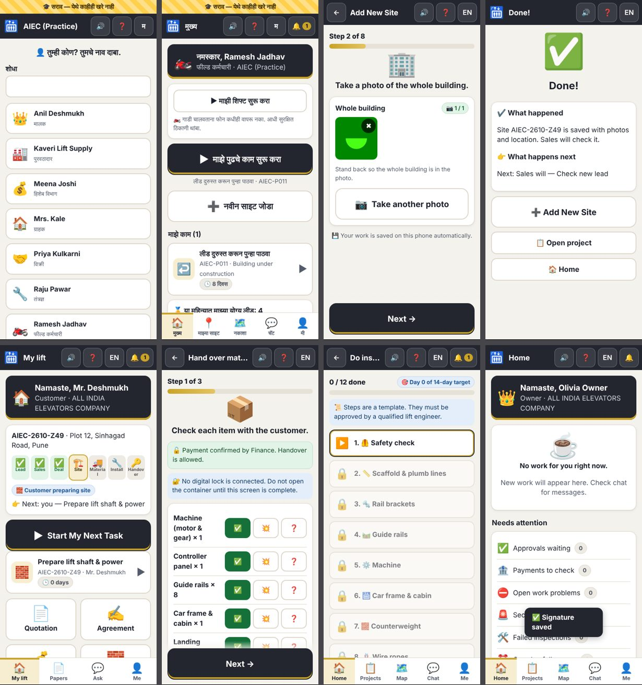

# AIEC Elevator OS

**ALL INDIA ELEVATORS COMPANY — lead-to-handover work manager**

One downloadable HTML file (`AIEC-Elevator-OS.html`) that runs on any Android phone or PC browser, **works without internet**, and guides every person through their next task with pictures, big buttons, audio and Marathi / Hindi / English.



---

## Quick start

| | |
|---|---|
| **मराठी** | `AIEC-Elevator-OS.html` फाइल फोनवर डाउनलोड करा → Chrome मध्ये उघडा → भाषा निवडा → **सराव मोड** दाबा (सर्व PIN `1111`) किंवा **नवीन कंपनी सेटअप** करा. मोठे बटण "माझे पुढचे काम सुरू करा" दाबा. 🔊 दाबून ऐका. |
| **हिंदी** | `AIEC-Elevator-OS.html` फ़ाइल फ़ोन पर डाउनलोड करें → Chrome में खोलें → भाषा चुनें → **अभ्यास मोड** दबाएँ (सभी PIN `1111`) या **नई कंपनी सेटअप** करें। बड़ा बटन "मेरा अगला काम शुरू करें" दबाएँ। 🔊 दबाकर सुनें। |
| **English** | Download `AIEC-Elevator-OS.html` → open it in Chrome → choose a language → tap **Practice mode** (every PIN is `1111`) or **New company setup**. Tap the big **Start My Next Task** button. Tap 🔊 to listen. |

**Real company use:** the Head Quarter creates the company, then adds each person under **Me → People & roles**. Every person gets a role and a 4-digit PIN from the Head Quarter/Admin — nobody can choose their own role.

**Install as an app (required for real use):** real company work only opens inside the installed app; opening the link in a normal browser tab shows an install screen (Practice mode still works there for demos). The installed app also asks the phone to keep its data permanently.

**Hosting:** host the repository on GitHub Pages (Settings → Pages → deploy from branch) and open the link in Chrome → **Add to Home screen**. The service worker (`sw.js`) then keeps the app working offline. Opening the HTML file directly also works; installation is only for convenience.

---

### Company server (automatic sync)
* **Me → Company server:** the Head Quarter or Admin types the server address once (the setup secret is optional). From then on phones send and receive updates by themselves (every minute, and a few seconds after each action) when they have internet. Without internet, work is saved on the phone and goes later.
* **Locked on the phone:** everything is locked (encrypted) on the phone before it leaves. The server never sees names, prices or photos; it only keeps an inbox the office reads and one box per person.
* **Each person's box:** it gets exactly what their file would have, so partner companies, technicians and suppliers still never receive customer contacts or prices. A person's file carries only their own connection, never the company key.
* **Removing a person** deletes their box and stops their phone at once.
* **What stays the same:** the rules are still checked on every phone, as before. Files, paste and the offline flows keep working.
* **Server in use:** the free Supabase server at `https://ycyvtdrtkdrnnkiszrxf.supabase.co/functions/v1/aiec`. Phones fill it in by themselves from `server.json`; Head Quarter only presses Turn on automatic sync.
* **One-tap setup on Cloudflare (another free way):** [](https://deploy.workers.cloudflare.com/?url=https://github.com/prashantashwable-cmyk/UNLIT-GPT-HTML/tree/main/server). Log in to Cloudflare and GitHub, keep the name `aiec-server`, and press Create and deploy.
* **Or set it up by hand (free, from a phone):** in Cloudflare choose Workers & Pages → Create → Connect GitHub. Pick this repository, choose the production branch `main`, set the root directory to `server`, and deploy.
  * There is no database to create, no card and no secret.
  * On the Head Quarter phone, type the address in Me → Company server and turn it on. The first office phone claims the server.
  * Details are in `server/README.md`.
* **Restore with the recovery code alone:** a new phone restores the whole company with the server address and the recovery code. No setup secret is needed.
* **A new phone without a file:**
  * The office makes a one-time 6-digit **login code** (Users → the person → Login code for a new phone) and tells it on a call.
  * The person types the server address, their mobile number and the code. Their data comes down locked with the code.
  * The code works once, for 2 days, and is deleted after 5 wrong tries. There is no SMS, so no SMS cost or DLT registration.
* **Join requests in the app:** a new person fills the Join form with their photo and ID photo and presses Send. Admin sees it on the home screen, checks the profile (warnings for a number already in the company, a wrong GST number, an expired licence), must call the person, then approves, asks for more details, or refuses with a reason. The person's phone shows the answer; when approved it opens the app as them, already connected. Without a server, the form goes by WhatsApp as before.
* **New customers:** at the start page, Customer → New lift asks one thing per screen like the rider's Add site (building photo, shaft photo, map pin, floors, building type, when needed, name, mobile, own PIN) and sends it to the office through the server. Admin accepts it as a new lead for Sales and the person's phone opens as the customer with their lift at step Lead. An existing customer keeps their page and can add another lift from a small button at the bottom. Sites entered by customers are checked by Sales like any new lead, with a duplicate warning, and give no rider lead points.
* **First week for new people:** the first screen after the first login is a short start page (privacy in two lines; camera, location and mic are asked only when used); no pop-up of every open job on a phone's first login. A new staff member sees "Your first week": who to call, their buddy and their first site, with the first-week steps open. Admin sees new people (used the app or not, steps done, stuck for how many days) and picks a buddy, who is asked to help after 2 quiet days. Practice explains that its late work is on purpose and offers a guided first job. The same job three or more times shows once with a count; notes and return reasons can be read aloud.
* **Where jobs wait:** Head Quarter and Admin see how many days each step takes (from the dated stage history), who it waits on, which jobs are waiting now and for whom, who jobs waited on most, and how long payments take from due to confirmed (30 days, 90 days or all). Their home shows the slowest step in one line.
* **Service lead:** fault tickets after handover go to the service lead Admin chooses on the People screen (QC, a senior technician, Sales or Admin); with none chosen to QC; with no QC to Admin; never by default to Sales. A person trapped or an unsafe lift also alarms the office and Sales; a late ticket also goes to the office.
* **Head Quarter forgot the PIN:** on the PIN screen, "Forgot PIN? Use the recovery code" lets Head Quarter set a new PIN with the recovery code written on paper, on a phone that holds the company's recovery key. Five wrong codes lock it for 15 minutes. Nobody else (not Admin, not the server) can reset Head Quarter's PIN.
* **Two bars on every task:** work done ("7 of 12 done · 58%", only when the work has parts: installation steps, site preparation, corrections, handover signatures, payments, first-week steps and training) and time used against the real limit (ticket hours, installation plan days, otherwise the reminder/escalation days), saying what happens next ("Day 2 of 3 · then goes to Admin", "2 day(s) over · now also with Admin"). Work that is on hold or blocked by someone else shows "Paused: waiting for …" instead of turning red. Customers and the project page see the whole job's % and time in the current step.
* **Permits and licences:** a statutory liaison (chosen by Admin on the People screen, otherwise Admin) owns every permission to erect, lift licence and renewal. Installation cannot start until the permission to erect is recorded (setting, on). The approved contractor's certificate of fitness is generated from the final QC record.
* **Discounts:** Sales alone up to 8%, Admin approves up to 18%, Head Quarter above (settings); every discount records what the customer gives in return (bigger advance, signed AMC, fixed site-ready date, reference site, or nothing with a reason).
* **QC independence:** 1 in 10 passed lifts (setting) is re-checked by a second QC, paid either way; a disagreement goes to the office to review; QC never inspects their own company's work.
* **Safety log:** the builder's site engineer counter-signs the day's safety check on the technician's phone (or the customer in their app); customers see "work paused today for a safety check" when work stops; a near miss never counts against anyone and earns the "Safety watcher" badge.
* **Money in one line:** technicians and QC paid directly see "You will get ₹X on Sunday", this week so far, what waits for approval and the last payment; technicians in a company see the value of their work and who pays them.
* **Replacing an old lift:** Sales chooses "New lift" or "Replace an old lift" in the needs; a replacement quote adds removing the old lift (setting) and reminds about the housing society's written approval.
* **Alerts:** connected phones that allow notifications are woken by the server.
  * An SOS or a safety incident wakes the office at once; other news at most every 10 minutes.
  * An alert carries no text or names. The details load when the person opens the app with their PIN.
* **Backups:** Head Quarter makes a recovery code once (Me → Company server) and keeps it on paper. Then an office phone uploads a locked backup of the whole company, photos included, once a day; the newest 7 are kept.
  * If every office phone is lost, a new phone chooses **Restore the company from backup** on the first screen and types the server address, the setup secret and the recovery code.
  * Nobody can open a backup without the recovery code, not even the server.
* **Lift QR stickers report straight to the office:** stickers printed after the server is on let a resident press **Send to the office now**.
  * The report is locked on their phone so only office phones can open it.
  * "Lift stopped" wakes the office at once.
  * The office sees **Resident reports** on its home screen and opens a ticket in one tap.
  * Calling stays the first step for someone trapped.
* **Phones and ready check (Head Quarter / Admin):** the Company server screen shows when each person's phone last took its updates (⚠️ after 2 days, ⛔ never connected), with a button to make their login code. A short check lists what is still missing: an https address, the recovery code, a recent backup, the office number.
* **Why the server does not check the business rules:** the server cannot read the data (it is locked on the phones), so it cannot check the rules on it. This is a deliberate choice for privacy. Every phone checks every record, and the office phones refuse a forged or out-of-role record when it arrives, as with files.

### Front door: who can get in, and how
The app opens with the animated AIEC logo (tap to skip; skipped for "reduce motion", lift QR stickers and join links), then one screen with the language choice and three doors. If one person used the phone before, "Continue as …" goes straight to their PIN.
* 🏠 **Customer or builder:** a list of customers only (never staff names), then PIN. On a phone without their file: **Open the file the office sent me**, or **I want a lift: new enquiry** (name, mobile, owner or builder, site address or location, floors). The enquiry is sent as a WhatsApp/SMS message with a code; the office pastes it and it becomes a task for Sales to call, then a new lead with the details filled in.
* 🧰 **Join us:** technician, sales, field, QC, finance, supplier or licensed partner company. The person fills their details (company, GST and lift licence for a company) and chooses their own PIN; only a salted fingerprint of the PIN travels. The request goes to the office on WhatsApp. The Admin pastes it (**Users → Paste a request**), calls to confirm, approves or refuses, then sends the person their file; their own PIN works. The office can share a **Join link / QR** that opens this door with the company and office number already filled.
* 👷 **Staff login:** staff only (no customers), with search for big teams. On a new phone: open the file from the office; new people are sent to Join us.
* **Builders:** one customer login can be linked to more sites (project actions → Link to another site). The builder's home shows a site switcher; each site opens as before.
* Limits: with no server, requests reach the office only as messages the person sends and the office pastes in; anyone can make a request, so approve only after a call; a new phone still needs the person's file from the office.

## What it does

### One project record, one state machine
Every lift job has one project ID (e.g. `AIEC-2610-K7Q`). Every action — a photo, a call, a quotation, a payment check, a signature — is saved as an **event** (who, role, when, what, reason, evidence). The project status is **rebuilt from those events**, so the home screen, task list, map, chat, timeline, documents and dashboards always show the same status. Nothing is silently edited: corrections create a new event and keep the old value.

**History tab as a tree:** each stage opens to show the steps done in it (newest stage open; what you open is remembered). Tap a step to see when, who, what, the reason (office only) and its photos and signatures. Customers see only their own job's customer-facing steps (payments, site checks, delivery, installation steps, inspections, handover, service), never office decisions or internal reasons.

**Chat for the next responsible person:** the job chat shows the job's next step and who must do it. Four message types each go to one person; the person who owns the next step is suggested first (⭐), and the office sees every message.
* 🚧 **Work stuck:** says what is stopping the work. It is a task for that person until they, the sender or the office mark it solved with a note. After a day the office gets a task too.
* 📅 **Follow-up:** on the chosen date it becomes a task for the person until done.
* 🗓️ **Work plan:** what will be done on a day; it shows on that person's tasks on the day.
* 🤝 **Appointment:** date, time and place. The other person (the customer too) accepts, suggests another time (then it goes back) or says they cannot come. Confirmed appointments remind both people on the day. Customers can propose appointments but not send the other types.
* Coming dates are listed at the top of the chat under **Coming up**.

### The complete lead-to-handover workflow
| Phase | Stage | Who acts |
|---|---|---|
| 📍 Lead | New site (photos + GPS + contact) | Field worker |
| | Check new lead → accept or send back with reason | Sales |
| 🤝 Sales | Call / WhatsApp, record outcome and follow-up date | Sales |
| | Lift needs (floors, capacity, door type, SS/MS, power) | Sales |
| | Quotation from pricing rules, versioned | Sales |
| | Approval when discount > limit or margin < floor | Head Quarter / Admin (not the author) |
| | Send quotation, get decision (yes / lower price / later / no) | Sales |
| ✍️ Deal | Agreement prepared from approved quotation | Sales |
| | Agreement signed (customer, or in person with Sales as witness) | Customer / Sales |
| | Token payment recorded → **verified by Finance** | Sales → Finance |
| 🏗️ Site | Illustrated checklist: shaft, pit, 3-phase power, cleaning, light, barricades — photo for each | Customer / Sales |
| | Site inspection: measurements, checks, photos → Approved / Corrections / Visit again | QC |
| | Corrections with photo proof → re-inspection | Customer / Sales → QC |
| | Release drawings, assign supplier and technician | Admin / Head Quarter |
| 🚚 Material | Packing checklist, seal number, vehicle, photos | Supplier |
| | Arrival: GPS, seal number seen, seal intact, condition, photos (mismatch = incident) | Technician / Supplier |
| | Arrival payment recorded → **verified by Finance** | Sales → Finance |
| | Material handover — **blocked until payment is verified and incidents are closed**; technician counts and signs; a customer with the app then signs on their own phone | Technician, then Customer |
| 🔧 Install | 12 SOP steps in order, photo/video for each, "I can't do this step" → blocker routed to the right role | Technician |
| | Final inspection: pass/fail checks; any fail → correction tasks → re-inspection | QC / Technician |
| 🔑 Handover | Final payment recorded → **verified by Finance** | Sales → Finance |
| | Signatures from customer, technician and QC | each person |
| | Handover certificate, warranty end date, AMC visit schedule | Admin / Head Quarter / QC |

### After handover and around the workflow
| Part | What it does |
|---|---|
| 💬 WhatsApp messages | 7 ready messages (introduction, quotation, follow-up, payment reminder, site preparation, service visit, AMC renewal) in Marathi / Hindi / English. The app fills in the name, project number, amount and date, then opens WhatsApp. Every sent message is logged on the project, and Sales records "replied" or "no reply". Head Quarter/Admin can change or add messages (**Me → WhatsApp messages**). |
| 🛠️ AMC service | Service visits are scheduled from the handover date. The technician does a 7-point check with a photo; any failed check creates a repair ticket automatically. The contract can be renewed for 1–3 years, which adds new visits. |
| 🎫 Problem tickets | The customer, Sales, a technician or the office reports a breakdown, complaint or request → the office assigns a person and a date → that person fixes it with a note and photo → the customer or office confirms, or reopens it. Overdue tickets are sent up to the Head Quarter/Admin. |
| ⏫ Escalation ladder | Every waiting task is measured from the day it started. **Level 1** (after 1 day): the person sees ⏰ Reminder. **Level 2** (after 3 days): it goes to the Admin as "Work is stuck". **Level 3** (after 7 days, or when the office already acted twice and it is still stuck): it goes to the Head Quarter. The ladder covers every stage, payments to check, work problems, security problems, unanswered questions, overdue follow-ups, tickets, service visits, renewals, technician pay and onboarding. **Me → Escalations** lists everything by level. The Head Quarter/Admin records what they did: *I spoke to them*, *New date agreed* (up to 7 days), or *Give to another person* (the job or ticket moves and the clock restarts). Each action is saved in the record. All days are business rules. |
| 👥 Two-person approval | When switched on (Business rules → Control), risky actions need a second Head Quarter/Admin: approving a quote below the margin floor, reversing a payment, closing a security problem, reopening a lost deal, making someone Head Quarter/Admin, and changing technician pay. The person who asks cannot approve it. |
| 🪪 Automatic onboarding | When a person is added, onboarding starts by itself. Their checklist has the profile (phone, area, skills), the documents the office must check (ID and address, plus safety certificate for technicians and QC) and the training for their role. The person sees their steps and a progress bar on the home screen; the office gets a "Check new worker's documents" task. If a person is not ready after 7 days, it goes to the Admin; after 14 days, to the Head Quarter. When every step is done they show as ✅ Ready for work. Directory with search and filters (role, availability, not complete). The app stores only checked / not checked for documents, never the document. |
| 🎓 Training | 5 short modules (app, safety, leads, installation, customers). Each has 3 spoken lessons and 3 picture-answer questions, and needs 2 of 3 right to pass. Optional rule: only technicians who have finished onboarding can be given a job. |
| 💰 Weekly pay | Pay is worked out from saved work: each installation step with proof, a bonus when the final inspection passes first time, and each service visit (amounts are a business rule). Technicians' work is billed to their partner company; QC Inspectors are paid directly. Head Quarter/Admin approves each finished week (any change needs a reason). Finance pays and records the bank reference; the approver cannot pay. The company (or QC Inspector) sees every line and can ask a question. |
| 🏆 Good work board | Monthly points for quality work checked by another person: valid leads, deals won, inspections passed first time, installations within target days, and service visits. There are no points for speed alone. |
| 🔔 Notifications with sound | New work and escalations ring as soon as they reach a person: a **ding** for a new task, **beeps** for urgent or Admin-level work, and a **siren** (with a shaking banner) when work reaches the Head Quarter. The phone also vibrates, can speak the task aloud, and shows a banner with an **Open** button. If the app is in the background, a phone notification appears instead, and tapping it opens the app. The icon shows a count of waiting tasks. Each piece of work rings only once per level, and your own actions never ring. **Me → Notifications and sound** has settings for sound, volume, vibration, speaking, phone notifications, quiet hours (Head Quarter-level escalations still ring) and test buttons. The sounds are made by the app itself, so they work offline. |
| 🙋 Ask for help | Type or speak a question. The app searches AIEC's own training, installation steps, site-preparation notes and common questions on the phone and reads the answer aloud. It is not an AI chatbot and works offline. |
| 🗺️ Address from GPS | With internet, the new-site screen suggests the address for the GPS point (OpenStreetMap Nominatim) in the chosen language. The person checks it before using it. |
| 📷 Reused photo check | A photo that is the same as, or nearly the same as, one used before is flagged ("Same photo used before") for a person to review. |

### Career ladder for installers (asset-light partners)
**Trainee 🌱 → Helper 🧰 → Technician 🔧 → Senior Technician ⭐ → QC Inspector 🔍.** Workers move up by earning ratings and trust from satisfactory work.

* **Ratings, shown as ★ 4.6 (23 reviews):**
  * Customers rate each finished lift and each service visit. If the customer has no login, Sales hands them the phone.
  * QC rates the workmanship at the final inspection. When work fails, QC chooses the cause; a material or site fault never counts against the installer.
  * The team lead rates each crew member.
  * There is one review per job per reviewer, nobody can review themself, and reviews can't be edited.
  * With few reviews the rating stays near 3.5, so one or two reviews never put a new worker above a long good record.
  * Every worker can see their own reviews, with a 5-to-1 star chart.
* **Trust score (0–100):** worked out from QC, customer and team-lead stars plus facts (first-time QC pass, finishing on time), minus 10 per active strike. It shows "new" until there is enough work.
* **Who may do which job:**
  * Trainees and Helpers work only as crew.
  * Technicians lead small and normal jobs.
  * Seniors lead big jobs (hospital, commercial, 10+ floors or 13+ persons), add crew and rate them.
  * QC Inspectors never inspect a job they worked on.
  * People pickers show only eligible workers, best rated first.
* **Promotion:**
  * The app checks the targets (jobs, stars, number of reviews, trust, training, a practical test on site, days at the level, no strikes) and shows the Admin a "Promotion ready" task.
  * The Admin approves promotions up to Senior. Only the Head Quarter can make someone a QC Inspector; that needs the QC training module and a practical test.
  * An installer can never become QC by a simple role change.
* **Benefits of each level:**
  * Pay rate: Trainee 60%, Helper 80%, Technician 100%, Senior 120%. QC is paid per inspection. Work keeps the rate of the day it was done.
  * Bigger jobs.
  * Fewer photo spot checks: 50% of photos for Trainees and Helpers, 20% for Technicians, 5% for Seniors. The sample is chosen fairly and is the same on every phone.
* **Motivation:** a ladder card with a progress bar and "2 more to Technician", badges (first job, 5 first-time passes in a row, 10 five-star customers, 90 days without a strike, safety star, top crew member), and a cheer sound with a banner when someone moves up a level or earns a badge.
* **Strikes:**
  * Strikes come only from facts:
    * a QC fail caused by workmanship;
    * a 1–2 star rating;
    * a confirmed complaint;
    * work that sat until the Head Quarter had to act;
    * a failed spot check (counts as 2).
  * Every strike can be appealed. Someone who did not give the strike decides, and a strike ends after 90 days.
  * Effects build up:
    * 2 strikes pause promotion;
    * 3 mean crew work only and a meeting with the Admin;
    * 4 go to the Head Quarter to decide on suspension.
  * Nothing happens to a person without a human decision.
* All targets, pay rates and spot-check rates are Head Quarter-approved business rules (**Me → Business rules → Career ladder**).

### Permits, Lift Inspector and lift licence; hold; stage back; disputes
* **Statutory records per lift:** the office records the erection permit, the Lift Inspector's visit (passed, or not passed with the list of fixes) and the lift licence (number, holder, valid-until date, photo of the paper).
  * The licence can be recorded only after a passed inspection.
  * Handover is refused until a valid licence is recorded, and service visits stop if the licence has expired (Head Quarter rule **Statutory records**).
  * The office is reminded 60 days before the licence ends.
  * The app keeps records of the papers; it does not issue permits or licences. Who holds the licence is an Head Quarter decision with a lawyer.
* **On hold:** the team lead, the partner company, Sales or the supplier can ask to put a job on hold, with a reason (customer, supplier, weather, permission, defect, payment) and a note. The office approves or refuses, and can also hold a job directly.
  * While on hold, there are no escalations or strikes for the waiting step.
  * Approved hold days are not counted in the 14-day installation target or in on-time records. The office ends the hold when work can restart.
* **Move back a stage:** the office can move a job one step back with a reason (site approved → site inspection, order → site approved, dispatched → order, final inspection → installing), for example to release again with corrected drawings.
* **Disputes:** Sales or the office can mark a dispute with the customer; the Head Quarter/Admin see it until it is settled. Workers' confirmed pay is not affected.

### Lift papers for all lifts, and drawings
* **Lift papers: all lifts (Head Quarter, Admin, QC):** from **Me** or a job's permit card. Each lift shows its permit, Lift Inspector visit and licence (number, holder, valid until), with the licence ending soonest on top.
  * Marks: 🚨 7 days or less, ⚠️ 30 days or less, then 60 days; an ended licence says how many days ago. Filters: ending in 60 days, papers missing.
  * Papers can be recorded straight from the list. The existing reminder to renew a licence still comes as a task.
* **Drawings:** the release records the approved drawing number. The office can add a photo of each page, and later new versions (for example after the pit depth changes). The newest is the current version; older ones stay in the record as replaced and only the office sees them.
  * The technician, partner company and supplier on the job see the current version; opening it is in the access log. Drawings never show prices.
  * The customer sees the drawings in **Papers** after QC approves the site and the token payment is found in the bank; until then the reason is shown. The customer's view is view only, with their name across the screen, and printing is blocked.

### Price talks, rate card, quotation validity, profit
* **Rate card with versions:** the Head Quarter can change costs and margins from a future date (**Business rules → Pricing / Margins → New rates start from**).
  * Quotations use the rates in force on their day and keep the rate card version. The rules page shows the version, waiting changes and the earlier rates.
* **Price talks:** the quotation screen shows earlier quotations and the customer's offers (recorded by Sales).
  * It shows the discount the offer needs, and discount steps (set by the Head Quarter) up to the Sales limit. Beyond the limit, the quotation goes for approval.
* **Below the margin floor:** only the Head Quarter may approve, and a second Head Quarter/Admin must agree, even when two-person approval is off.
* **Quotation validity:** a sent quotation is valid for the set days. After that it cannot be won, and Sales gets "make a new quotation".
* **Profit per job (Head Quarter/Admin):** price before tax, estimated cost from the quotation's rate card, labour paid so far, margin and markup.

### Consent, field pay, payment plan, refunds, receipts
* **Call and WhatsApp consent:** when a site has a phone number, the field worker asks the person "may we call?" and "may we send WhatsApp?" and records who they are (owner, builder, manager, watchman).
  * A "no" turns that button off, and WhatsApp messages are refused. Sales or the office can record "asked us to stop" (calls, WhatsApp or both) at any time.
* **Towers:** a lead in another tower of the same building is not counted as a duplicate. When attaching to an existing lead, the field worker can mark "I added new useful information".
* **Field worker pay (Head Quarter rules, off until set):** a fixed amount for each lead Sales accepts, and a % of the price before tax when the deal is won. A worker who added new information to another person's lead shares that % (duplicate-lead share). Field workers see their own pay.
* **Payment plan:** the token can be part of the price or paid on top. The Head Quarter can add a **cabin payment** (a % of the price): the cabin step of installation waits until Finance confirms it.
* **Refund after cancellation:** Finance works out the refund from the stage reached:
  * before ordering: everything paid, less costs (all of it if the site was rejected);
  * after ordering: less the token and the supplier's charge;
  * after dispatch: less freight;
  * after the cabin payment: less the cabin payment and material;
  * after installation started: nothing by default.
  * A different amount needs a reason. The Head Quarter approves or refuses; Finance pays with the bank reference, and a second Finance person pays when there is one.
* **Receipt:** each confirmed payment has a 🧾 receipt (number, date, customer, purpose, amount, method, bank reference, who checked it) that can be printed or saved as PDF.

### Purchase order, serial numbers, safe keeping, part claims
* **Purchase order:** releasing the material makes a numbered purchase order (parts list, quantities, drawings, needed-by date from the Head Quarter's "days to dispatch").
  * The supplier accepts it with a dispatch date, or declines with a reason; the office then picks a supplier again (a new order number).
  * After the promised date the dispatch task turns urgent and the office sees "supplier is late". The office and the supplier can open and print the order; it has no customer phone.
* **Dispatch:** the supplier writes the serial numbers of the machine, controller and governor and the delivery challan number, besides the seal and photos.
* **Representative:** the customer, Sales or the office can name a person who receives the material (family member, society secretary, site manager, watchman), with a photo of the letter or ID. The name and phone never go to partner companies, technicians or suppliers.
* **Safe keeping at delivery:** the material handover needs a photo of the storage place, and the customer or representative accepts to keep the material safe until installation, then signs.
  * When the customer has the app, the technician's phone does not take the customer's signature. The technician counts the items, photographs the storage place and signs. The customer then gets "Sign for the material received": they see the counted list, who counted it and the storage photo, can ask a question first, accept to keep the material safe, and sign on their own phone.
  * Installation starts (and the installation days count) from the customer's signature. If the customer has not signed after a day, the office gets a task to call them.
  * A representative, or a customer without the app, still signs on the technician's phone at the site.
* **Part claims:** a line marked damaged or missing at the handover becomes a claim at once; later the team can report damaged, missing or extra parts with a photo and the serial seen.
  * Only parts on the job's list can be claimed. A claim does not stop the work; a "safety emergency" claim rings the office alarm.
  * The office approves or refuses with a reason, the supplier sends the part with a challan number, and the technician confirms with a photo.

### Supplier bills and bank statement match
* **Supplier bills:** once the order is dispatched, the supplier sends its bill from **Me → Supplier bills** (bill number, amount, GST, date and a photo of the bill).
  * The office checks it: approve, approve with a deduction (for example a damaged part; a reason is needed), or send it back with a reason. Approved part claims for the job are shown while checking.
  * Finance pays it with the bank reference. Paying waits until the customer's own payment for the material is found in the bank, so the company does not pay before it is paid. The person who approved a bill does not also pay it (the Head Quarter can pay in place of Finance only for a bill someone else approved).
  * The supplier sees only its own bills and their status. Paid bills are in the payments spreadsheet as money out.
* **Bank statement match (Finance and office):** **Me → Bank statement match** loads a bank statement saved as CSV.
  * The file is read on the phone and not stored. Credits are matched to customer payments waiting to be checked: first by the UPI/UTR reference in the bank text, then by the same amount within 3 days. A bank line that carries the job number (the UPI payment link puts the job number and a short purpose code such as ARR in the payment note) is matched to that job's waiting payment of the same amount, even without a UTR.
  * Each match is only a suggestion: a person presses **Confirm** (this marks the payment found in the bank, with the statement line as the reference) or **Not this**. Bank lines that match nothing are listed for a person to look at. Someone cannot confirm a payment they recorded themselves.

### Ticket urgency, time limits, lift QR sticker
* **Urgency:** each ticket is marked person trapped, unsafe to use, lift stopped, fault came back, or ordinary.
  * "Fault came back" is set by the app when a problem arrives within 30 days of an earlier breakdown on the same lift. The office can change urgency with a reason.
  * Person trapped and unsafe ring the alarm. Choosing "person trapped" shows buttons to call the rescue number and 112, because a ticket alone reaches nobody in time.
  * The office records where a ticket came from (phone call, lift QR, WhatsApp, the app). Open tickets are listed most serious first.
* **Time limits (Head Quarter rules, sample numbers):** hours to fix for unsafe, stopped, repeat and ordinary tickets.
  * Each ticket shows the hours left or how late it is. After the limit, the worker's task turns urgent and the office sees "a ticket passed its time limit". A fixed ticket stays recorded as fixed in time or late.
  * There is no published target for a person trapped (the rescue line comes first).
* **Lift QR sticker:** every handed-over lift gets a lift code. The office prints a sticker with the QR, the lift's name (for example building and wing), and the rescue number and 112 printed as text.
  * The QR holds only the lift code, that name and the company numbers, never customer details.
* **Resident page (no login, no data on the phone):** scanning the QR opens a page in Marathi, Hindi or English.
  * A big red "Person trapped — call" button calls the rescue number, with 112 below.
  * "Report a problem" lets the resident pick the problem, add a call-back number, and send it to the office on WhatsApp or SMS. The office then opens the ticket.
  * Staff who log in from the page land on that lift.

### Office queue, closing the day, backup approver, phone clock checks
* **Needs the office (Head Quarter/Admin):** one list of everything waiting for the office, in four levels (critical, high, medium, low), most serious first, then oldest.
  * Critical: SOS, person trapped, unsafe lift, emergency part claims.
  * High: tickets past their time limit, licences and permits, declined orders, payment disputes, unusual data access, stuck work at Head Quarter level.
  * Medium: approvals, late suppliers, part claims, appeals, holds, disputes, problems.
  * Low: onboarding papers, phone clock checks, unassigned leads.
  * There are counts at the top, filters by level and a search by project number. Items close only when the work behind them is done.
* **Close the day:** after 6 pm the office is asked to close the day. Each open item rolls to tomorrow with a named person (the person it belongs to, else the Admin, else the Head Quarter). Open red items need a note. Next day those items show "from yesterday → name". One close per day.
* **Backup approver:** the Head Quarter names a trusted person (Admin, Sales, Finance or QC) for up to 31 days. That person sees the office queue, gets second approvals and can close the day. They can never approve their own request. The Head Quarter can end it early.
* **Phone clock checks:** a record from a phone whose clock went back more than 6 hours, or that is dated more than 6 hours in the future, goes to the office as one low item. The Admin accepts the time or marks it as not trusted, with a reason. A wrong clock on one phone no longer pushes new records into the future.

### Weekly summary, key numbers, spreadsheets, what the app does by itself
* **Weekly summary (Head Quarter/Admin):** the last 7 days, with earlier weeks one tap away.
  * Sales: leads, quotations, deals won with value, lost. Money: payments found in the bank, refunds.
  * Installation: started, handed over, inspections passed. Service: tickets opened, closed, in time, late now.
  * Safety: incidents, SOS, daily checks. Control: second approvals, stage moves back, disputes, holds, days closed, clock checks. Plus what is open in the office queue.
  * "Send the summary" prepares it as a WhatsApp message; it can also be printed or saved as PDF.
* **Key numbers (all jobs):** passed final inspection the first time, installed on time (hold days not counted), tickets fixed in time, days from lead to deal, and money collected. Each says how it is counted.
* **Spreadsheets (Head Quarter only):** jobs, payments and tickets as CSV files that open in Excel or Google Sheets.
  * Every save is recorded with who and how many rows. Customer phone numbers are left out.
  * Cells that look like formulas are saved as plain text.
* **What the app does by itself:** one page listing every automatic rule with today's numbers and whether the Head Quarter approved it: reminders and escalation, quotation expiry, supplier dispatch, ticket time limits, daily safety check, co-worker check, payment gates, licence reminders, data-access alerts, AMC visits and QR, clock checks, closing the day, backup reminders.

### Undo, photo stamp, voice notes, critical alerts
* **Undo:** for 5 minutes a person can take back their own simple record (a call note, chat message, follow-up date, site information, needs, SOP step, problem report, ticket update, part claim, representative, profile, rating), if nothing else happened on that job since.
  * The record and its undo stay in the history; the job looks as if it had not happened.
  * Money, signatures, approvals and safety records are never undone; they are corrected with a new record.
* **Photo stamp:** every photo taken in the app gets a band across the bottom with date and time, GPS (or "—"), the person's name and role, the job number, the company and the phone.
  * The stored check code is of the stamped photo, and the original photo's code is kept too. A stamp can be faked by editing the picture outside the app; it helps, it does not prove.
* **Voice notes in chat:** up to 60 seconds, recorded in the app and kept on the phone like photos. A voice note can be sent alone. Spoken phone numbers cannot be hidden the way typed ones are.
* **Critical alerts:** SOS, person trapped, unsafe lift and emergency part claims show a red bar on every screen. They ring the siren at every check (every minute), even in quiet hours, until the person taps "I am on it". Others who have not answered keep getting it. "I am on it" is kept on that phone only.

### Colours, sync status, day summary, safety test, trial job, privacy notice
* **Colours (Me → Settings):** like the phone, light, dark (night work) or strong contrast (bright sun, weak eyes).
* **Sync status (Me → Share data):** when this phone last sent and loaded a file, which phones' records are here with how many and how new (a phone not heard from for 3 days or more is marked ⏰), and the last files loaded.
* **Field worker's day:** the day report adds today's estimated earnings (by the Head Quarter's field pay rules) and "Send my day to the office", which prepares a WhatsApp summary (sites added, accepted, to fix, GPS points, shift times, earnings).
* **Safety test every year:** the safety training must be passed again every 12 months (Head Quarter rule; 0 = never). Until then the person's onboarding is not complete and the training screen says "time to take this test again".
* **Trial job:** a technician the office adds directly at Technician or Senior level (not grown through the ladder) has a trial pending.
  * They can work in teams and lead small and medium jobs at once, so a new partner company can start work. Big jobs wait for the trial.
  * Their first lead job that passes final inspection counts as the trial. A QC Inspector, the office, or the Senior lead of a job where the person was in the team can also record one. "Needs another trial" needs a reason.
  * People added before this version, or who grew through the ladder, need no trial.
* **Privacy notice:** the first-login screen explains what is kept, why, who sees it, where and how long, and the person's rights, with the office number.
  * In real use, tapping Next records a signed "privacy notice read" (version 1). It can be read again any time in Me → Privacy notice.
  * The text follows India's Digital Personal Data Protection Act, 2023; a lawyer must confirm it.

### Screen stays on while working
* While someone is working in the app (a form, the installation checklist, the safety log, a critical alert, the lift help page), the screen does not turn off by itself. Everywhere else it turns off as usual, and never because of a field worker's shift (no phone use while riding).
* It can be switched off in Me → Settings, which also shows whether the phone supports it.

### How customers pay, and small teams (no dead ends)
* **How to pay:** when a payment is due, the customer's home shows the amount and a "Pay the next amount" task.
  * The pay screen has a "Pay with a UPI app" button with the company UPI ID and the exact amount filled in, a UPI QR code to scan from another phone, and the company bank account with IFSC and the job number to write in remarks.
  * It warns to pay only into the company account.
  * The Head Quarter sets the details in Business rules → How customers pay.
  * Sales can open the same screen for the customer right after the agreement is signed.
* **"I have paid":** the customer reports the payment with the UPI or bank reference (and a screenshot if they like). Finance, or the Head Quarter when there is no other Finance person, checks it in the bank and confirms. The one who reported or recorded a payment never confirms it.
* **Small teams:** when nobody else in the team holds the Sales, Finance or QC role a step needs, the Head Quarter gets that task and may do it. When the team has such a person, the usual separation stays.
  * Examples: confirming a payment, inspecting the site, final inspection, signing the handover as QC.
  * Physical work (technician, supplier, partner, field) is never covered this way.
  * A test runs a whole job from lead to handover with only the Head Quarter, a field worker, a partner company, a supplier and the customer. At every step it checks that the person acting has the task.
  * A second test walks the side branches with the same small team, checks that each task opens its screen, and finally that no task anywhere is left without someone who can do it:
    * a lead sent back and fixed;
    * a quotation below the margin floor;
    * site corrections;
    * a payment not found in the bank;
    * a failed final inspection;
    * a breakdown ticket and a service visit.
* **Quotation by the Head Quarter:** the Head Quarter's own discount needs no approval unless it goes below the margin floor. Below the floor a second Head Quarter/Admin (or the backup approver) must agree. If there is nobody, the Head Quarter gets "withdraw it and make a new quotation" instead of a stuck job.
* **Lead sent back:** it returns to whoever added it (field worker, Sales or the Head Quarter).
* **Payment not found in the bank:** the customer's pay screen says so, with the reason, and the customer can report the payment again.

### Shaft limits, variation, co-worker check, surprise QC
* **Shaft limits:** QC enters the shaft width, depth, pit and headroom; any value below the minimum is shown in red. The minimums are sample numbers that a lift engineer must set (**Business rules → Shaft limits and checks**).
  * A shaft below the minimum cannot simply be approved: QC asks for corrections, or approves "with a variation quote".
* **Variation quote:** Sales writes what changes in the lift and the price change. The customer accepts and signs (or declines).
  * Material cannot be released until the variation is signed, and the final payment changes by the agreed amount.
* **Co-worker check:** after the doors (interlocks), wiring (earthing) and safety-device steps, another technician of the same company (not on this job's team, Technician or Senior) or a QC Inspector looks at the photos before the next step.
  * "Not right" sends the step back to be done again. Waiting for the check never counts against the lead.
* **Surprise QC:** the office plans a surprise inspection date that only the office and QC see (it is removed from technicians' and companies' files).
  * On that day QC takes photos and records the result; a problem found is a strike for the team lead.

### Data protection against poaching (partner companies, technicians, suppliers)
* **Each phone gets only its own share (the offline version of row-level security):**
  * A partner company, technician or supplier receives only the jobs they hold or work on.
  * Their file never contains customer phone numbers, names or notes, prices and cost settings, discounts, payment amounts or references, WhatsApp messages, the agreement signer, other companies' licence details, or the names of other companies, their technicians, customers and suppliers. Those fields are removed before the file is made.
  * Each removed field has its own fingerprint in the signature, so the rest of the record can still be checked. Jobs still reach the same stage on their phone as at the office.
  * Only a file made by the office (Head Quarter, Admin or Sales) may carry records with removed fields. Such records from anyone else are refused.
  * Each phone lists only the people who can log in on it.
* **Contact masking:** partner companies and technicians never see customer phone numbers. They talk to the customer through the project chat, or call the AIEC office number (set by the Head Quarter in **Business rules → Data protection**). Phone numbers and e-mails typed in chat by customers or outside companies are hidden. Technicians cannot send WhatsApp messages to customers.
* **No export:** outside companies can only send their own work to the office. There is no export of project lists, customers or prices, the agreement and quotation are not shown to them, and printing is refused.
* **Field technicians:** no money screens, prices, margins, customer names or phone numbers. They see their tasks, the daily safety check and the step-by-step installation with photo proof. The partner company owner sees the company's jobs, team, licence and weekly bill.
* **Screenshots:** every page for an outside company carries a faint watermark with the viewer's name, code and date. Copying text is switched off, and the screen is blurred when the app goes to the background (the app-switcher picture).
* **Access log and alerts:** opening jobs, documents, safety logs, other people's profiles and pay, and trying pages they may not see, are recorded on the phone and sent with the person's file. The office's **Who looked at what** page shows each person's last 7 days. The office gets an urgent "Unusual looking at data" task when someone:
  * tries pages they may not see 3 times;
  * opens more than the set number of different jobs in one day;
  * saves many data files.

### Site safety
* **SOS 🆘:** a red button on every screen for technicians, QC Inspectors, field workers and partner companies.
  * Press and hold it for 1 second; a short tap only explains how.
  * It saves an SOS with the phone's GPS and the job the person is on (the one open on screen, or the nearest job within 300 m), and stops work on that site.
  * It shows big buttons: call the **company rescue number** (set by the Head Quarter in **Business rules → Site safety**), then 112, and "send my location by SMS".
  * The office and the person's partner company get an alarm task (siren, even in quiet hours) until the office confirms the person is safe.
* **Daily safety check:** before installation work each day (India time), the team lead takes 4 photos: helmets and harness, scaffolding, barricade, earthing. They then confirm everyone wears safety gear.
  * Work starts at once. The partner company is asked to look at the photos; the company, QC or the office can mark the day "not safe", which stops work until a new check is sent.
  * Installation steps and fixes are refused without that day's check. The Head Quarter can switch this off.
* **Hazard stops work:** anyone on the job can report a hazard. A hazard, an injury or an SOS stops installation steps, fixes, inspection requests and service visits on that site until the office closes it.
* **Incident form:** the report records the type (hazard, someone hurt, near miss, equipment damaged, other), what happened, what was done straight away, witnesses and photos. Closing needs the root cause, what was fixed and the office's decision; a stop-work incident also needs a photo of the place made safe.
* **Safety-critical QC items:** final inspection checks earthing (with the measured value), brakes, overspeed governor and safety gear, and door interlocks one by one, each with its own photo. If any one fails, the whole inspection fails.
* **Safety log:** each job has a day-by-day safety log (checks, reviews, hazards and how they were closed, steps done, critical QC results). It can be printed or saved as a PDF for the builder; customers see it without internal notes.
* **Check-in at the site:** each work day the team lead (and any crew member) checks in at the site before the daily safety check.
  * The phone's GPS is compared with the site's saved location. Within the allowed distance (default 150 m, **Business rules → Installation**) the check-in is plain.
  * Farther away, or with no GPS, the person picks a reason (basement or pit, weak signal, site location wrong, other). Work is not stopped; the office gets a task to look at it and accept it or not.
  * The safety check is refused until the lead has checked in that day. The Head Quarter can switch this rule off.
* **End my day:** the technician's home shows "End my day" for the site they checked in at. It lists today's steps, co-worker checks waiting and open blockers or hazards. A hazard or SOS the person reported today must be reported or closed first. After ending, the printable safety log is offered as today's report for the builder.

### Licensed Partner Companies (technicians work under a licensed company)
* **Role:** a **Licensed Partner Company** 🏢 holds the lift licence. Technicians are members of a company. AIEC gives jobs to the company and pays the company; the company pays its technicians.
* **Licence:**
  * The company (or the office) types the licence number, holder, issuing office and the date it is valid until. The office checks the licence copy (document "Electrical / lift licence").
  * Jobs are given only while the licence is saved, checked and not expired. The company and the office are reminded 60 days before it ends; when the company changes the number or date, the office must check the copy again.
* **Technicians:**
  * The company adds its own technicians (starting as Trainee or Helper). An AIEC Admin approves each one ("Approve a company's technician"); the usual onboarding (documents, training) still applies.
  * The office can add a technician directly into a company, or move one to another company. A technician without a company gets a "Link technician to a company" task for the office.
  * A technician can be placed on work only when they are an approved member of a company with a valid licence. Only people of the company holding a job can be its lead or crew.
* **Ratings:** each technician keeps their own level, stars and strikes. The company has its own record: finished jobs, fair stars from its technicians' reviews, strikes earned on its jobs, and trust. A company needs a record (set by the Head Quarter) before it can take big jobs.
* **Weekly bill:** the company is paid its technicians' work done while they were with it, at each person's level rate. The Head Quarter/Admin approves the bill, Finance pays it, and the company can question it. A technician sees the value of their work, marked "paid to my company". When a technician leaves, earlier work stays on the old company's bill.

### Job marketplace (companies apply with their team, the office confirms)
* **What can be posted:** a team lead for an installation, AMC service visits, repairs (tickets), and QC site or final inspections. The office posts from **Project → Post job to marketplace**. There are no crew posts: the company brings its own crew. A released job without a team lead creates a "Find a team lead" task.
* **Who applies:**
  * Installation, service and repair jobs: licensed partner companies. Each application names who the company sends: a lead whose level allows the job (Technician for small and normal jobs, Senior for big jobs) and crew from the same company.
  * Inspections: AIEC QC Inspectors who did not work on the job — never the installing company.
  * A company cannot apply when its licence is not valid, when it has too many strikes, when it has no approved technician for the job, or when all its leads already have the most jobs allowed. Locked jobs show the reason.
* **The job card:**
  * shows the area (locality and city), job size, floors, start date, target days, distance, and what AIEC pays the company;
  * never shows the building name, exact address or customer phone. Those appear only after the company is given the job.
* **Applying:** the company chooses its team, adds an optional note and location. It can withdraw, and there is a limit on open applications.
* **Choosing:** companies are listed best match first, by the company's fair stars and number of reviews, then trust, distance, and jobs in hand. Each application shows the team. The best one is marked "Suggested".
* **What giving the job does:**
  * Team lead: the company holds the job; its lead and crew go on it. The company can later change its own team ("Change the team").
  * Service visit or repair: the company's named technician gets it.
  * Inspection: that QC Inspector gets the inspection task.
  * The company and its team hear "You got the job!", and the post closes.
* **Notifications and escalation:** eligible companies hear a "new job" ding. Applications waiting for a choice, and posts nobody applies to, go to the office and up the escalation ladder.
* **Business rules (Head Quarter-approved):** the limits are set under **Me → Business rules → Job marketplace**.

### Head Quarter stays out of day-to-day work; the Admin runs the day
* **Admin** gets all daily work and decisions:
  * quotations above the discount limit, technician weekly pay, approval requests in chat, refunds and suspension reviews;
  * releasing drawings and assigning teams, work problems, tickets, new workers' documents and completing handovers;
  * covering a step when the company has no Sales, Finance or QC person.
* **Head Quarter** is not sent day-to-day tasks while there is an Admin. It gets:
  * work still stuck after the last reminder (the Admin's own late work reaches the Head Quarter only then);
  * SOS and injury alarms (the Admin handles them);
  * business rules and two-person approvals.
* **Everyone's open work:** the Head Quarter's home shows every open task by role, longest waiting first, to view only.
* The Head Quarter still takes the work when the company has no Admin, or when the only Admin is the person who asked (no one approves their own request). Both keep full permission to act on any project. In the job chat, the Head Quarter is not offered as a person to send day-to-day items to.

### Enforced role permissions
* Each event type has an allowed role list and allowed stages (see **Me → What can I do?**; Head Quarter/Admin see the full matrix).
* Project-level access: a field worker sees only their sites, a supplier only their orders (no customer phone, no prices), a technician only assigned jobs (no margins), a customer only their own lift (no internal notes, approvals or margins).
* Separation of duties: the person who records a payment cannot confirm it; the author of a quotation cannot approve it.
* Payment gates: stages only move forward when **Finance** confirms a payment with a bank reference. A screenshot is never treated as proof.
* The **same check runs again** for every event loaded from another phone's file. Entries that break the rules are refused and listed under **Me → Refused entries**.

### Designed for people who find apps difficult
* One question per screen, "Step 2 of 5" and a progress bar.
* Big buttons (56–78 px) with a picture **and** a word; status always shows an icon and words, never colour alone.
* 🔊 on every screen reads it aloud in Marathi / Hindi / English (uses the phone's text-to-speech); optional auto-read.
* 🎤 lets people speak names, addresses and numbers instead of typing; "Read the number to me" confirms phone numbers.
* Work is saved automatically as a draft; ← never loses work.
* After every action: **What happened** and **What happens next** (and who will do it).
* Main screens show only work that needs attention now (urgent, overdue or escalated). Other work, queues, the dashboard, papers and settings sit in sections that open with one tap, and the app remembers how each person left them.
* Screen size 20%–150% (Me → Screen size) scales the whole page; below 60% a normal-size "↺ 100%" button stays on screen. Tested at 320 px width up to 150% with no sideways scrolling.
* Rider safety: lead capture and shift start begin with "Have you stopped in a safe place?" and are blocked if the phone reports movement.
* Practice mode with sample data for every role — separate from real data and never sends calls or messages.

### Evidence
Photos and 10-second videos are taken **only with the in-app camera** (no gallery upload). Each item keeps the original file, a unique ID, time, user, GPS (when available), device info and a SHA-256 fingerprint ("Check the photo is unchanged"). Simple automatic warnings (blurred, dark, no GPS, far from site) are shown as warnings only — a person decides.

### Sharing between phones (no server needed)
**Me → Share data with other phones**
* **Full company file** — for office phones (Head Quarter/Admin).
* **File for one person** — only that person's projects; other people's PINs are removed so nobody else can log in on that phone.
* **Send my updates to office** — the office accepts only the work that person did themself.
Files can be sent by WhatsApp or email. Practice files and real files can never be mixed.

---

## Business rules that need Head Quarter approval
These numbers come from the original brainstorm and are marked **"Proposed — not approved"** everywhere they appear until the Head Quarter approves them in **Me → Business rules** (changing a number requires approval again):

| Rule | Default |
|---|---|
| Prices per component | sample numbers only — enter real costs |
| Margin: start / Sales discount limit / minimum without approval | 60% / 30% / 20% (margin = (price before tax − cost) ÷ price before tax) |
| Token payment | ₹10,000 |
| Payment milestones | 90% of total by material arrival, rest at handover |
| Installation target | 14 days from material handover (planning target, not a penalty) |
| Warranty / AMC visits / quotation validity | 12 months / 4 per year / 30 days |
| Duplicate-lead commission | 10% |

## Honest limits of this version
* **Offline, single file.** Roles are enforced by the app on every action and on every imported file. There is no company server.
* **Money:** refunds and receipts are records in the app. The money itself moves through the bank; the app does not send payments, and a receipt is not a GST tax invoice.
* **Lift QR:** the QR points to the address the office's app runs from, so print stickers from the installed app or the website, not from a file copy. The resident page does not send anything by itself: the phone call, WhatsApp or SMS does, and a ticket is opened by the office. There is no 24×7 rescue staffing in the app; the company must run the rescue line before printing stickers.
* **Weekly summary:** the app prepares the message; a person sends it (there is no server to send it automatically).
* **Background:** a web app cannot run while the phone is locked or the app is closed. Keeping the screen on helps only while the app is open; phone notifications for due tasks come at most about once an hour on installed Android apps (periodic background check), and not at all on some phones. A separate Android app would be needed for always-on alerts and for blocking screenshots.
* **Site check-in:** phone GPS can be wrong indoors, in a basement or in a shaft, so a far check-in is a flag for the office to look at, not proof that someone was absent.
* **Bank statement match:** banks save CSV files in different layouts. The app looks for the date, narration and credit columns; if it cannot find them it reads nothing. Matches are suggestions; nothing is confirmed without a person.
* **Drawings:** a picture shown on a phone can still be photographed with another phone; the name across the screen makes such a picture traceable. The app keeps photos of drawing pages, not CAD files.
* **Safety:** the SOS reaches the office's phone only when files are shared, so the phone call and SMS are the real alert. Safety photos are checked by people, not by a computer. The daily check is confirmed by the team lead (an Head Quarter decision); it does not replace the statutory inspection or a qualified engineer.
* **Data protection limits:**
  * There is no server, so prices and rules are checked by the same rules on every phone and on every file loaded, not on a server.
  * A web app cannot block screenshots (Android FLAG_SECURE needs the native Android app); the watermark makes leaked pictures traceable.
  * The access log reaches the office only when the person's file is shared.
  * A person can still photograph the screen with another phone.
  * Masked calling (a virtual number) needs a telephone provider; until then calls go through the AIEC office.
* **Signed records (company data only, not practice).**
  * Each person's phone makes its own signing key at first login, and every new record is signed with it. Files are also signed by the phone that made them.
  * When a file is loaded, a record from a person with a known key must carry that person's valid signature. Changed or forged records are refused.
  * A person's second phone must be approved by an Head Quarter or Admin (task "Approve a new phone"). Records from that phone are held back until then; after approval the person sends their file again.
  * Private details (PINs, other people's phone numbers, application notes) can be removed from a file without breaking signatures.
  * Limits:
    * A brand-new phone trusts the first file it loads.
    * Records made before signing started are accepted only from an Head Quarter/Admin file.
    * If the Head Quarter's only phone is lost, an Admin must approve the Head Quarter's new phone.
    * A company server with signed sync is still the recommended next step.
* **PINs** are stored with slow hashing (PBKDF2, 150,000 rounds); older PINs are upgraded at the next login. The Head Quarter can make new PINs 6 digits (**Business rules → Login security**). A full file for another office phone carries only Head Quarter/Admin logins unless "include everyone's logins" is chosen.
* **Backups:** the Head Quarter/Admin is reminded to save a file after 7 days or 200 records that are only on their phone. Records are stored in chunks, so large companies stay fast. **Archive old photos** (Head Quarter, **Share data**) saves the photos of lifts handed over long ago to a file and removes them from that phone; loading the file brings them back.
* **Notifications** come from the app itself. The installed app checks every minute while it is open or recently used, and Chrome may also wake it about once an hour for escalations (periodic background sync, decided by the phone). Instant alerts when the phone has fully closed the app need a push server or a native Android app.
* **Not connected:** payment gateway, bank/EMI partner, WhatsApp delivery and read reports (they need the WhatsApp Business API on a company server; the app opens WhatsApp and records what the person sent), container GPS tracker, motion sensors, CCTV, digital locks. The app never claims they exist; it records what people did and asks Finance to verify money from the bank.
* **No AI decisions.** Automatic checks are simple rules and only warn.
* **Templates:** QC checklists, the 12 installation steps, the agreement text and the handover/NOC text are templates. They must be approved by a qualified lift engineer (Maharashtra Lifts Act and rules) and a lawyer before real use. The app does not issue statutory licences.
* Address from GPS needs internet (OpenStreetMap Nominatim); offline the user types or speaks a landmark.
* Not yet built (later phases of the spec): EMI, hardware (GPS trackers, sensors, CCTV, digital locks), server sync.
* The training lessons, quiz answers and pay amounts are starting templates. The Head Quarter must check them with a qualified lift engineer and with labour and accounting rules.
* Personal data stays on the phone until deleted. The Head Quarter must set a keep-and-delete policy that follows the Digital Personal Data Protection Act, 2023.

---

## Files
| File | Purpose |
|---|---|
| `AIEC-Elevator-OS.html` | **The whole app** — download and open this file |
| `index.html` | Redirects to the app (for web hosting) |
| `manifest.webmanifest`, `sw.js`, `icon*.png`, `icon.svg` | "Add to Home screen" and offline support when hosted over https |
| `tests/` | Automated browser tests |

## For developers
* No build step and no external libraries: HTML, CSS and plain JavaScript in one file. Data is stored in IndexedDB (falls back to localStorage, then memory with a warning).
* Key parts inside the script: `L` (all words in 3 languages), `RULES` + `validate()` (permissions and stage guards), `apply()` (event → state), `needs()` (who must act next), `WIZ` (step-by-step task screens), `SCREENS`.
* Run the tests (Chromium via Playwright):
  ```bash
  npm install
  npx playwright install chromium
  npm test
  ```
  The suite covers: practice data for all 15 sample users; a full real-mode lead-to-handover run through the UI with 10 roles, including rejected quotation, QC corrections, a blocker, a failed final inspection and three verified payments; permission refusals and forged imports; phone-to-phone file sharing; WhatsApp templates, AMC visits and tickets, automatic onboarding, the escalation ladder and office actions, licensed partner companies (licence, member approval, team on a job, company bill and record), the job marketplace (company applications with a team, area-only cards, applying, ranking, giving each kind of job), the career ladder (levels, job eligibility, stars and review counts, trust, promotion, pay by level, spot checks, strikes and appeals, celebrations), notifications with sound (new work, escalation siren, quiet hours, background phone notifications), two-person approval, training, weekly pay, helper, address lookup and reused photos; camera/location denied; and every screen at 320 px with Extra-large text in Marathi and Hindi (no overflow, no missing words, no errors).
